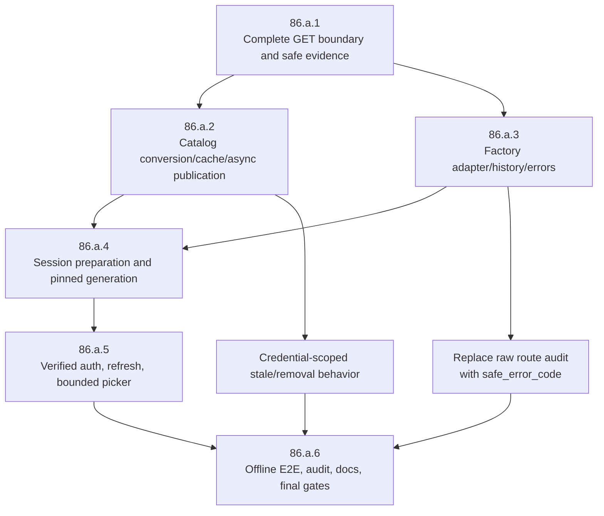

# Feature 86 — OpenRouter Completion Assessment

**Assessment step:** Code-Test-Review Step 3 — fresh independent completion check  
**Date:** 2026-09-30  
**Repository / branch:** `/root/Code/slo-openrouter-implementation/slo` / `feature-86-openrouter-implementation`  
**Verdict:** **NOT READY — workflow not complete**  
**Assessment model disclosure:** The intended assessment model is **`gpt-6-astra` at medium reasoning**, as corrected by the user after this run. The original request used an incorrect Astra identifier, which the harness rejected. This assessment actually used **`gpt-5.6-terra` at medium reasoning** as fallback.

## Scope and evidence policy

This is an independent assessment of the current worktree, not a coding pass. It re-derived requirements from the immutable Feature 86 request, parent overview, dependency index, and all six child specifications (`86.a.1` through `86.a.6`), then inspected current production code and tests.

The Feature 86 specification-development reports (`completion-summary.md`, `final-review-report.md`, `independent-verification-report.md`, and `post-hook-report.md`) are treated only as **non-implementation evidence**. They describe an implementation plan, not shipped behavior.

Project, installed, and user skill collections were confirmed accessible:

- repository: `/root/Code/slo-openrouter-implementation/slo`
- installed skills: `/root/.local/share/pipx/venvs/slo/lib/python3.11/site-packages/skills`
- user skills: `/root/.slo/user_skills`

No live provider call, credential inspection, paid inference, commit, push, merge, reset, clean, shared-environment change, system/PATH modification, or other-worktree access was performed.

## Metric table

| Metric | Result | Basis |
|---|---:|---|
| Feature completion | **13%** | Effort-weighted implementation checklist below; foundation work is present, but the five connected user/runtime slices are mostly absent. |
| Incompletion | **87%** | `100% - completion`. |
| Infrastructure readiness | **27%** | Provider identity, effective credential provenance, partial GET boundary, basic converter/policy helpers, and enum taxonomy exist; catalog lifecycle, runtime gateway, and user-facing plumbing do not. |
| Required slices fully done | **0 / 6** | Every `86.a.*` slice has required missing behavior or verification. |
| Unresolved glaring gaps | **Yes — 6** | Missing catalog lifecycle, runnable adapter/history, runtime preparation, auth/picker, safe route audit, and full-flow proof/docs. |
| Focused Feature-86 tests | **103 passed** | Fresh command listed in Test / gate evidence. These prove only the implemented subset. |
| Full non-E2E gate | **PASS: 4344 passed, 15 deselected, 153 warnings** | Fresh `make test`, 259.26 seconds. |
| Formatting gate | **PASS** | Fresh targeted `poetry run black --check ...`: 25 files unchanged. |
| Full mypy gate | **FAIL** | `make lint` exits non-zero; command runs `poetry run mypy src/ tests/`. Output begins with existing and broad errors; a complete, untruncated total was not captured in this assessment. |
| Authenticated discovery/live inference | **Not run** | Prohibited/no authorization; no claim of account entitlement or remote compatibility. |

### Weighting method

The total is 100 effort points aligned to the dependency index: **86.a.1 15**, **86.a.2 20**, **86.a.3 20**, **86.a.4 20**, **86.a.5 15**, **86.a.6 10**. Partial status receives half of a slice's weight only when substantive production behavior and meaningful tests exist. Scores: a.1 partial = 7.5; a.2 partial = 2.5; a.3 partial = 2.5; a.4/a.5/a.6 not started = 0. This intentionally does not count planned work or unintegrated helper classes as completed user behavior.

## Requirement status by layer

| Layer / required deliverable | Status | Current evidence | Completion finding |
|---|---|---|---|
| Provider identity and route grammar | **Partial** | `src/auth/credential_dao.py`, `src/auth/provider_for_model.py`; `tests/auth/test_provider_for_model.py` | `ProviderName.OPENROUTER` and structural `openrouter:<id>` classification work. Exact membership/preparation and broader boundary coverage remain absent. |
| Credential precedence and provenance | **Partial** | `CredentialResolver.resolve_with_source()` in `src/auth/credential_resolver.py`; `config/cfg.py::openrouter_api_key`; resolver tests | Env-over-store source result and operation-time OpenRouter env read exist. Candidate-before-persist auth handoff, public-result serialization checks, and UI behavior do not. |
| Fixed authenticated GET boundary | **Partial** | `src/integrations/openrouter/{client,dao,exceptions}.py`; two client tests | `/key` and one `/models/user` GET use captured credentials and no response-body logging. Required paginated complete-list algorithm, 16 MiB/10,000-record caps, exact-multiple terminal page, safe allowlisted metadata, timeout/cancellation coverage, and catalog integration are missing. |
| Pool provider invariant | **Partial** | `config/model_pool_config.py::_entry_from_dict`; `ModelPoolEntryDAO` validator; focused tests | Parser and programmatic mismatches reject. Full preservation proof for comma, JSON string-array, object-array, enum/string forms and runtime use remains incomplete. |
| Metadata conversion / capabilities | **Partial** | `src/agents/model_catalog/openrouter.py`; `ModelCatalogEntryDAO.availability`; two converter tests | Exact route identity and basic text/tools/context eligibility exist. No generic capabilities model, expiry/output/top-provider/reasoning policy, strict malformed-record behavior, duplicate reconciliation, or required conversion matrix. |
| Credential-scoped cache, refresh, publication | **Not Started** | `src/agents/model_catalog/service.py` still has synchronous `load(enable_discovery=...)`; `discovery.py` still has placeholder provider discovery | No schema-2 slices, fingerprint cache partition, atomic persist-before-publish, coalescing, lease, stale rules, tombstones, generation, or offline snapshot views. |
| Factory / OpenRouter Chat Completions adapter | **Not Started** | `LLMFactory.create()` resolves provider then raises `Provider 'openrouter' has no configured LLM builder.` in `src/agents/base.py`; `src/agents/providers/openrouter.py` is not wired | The helper policy is not factory construction, not local HTTP/SSE transport, and not a runnable model route. |
| Tools, streaming, usage, reasoning, image compatibility, history replay | **Not Started** | No message-extension module or changes to agent runtime/history projector/token counting | Required same-route reasoning continuation, tool-result second request, usage/truncation/refusal/cancellation behavior, image rejection, and replay are absent. |
| Error normalization, audit redaction, no post-commit replay | **Partial / security blocker** | Terminal enum cases and `_classify_openrouter()` in `credit_exhaustion_policy.py`; however `RouteSwitchRecordDAO.error_text` and `_safe_route_switch_error_text()` remain in `model_pool.py` | Classifier only covers a small status subset. Raw `str(error)[:500]` is still persisted via `sessions/service.py:3947`; the required safe audit-code field, HTTP-200/nested/SSE normalization, Retry-After policy, terminal recovery wiring, and committed OpenRouter barrier are missing. |
| Session preparation and pinned catalog generation | **Not Started** | No `SloAgentSession.prepare`, `prepare_model_selection`, `refresh_model_catalog`, or pending state | No async membership preparation, run snapshot, next-run adoption, model-switch race handling, or pool-member removal behavior. |
| CLI, resume, headless, child, scheduled paths | **Not Started** | `TyperDispatch._apply_model_override()` only changes `model_name`; it does not clear pool. `spawn_env.py` still strips all `*KEY*` values. No OpenRouter CLI path. | Explicit-model precedence, resumed route semantics, one headless preparation identity/status path, child key exception, and schedule reuse are absent. |
| `/auth` effective-key verification | **Not Started** | `provider_select.py` has Anthropic/OpenAI/Kimi only; `auth_screen.py` persists keys immediately | OpenRouter is absent from the modal. No API-key-only capability path, candidate verification, cancellation, source notice, or refresh handoff. |
| `/model refresh` and bounded picker | **Not Started** | `SlashRouter._handle_model()` has no `refresh`; `_model_argument_state()` remains prefix-only and calls existing projection. The unintegrated `_bounded_openrouter_rows()` helper has one test. | No generation-backed rows, honest status, substring/display search in real `/model`, menu viewport, canonical argument replacement, or per-keystroke I/O elimination. |
| Offline end-to-end flow, security audit, documentation | **Partial** | `tests/integration/test_openrouter_full_flow.py` only proves GET → converter; README/RESEARCH/docs research say incomplete | Missing required auth → discovery → publish → search/select → actual local Chat Completions tool continuation → history/resume E2E; no cross-channel sentinel audit, consolidation grep, AGENTS/headless/scheduler docs, or KB update. |

## Slice assessment

| Slice | Weight | Status | Exact current evidence | Required completion condition not met |
|---|---:|---|---|---|
| 86.a.1 — identity, credentials, HTTP boundary | 15 | **Partial** | `credential_dao.py`, `credential_resolver.py`, `provider_for_model.py`, `config/cfg.py`, pool parser/DAO, `src/integrations/openrouter/`, focused tests | Complete GET pagination/protocol/resource/security contract and test matrix; integrate safe evidence with refresh. |
| 86.a.2 — catalog lifecycle | 20 | **Partial** | Standalone `OpenRouterCatalogConverter`; small DAO additions | No async discovery, schema-2 store, provenance, atomic generation publication, views, or lifecycle tests. |
| 86.a.3 — transport/history/failure policy | 20 | **Partial** | Unwired `OpenRouterRequestPolicy`/`OpenRouterChatOpenAI` skeleton and basic classifier cases | Factory route still fails; no adapter overrides, tool/history transport, safe audit replacement, full error matrix, or no-replay proof. |
| 86.a.4 — runtime preparation/pinning | 20 | **Not Started** | No required session/CLI/headless implementations found | Dynamic route cannot be prepared or pinned in TUI/headless/pool/resume/child/schedule flow. |
| 86.a.5 — verified auth and bounded picker | 15 | **Not Started** | Isolated 25-row helper only | No modal option/service, refresh command, real picker integration, literal paint, or user selection path. |
| 86.a.6 — integration, consolidation, docs | 10 | **Not Started** | Narrow client/converter test and incomplete-foundation docs | No required end-to-end test/security audit/consolidation or complete operator/developer documentation. |

## Implemented files (partial foundation only)

### Production

- `config/cfg.py` — adds `OPENROUTER_API_KEY` and `openrouter_api_key()` operation-time accessor.
- `config/model_pool_config.py` — validates explicitly declared pool provider against route ownership.
- `src/auth/credential_dao.py` — adds OpenRouter enum, credential source, repr-hidden resolved credential.
- `src/auth/credential_resolver.py` — adds source-bearing resolution and OpenRouter env mapping.
- `src/auth/provider_for_model.py` — owns OpenRouter qualified route grammar.
- `src/agents/base.py` — delegates factory provider classification to canonical classifier; does **not** build OpenRouter.
- `src/agents/model_catalog/dao.py` — makes TPM nullable and adds basic entry availability field.
- `src/agents/model_catalog/openrouter.py` — partial converter, not catalog lifecycle.
- `src/agents/providers/credit_exhaustion_policy.py` — basic OpenRouter terminal/status classification.
- `src/agents/providers/model_pool.py` — validates provider/route agreement; retains unsafe route audit field.
- `src/agents/providers/openrouter.py` — unintegrated request-policy helper and minimal subclass skeleton.
- `src/integrations/openrouter/{__init__,client,dao,exceptions}.py` — partial fixed-origin GET boundary.
- `src/tui/slash_suggestion_engine.py` — unintegrated bounded helper only.

### Feature-specific tests

- `tests/auth/test_provider_for_model.py`
- `tests/auth/test_credential_resolver.py`
- `tests/config/test_model_pool_config.py`
- `tests/agents/providers/test_model_pool.py`
- `tests/integrations/openrouter/test_client.py`
- `tests/agents/model_catalog/test_openrouter.py`
- `tests/agents/providers/test_openrouter.py`
- `tests/agents/providers/test_openrouter_errors.py`
- `tests/tui/test_openrouter_picker.py`
- `tests/integration/test_openrouter_full_flow.py`

## Test and gate evidence

### Freshly executed in this assessment

| Command | Result | Interpretation |
|---|---|---|
| `PYTHONPATH="$PWD" poetry run pytest -q tests/auth/test_provider_for_model.py tests/auth/test_credential_resolver.py tests/config/test_model_pool_config.py tests/agents/providers/test_model_pool.py tests/integrations/openrouter/test_client.py tests/agents/model_catalog/test_openrouter.py tests/agents/providers/test_openrouter.py tests/agents/providers/test_openrouter_errors.py tests/tui/test_openrouter_picker.py tests/integration/test_openrouter_full_flow.py` | **103 passed, 2 warnings, 1.45s** | Subset is green. It does not exercise the missing production chain. |
| Targeted `poetry run black --check ...` across changed/new Feature-86 code and tests | **Pass: 25 files unchanged** | Formatting only. |
| `make test` | **Pass: 4344 passed, 15 deselected, 153 warnings, 259.26s** | Full non-E2E regression gate is green. This proves existing behavior and the small foundation do not currently break the suite; it does not prove Feature 86 requirements. |
| `make lint` | **Fail** | Runs `poetry run mypy src/ tests/`. Captured output includes untyped yaml imports, existing `FauxChatModel` override failures, test protocol failures, and other broad errors. The assessment intentionally stopped output after 80 lines, so it does not assert a new exact total. Full lint is non-green, therefore required gate is not satisfied. |
| `git diff --check` | **Pass** | No whitespace errors in current tracked diff. |

### Historical but non-authoritative test claims

`implementation-log.md` states a previous baseline and prior test runs. This assessment does not rely on those statements for completion. Its fresh results above are authoritative for this report.

## End-to-end and security determination

The required flow is **disconnected**:

1. `openrouter:<remote-id>` resolves to `ProviderName.OPENROUTER`.
2. The resolver can return an effective credential source.
3. The factory reaches the OpenRouter provider branch and raises because no builder exists (`src/agents/base.py`).
4. No catalog refresh publishes the standalone converted model; no session prepares it; no picker selects it; no UI verifies it.

The critical security contract is also incomplete. `src/agents/providers/model_pool.py` still defines `RouteSwitchRecordDAO.error_text` and returns `str(error)[:500]` for non-stream errors. `src/agents/slo_agent/sessions/service.py` persists that value in route-switch history. If an OpenRouter exception ever reaches a pool switch, upstream text can cross a durable audit boundary. This is directly contrary to Feature 86's required safe-code-only contract.

**Unresolved Glaring Gaps: YES.** The six blockers are:

1. incomplete authenticated client contract and no catalog lifecycle;
2. no runnable `LLMFactory` OpenRouter construction or transport adapter;
3. no tools/reasoning/history/usage/image/replay behavior;
4. raw route-switch audit plus missing normalized error/no-postcommit policy;
5. no preparation/pinning/CLI/headless/resume/child/schedule integration;
6. no verified auth, real bounded picker/refresh, required local full-flow test, or complete documentation.

## Dependency-ordered pending work

### 1. Finish the foundation GET contract — 86.a.1

- **Paths:** `src/integrations/openrouter/{dao.py,client.py,exceptions.py}`, `tests/integrations/openrouter/test_client.py`.
- **Pattern:** Existing injected `httpx.AsyncClient` shape in `client.py`; use `httpx.MockTransport` tests.
- **Key differences from current partial code:** implement unpaginated first call, restart offset/limit=500 when incomplete, short/final-empty page rules, repeated/conflicting page rejection, total/count consistency, response/record caps, Retry-After allowlisting, timeout/cancellation behavior, and no raw response retention. `OpenRouterAPIError` must retain only specified safe fields including validated `limit_source`.
- **Dependency:** prerequisite for real catalog refresh and auth verification handoff.

### 2. Build catalog conversion, credential-scoped persistence, and publication — 86.a.2

- **Paths:** `src/agents/model_catalog/{dao.py,openrouter.py,discovery.py,store.py,service.py}`, `src/agents/slo_agent/history/atomic_io.py`, `config/ai_model_config.py`, `src/agents/reasoning_capabilities.py`, `src/tui/model_catalog.py`.
- **Pattern:** Extend the existing `ModelCatalogService` / `ModelCatalogStore`; do not create another registry or refresh service. Mirror `AtomicFileWriter` for persistence semantics.
- **Key differences:** replace current synchronous placeholder `ProviderModelDiscoveryService.refresh()` and `load(enable_discovery=...)` behavior with explicit async, provider/fingerprint-scoped refresh. Implement schema-2 raw slices, same-key stale policy, complete-list reconcile/tombstones, private fingerprint checks, coalescing, POSIX lease, persist-before-single-snapshot publish, and snapshot-aware read views. Expand converter to capabilities/expiry/reasoning/output limits rather than defaulting unsupported metadata.
- **Required tests:** malformed/duplicate rows; credential rotation; failed/partial preservation; atomic failures; coalescing/cancellation/lease; override restrictions; every projection consumer.

### 3. Wire an actual OpenRouter Chat Completions lane and safe failure boundary — 86.a.3

- **Paths:** `src/agents/base.py`, `src/agents/providers/openrouter.py`, new `src/agents/providers/message_extension.py`, `src/agents/providers/{model_pool.py,credit_exhaustion_policy.py}`, recovery/session/history/runtime files named in `86.a.3`.
- **Patterns:** mirror Kimi's OpenAI-compatible constructor only for base client shape; retain `LLMFactory` as the sole builder and `ModelPool` as the sole fallback owner.
- **Key differences:** construct only from a prepared catalog entry using exact `api_model_name`, fixed OpenRouter URL, Chat Completions semantics, retries=0, gateway headers, and `provider.require_parameters=true`. Override LangChain conversion only for OpenRouter reasoning/details and safe error normalization. Preserve details only for same canonical route in the shared typed extension through trace/history/projector/token accounting. Replace `error_text` with `safe_error_code` and ensure OpenRouter never serializes raw upstream text. Implement status/body/HTTP-200/nested/SSE classifier matrix and prevent switch/replay/continuation after a committed chunk.
- **Required tests:** local HTTP/SSE actual adapter, tool result second request, history/resume, usage/truncation/refusal/cancellation, image compatibility, every error shape, pool timing, and sentinel leakage tests.

### 4. Add session preparation and generation pinning across execution contexts — 86.a.4

- **Paths:** `src/agents/slo_agent/sessions/{dao.py,service.py}`, graph/agent threading seams, `src/cli/{typer_dispatch.py,headless.py}`, `src/agents/slo_agent/orchestrator/spawn_env.py`, schedule runner.
- **Patterns:** `SloAgentSession` owns one asynchronous construction gateway; `TyperDispatch` owns option/config precedence; `HeadlessRunner` owns terminal lifecycle.
- **Key differences:** add `SloAgentSession.prepare()` and selection/refresh methods, capture a snapshot under the existing prompt lock, and retain it through retries/compaction/pool. Explicit `--model` must be applied before pool parsing and clear `model_pool_dao` / fallback notice. Read resume metadata through the existing store protocol; pre-materialize headless session identity; allow exactly `SLO_OPENROUTER_API_KEY` for trusted child execution only.
- **Required tests:** pending TUI state, mid-run publication pinning, removed member rejection, model-selection race, resume tree/flat behavior, headless preparation cancellation/status, spawn env, schedule behavior.

### 5. Implement verified `/auth`, `/model refresh`, and actual bounded picker — 86.a.5

- **Paths:** new `src/auth/openrouter_authentication.py`; `src/tui/authentication/{auth_screen.py,auth_state.py,widgets/provider_select.py,widgets/api_key_input.py,widgets/success_widget.py}`; `src/auth/provider_factory.py`; `src/tui/{model_catalog.py,slash_suggestion_engine.py,widgets/slash_suggestion_menu.py,slash_router.py,slash_command_registry.py,app.py}`.
- **Patterns:** capability-based API-key-only flows in provider factory; the existing screen owns tracked task cancellation; suggestion engine owns matching; menu owns viewport; router delegates to session.
- **Key differences:** avoid the existing immediate key persistence for OpenRouter. Verify captured effective credential before persistence, reuse matching evidence for refresh, handle environment override/cancel/race safely, and never select an arbitrary remote model. Integrate substring/display ranking, 25-candidate cap, total/window state, literal labels, full argument replacement, and `/model refresh`; the present private helper is insufficient.
- **Required tests:** auth service/store timing, painted small terminal UI, no per-keystroke I/O, ranking/insertion/viewport publication behavior, router delegation, and real local auth-to-selection flow.

### 6. Run the completion integration, consolidation, and documentation gate — 86.a.6

- **Paths:** `tests/integration/test_openrouter_full_flow.py`, fixture metadata under `tests/fixtures/openrouter/`, `AGENTS.md`, `README.md`, `docs/RESEARCH.md`, `docs/SLO_HEADLESS_README.md`, `docs/SLO_SCHEDULER_README.md`, and relevant KB page.
- **Pattern:** local-only `httpx`/SSE plus real temp catalog/history state and session/router boundaries; do not use live credentials.
- **Key differences:** replace today's GET→converter smoke with the required full user/system flow: verify → discover/publish → search/select → real local adapter tool continuation → history → reset/reload/resume. Add stale/rotation/removal/mixed-pool/committed failure/headless/child/schedule and cross-channel redaction assertions. Grep away duplicate owner paths before final docs.
- **Final gate:** full focused suite, Black, `make lint` green or explicitly resolved baseline policy, and `make test` green. Live checks remain optional and require new authorization.

## Remaining-work dependency graph

## Review finding reconciliation

The existing `docs/implementation/86-openrouter/review-report.md` reported six glaring gaps and instructed a return to Step 1. Fresh inspection confirms the conclusion remains correct after the subsequent partial remediation:

| Prior review finding | Fresh reconciliation |
|---|---|
| HTTP boundary absent | **Partially remediated:** a small fixed-origin client and two tests now exist, but complete-list/pagination and lifecycle requirements remain absent. |
| Model construction absent | **Still unresolved:** factory resolves provider then raises; adapter is unwired. |
| Catalog lifecycle/generation absent | **Still unresolved:** current service/discovery flow remains synchronous/placeholder. |
| Raw audit leak | **Still unresolved:** `error_text` / `str(error)[:500]` remain. |
| Auth/picker/runtime contexts absent | **Still unresolved:** no OpenRouter UI, refresh command, preparation, or execution-context wiring. |
| E2E/docs absent | **Still unresolved:** narrow smoke is not the required full flow; AGENTS/headless/scheduler/KB remain unupdated. |

Therefore there are unresolved **Glaring Gaps**, not merely documentation debt. Step 2's REVISE verdict cannot be promoted to a workflow-complete result.

## Evidence limitations

- The feature specification and reports are comprehensive plans but not proof of implementation.
- No authenticated `/key` or `/models/user` request and no paid inference were run; this is intentional and required by task constraints.
- `make test` is green, but that does not cover unimplemented behavior.
- `make lint` is non-green. The captured output demonstrates broad existing issues; without a clean baseline comparison and a full captured tail, this report does not assign an exact current total or claim the new code is non-regressive.
- This assessment inspected the current worktree only. No comparison worktree, environment repair, package installation, or system change was used.

## Branch, baseline, and no-commit status

- Current branch: `feature-86-openrouter-implementation`.
- HEAD baseline: `f63df0a Merge branch 'feature-compaction-revisited' into 'main'`.
- Worktree was already modified and has both tracked changes and untracked Feature-86 files.
- This assessment created only this required report. It did **not** commit, push, merge, reset, clean, stage files, modify implementation/tests/specifications/KB, or change any external/shared environment.

## Final verdict

**NOT READY. Feature 86 is 13% complete by effort-weighted deliverables, has unresolved security and end-to-end blockers, and has a non-green mypy gate. The Code-Test-Review workflow must return to Step 1; it is not complete.**
