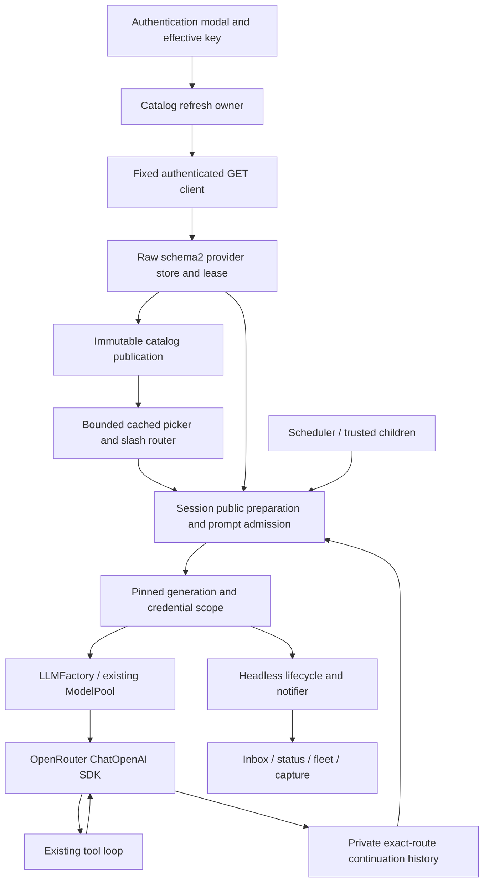

# Feature 86 — frozen functional review

Date: 2026-10-03. Independent Step 2, review-only.

## Executive summary

**NOT FULLY REVIEWED.** The frozen-state receipt is valid, and the latest catalog-admission, reasoning-budget, and picker corrections have meaningful source-level evidence. However, this review did not complete the requested fresh whole-feature audit: substantial shipping transport, session, capture, scheduler, authentication, and fixture-harness paths were not independently traced. The earlier requirement matrix and green suite cannot substitute for that work. No feature approval or Step 3 completion is asserted.

Fresh confirmed functional/security blockers: **0**. This is a count of established findings, **not** a finding that no blockers exist. The limiting condition is incomplete independent inspection, not a newly demonstrated production failure. No production, test, specification, configuration, dependency, existing report, or Git state was changed. This report is the only deliberate write. No tests or external/provider calls were run.

## Frozen-state receipt and provenance

- Workspace: `/root/Code/slo-openrouter-implementation/slo`.
- Verified branch: `feature-86-openrouter-implementation`.
- Verified HEAD: `f63df0a4958eedb4bc603f1946ba4591dd181fff`.
- Manifest: `.f86-window-correction-tPhyAzET/source-test-manifest.sha256`.
- Independently computed manifest SHA-256: `fc8fc0887331bf9ecae26538397c5ca33552e73a90cc36f66d79b8a53ca33d89`.
- Listed records: **1733**. An explicit read-only hashlib check verified **all 1733**, with **zero missing or mismatched files**, before reporting.
- This report's path was **not listed**, and did not exist before writing. There is no intentional manifest-file delta from writing this report.

The provenance is the freeze contract in `sequential-r1-r4-remediation-2026-10-03.md:67–75`, followed by the bounded-window correction receipt at `implementation-log.md:1429–1496`. It describes a post-gate source/test/config/plugin/skill/documentation freeze excluding execution scratch, caches, and copied baselines. It is not a claim that every repository file or every execution artifact is hashed.

The actual list was independently classified: **926 docs paths, 374 tests paths, 275 src paths, 127 skills paths, 6 config paths, 2 plugins paths, and 23 root files/pointers**. It includes historical documentation/evidence as well as current documents; directory counts are not counts of shipping Python modules. A read-only filesystem comparison found **647 `.py` files under src/config/tests/plugins**, excluding `__pycache__`, and **all 647 were listed**. No Python file in those four roots was omitted. This explicit comparison, not the manifest filename, establishes that bounded scope. It does not classify Python elsewhere as shipping or nonshipping.

### Retained gate independently read

Read the actual expanded `full-command.txt`, `full.exit`, and final summary of `full.log` under `.f86-window-correction-tPhyAzET/`:

**5156 passed, 18 deselected, 196 warnings in 332.15s; exit 0.**

The command uses `env -i`, `/root/.pyenv/versions/slo-harness/bin/python -B`, checkout-owned HOME/TMPDIR/SLO_HOME/auth/basetemp, disabled bytecode/pytest cache/visualization, `-m 'not e2e' tests`, and `--tb=short`. This is retained owner execution, not fresh reviewer execution or independently observed syscall containment. The previous `5155 passed / 1 failed` receipt remains preserved at `.f86-final-remediation-hldebc_g/full-final.log`; nothing here rewrites it as green.

## Authority, reading scope, and review limitations

Read the exact repository Code-Test-Review workflow, review-feature-code skill, and mandatory code-review-rules post-hook. Repository/global instructions supplied in context were consulted, along with root RESEARCH and relevant current research/status material. KB Welcome, Slo gotchas and Feature 86 status were consulted read-only; `KB/slo/index.md` does not exist. The README fallback was not completed.

Read the complete a.2 contract and the runtime contract's §§7.2–8.3; inspected headings, acceptance clauses and relevant excerpts from the other exact canonical files at `/root/Code/specifications/projects/slo/specifications/86-openrouter-intergration/`. **The complete overview, request, dependency index and all other individual slice contracts were not read in full.** Read the full continuation review, portions of the older independent-final review, final recovery evidence and current remediation/ledger/remaining-requirement entries. **The requested complete current-evidence reconciliation and newest referenced wf-e227 reports were not completed.** These are explicit prerequisite limitations, not implicit acceptance of prior reports.

The coverage below distinguishes newly inspected evidence from retained pointers. A row marked **not independently cleared** is a review gap, not a claim of missing implementation. This is not an every-file, every-test, or every-decision-point certification.

## Requirements matrix — all 42 allocations

Paths are repository-relative. `overview §…` means the exact immutable overview. Source/test locations are fresh where stated; retained pointers are explicitly not fresh line-level validation.

| ID | Exact contract allocation | Current evidence and inspection depth | Status |
|---|---|---|---|
| F86-01 | overview §§7.1–7.2; a.1 §9 | Retained resolver/env/store/API-key coverage in continuation matrix; resolver implementation not freshly audited end to end. | Not independently cleared |
| F86-02 | overview §7.2; a.5 §9 | `tests/integration/test_openrouter_full_flow.py:219` located; rejected replacement/auth paint assertions not fully reread. | Not independently cleared |
| F86-03 | overview §§7.2,7.4,7.9,7.12; a.6 §7.2 | Prior F1/R2/capture security receipts retained; actual all-channel producers not freshly traced. | Not independently cleared |
| F86-04 | overview §§7.1,7.3,7.6; a.1 §9 | Canonical/API/provider separation described in retained matrix; actual route grammar/factory path not freshly cleared. | Not independently cleared |
| F86-05 | overview §§7.1,7.9; a.4 §§7.2,9 | Fresh `service.py:345–410` missing-route refresh/rejection read; CLI/direct compatibility remains retained. | Partial fresh review |
| F86-06 | overview §§7.1,7.9; a.4 §7.4 | Explicit-before-pool and atomic selection contract read; implementation/test trace retained only. | Not independently cleared |
| F86-07 | overview §7.1; a.1 §7.4 | Pool parser/DAO assertions are retained references, not fresh audit. | Not independently cleared |
| F86-08 | overview §7.6; a.3 §9 | `test_openrouter_budget_evidence.py:39–111` constructs actual factory/SDK and completes local response; complete constructor policy not reread. | Partial fresh review |
| F86-09 | overview §7.6; a.3 §9 | Header/cache assertions retained, not independently inspected. | Not independently cleared |
| F86-10 | overview §§7.6–7.8; a.3 §9 | Actual SDK removal composition freshly read; full tool/usage/truncation/cancel matrix retained only. | Partial fresh review |
| F86-11 | overview §7.7; a.3 §§7.4,9 | Removal composition checks readable history; private extension codec/replay/security paths not freshly traced. | Not independently cleared |
| F86-12 | overview §§7.2–7.4; a.2 §9 | `test_openrouter_final_compositions.py:41–61,96–98` uses actual client with local key/user-list transport. Complete endpoint boundary remains unreviewed. | Partial fresh review |
| F86-13 | overview §§7.2–7.3; a.1 §9 | Prior repeated-page correction credited as retained; paging bounds/schema/labels not freshly audited. | Not independently cleared |
| F86-14 | overview §7.3; a.2 §7.2 | Exact eligibility contract read; converter's full validation matrix not reread. | Not independently cleared |
| F86-15 | overview §§7.3,7.6; a.3 §9 | Budget test does not establish image/history or all output-cap paths. Retained transport evidence only. | Not independently cleared |
| F86-16 | overview §7.3; a.2 §7.2 | Exact variant/router/latest contract read; implementation assertions not freshly inspected. | Not independently cleared |
| F86-17 | overview §§7.3,7.6; a.2 §7.2 | `dao.py:207–209`, `openrouter.py:282–295`, real schema2/public prepare/SDK test `test_openrouter_budget_evidence.py:39–111`; router helpers `slash_router.py:839–902,1000–1004`. Broader reasoning/error matrix retained. | Latest evidence correction supported; full row not cleared |
| F86-18 | overview §§7.3,7.6; a.2 §7.2 | Strict optional `supports_max_tokens` retained as evidence only; request asserts effort only, no reasoning budget. Local rate/endpoint matrix not freshly traced. | Partial fresh review |
| F86-19 | overview §§7.4–7.5; a.2 §§7.3,7.6 | Real loader/race and override tests read; import/help/typing no-I/O proof not freshly audited. | Partial fresh review |
| F86-20 | overview §§7.2,7.9; a.4 §§7.2,9 | Pending/startup temporal contract read; app/session worker and cancellation paths not freshly inspected. | Not independently cleared |
| F86-21 | overview §7.10; a.5 §7.6 | Actual mounted refresh test located at `test_openrouter_full_flow.py:321`; its assertions not fully reread. | Not independently cleared |
| F86-22 | overview §7.9; a.4 §§7.6–7.7 | Headless identity/cancellation/child contract read; headless and scheduler code not freshly traced. | Not independently cleared |
| F86-23 | overview §§7.4–7.5; a.2 §§7.4–7.5 | `service.py:414–535` adoption/revalidation inspected; real store race `test_openrouter_real_store_recovery.py:21–84`; full atomic fault matrix remains retained. | Partial fresh review; E1 below |
| F86-24 | overview §7.4; a.2 §8.2 | Failure/timestamp preservation contract read; complete refresh failure tests not freshly audited. | Not independently cleared |
| F86-25 | overview §§7.4–7.5,7.9; a.2 §7.4; a.4 §7.3 | First-read publication barrier and actual in-flight removal composition read; coalescing/process lease/append ownership not freshly cleared. | Partial fresh review; E1 below |
| F86-26 | overview §7.4; a.2 §§7.3–7.4 | Actual-loader rotation test read; source checks fingerprint around await at `service.py:494–499`. Full TTL/A→B→A matrix not reread. | Partial fresh review |
| F86-27 | overview §§7.4–7.5,7.9; a.6 §7.1(4) | `test_openrouter_final_compositions.py:27–148`: actual empty discovery, pinned admitted session, failed prepared resume, byte-identical and projectable history, one inference. | Specified removal composition supported at source |
| F86-28 | overview §§7.1,7.3–7.5,7.10; a.2 §7.6 | Canonical/presentation split and live-view assertions are retained; global ownership/deletion audit incomplete. | Not independently cleared |
| F86-29 | overview §7.4; a.2 §§7.3,8.2 | `test_openrouter_real_store_recovery.py:87–122` writes real raw cache and restriction file, verifies label/hide/cap, removes override, reloads exact entry, preserves bytes. Full broadening rejection paths retained. | Specific restoration gap closed at source |
| F86-30 | overview §7.10; a.5 §7.5 | Detail helper inspected, but substring/ranking/insertion/navigation code not fully reread. | Not independently cleared |
| F86-31 | overview §7.10; a.5 §§7.5,9 | `slash_suggestion_menu.py:77–108` bounded capacity/inner-width truncation read; eight-label/footer compositor assertion located at `test_slash_suggestions_app.py:188`. Full scale/navigation assertions not reread. | Partial fresh review |
| F86-32 | overview §§7.2,7.10; a.5 §7.4 | `slash_suggestion_engine.py:495–506` preserves direct summaries; router disable/default distinction inspected; lifecycle status truth not completely traced. | Partial fresh review |
| F86-33 | overview §§7.1,7.5,7.8; a.3 §9 | Mixed-pool fallback/tools/audit implementation and assertions retained only. | Not independently cleared |
| F86-34 | overview §7.8; a.3 §9 | Error matrix not freshly audited. No new claim about classifier correctness. | Not independently cleared |
| F86-35 | overview §§7.7–7.8; a.3 §9 | Commit-no-replay/security normalization paths not freshly audited. | Not independently cleared |
| F86-36 | overview §7.8; a.3 §9 | Retry/cooldown/shared-quota assertions retained only. | Not independently cleared |
| F86-37 | overview §7.9; a.4 §§7.4–7.7 | Prepared removal/resume source assertions read; active inbox, schedule, child, preference and F1/R2 lifetimes not freshly traced. | Partial fresh review |
| F86-38 | overview §7.11; a.6 §§7.3,9 | Actual final command/log/exit and complete manifest verified. Test-first ledger partially read; no reviewer test execution. | Retained gate verified; not full acceptance |
| F86-39 | overview §7.11; a.6 §§7.7,9 | Local fixture provenance limitations retained; entire fixture harness and cost-bound enforcement not inspected. | Not independently cleared |
| F86-40 | overview §§7.11–7.12; a.6 §§7.5–7.6 | Current receipt and historical-failure separation verified; all user docs/report reconciliation not completed. | Partial fresh review |
| F86-41 | goals/non-goals; a.6 §7.4 | Inspected fixes reuse existing catalog/presentation owners; whole shipping consolidation/hard-rules audit incomplete. | Not independently cleared |
| F86-42 | journey; overview §§7.2–7.4,7.10; a.6 §9 | Mounted full flow located at `test_openrouter_full_flow.py:403`; complete auth→tool→resume assertion chain not freshly reread. | Not independently cleared |

Six-slice disposition: a.1 not independently cleared; a.2 partial fresh inspection; a.3 partial fresh inspection; a.4 partial fresh inspection; a.5 partial fresh inspection; a.6 retained gate verified but acceptance audit incomplete.

## E1 — precise disposition

**Do not retain the earlier demand for an all-real zero-HTTP missing-ID admission test as a mandatory blocker.** That combines incompatible premises. Overview §7.10a explicitly says missing requested IDs cause one refresh attempt; a.4 §7.2 repeats that rule. The inspected `service.py:376–395` implements it: revalidated membership absent means `refresh(force=True)`. A zero-client assertion in this branch requires an injected result or a different scenario, not a production change to suppress the mandated refresh.

The new `test_openrouter_real_store_recovery.py:21–84` genuinely executes the schema-2 loader before withholding its first async delivery. It then commits/publishes removal or rotates the synthetic effective credential. It does **not** return fabricated cache DAOs in place of disk reads. Its removal case still patches `ModelCatalogService.refresh` to a safe `fresh` outcome and asserts no client construction. That qualification is material and must remain visible: this is real-loader/public-admission/barrier evidence, not an all-real refresh composition.

The exact mandatory integrated removal scenario is separately specified in a.6 §7.1(4) and §9: complete refresh removes an active route while a prompt runs; old run stays pinned; next admission fails; history remains readable. Freshly inspected `test_openrouter_final_compositions.py:27–148` exercises actual `OpenRouterAPIClient`, catalog refresh, store/publication, session invocation, SDK transport and prepared resume using local MockTransport. It asserts removal publication, retained admitted snapshot, surviving answer, unchanged history on rejected resume, successful history projection and one inference request. The refreshed user list actually becomes empty; the refresh result is not fabricated there.

**Independent decision:** these complementary tests address the specified removal acceptance and the first-read regression at source-assertion level. None of the inspected exact clauses requires combining every collaborator into the first-read interleaving test, nor zero HTTP after missing membership. Consequently E1's specific stronger test demand is **not sustained as a fresh mandatory acceptance blocker**. This is not a waiver of a.2 concurrency or a.4 admission requirements, and does not independently clear all concurrency paths. A single public-admission/local-MockTransport barrier test with actual forced refresh would strengthen composition, but is optional absent a demonstrated uncovered contract failure. It should expect the bounded GET branch, not contradictory zero HTTP.

## Latest corrections

- **R1:** router helpers distinguish no controls, explicit disable, and unavailable disable; bare summaries identify provider default versus supported off (`slash_router.py:839–902,1000–1004`). The inspected pure projection test proves the two canonical shapes. Full direct-provider/router regression audit remains incomplete.
- **R2:** the mounted two-size tests and hidden-paint sensitivity were located in `test_openrouter_picker.py:196–268`. Their full assertions were not reread here, so this report does not claim independent positive-compositor/sensitivity verification merely from grep results or owner prose.
- **R3:** fully read the real schema2/public prepare/factory/SDK budget test. True, false, absent and malformed inputs assert strict retained evidence and a valid completed SDK response; wire reasoning is exactly `{"effort": "low"}`, with neither nested budget nor top-level `reasoning_max_tokens`. This closes the previously described helper-only evidence limitation at source level, not through fresh execution.
- **Bounded menu:** source now limits the OpenRouter suffix to OpenRouter and uses the same inner width for detail lines. The three-line special-case capacity is an expressly disclosed adjustment to the two-line presentation plan, not silently weakened counts. Full resize/navigation acceptance was not independently completed.
- **Selection offset:** no causal repair is claimed. Historical unreproduced offset failure and later ordered/full green runs remain reliability evidence only.

## End-to-end traces

### Freshly traced removal boundary

`SloAgentSession.prepare` (test public entry) → real catalog GET/store publication → actual SDK request blocked by event → complete empty GET refresh → published route removed, admitted snapshot unchanged → release request → terminal history → another public prepare rejects → history bytes and projected answer survive.

Verdict: meaningful source-level acceptance composition; not freshly executed by this reviewer.

### Freshly traced budget boundary

Converter fixture → actual schema2 write/read → public `prepare_models` using matching fresh synthetic evidence → prepared snapshot → `LLMFactory.create` → real OpenRouter SDK over MockTransport → valid answer and exact no-budget wire assertions.

Verdict: meaningful correction evidence. This is not live provider authorization.

### Remaining traces

Auth→picker→tool→resume, mixed-pool/compaction fallback, F1 operation capture, R2 delayed notifier, active inbox, scheduler, trusted child capture/reporter and append-lease lifetimes remain **retained evidence, not fresh end-to-end traces in this review**. No stale allegation of unwired capture or absent Plan B is made.

The diagram describes the intended/current recorded ownership topology; it does not certify uninspected edges.

## Test assessment

- **Fresh tests run: none.** No pytest imports, temporary test directories, subprocess fixtures, native capture faults or provider requests were executed by this reviewer.
- Fresh read-only checks: branch/HEAD, manifest digest/count, complete manifest hash validation, bounded Python-scope comparison, report-path nonoverlap, retained command/exit/log inspection.
- Retained full gate: 5156/18/196, 332.15s, exit 0. This does not demonstrate every mandatory decision path merely by its count.
- Newly inspected assertions distinguish real loaders/stores/SDK from injected refresh outcomes. Test function names alone are not accepted as behavioral proof.
- All provider evidence credited here is offline synthetic/local fixture evidence. No real credentials, authenticated remote GET, live availability, entitlement or paid inference was verified.
- The 18 deselections include E2E/default-disabled live/fixture cases; they were not executed in the retained default gate or this review.
- Black and mypy are explicitly waived static gates, **not green**. Functional/security/mandatory acceptance requirements remain unwaived.

## Convention and hard-rules post-hook

Applicable stacks: Python/asyncio/Pydantic/httpx, LangChain/LangGraph, Typer/Textual and filesystem/POSIX. SQL/FastAPI/Vue/Go/DBOS-specific checks are not applicable to this feature surface.

Applied the post-hook checklist to the inspected changes, but **did not complete it against the entire shipping diff**. The existing catalog remains the adoption/publication owner; the budget field is typed, strict and described; presentation does not become a second capability owner. Canonical `model_name` versus wire identity remains a stated separation rather than an alleged synonym defect. No complete naming, type/docstring, declarative-structure, public API, test-decision or source-ownership certification is made. Static waiver must not be interpreted as a waiver of semantic or mandatory architectural rules.

## Findings and handoff

### Glaring gaps / blockers

No fresh confirmed code/security defect is established by this bounded review. **The full-review deliverable itself is incomplete**, as itemized above. This prevents Step 2 READY regardless of the retained green suite. It is not a request to implement speculative code changes.

### Optional improvements

An all-real first-read removal/public-admission MockTransport composition could reduce the separation between the two E1 tests. It must preserve the contract's forced-refresh behavior. This is not added as a release gate.

### Retained qualifications, not reopened defects

- Instrumented shipped-writer bodies with native I/O, reaped launcher, kernel EBADF, and unchanged reporter limits are bounded evidence, not native interpreter-startup equivalence.
- Literal argv equality is not a product acceptance requirement.
- Plan B append ordering/refusal and existing capture handoff are not declared absent.
- No known native-selection root cause was repaired.
- Prior concurrent reviews are historical, not frozen approval.

### Completion checklist

- [x] Verify supplied manifest digest, count and all listed bytes before inspection.
- [x] Determine report-path overlap before writing: absent from manifest.
- [x] Preserve frozen code/tests and all prior work.
- [x] Record exact retained gate and static/live limitations.
- [x] Resolve the specific contradictory zero-HTTP E1 demand against exact clauses.
- [ ] Complete all nine authoritative document reads and current report reconciliation.
- [ ] Freshly trace all major shipping paths and meaningful assertions listed as not independently cleared.
- [ ] Finish full applicable hard-rules review before approval.

Post-write manifest verification is reported in the accompanying final response; no anticipated post-write result is asserted in this file.

NOT FULLY REVIEWED
