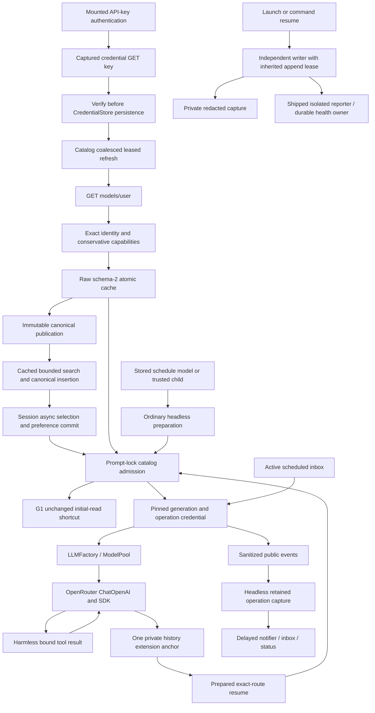

# Feature 86 — independent Step 2 rereview, 2026-10-03

## Executive summary

**REVISE.** The retained Step 1 final gate is genuinely green: **5115 passed, 18 deselected, 196 warnings, 373.69s**, with an accompanying exit-code file containing **0**. Nevertheless, current source has an admission race on the **unchanged-entry fast path**, and the reasoning conversion still loses a documented disable-only control. A mounted authentication regression also waits for obsolete error text without asserting that any error was painted. Mandatory picker decomposition and current-facing documentation remain unfinished.

This is **Step 2 only**. No implementation, test correction, specification edit, Step 3 assessment, completion percentage, or release approval was performed. Supplied call provenance: call1 parallel gpt-5.6-terra medium, three owners; call2 integration gpt-6-astra medium; call3 integration retry gpt-6-astra medium; this review is call4, requested gpt-6-astra medium. These are supplied labels, not independently attested backend identities.

### Inspection completeness disclosure

All six immutable engineering contracts, the complete request, overview and dependency index were read. The table below accounts for **all 42 requirement allocations**, including delivery obligations rather than only the three latest owners. It is not, however, a certification that every shipping test method, every changed line, and every historical ledger was exhaustively reread. In particular, the very large original `review-report.md`, consolidated final report, implementation log and remaining-requirements history were not all read to completion in this call. Current owner reports, the complete section A/B/C reviews, the two recent independent rereviews, integration/retry reports, current pointers and relevant ledger sections were inspected. Actual source, assertions and selected diffs were independently inspected, not inferred solely from those reports.

**The requested exhaustive independent review is therefore not fully delivered by this call.** Requirement coverage below distinguishes fresh source/assertion inspection from retained evidence; uninspected is not recast as missing implementation. The concrete findings independently prevent READY. This artifact must not be represented as a completed clean whole-diff audit.

## 1. Stack, authority and preservation

Python 3.11, asyncio/threads/ContextVar, Pydantic, httpx, LangChain/OpenAI SDK, LangGraph, Typer, Textual and private filesystem/POSIX process ownership. No SQL, Vue, Go or DBOS changes require review here.

Authority consulted:

- Supplied `AGENTS.md`, global/repository `SLO.md`, `CLAUDE.md`, and `docs/RESEARCH.md`; root `RESEARCH.md` read from disk.
- Exact `skills/design-and-analysis/workflows/code-test-review.md` and `review-feature-code/SKILL.md`.
- Complete always-on named-input/type, declarative-method, docstring, testing-policy and code-test-loop guidance; complete hard-rules checklist and ubiquitous-language guidance.
- KB `Welcome.md`, `slo/README.md`, `slo/gotchas.md`, and `slo/feature-86-openrouter-status.md`. The KB's old gate/no-waiver statements are superseded by the current user waiver and retained final log.
- Immutable spec root: `/root/Code/specifications/projects/slo/specifications/86-openrouter-intergration/`. The documented checkout `specifications` link is absent; no replacement was created.

Dirty/untracked inventory was inspected and preserved. No Git mutation, workflow/subagent launch, network request, credential lookup/enumeration, interpreter/project import, pytest run, install, formatter or mypy execution occurred. Read-only Git diff checks and bounded source/log reads were used. No production/tests/specs/prior reports were edited.

**Safety deviation:** an oversized combined context read triggered the bash tool's automatic output spill to `/tmp/slo-bash-mdw18a2_.txt`. It was not manually requested, but is still outside the user's write boundary. It was disclosed during the review and neither accessed nor altered afterward. Subsequent reads were bounded. This review artifact is the only deliberate file write. Perfect no-`/tmp` compliance is not claimed.

## 2. Glaring Gaps — must fix

### G1 — High: unchanged-entry admission can return a superseded snapshot

**Immutable clauses:** overview §§7.4–7.5; 86.a.2 §7.4 (ordered coherent publication and credential recheck); 86.a.4 §7.3, especially “capture newest valid snapshot” and next-prompt metadata/removal adoption. F86-23/25/26/27.

**Current locations:** `src/agents/model_catalog/service.py:373–390`, `:432–454`; consumer `src/agents/slo_agent/sessions/service.py:4093–4100`.

**Causal path:**

1. Admission captures current in-memory snapshot S1 at line 374.
2. Its first off-loop cache read at line 375 reads matching S1 bytes, but delivery to the coroutine is delayed.
3. A concurrent same-key refresh commits and publishes S2, removing the requested route or lowering its cap.
4. The old read returns S1. `_adopt_current_openrouter_slice` compares those entries with the **passed S1**, not the current published reference. Equal entries return S1 at line 454.
5. The original S1 key/list timestamps are fresh and S1 contains the route, so line 390 returns S1. Session admission's credential equality check cannot detect a same-key generation change and pins/reuses the stale entry.

This does **not** overwrite global S2. It admits a new prompt with S1 after S2 has completed, violating the specified next-admission contract. A credential change during this first read is also not rechecked on the equal-entry return, although ordinary prompt admission separately checks key equality; that protection must not be confused with catalog/startup/selection gateway validation.

**Important distinction:** the corrected `_publish_admission_candidate_if_current:489–500` really does recheck after its final await and preserve an intervening publication. Owner1's stronger distinct-route/512-cap assertions genuinely test that helper. G1 is an earlier branch that **never calls that helper**. It is not a resurrection of the corrected final-read publication defect.

**Coverage:** `test_openrouter_final_read_race.py:88–111` directly invokes the publication helper, then asserts the distinct winner remains. `test_openrouter_admission_security.py:448–460,507–519` supplies already-changed loader returns; it does not suspend delivery of the *unchanged* initial read while a newer publication completes. The actual two-process `test_catalog_process_ordering.py` tests force-refresh lease ordering, not this admission shortcut.

**Minimal correction:** put the post-await published-reference/effective-identity validation at the common admission boundary, including equal-entry/no-candidate returns. Re-adopt the current valid view or retry the read when it has changed. Keep one catalog owner; preserve admitted old runs and supplied-snapshot offline validation.

**Exact regression:** extend admission tests with a real temporary schema-2 S1 cache and a barrier **after the first read has read its bytes**. Publish distinct S2 through the existing owner before releasing S1 delivery. Through public `prepare_models`, assert removal rejects or lowered cap is returned, global S2 remains unchanged, and no HTTP is needed to adopt a fresh winner. Add a separate first-read credential rotation case. This is a source-confirmed counterexample; no new executable reproduction was run in this review.

### G2 — Medium: explicit disable-only reasoning evidence is discarded

**Immutable clauses:** overview §7.3 reasoning table: “`none` maps to Slo off”; optional reasoning with explicitly false mandatory and advertised reasoning permits off → `reasoning.enabled=false`. 86.a.2 §7.2 incorporates that exact parent policy; 86.a.3 §7.2 requires conservative, metadata-backed wire translation. F86-17/18.

**Locations:** `src/agents/model_catalog/openrouter.py:109–112,284–310,335–347`; `src/agents/providers/openrouter.py:105–108`; factory forwarding `src/agents/base.py:639–648`.

For advertised `reasoning` with `supported_efforts=["none"]` and `mandatory=false`, the converter records `reasoning_disable_available=True` but filters out `none`, concludes `reasoning_controls_available=False`, and builds off-only compatibility state. The wire policy returns `{}` immediately on false controls and never consumes the known disable permission. The explicit advertised disable control is silently omitted.

Omitted efforts versus explicit null is now correctly distinguished; missing mandatory no longer authorizes `enabled=false`. Those corrections are credited. The remaining disable-only case is different from unknown/omitted controls and must not be described as conservative absence of evidence.

**Additional same-owner semantic discrepancy:** `openrouter.py:329–332` sets default off whenever mandatory is absent, even when a valid `default_effort` is advertised. The parent table specifies the advertised default, otherwise lowest known effort, and withholds only disable permission when mandatory is absent. Tests at `test_openrouter_converter_metadata.py:208–234,257–295` positively expect off for missing-mandatory known efforts. That expectation is not an explicit specification amendment. Resolve default semantics in the same truth table without reintroducing unauthorized disable.

**Minimal correction:** distinguish known enabled effort support, known disable-only support and unavailable controls within the existing capabilities/profile/policy. Apply advertised/default-effort semantics independently of permission to disable. Do not infer controls for omitted efforts or invent effort-to-budget mappings.

**Exact regression:** extend converter → `resolve_reasoning_config` → real `LLMFactory`/MockTransport tests with (1) none-only + mandatory false + reasoning advertised: off sends exactly enabled false; (2) same without advertised reasoning: no payload; (3) known low/high, absent mandatory, valid default high: default resolves/transmits high while explicit off does not send enabled false; (4) omitted versus null efforts unchanged. Assert picker wording does not call a real disable-only control unavailable. Existing off-wire matrix is useful but is not this default/disable-only matrix.

### G3 — Medium: mounted rejection/timeout test does not assert the required visible error

**Immutable clauses:** 86.a.5 §§7.3,8.2 require painted rejection/timeout/protocol states at 80×24 and 60×15; 86.a.6 §§7.1,7.3 and overview §7.11 require assertions on actual paint, not widget state. F86-02/39.

**Locations:** `tests/integration/test_openrouter_full_flow.py:269–284`; helper `tests/tui/authentication/_painted_output.py:76–99`.

The real-service parameterized test waits for the obsolete generic text `OpenRouter authentication failed; retry authentication.`. Current auth service correctly returns distinct rejected/timeout/protocol copy. `wait_until_painted` returns the last viewport after its bounded wait; it **does not fail** when the requested text is absent. The caller asserts only secret absence, button/input state, safe result flags and preserved store/session. It never asserts the expected text is present. All eight cases can pass with no visible error.

The service correction is credited; no claim is made that the actual screen currently fails to render it. This is a concrete false-confidence acceptance test. `test_modal_paints_safe_result` asserts positive text but supplies a mocked generic service result, not the three real categories. The listing-time credential-change test does have a positive paint assertion.

**Minimal correction:** parameterize the exact safe expected category text and assert its whitespace-normalized presence in the returned compositor text. Preserve current store-byte, no-discovery, no-secret, enabled retry and route assertions. Do not increase sleeps to make the old expectation pass.

**Exact regression:** update `test_mounted_rejected_replacement_preserves_store_and_session` for unauthorized/forbidden/timeout/protocol × both terminal sizes; demonstrate that suppressing the status update causes the positive assertion to fail. Add bounded refresh count/time paint through the real session/router: current `test_refresh_catalog_notice.py` checks returned strings while `test_slash_router.py` mocks a generic string, so they do not jointly prove the requested painter path.

### G4 — Medium: prescribed declarative picker decomposition is still absent

**Immutable clauses:** 86.a.5 §7.5 explicitly requires separate matching, empty-query and bounded-state helpers; overview §7.10a repeats the single-decision helper contract. Mandatory declarative/hard-review rules apply independently of the static waiver. F86-31/41.

**Location:** `src/tui/slash_suggestion_engine.py:240–285`.

`_model_argument_state` fetches rows, decides empty-query policy, encodes active/recent/first-class ordering in nested conditional expressions, computes recent offsets, invokes matching/capping, and constructs replacement/ghost state. The requested empty-query and bounded-state responsibilities remain embedded in the orchestration method. This is a feature-local, explicit contract violation, not a demand to repair every long pre-existing method or run Black/mypy.

**Minimal correction:** extract the specified named decisions within `SlashSuggestionEngine`; keep ranking, recent list and row bounds in the existing owner. No new search service or persistent recency state.

**Exact regression:** retain current rank/offset/ghost/25-cap/1000-row/active-recent tests and add focused helper decision coverage for deduped recent successes, active priority and empty/single results. Preserve the mounted viewport assertions. The broader source-style audit is not certified clean by this one finding.

### G5 — Medium: current delivery documentation still points at superseded gate and obligations

**Immutable clauses:** 86.a.6 §§7.5–7.6,9; overview §7.12/F86-40: exact current implementation/evidence truth.

**Locations:** `README.md:86–94`; `docs/SLO_HEADLESS_README.md:102–108`; `docs/SLO_SCHEDULER_README.md:88–96`; current Feature-86 sections in `AGENTS.md`, root/docs RESEARCH.

README says current Step1 REVISE and identifies 5073/15 as the latest gate; the retained latest handoff is Step1 READY with 5115/18. Headless/scheduler text still presents current full/static gates as incomplete despite the full green and explicit static waiver. AGENTS/research retain broad already-superseded capture and gate residual statements. These are current-facing descriptions, not just preserved dated reports.

**Minimal correction:** update current-facing summaries to the latest Step1 receipt and this Step2 REVISE, naming the finite current findings and qualified evidence limits. Preserve historical reports verbatim; do not replace review findings with a completion claim.

**Exact verification:** documentation cross-check against `full-command.sh`, `full-exit-code.txt`, final log and current test symbols. Assert/count no live validation, static waiver rather than static green, synthetic harness rather than a real-network procedure, and 18 normal E2E exclusions. No live execution is needed.

## 3. Exhaustive requirement-allocation table

**Notation:** **I** = implemented boundary supported by fresh inspected source/assertions; **R** = implemented according to retained section/owner evidence, not independently exhaustive in this call; **P** = partial because of a named finding or expressly limited verification. Neither I nor R is an every-branch coverage certificate. Paths are checkout-relative; `a.N` denotes immutable `86.a.N-*`.

| ID | Exact clause allocation | Actual owner / assertions / disposition |
|---|---|---|
| 01 | a.1 §7.1; a.5 §§7.2–7.3 | **I/R** Provider enum, operation-time env accessor, resolver source result, API-key capabilities. Resolver/auth suites retain env→store/no-legacy/empty/whitespace coverage; no real credential used. |
| 02 | a.1 §7.2; a.5 §§7.2–7.3,8.2 | **P G3.** Auth service verifies before persist, handles timeout/rejection/protocol and listing rotation; mounted real failure cases lack positive text assertion. |
| 03 | a.1 §§7.1,7.3; a.2 §§7.3–7.5; a.4 §7.7; a.6 §7.2 | **I/R.** Repr-hidden credentials; one operation capture; public headless sanitization before retention; delayed notifier binding; writer inherited lease. R2 and qualified capture evidence retained, not reopened. Not an exhaustive fresh artifact scan. |
| 04 | a.1 §7.1; a.2 §7.2; a.3 §7.2 | **I.** `provider_for_model`, converter and factory retain exact canonical/API/provider separation; prefix author cannot select native transport. Identity/config diffs inspected. |
| 05 | a.4 §§7.2,7.4–7.5 | **P G1.** Exact unknown route remains actionable; direct pending escape implemented. Next admission can still pin superseded membership on unchanged-entry shortcut. |
| 06 | a.4 §7.4 | **I/R.** Typer explicit model branch precedes pool parsing; override clears pool/fallback; session commits prepared selection before preference. Startup config-identity check prevents late overwrite. |
| 07 | a.1 §7.4 | **I/R.** Config parser and direct ModelPoolEntryDAO both validate canonical provider; existing comma/JSON/object tests retained. |
| 08 | a.3 §§7.2–7.3 | **I.** Factory prepared-entry check, fixed Chat Completions URL, zero retries, Responses false; actual fixture harness crosses SDK. Not live compatibility. |
| 09 | a.3 §7.2 | **I/R.** Fixed Slo attribution headers/no Referer, explicit cache false; factory/transport assertions retained. |
| 10 | a.3 §§7.3–7.5; a.6 §7.1(1) | **I/R.** SDK tools/results, raw visible-reasoning detached projection, usage/truncation/refusal tests, actual session commit/cancel matrix. Plaintext/summary full-session continuation not newly established here. |
| 11 | a.3 §7.4; a.6 §7.1(1) | **I/R.** One extension DAO; first tool anchor; projector reconstruction and token counts; mounted third request preserves exact anchor/result. Same-process new-session resume, not OS restart inference proof. |
| 12 | a.1 §7.2; a.2 §§7.2–7.4 | **I.** GET allowlist `/key`,`/models/user`; no public fallback; bundle auth test asserts exactly one key GET then listing and disk reload. |
| 13 | a.1 §§7.2–7.3; a.2 §7.2 | **I/R.** Bounded client pagination/bytes/records/deadline, no-progress full-page rejection, literal converter labels. R3 remains corrected; other boundary tests retained. |
| 14 | a.2 §7.2; a.4 §7.3 | **I/P G1.** Strict text/tools/context/output/expiry/batch conversion exists; coherent next admission still has G1. |
| 15 | a.2 §7.2; a.3 §7.2; a.2 §7.6 | **I/R.** Conservative caps, input modality rejection, summary reserve bounded by pinned route; selected-lane pool cap hook. Real direct SDK and fake-member fallback evidence are distinct, not full persisted SDK fallback proof. |
| 16 | a.2 §7.2; a.4 §7.2 | **I/R.** Concrete listed variants only; batch/router/latest excluded; exact membership error includes unsupported-variant guidance. |
| 17 | a.2 §7.2; a.3 §7.2 | **P G2.** Omitted/null and missing-mandatory disable correction credited; none-only and absent-mandatory default semantics remain. |
| 18 | a.2 §7.2; a.3 §7.2 | **P G2.** Local RPM20/TPM unknown, explicit remote ceiling separation and require_parameters exist; reasoning metadata is not yet fully preserved. |
| 19 | a.2 §§7.3,7.6; a.5 §7.4 | **I/R.** Offline load and read-only projections; picker rows use no resolver per keystroke. Cold cache hydration is not current-key authorization. |
| 20 | a.4 §§7.2–7.3; a.5 §§7.2–7.3 | **I/R.** Tracked startup, prompt gate, direct escape, late success/failure/cancel immunity. Auth refresh does not choose first remote model. |
| 21 | a.5 §7.6 | **I/P G3 testing.** Exact refresh router branch; session now reports eligible visible count and actual/unknown check time. Real count/time painter assertion not located. |
| 22 | a.4 §§7.6–7.7; a.6 §7.1(7–8) | **I/R.** Headless materialized ID, preparation task/SIGTERM, existing terminal status/notifier. Child/schedule reuse source path; see topology distinctions below. |
| 23 | a.2 §§7.4–7.6; a.4 §7.3 | **P G1.** Persist-before-publish and final-helper check present; unchanged-entry admission can return older view. |
| 24 | a.2 §7.3; a.6 §7.1(3) | **I/R.** Failed listing/repeated-page preservation of raw bytes/success time and fresh-key stale admission. No new contrary failure-retention result alleged. |
| 25 | a.2 §7.4; a.4 §7.3 | **P G1.** Coalescing, process flock, force-waiter no-fetch winner adoption and immutable in-flight run are distinct tested contracts; admission shortcut remains. |
| 26 | a.2 §§7.3–7.4; a.4 §7.3 | **P G1 gateway.** Captured credentials and run-boundary equality protect normal inference; catalog equal-entry gateway lacks common after-await identity validation. |
| 27 | a.2 §7.3; a.4 §§7.3,7.5 | **P G1.** Real removal-during-run test proves old run completes, next prepared resume rejects and history bytes survive. It does not cover stale first-read delivery. |
| 28 | a.2 §§7.1,7.6; a.6 §7.4 | **I/R.** Provider-scoped discovery delegation, raw slice writer, live defaults/reasoning views, dynamic groups, presentation-only ModelPickerRowDAO. No second catalog owner found in inspected paths. |
| 29 | a.2 §7.3 | **R.** Raw cache versus restricted overrides retained; invalid-override precommit tests credited. Exact override-removal/reload assertion not independently re-established here. |
| 30 | a.5 §7.5 | **I/R.** Casefolded ID/display substring, exact/prefix/display/substring rank, canonical replacement/ghost conditions; mounted insertion asserts exact route. |
| 31 | a.5 §§7.4–7.6; a.6 §7.3 | **P G4.** Functional 25-candidate/viewport/count/recent/no-I/O evidence retained. Explicit required named-step structure absent. |
| 32 | a.5 §7.4 | **I/R, related G2/G3.** Historical/configured/verified/checked/stale states do not claim inference. Passive warm TTL aging is not certified; disable-only control wording remains inaccurate. |
| 33 | a.3 §7.6; a.4 §7.3; a.6 §7.1(5) | **I/R.** ModelPool sole fallback owner, bound kwargs unwrap, canonical safe audit and pinned cooldown; successful durable tool/audit full composition not newly proved. |
| 34 | a.3 §7.5 | **I/R.** Explicit auth/policy/404/402/429/transient/context taxonomy, exact budget and positive Retry-After. No TUI status ladder; exhaustive error tests retained. |
| 35 | a.3 §§7.3–7.6; a.4 §7.8; a.6 §7.2 | **I/R.** Actual session/SDK role/usage/text/reasoning/tool × cancellation/failure asserts one request, no switch/retry/recovery and closed stream. R2 terminal capture retained. |
| 36 | a.3 §7.6 | **I/R.** No adapter retry; SDK zero; pool first-chunk barrier/session budgets; existing pinned retry tests. No independent-account quota claim. |
| 37 | a.4 §§7.4–7.8 | **I/R/P G1.** Exact dispatch resume and active schedule route preserved; qualified detached writer/reporter proof credited. No wholesale OS restart/inactive-schedule inference certification. |
| 38 | a.6 §§7.3,8.2,9 | **I evidence, P coverage.** Read final 5115/18 summary, exit receipt and expanded isolated command. Full gate not rerun; uncovered paths G1–G3 remain despite green. Static waiver honored. |
| 39 | a.2 §8.4; a.3 §8.4; a.6 §§7.7,8.1 | **I synthetic/P G3.** New bundle has meaningful GET/auth/catalog/SDK consumers and default-denial tests. Mock-only authorized modes, not a shipped real-network live procedure or observed public capture. Explicit limitation, not permission to fetch. |
| 40 | a.6 §§7.5–7.6 | **P G5.** Current pointers in delivery ledger are improved but operator/agent entry documentation still stale. |
| 41 | all non-goals; a.6 §7.4 | **I/R/P G4.** Existing resolver/catalog/factory/pool/session owners retained; no SDK/graph/provider-platform rewrite in inspected paths. Mandatory whole-diff style/deletion audit not fully completed. |
| 42 | a.5 §7.2; a.6 §7.1(1) | **I.** Mounted auth→unseeded discovery→exact picker/router→real SDK tool→new prepared session has positive answer/anchor assertions; no arbitrary selection or remote entitlement claim. |

## 4. E2E dataflow and architecture evidence

### Positive composed evidence

- `test_openrouter_full_flow.py` uses real credential store/resolver, auth service, fixed GET client, converter/catalog, mounted screen/picker/router, session/factory and local SDK. `/key` precedes persistence; listing follows. The mounted test's third HTTP request carries the persisted exact private anchor and tool result after a newly prepared session. Its first two requests exercise a real tool loop. The fixture's reasoning is encrypted-only; do not call it a plaintext/summary loop proof.
- `test_openrouter_final_compositions.py` holds a real admitted SDK response while complete removal publishes, verifies that admitted answer survives, then rejects prepared resume and preserves readable history bytes. Its headless normalized-error case populates actual status and terminal inbox with exactly one failure, safe body text and positive ordinary-content controls.
- `test_openrouter_session_commit.py` drives a real session/agent/mixed pool with local SSE. Role-only, usage-only, text, reasoning and partial-tool frames are crossed with failure/cancellation. Assertions forbid any second request, fallback audit, retry/recovery event; cancellation closes the stream.
- `test_openrouter_scheduled_preparation.py` explicitly tests **active inbox** delivery through actual scheduler/store/mounted TUI/session/SDK. A different schedule-definition route does not replace the target route. It is not an inactive scheduled OS-child test. Historical reports of another composition must retain that distinction.
- `test_openrouter_terminal_lifetime.py` drives the actual runner's child-task/terminal-notifier lifetime with a real session admission/history scope and populated inbox. It injects the drain boundary and synthetic secret-bearing terminal content; it does not claim an entire live provider run. Captured A survives effective B or resolver failure, and cleanup resets it. R2 is not reopened.
- Capture source now passes append-lock FD in `pass_fds` and closes the parent duplicate after transfer. Owner-B's retained reaped-launcher tail ordering and the qualified native-I/O EBADF reporter proof are credited. No “unwired capture”, argv equality, native interpreter-startup equivalence or arbitrary FD raw-body-filter requirement is introduced.

### Latest synthetic fixture/harness audit

`invoke_fixture` gates explicit fixture mode before resolver or HTTP/client construction. Its bounded MockTransport enforces allowed host/scheme/endpoints, exact selected model, positive cap ≤256 and at most two inference attempts. Discovery invokes production `/key` then `/models/user` and conversion. Paid-fixture mode binds one no-argument in-memory `fixture_echo`, refuses wrong/multiple/argument-bearing tools, sends the ordinary tool result plus private continuation on request two, and refuses a further tool request. Rate-limit test asserts one POST and no retry. The independent transport third-request/GET-only refusal tests are meaningful, not numeric configuration assertions.

`test_harness_contract.py` also consumes key/models/errors through real candidate auth, persistence, publication and disk reload. SSE/private anchor assets cross the SDK and second request. This closes the prior **shape-only bundle** criticism. All data remain authored synthetic; the checked-in API is `invoke_fixture`, not an authorized real-network executable. A future live procedure still requires separate approval. No public observed fixture provenance or locked-SDK equivalence was fabricated.

## 5. Unit tests and decision-path assessment

| Family | What the assertions actually establish | Remaining finite concern |
|---|---|---|
| Final admission read | Real bytes read before barrier; distinct newer route and 512 cap remain global winner; rotated identity rejects | Direct helper call skips G1 initial unchanged-entry path |
| External process ordering | Two processes; older pre-lease barrier; newer writes winner; older fetch count zero; exact bytes preserved | Force-refresh ordering, not warm admission after external write |
| External removal/cap admission | Mock loader changes initial to removed/lower-cap; returned/global membership checked | Despite report wording, these functions do not read/write their declared `cache_path`; use real-store regression for G1 |
| Reasoning | Real converter/resolver/factory SDK off-wire matrix distinguishes omitted/null, mandatory clamp and explicit-disable permission | None-only and absent-mandatory default semantics G2; green wrong/default oracles are not compliance |
| Refresh count | Actual session method, mocked service outcome/snapshot/status; visible+available-only count and actual/unknown time | Real router/painter composition missing; pure return tests do not establish paint |
| Pending recovery | Session and mounted event barriers preserve direct selection after old startup success/failure/cancellation | Credited correction; no blanket pending-selection rejection finding retained |
| Auth | Store bytes preserved, source races and saved-state cancellation; listing rotation clears dismissal | G3's actual rejection/timeout paint oracle is absent |
| Transport/history | Real SDK request shapes; detached assistant projection; exact same-route anchors; fragment/conflict/size tests; committed session matrix | Full plaintext/summary live session and persisted smaller-fallback summary proof not newly established; no claim those components are absent |
| Captures | Named allocation/lease/private-creation corrections and retained real process/native-I/O proof | Not a new complete syscall/security audit; earlier topology limits preserved |
| Harness | Default construction tripwires; real GET/converter; SDK two-request control; third request denied; bundle persisted/reloaded | Synthetic only; not live route entitlement |

No major production owner is alleged to have zero tests. The critical issue is the path and assertion actually exercised, not the existence or total count of test files. The historical mounted-auth success-paint miss remains an unexplained reliability signal; reported 20 isolated passes and two later full-order passes do not identify or repair its cause. It is recorded as a limitation, not used alone as a new must-fix product defect.

## 6. Conventions and ubiquitous language

Hard-rules pass applied to inspected paths. Black/mypy were neither run nor used as blockers. SQL namespace/model/Alembic and Vue rules are not applicable. The F86 contract explicitly preserves the existing graph/factory/pool architecture; generic examples do not authorize replacing it with a new framework.

| Rule | Assessment |
|---|---|
| Named inputs / types | Principal new APIs use keyword contracts; third-party protected signatures remain local compatibility seams. Not every call site audited. |
| Google docstrings | Many new lifecycle methods explain ownership and teardown. Stale factory text still says prepared-snapshot integration is future work; optional cleanup alongside G5. |
| Declarative structure | G4 is a concrete current feature-specific violation. Catalog refresh extraction and capture ownership helpers are credited; no blanket clean claim. |
| Tests per decision | G1 and G2 expose untested/incorrectly specified branches; G3 exposes false confidence. Passing aggregate gate cannot substitute for those assertions. |
| Data ownership | One catalog, credential resolver/store, factory, extension DAO, pool and session admission owner remain recognizable. |
| Canonical naming | `model_name` is Slo identity; `api_model_name` is wire identity; `provider` owns credentials/transport. These are distinct concepts, not synonyms. `ModelPickerRowDAO` is correctly presentation-only. |
| Private versus public | `provider_message_extension` belongs to private replay. `safe_error_code` deliberately enters legacy history `error_message`; no raw OpenRouter body is authorized by that schema name. |
| Resource lifetime | Inherited writer lease and delayed notifier capture are present. No obsolete ownership findings carried forward merely from old reports. |

## 7. Commands and evidence ledger

Only read-only commands were run. No new functional execution is claimed.

| Command/artifact inspected | Result and meaning |
|---|---|
| `pwd; git status --short` | Confirmed requested dirty/untracked checkout; inventory included actual untracked producers/tests and retained scratch. No deletion/staging. |
| `readlink specifications` / `ls -ld specifications` | Link absent; canonical immutable directory read directly. |
| Bounded `read`, `grep`, numbered `sed` and selected `git diff -- <paths>` | Current source/assertion inspection, including identity/config, session/startup/admission, pool, graph/history/token counting and adapter/harness. Not a test run. |
| `git diff --check` | Exit 0; tracked whitespace check only, not coverage or static approval. |
| `.f86-integration-retry-ucwY1o/full-command.sh` | Expanded `env -i`, isolated HOME/TMPDIR/SLO_HOME/auth path, approved Python 3.11.7 harness `-B`, no cacheprovider, checkout-owned basetemp, timeout 1200, only `-m 'not e2e' tests`. Read, not executed. |
| `full-non-e2e.log` terminal section and `full-exit-code.txt` | **5115 passed, 18 deselected, 196 warnings in 373.69s; 0**. Retained Step1 evidence, not this reviewer's execution. No immutable source-hash receipt independently verified. |
| `surrounding.log` / `surrounding.exit` | **70 passed, 3 deselected, 5 warnings in 46.99s; 0**. Retained retry partition. |
| Owner1/2/3 and integration/retry/remediation reports | Reviewed as evidence provenance and test pointers, not automatically accepted whole-feature verdicts. |
| Runtime `RunnableBinding.__getattr__` source | Delegates attributes to bound model; avoids a false allegation that the summary-cap method is unavailable merely because members are tool-bound. Read-only package source, no imports/changes. |

Final log retains unawaited-AsyncMock warnings. They are not suppressed here, nor asserted to cause the historical paint failure. The 18 E2E exclusions are the ordinary final-gate exclusions, including the three legacy synthetic harness tests; meaningful new harness checks run in the default gate. No live tests or new exclusions were introduced by this review.

## 8. Optional improvements and acknowledged limits

### Nice-to-Haves

- Add a dirty-source hash manifest beside future command/exit receipts, so evidence can be bound to tracked and untracked shipping inputs.
- Remove misleading test module comments saying mounted/tool/resume behavior is only future work when later functions already exercise it.
- Consolidate current documentation pointers without deleting historical reports.
- Inspect passive warm-status TTL aging and raw-versus-override equality separately; no fresh failure reproduction or additional blocker is claimed for those concerns here.

### Temporary shortcuts / limits

- Synthetic MockTransport and finite process tests are not live OpenRouter authentication, entitlement, availability, paid inference, or observed-provider fixtures.
- Installed/locked SDK cross-version execution was not performed; no dependency change was authorized.
- Shipped-body/native-I/O/reaped-launcher/EBADF evidence is qualified and useful, not native startup equivalence.
- No new full suite was required or run. All cited execution is retained evidence.
- Exhaustive every-file/every-test/historical-ledger and all layer-skill reading was not completed. This limitation is explicit and prevents presenting this artifact as full Step2 approval.

## 9. Finite handoff and terminal verdict

### Must-fix code

- [ ] G1: protect unchanged-entry admission after its first asynchronous read; do not only protect candidate publication.
- [ ] G2: preserve explicit disable-only reasoning and specified default-effort semantics without enabling unknown controls.
- [ ] G4: perform the prescribed owner-local picker decision decomposition.

### Required tests

- [ ] First-read stale-delivery barrier through public admission, distinct same-key removal/cap winner, plus credential rotation.
- [ ] Converter→resolver→factory wire none-only/default-effort cases with exact payload and picker truth.
- [ ] G3 positive real-service error paint assertions at both required terminal sizes; real refresh count/time painter assertion.
- [ ] Retain corrected final-helper race, process ordering, default-denial/bounded harness, pending-direct, F1/R2/R3/R4 and qualified capture regressions.

### Documentation and review completion

- [ ] G5: reconcile current-facing docs to latest Step1 evidence and this Step2 verdict; preserve dated history.
- [ ] Complete the remaining exhaustive source/test/ledger review scope before claiming a clean whole-feature audit.
- [ ] Keep static waiver, synthetic/live limits and historical paint non-reproduction honest. No real credentials/network/paid test required to fix the named issues.

**Terminal verdict: REVISE. Do not run Step 3.**
