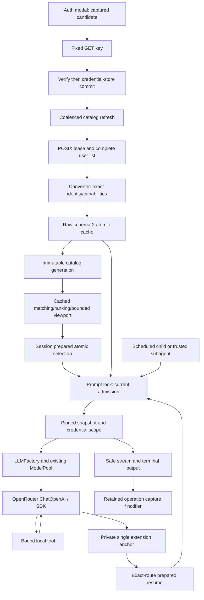

# Feature 86 — independent whole-feature Step 2 continuation

Date: 2026-10-03. Requested Call 3, concurrent with final Step 1 remediation.

## Executive verdict

**REVISE.** All six contract areas and all F86-01–42 allocations were assessed below, including implementation flows and actual test assertions. The previous five findings are not simply carried forward: admission now has an equal-slice recheck, disable-only reasoning reaches the wire, actual error paint is asserted, the picker is decomposed, and current-facing documentation labels its older gate honestly. However, reasoning presentation still contradicts capability evidence, one explicitly required metadata field is discarded, and finite mandatory evidence remains incomplete.

This is a bounded requirement-level audit, not an every-line or branch-coverage certification. No production/test/shared-document/specification changes, Git commands, interpreter imports, test execution, external requests, credential access, installs, system writes, or process operations were performed. Only read/find/grep/ls tools were used for inspection. This report is the sole deliberate write. Prior reports and historical evidence are preserved.

### Concurrent-checkout limitation

The checkout was demonstrably changing during inspection: the rejection-paint sensitivity check changed from a patched visibility property to explicit visibility save/restore; the listing-rotation test gained both terminal dimensions; a real refresh-paint test appeared after the initial read. Thus this report cannot certify one frozen source state. Locations below describe the inspected versions and include symbols to survive line movement. No source-hash receipt binds the retained full gate to those later edits.

## Authority and evidence

Read supplied AGENTS.md, repository/global SLO.md, CLAUDE.md and docs/RESEARCH.md; disk root RESEARCH.md; review-feature-code, the exact Code-Test-Review workflow, named-arguments/type, declarative-method, docstring, test-verification and hard-review guidance, plus relevant client/product-CLI/Textual boundaries. KB Welcome, Slo README and gotchas were consulted read-only. The checkout `specifications` path was unavailable; no link was created.

The immutable canonical root used was `/root/Code/specifications/projects/slo/specifications/86-openrouter-intergration/`. Read the complete request, overview and dependency index, and **each of the six 86.a contracts individually**, including implementation and acceptance sections. This review's contract reads are not based on the prior truncated combined read.

Read the latest independent-full-rereview, integration-final-retry, owner1/2/3, owner4, owner6, integration-remediation, current status, current remaining-requirements/reconciliations and implementation ledger. The implementation ledger was read in bounded ranges; a truncated historical range was completed with a follow-up read. Historical remaining-requirements sections beyond the relevant reconciliations were not exhaustively reread; they are not silently promoted into current blockers. Owner-C evidence was also checked against shipping transport/compaction assertions.

### Actual retained gate

Independently read `.f86-current-full-hONnN8/command.txt`, the start and final summary of `full-non-e2e.log`, and `exit`:

- Python 3.11.7; collected 5140, 18 deselected, 5122 selected.
- **5122 passed, 18 deselected, 196 warnings in 329.09s; exit 0.**
- Expanded command uses `env -i`, checkout-owned HOME/TMPDIR/SLO_HOME/auth/basetemp, approved harness Python `-B`, disabled pytest cache and exactly `-m 'not e2e' tests`.
- The log retains unawaited AsyncMock warnings. They are not suppressed or asserted to cause a particular defect here.
- This is genuine retained Call 2 execution, **not** a reviewer rerun or a final gate for concurrent additions.
- Black/mypy are waived as static gates, not green. No live key, authenticated remote GET, paid inference, remote entitlement or SDK cross-version equivalence is established.

## 1. Glaring gaps — confirmed current contract defects

### G1 — Medium: reasoning presentation still loses the disable-permission distinction

**Requirements:** F86-17/32; overview §7.3 optional/missing reasoning rows and §7.10; 86.a.2 §7.2; 86.a.5 §7.4.

**Locations:** `src/agents/model_catalog/openrouter.py:349–352` (`_reasoning_profile`); `src/tui/model_catalog.py:155–165` (`_project_rows`); `src/tui/slash_suggestion_engine.py:481–486` (`_model_detail`); `src/tui/slash_router.py:832–837,959–960`.

**Causal paths and impact:**

1. For advertised reasoning, `supported_efforts=['none']`, `mandatory=false`, the converter correctly produces enabled-effort controls false and disable permission true. The factory now ORs these flags and sends `reasoning.enabled=false`. The picker copies **only** `reasoning_controls_available`, then prints `provider default; controls unavailable`. `/reasoning` also treats every off-only profile as unsupported. Thus a real supported disable control is advertised as unavailable.
2. For known enabled efforts with mandatory absent, `_reasoning_profile` includes `off` in `supported_levels`. The picker advertises it and `/reasoning off` accepts it, but the request policy correctly omits a disable field because permission is unknown. The parent contract explicitly says not to advertise disable in this case. Retaining internal off compatibility must not imply that it turns provider reasoning off.

This is not the superseded missing-mandatory **wire** defect: the wire guard is credited. It is the remaining cross-layer semantic loss, observable without a provider call.

**Minimal correction:** preserve the distinction in the existing presentation projection/router. Expose disable-only controls truthfully; distinguish provider-default/no-control state from supported off; do not infer disable permission or add a second reasoning owner. Keep direct-provider semantics unchanged.

**Required test:** converter → canonical capability → actual picker/router at both dimensions, for none-only/mandatory-false and known-effort/mandatory-absent records. Assert literal detail and `/reasoning` response, alongside the existing real SDK off-wire matrix. `test_openrouter_reasoning_semantics.py:20–102` proves the wire branch but cannot prove presentation. Converter tests currently positively include off for missing mandatory and do not assert this UI distinction.

### G2 — Low but mandatory: advertised reasoning-budget evidence is discarded

**Requirements:** F86-17/18; overview §7.2 wire metadata and §7.3 “reasoning budgets”: retain `supports_max_tokens` as evidence only; 86.a.2 §7.2 incorporates the parent reasoning policy.

**Locations:** `src/agents/model_catalog/openrouter.py:103–111` capability construction; `src/agents/model_catalog/dao.py:190–214` (`ModelCapabilitiesDAO`); `src/integrations/openrouter/dao.py:20–32`.

**Causal path:** the wire envelope retains model dictionaries, but conversion projects only modalities, parameter names, output ceiling, expiry and two reasoning booleans. No source field or reference named `supports_max_tokens` exists. The schema-2 cache persists converted entries, so supplied evidence is lost at conversion and cannot survive reload.

**Impact:** explicit metadata-preservation acceptance is unmet. This does not justify adding a token-budget control: the spec expressly forbids that in v1.

**Minimal correction:** add an optional strictly validated evidence field to the existing capability DAO/converter, with absent/invalid represented conservatively and backward-compatible default. Never translate it into a request parameter.

**Required test:** true/false/absent/malformed metadata through conversion, raw-cache save/reload and prepared entry; assert no reasoning token-budget wire field is sent in every case.

## 2. Missing mandatory evidence / REVISE conditions

These are not asserted production failures.

### E1 — First-read admission regression is still synthetic rather than the prescribed real-store proof

**Requirements:** F86-23/25/26/27, 86.a.2 §7.4 and §8.2; 86.a.4 §7.3; prior G1 exact regression.

**Locations:** `tests/agents/model_catalog/test_openrouter_admission_security.py:230–402`; production `service.py:467–509`.

The new public `prepare_models()` tests do exercise the correct first-read boundary and reject removal/rotation. However their replacement `asyncio.to_thread` returns constructed `initial`/`removed` DAOs directly. The declared cache path is never populated/read there. The final-read test (`test_openrouter_final_read_race.py:55–112`) reads real bytes but calls the publication helper directly, not the new equal-entry branch. The independent-process test proves force-refresh lease ordering, not this admission shortcut.

**Needed:** one real temporary schema-2 cache, barrier after the first actual loader read, distinct committed removal/lowered-cap winner before delivery, public admission assertion, zero HTTP assertion, plus credential rotation. Keep the current synthetic cases. The new helper's source closes the reported initial-read interleaving; evidence should not claim more than its actual collaborators establish.

### E2 — “transmits advertised effort” test stops before the factory/SDK

**Requirements:** F86-17/18/39; 86.a.3 §§7.2,8.1; prior G2 exact regression.

**Location:** `tests/agents/providers/test_openrouter_reasoning_semantics.py:104–126`.

The named test converts metadata and asserts `resolve_reasoning_config().provider_effort == 'high'`; it does not construct a model or capture an HTTP body. The real SDK parameterization above it always requests off. Generic policy tests and factory-property assertions are useful, but are not this repaired default-effort handoff.

**Needed:** extend this test through real LLMFactory/OpenRouterChatOpenAI with MockTransport and exactly one request carrying high; contrast explicit off without disable permission. Retain malformed/unadvertised zero-request control tests, which are already meaningful.

### E3 — Override removal/reload acceptance not established

**Requirement:** F86-29; 86.a.2 §§7.3,8.2; overview §7.4.

**Locations:** `tests/agents/model_catalog/test_model_catalog_overrides.py:259–284`, `test_model_catalog_store.py:45–69`, `test_atomic_publication.py:171–200`; implementation `src/agents/model_catalog/discovery.py:296–416` and `service.py:1508–1525`.

Source keeps raw provider slices separate and applies restrictions; tests reject broadening, retain bytes on invalid override, and check raw-envelope serialization. The service override integration substitutes `_apply_manual_overrides`, and no inspected test removes an OpenRouter override then reloads to assert restoration of raw capabilities. This was an explicit scenario, not an invented broad matrix.

**Needed:** real temp cache/override files; lower cap/relabel/hide; verify raw cache unchanged; remove override; reset/reload or publish through the ordinary owner; assert original raw values return. No HTTP is necessary. This is a test gap, not evidence that override removal is broken.

### E4 — Final concurrent changes need a post-change gate and reconciled handoff

**Requirements:** F86-38/40; 86.a.6 §§7.3,7.5–7.6,9.

**Locations:** `docs/implementation/86-openrouter/current-status-2026-10-02.md:3–18`, `integration-remediation-2026-10-03.md` remaining requirements; concurrent test additions at `test_openrouter_full_flow.py:285–399` and auth test `:112–168`.

The verified 5122 gate predates additions observed here. At report preparation no newer final receipt was independently inspected. Complete the new focused tests and full non-E2E gate after the final edit, retain command/exit/log evidence, and reconcile current pointers without rewriting history. Do not use static waiver or the old gate to certify these additions.

## 3. Disposition of the five original blocker classes

| Original class | Current source/assertion assessment | Disposition |
|---|---|---|
| Async stale first read, generation and credential | Equal-slice branch now delegates to `_revalidate_unchanged_admission_snapshot`; effective identity is checked before/after second await, changed publication reference returns current view, changed durable cache is adopted. Public removal/rotation tests hit first-read delivery. Existing final-helper winner test checks distinct membership/cap and rotation. | Original code defect addressed for its stated interleaving; E1 real-store evidence remains. No claim of a new confirmed admission race. |
| Reasoning truth table and SDK rejection | Omitted efforts do not become explicit-null; none-only explicit disable reaches real wire; mandatory off clamps; advertised default is now selected. Semantic-controls suite captures valid requests and asserts empty request lists for malformed/unadvertised inputs, including false values. | Wire corrections credited; G1 presentation, G2 metadata evidence and E2 default SDK proof remain. |
| Mounted auth positive paint/rejection/timeout/protocol/rotation | Eight real GET/service rejection cases positively inspect compositor region at both dimensions, preserve old store bytes and exclude key. New sensitivity code hides paint while retaining render text and expects assertion failure. Rotation now parameterized at both dimensions. | Original false-positive oracle removed; concurrent additions require E4. Rotation test injects catalog outcome; actual resolver/catalog races are tested separately. |
| Declarative picker split | `_model_argument_state` delegates ordered entries → bounded rows → bounded state; matching, empty query, recent positions/rank and row projection remain in same engine. | Closed at inspected source; active/recent/first-class and 1000-row tests retain behavior. |
| Current docs gate/offline/static waiver | README/AGENTS/root+docs RESEARCH/headless/scheduler call 5115 explicitly pre-correction, preserve REVISE and static waiver, distinguish 18 exclusions from executed offline tests. Current-status records actual 5122 receipt. | Prior inaccurate “latest 5073” class closed. Final concurrent receipt/pointers remain E4, not a demand to erase history. |

### The four Call 2 residual gaps

1. **Suppressed-paint sensitivity:** now present in source; positive → hidden negative → restored positive, using compositor helper rather than widget model. Execution after the final revision is not certified here.
2. **Listing-time rotation at both sizes:** now present at 80×24 and 60×15 with positive region paint and full-viewport sentinel checks. Actual catalog result is injected; this is a mounted consumer test, not a second real rotation integration.
3. **Real refresh count/time paint:** now present in `test_mounted_refresh_paints_session_router_count_and_check_time`; real GET/catalog/session/router/app, listing barrier, one exact route, check-time from lifecycle, no model switch. At 60×15 it asserts first and last wrapped portions across scrolling; 80×24 asserts the full message. Needs final execution receipt.
4. **Truncated specification reading:** this independent call read the complete nine authoritative documents in bounded reads. That closes this review's reading limitation, not a retroactive claim about the Step 1 author's earlier read. Step 1 should record its own reconciliation.

## 4. Full F86-01–42 ownership / coverage matrix

**Meaning:** Covered = implementation and meaningful inspected assertions support the bounded offline requirement; Partial = named defect/evidence condition or expressly narrower composition; Not = required artifact/behavior absent. Covered is not a claim that this reviewer executed it or inspected every test method. `GATE` below is the independently read 5122 log/exit; later edits are pending E4. Test paths are under `tests/`; source paths under `src/` unless `config/` is stated. Each row records behavior, not merely an ID allocation.

| ID | Requirement / owner | Source + assertion/evidence | Assessment |
|---|---|---|---|
| F86-01 | Enum/env/store/no legacy — a.1/a.5 | `auth/credential_dao.py`, `credential_resolver.py:166–274`; `auth/test_credential_resolver.py` asserts environment/store source, no legacy, current env and whitespace; API-key capability test covers OpenRouter/Kimi. GATE. | Covered |
| F86-02 | Effective key, failures, Back/Cancel — a.1/a.5/a.6 | `auth/openrouter_authentication.py:104–227`, auth screen tracked token/task; `integration/test_openrouter_full_flow.py:210–317` real rejected/timeout/protocol GET preserves bytes, positively paints, no discovery; auth modal cancellation awaits task. Concurrent sensitivity/two-size additions E4. | Partial: final evidence |
| F86-03 | Secrecy/private state/trusted child — a.1/a.3–6 | Resolver operation ContextVar + escaped/literal redaction; headless capture handoff; fixed GET/SDK exceptions; channel test asserts one private anchor and clean public/TUI; terminal-lifetime test asserts populated delayed inbox after rotation/failure. Capture/Plan B qualified evidence retained, not reopened. | Covered, bounded channels |
| F86-04 | Exact canonical/API/provider — a.1/a.3 | `auth/provider_for_model.py:33–79` classifies prefix before native; converter preserves API ID; factory exact-entry tests and auth route tests reject unsafe grammar, retain upstream author independence. | Covered |
| F86-05 | Unknown actionable/direct compatibility — a.4/a.5 | Catalog `prepare_models:270–319` exact-name guidance; dispatch preserves qualified route; runtime-boundary test asserts no credential/factory before missing-entry rejection; pending direct escape tested. | Covered |
| F86-06 | Explicit model clears pool — a.4/a.5 | `cli/typer_dispatch.py:446–470`, session `_commit_model_selection`; CLI preparation tests assert invalid pool parser never called, pool/notice cleared, old config unchanged; mounted exact selection tests exercise consumer. | Covered |
| F86-07 | Comma/JSON/object pool invariant — a.1 | `config/model_pool_config.py`, `providers/model_pool.py:62–77`; parser tests cover each format and mismatch, DAO validates programmatic entries independently. | Covered |
| F86-08 | Fixed ChatOpenAI lane — a.3 | `agents/base.py:600–667`; `providers/test_openrouter.py` asserts URL/API ID/Responses false/retries zero; actual SDK transport/full-flow requests assert chat/completions. | Covered, offline |
| F86-09 | Headers/cache policy — a.3 | Same builder sends exactly two Slo headers, no Referer, explicit caching false; construction assertions inspect exact header mapping/cache flag. | Covered |
| F86-10 | Streaming/tools/usage/truncation/cancel — a.3/a.6 | Adapter delegates SDK, maps refusal/length; transport tests assert exact second tool ID/args/result, refusal visible and usage unknown when absent; session-commit matrix asserts stream closure and one request on cancellation/failure. | Covered |
| F86-11 | Private reasoning/history — a.3/a.6 | One extension DAO; agent trace anchor → history projector → exact-route adapter. Fragment tests assert ordered merged details, single extension chunk, conflicting/non-JSON/size failures; channel tests assert one anchor, resumed/compacted tail and public secrecy. Mounted new-session resume uses exact private anchor. | Covered, service-reset rather than OS inference restart |
| F86-12 | Authenticated list only — a.1/a.2 | Client allowlist `/key`,`/models/user`; bundle composition asserts candidate key then user list, exactly one key GET and disk reload; no public fallback. | Covered |
| F86-13 | Bounded HTTP/schema/pagination/labels — a.1/a.2 | `integrations/openrouter/client.py:90–287`, converter literal sanitization; client tests assert restart offsets, final empty page, contradictory totals, aggregate bytes, redirects, transport safety; R3 no-progress guard remains. | Covered |
| F86-14 | Eligibility — a.2 | Converter requires text I/O/tools/strict context, excludes expired/batch/router; metadata tests assert ineligible visibility and exact expiry boundaries; supplied-snapshot admission reevaluates expiry. | Covered |
| F86-15 | Conservative output/images — a.2/a.3 | Converter min cap and factory validation before credential/client; capability recovery tests assert zero HTTP for malformed controls and image rejection in user/assistant/tool history; image-capable route preserves image at actual wire; compacter cap evidence distinguishes direct SDK from fake-member fallback. | Covered, bounded composition |
| F86-16 | Concrete variants only — a.2/a.4 | Converter exact batch-segment/router/latest exclusion, exact membership error; review-contract test keeps `:batching` and rejects `:free:batch`. No suffix invention. | Covered |
| F86-17 | Reasoning/optional controls — a.2/a.3 | Converter + resolver + factory off-wire matrix; semantic-controls valid/zero-request assertions. G1 presentation, G2 dropped evidence and E2 missing default-effort wire handoff. | Partial |
| F86-18 | Local limits versus evidence — a.2/a.3 | Converter sets 20 RPM/TPM None/retry 2/wait 60, records remote cap separately; SDK asserts require_parameters true, no native-family policy. Reasoning evidence incomplete G2. | Partial |
| F86-19 | Offline seed/cache/typing — a.2/a.5 | Catalog `load` never resolves credentials/network; live Mapping/Sequence projections and cached picker status; read-view tests tripwire global reads with supplied snapshot and reject enable_discovery; picker tests bound 1000 local rows. | Covered |
| F86-20 | Async auth/startup refresh — a.4/a.5 | Session pending initialization + tracked app startup worker; auth service refresh carries same verification; startup/direct-recovery tests use barriers and prevent late startup overwrite/cancel regression. | Covered |
| F86-21 | Manual refresh first — a.5 | Router exact refresh branch → session `refresh_model_catalog:2184–2216`; notice tests assert eligible visible count, actual/unknown time and ≤240 chars. Concurrent mounted real refresh composition now present, E4. | Partial: final evidence |
| F86-22 | Headless/schedule/child prepare — a.4 | Headless materializes identity, prepares before subscribers/inference; CLI test drives real dispatch/status/notifier failure and asserts zero factory/invoke, SIGTERM restoration. Scheduler `_base_argv` passes exact stored model; children reuse same gateway. | Covered, no live child inference claim |
| F86-23 | Atomic coherent publication — a.2/a.4 | Raw schema-2 store, atomic outcome, save-before-publish; atomic tests assert invalid override leaves exact bytes/generation and committed warning publishes. New initial-read public tests are synthetic; E1. | Partial |
| F86-24 | Failed refresh retains success — a.2 | Lifecycle tests compare cache/generation after failure, malformed/conflicting list and repeated-page rejection; stale admission tests separate fresh key evidence from failed listing, retain original listing time. | Covered |
| F86-25 | Coalescing/process order/run pin — a.2/a.4 | Shielded shared refresh waiters, leased reread; real two-process force-refresh test asserts newer winner bytes and zero old GET calls. Prompt barrier tests prove old run pinning/new metadata rebuild or reuse; E1 first-read real-store proof. | Partial |
| F86-26 | Fingerprint/TTL/rotation — a.2 | Separate active/cached identity, no raw key in cache; refresh evidence tests assert supplied capture cannot publish on rotation, timestamps and exact TTL/future rejection; new first-read credential test exists but synthetic. | Partial: E1 |
| F86-27 | Removal/history/resume — a.2/a.4/a.6 | Reconciliation/tombstones; real complete removal during blocked SDK run lets admitted answer persist, rejects next prepared resume, preserves byte-identical/projectable history. First-read barrier evidence E1. | Partial |
| F86-28 | Consolidated dynamic owner/views — a.2/a.4 | Async discovery compatibility delegate, no merged writer, read-only defaults/reasoning/TUI views, provider enum grouping, canonical versus ModelPickerRowDAO separation; read-view tests prove new publication observed and caller mutation detached. | Covered |
| F86-29 | Raw cache/restricted overrides — a.2 | Existing override owner rejects cap/rate/reasoning broadening; raw store and precommit invalid-override tests inspected. Actual removal/reload restoration not demonstrated, E3. | Partial |
| F86-30 | Substring/display/rank/insertion — a.5 | Engine matching/rank/ghost/offset helpers; tests assert mixed case/display-only exact canonical insertion, rank and mounted Tab; no display label used as identity. | Covered |
| F86-31 | Bound/menu/recent/count/no I/O — a.5 | Extracted matching/empty/bounded helpers, max25 and total; tests assert active→deduped recent→first-class→lexical, 1000→25 count; viewport suite covers small terminal navigation and no-match notice. | Covered |
| F86-32 | Honest status — a.5 | Historical/configured/verified/checked/stale lifecycle projection avoids inference claims; auth rotation clears dismissal credential. Disable-only/missing-mandatory presentation violates truth, G1. Warm passive aging not certified as a separate timer feature. | Partial |
| F86-33 | Sole mixed-pool fallback/tools/audit — a.3/a.4 | ModelPool selects/unwraps bound member, fixed safe_code for OpenRouter and canonical identities; actual SDK error fallback tests plus pinned-retry clone test, ordinary bound-tool pool regressions in GATE. No new pool implementation. | Covered, component composition |
| F86-34 | Error matrix — a.3 | Shared classifier status/security precedence, exact temporary-402 conjunction; review-contract tests assert contradictory auth/policy wins, 413 terminal, header decimal ceil, unknown terminal; actual HTTP/SSE normalization tests. | Covered |
| F86-35 | HTTP200/nested/SSE/no replay — a.3/a.4 | Adapter normalizes before conversion and records committed first chunk; actual session/mixed-pool role/usage/text/reasoning/tool × cancel/failure asserts one request, no switch/retry/recovery, stream closed; actual headless failure gives one terminal event plus populated status/inbox. | Covered |
| F86-36 | Retry ownership/quota — a.3 | SDK zero retries, no adapter loop, ModelPool once-per-eligible-lane cooldown and session budgets; pinned Retry-After test captures 7-second ceiling despite 999 advice and bound clone. | Covered |
| F86-37 | Preferences/resume/all contexts — a.4/a.6 | Dispatch exact precedence/protocol metadata, atomic selection and preference-after-commit; active schedule composition uses different definition route yet both SDK requests retain target route; headless failure/child artifact evidence retained. No claim of native-startup equivalence. | Covered, stated topology limits |
| F86-38 | Offline/test-first/full gate — all/a.6 | Actual 5122/18/196 exit0 log read; local transport and persistence guards in inspected tests, retained red→green ledgers; source/test changes observed afterward require E4. | Partial |
| F86-39 | Fixtures/paint/bounded opt-in — a.6 | Bundle provenance explicitly synthetic; harness contract tests consume real GET/auth/catalog/SDK and enforce disabled-before-construction, exact model, 256 cap, two attempts, one harmless tool, no retry. New paint assertions await final execution; E2 repaired-default wire missing. | Partial |
| F86-40 | Docs and exact evidence — a.6 | Current docs correctly call 5115 pre-correction and static waived, current-status records 5122, prior reports preserved. Final concurrent reconciliation E4 outstanding. | Partial |
| F86-41 | Existing owners/non-goals — all | No second credential/catalog/SDK/pool/search/preparation owner in inspected implementation. Picker required decomposition is now present; no OAuth/pricing/router/latest/gateway pool/explicit-cache scope expansion. Hard-rules caveat below. | Covered for architecture/scope |
| F86-42 | Unseeded explicit choice/full flow — a.2/a.5/a.6 | Mounted real auth/store/client/catalog/picker/router/factory/SDK/tool/history/new-session test asserts candidate verified before save, unseeded exact route and resumed private anchor; auth dismissal primes search without first-model selection. | Covered, offline |

No whole requirement is marked Not merely because it is uncertain. G2's specific required metadata field is absent; the surrounding F86-17/18 functionality is Partial rather than entirely absent.

## 5. End-to-end flow and test assessment

- **Identity/HTTP:** structural identity is independent of catalog membership; membership is validated at preparation. The fixed GET boundary captures credentials, has no inference/retry/public fallback authority, and rejects partial pagination. Converter, not UI, sanitizes remote labels.
- **Catalog:** refresh owns coalescing/lease/deadline, candidate validation, save-before-reference-swap. Offline browsing is not authorization. Admission now revalidates the equal-entry branch; E1 limits the strength of its new proof, not the existence of its code.
- **Transport/history:** normal SDK tool/result flow is retained. Stream metadata is accumulated per invocation and attached once; private history/projector restores exact-route metadata; visible reasoning is removed from detached outbound assistant content, not from private anchors. Errors and refusals/truncation remain distinct. Existing fragment and channel assertions are materially stronger than checking constructor types.
- **Runtime:** prompt-lock snapshot and credential ownership encompass lazy construction, retries, compaction and terminal persistence. ModelPool clones retain pinned policy. Explicit selection prepares before mutation and persists preference afterward. Pending startup cannot overwrite a later direct selection.
- **Auth/picker:** candidate-before-save, environment override, credential-change rejection and post-save cancellation are separated. Positive compositor checks now complement state/secret absence. Search is local and bounded. G1 is a genuine semantic discrepancy between canonical capability facts and UI output.
- **Delivery:** new fixture harness is an executable MockTransport consumer, not shape-only scaffolding. Its disabled path prevents resolver/client construction and independent transport rejects third requests. It is deliberately not a shipped real-network procedure or remote availability proof.

No major area was abandoned when defects were found. The matrix completes requirement-level disposition, but not every implementation file/test method was reread end to end. Security/process details use current source plus the already-qualified retained acceptance; no speculative reopening of capture/Plan B/F1/R2/R3/R4 is made.

## 6. Hard-rules and language audit

Python/asyncio, Pydantic/httpx, LangChain/OpenAI SDK, LangGraph, Typer/Textual and filesystem/POSIX are applicable. SQL/FastAPI/Vue/Go/DBOS rules are not. The feature-specific contract requires extending existing graph/factory/session APIs; it does not authorize framework replacement or new command classes.

- **Ownership:** canonical `model_name` → session/history/audit, distinct `api_model_name` → wire, and `provider` → credential/transport remain explicit. ModelPickerRowDAO is presentation-only. The private extension is one shared DAO rather than copied schemas.
- **Declarative structure:** the specifically prescribed picker split is now satisfied; catalog refresh has named lifecycle helpers. Larger admission/request-policy methods still contain multiple branches, so this is not blanket style-clean certification. No Black/mypy failure is repackaged as a blocker.
- **Types/docstrings:** new capability flags have descriptions and codec uses JsonValue; third-party protected signatures retain localized Any boundaries. Factory `_build_openrouter` still has stale prose saying prepared-snapshot integration is future work, despite the actual prepared entry flow. That prose is optional cleanup, not an inference defect.
- **Decision tests:** E1/E2/E3 are finite paths required by the contracts; the aggregate gate cannot replace them. Test names and comments are not execution evidence. New sensitivity assertions are credited only at source until E4.
- **Test safety:** this reviewer ran no suite or process fixture, therefore makes no fresh syscall/host-integrity certification. Inspected new persistence compositions validate temp-root ancestry and replace HTTP transport; ordinary tests remain synthetic. Prior recorded safety deviations are history, not actions performed by this review.

## 7. Optional suggestions (not additional gates)

1. Add a source manifest/hash receipt beside future full commands and exit codes, especially while multiple owners edit dirty/untracked files.
2. Update stale `_build_openrouter` future-integration prose and the full-flow module header which predates its mounted tests.
3. Keep one unmistakable current status pointer above historical records; preserve all dated evidence rather than repeatedly calling old sections “current.”

## 8. Finite handoff

1. Correct G1 presentation semantics in existing projection/router and prove the exact two metadata shapes through paint plus wire.
2. Preserve G2 supports_max_tokens evidence without introducing budget control.
3. Close E1 real-store first-read proof, E2 default-effort actual SDK handoff, and E3 override-removal/reload proof.
4. Finish the concurrently added sensitivity, two-size rotation and refresh-paint tests; retain their actual results and one final full non-E2E gate after all edits (E4).
5. Reconcile current documentation to that receipt and this independent REVISE, preserving old reports and the offline/static-waiver qualifications. Recheck the changed source before Step 2 approval; Step 3 has not been performed here.

The original admission/wire/picker fixes are credited. The 5122 full gate is credited. Capture/Plan B/F1/R2/R3/R4 are not reopened. Neither retained green evidence nor concurrent source additions eliminate the confirmed current capability/presentation defects or the named evidence conditions.

REVISE
