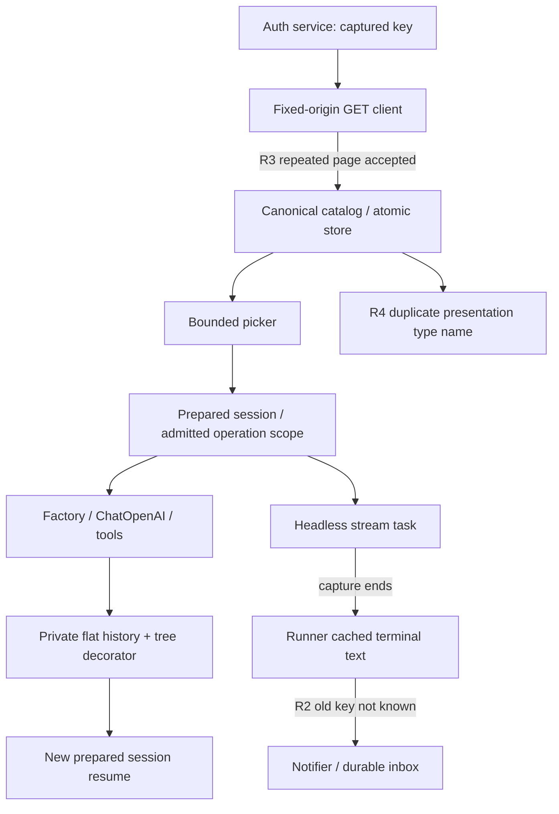
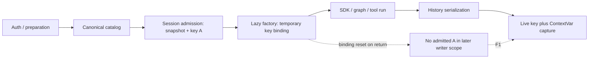
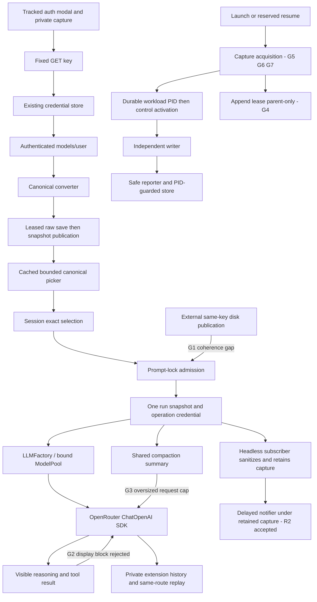
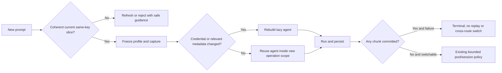

# Feature 86 — Independent final functional review

> **Current authoritative disposition:** see **“2026-10-03 — Independent A/B/C synthesis addendum”** at the end of this file. Verdict: **REVISE**. Earlier dated reviews are preserved as historical evidence; their open/closed findings and gate counts are not the current disposition.

## Latest revision — 2026-10-03, after R2/R3/R4 remediation

**STEP2 REVISE — independent whole-feature audit incomplete. Step 3 NOT RUN.**

This revision supersedes the earlier claim that R2/R3/R4 remain open. It does not supersede the historical whole-feature mapping with an approval: the requested all-shipping-file, all-42-requirement independent inspection was not completed in this call. No percentage or completion assessment is inferred from suite totals. Requested model/settings: **gpt-6-astra medium**; actual backend identity is not independently attestable here.

### Independently verified remediation

- **F1:** inspected real session/history regression assertions in `tests/agents/slo_agent/test_key_rotation_admission.py`. Fresh execution covers A admission, return from lazy readiness, effective B, actual populated history writes without A; resolver failure retains protection. The next-B test asserts two builds, so it proves rebuild, not cached reuse. Prior independent same-B reuse/cancellation probe remains historical evidence, not freshly rerun here.
- **R2:** `src/cli/headless.py:134–146` releases the lifecycle-local capture in `invoke` finally; `:412–421` obtains the operation capture and sanitizes the event before retaining/emitting it; `:852–855` binds it around delayed terminal notification. `src/auth/credential_resolver.py:91–101` accesses only the task capture, without a new credential lookup or public/persisted field. Fresh `test_openrouter_terminal_lifetime.py` exercises the actual runner's child task, real session admission/history, task exit, and actual notifier/inbox. Completed/failed × rotation/resolver failure × success/error/actual cleanup cancellation cases pass, with populated inbox/output and capture reset assertions. Concurrent handoff also passes; that case manually clears runner references and is not proof of two complete concurrent CLI lifecycles. This is synthetic terminal-payload evidence, not a live SDK disclosure claim.
- **R3:** `src/integrations/openrouter/client.py:194–219` records prior unique count and rejects a full page adding no unique rows. Fresh exact 0/500 repeated-page test refuses before offset 1000, while distinct pages accept the empty terminal page. Real refresh integration asserts unchanged snapshot and byte-identical cache after repeated/HTTP/partial failure. This closes the specific earlier repeated-full-page counterexample, not every possible pagination anomaly.
- **R4:** `src/tui/model_catalog.py:15–37,70–106` exports/constructs `ModelPickerRowDAO`; no ambiguous canonical-name alias remains there. Fresh public type/export regression passes. Canonical catalog entity is not renamed.

### Gates actually checked

Fresh command (exit 0):

```bash
ROOT=$(mktemp -d "$PWD/.f86-final-rereview-XXXXXX")
mkdir "$ROOT/home" "$ROOT/tmp"
env -i PATH=/root/.pyenv/versions/slo-harness/bin:/usr/bin:/bin \
 VIRTUAL_ENV=/root/.pyenv/versions/slo-harness HOME="$ROOT/home" TMPDIR="$ROOT/tmp" \
 SLO_HOME="$ROOT/home" SLO_AUTH_FILE="$ROOT/home/auth.json" SLO_ENV=test \
 SLO_AUTO_VISUALIZE=0 PYTHONDONTWRITEBYTECODE=1 PYTHONPATH="$PWD" \
 /root/.pyenv/versions/slo-harness/bin/python -B -m pytest -q -m 'not e2e' \
 -p no:cacheprovider --basetemp="$ROOT/tests" \
 tests/cli/test_openrouter_terminal_lifetime.py \
 tests/agents/slo_agent/test_key_rotation_admission.py \
 tests/integrations/openrouter/test_pagination_completeness.py \
 tests/integration/test_openrouter_repeated_page_retention.py \
 tests/tui/test_picker_row_identity.py --tb=short > "$ROOT/targeted.log" 2>&1
```

Actual root: `.f86-final-rereview-wj387E`. Result: **25 passed, 2 warnings in 2.73s**. Log: `.f86-final-rereview-wj387E/targeted.log`.

Independently inspected retained log tail: `docs/implementation/86-openrouter/logs/remediation-full-final-non-e2e.log`: **5045 passed, 15 deselected, 196 warnings in 353.28s**. This is the prior remediation execution, NOT a fresh reviewer full run. `git diff --check` exited 0. `dpkg -V coreutils` exited 0 without output. Black/mypy remain expressly waived, nonblocking, and were not run. No paid/live provider calls or real credentials were used. Local synthetic tests do not prove remote entitlement/availability.

### Mandatory posthook and remaining review scope

The inspected catalog refresh orchestration at `src/agents/model_catalog/service.py:763–891` still mixes lease/cache freshness, verification, conversion, reconciliation, credential checks, persistence and publication in one method. This is a **confirmed mandatory convention deviation**, not a functional failure or mypy/Black finding: hard-rules §1.3 requires single-decision named delegations, and slice 86.a.2 §7.4 explicitly prescribes discover/commit/publish separation. The earlier review classified this as nonblocking debt without an explicit waiver for that rule. This revision does not claim that classification satisfies the mandatory posthook. Minimal correction is extraction inside the existing catalog owner, preserving lease/cancellation/commit ordering and existing tests—not a new refresh service. Source/test changes are outside this reviewer mandate.

The all-requirement mapping below remains historical owner-level evidence only. Fresh inspection here was bounded to F1/R2/R3/R4 and the catalog orchestration deviation; it did **not** independently reaudit all F86-01..42. In particular, catalog TTL/coalescing/process ordering/removal/override branches, SDK policy/continuation/error matrices, mounted auth/picker, pool/resume/direct compatibility, scheduled active inbox, capture/append/reporter lifecycle, and all tracked/untracked shipping files still lack the requested complete fresh review in this call. These are **review limitations**, not new allegations that implementation or tests are absent. No exhaustive convention or lexical certification is made.

Credit retained Plan B append-lease ordering/refusal, independent-process admission, cancellation and post-durable-PID control-FD evidence. Credit shipped writer/native-I/O/kernel EBADF after launcher reap, reporter/health and unchanged workload PID/group evidence as qualified in earlier reports. None was rerun here. No native-interpreter-startup or equal-argv requirement is invented.

### Scope and safety disclosure

Read-only Git status inventoried dirty tracked and untracked paths; nothing was staged, reset, cleaned, committed or otherwise mutated through Git. Existing artifacts remain intact. No production/test/spec files changed. The six slices were read, along with review/workflow/hard-rules material, selected conventions, project research/instructions, KB entry point/gotchas and remediation/prior independent report. Not all governing sources, the complete historical ledger, remaining requirements, or shipping source/tests were reread; therefore the requested prerequisite and audit scope are incomplete. A combined context read was oversized and tool-spilled to `/tmp/slo-bash-z4hyn3_p.txt`; it was not a test write and was left untouched. Subsequent reads were bounded. Deliberate test writes were checkout-contained under the fresh root.

**Verdict:** remediation regressions pass, but independent Step 2 is not READY. Required next work is the catalog convention correction (or explicit applicable waiver) and the finite whole-feature independent audit already requested, not an invented additional acceptance matrix. **Step 3 was correctly withheld.**

---


## Current independent revision — 2026-10-03 (after F1 correction)

### 1. Stack Summary

Python 3.11, Pydantic, asyncio/ContextVar, LangChain/OpenAI Chat Completions, LangGraph, filesystem history/catalog/inbox, Typer dispatch, Textual, and POSIX capture/lease ownership. No new SQL, FastAPI endpoint, Vue, DBOS or dependency platform is involved. This is workflow Step 2 only; no completion assessment or percentage is supplied. Requested review model: **gpt-6-astra medium**; backend identity is not independently attested.

### 2. Executive Summary

**REVISE.** The original F1 session-history lifetime defect is corrected and its real session-scope/filesystem regressions pass, but the later headless terminal notification still loses the admitted credential. A second fresh executable probe establishes that repeated full discovery pages are accepted as a complete catalog; a separate explicit consolidation requirement remains unimplemented in the TUI presentation type.

This revision independently inspects current tracked and untracked producers and credits current composed tests, rather than treating historical REVISE tables or passing totals as approval. The finite requirement mapping below covers all 42 IDs at owner/contract level, with differing evidence depths stated. It is **not an assertion that every line or every test method across the entire dirty feature has been exhaustively reviewed**. No additional unspecified matrix is requested. Source/test remediation belongs to Step 1.

### 3. Feature Completeness Table

`Implemented/observed` means the named current owner and evidence support the contract, not blanket branch certification. `Partial` identifies a finding or an explicit review limitation. Test names below are repository paths, not copied baseline/capture trees.

| Requirement | Status and current evidence |
|---|---|
| F86-01 | Implemented/observed: credential enum, resolver env→store, API-key-only factory capabilities; auth module and mounted UI tests freshly pass. |
| F86-02 | Implemented/observed: `openrouter_authentication.py` captures/verifies before commit, rechecks environment, forwards evidence; fresh service/UI/full-flow tests. |
| F86-03 | **Partial — R2 security blocker**: real history capture works; delayed terminal notifier persists admitted A after rotation. Repr-hidden credential fields inspected; child/capture evidence credited separately. |
| F86-04 | Implemented/observed: `provider_for_model.py` checks qualified syntax first; exact remote suffix retained by converter/factory. |
| F86-05 | Implemented/observed: strict/pending preparation and actionable removed-route errors; fresh startup/removal flow; all direct-provider regressions are retained full-gate evidence, not freshly rerun. |
| F86-06 | Implemented/observed: dispatch explicit selection before pool parse, session clears pool; selection/full-flow tests. |
| F86-07 | Implementation/test inventory: parser plus `ModelPoolEntryDAO` route invariant; comma/JSON/object compatibility retained in full gate; not separately rerun here. |
| F86-08 | Implemented/observed: factory-created adapter and actual SDK `/chat/completions` requests in fresh composed tests; no native-provider reroute. |
| F86-09 | Implementation/test inventory: fixed headers, no Referer, explicit caching false; `test_openrouter_transport.py`; fresh integration proves transport, not every header assertion. |
| F86-10 | Implemented/observed: actual tool/result/second-request flow; fresh role/usage/text/reasoning/tool failure and cancellation barrier tests. Truncation/refusal unit evidence retained, not freshly rerun. |
| F86-11 | Implemented/observed: one typed private extension; fresh mounted NEW-session resume and active inbox assert exact private anchor/tool result; history writer tests preserve unrelated opaque data. |
| F86-12 | Implemented/observed: fixed GET client uses `/key` and `/models/user`; no public-list fallback; fresh client/full flow. |
| F86-13 | **Partial — R3 protocol blocker**: bounded reads/deadline/strict records exist; repeated-page rejection missing, fresh MockTransport reproduction. |
| F86-14 | Implemented/observed: converter explicit text/tools/context/expiry/batch checks; parameterized converter evidence present, not freshly rerun. |
| F86-15 | Implementation/test inventory: conservative output cap and image/history validation at adapter; policy/transport tests retained. |
| F86-16 | Implementation/test inventory: concrete ID filtering in converter and admission; unknown variant cannot be fabricated by factory. |
| F86-17 | Implementation/test inventory: conservative reasoning profiles and request policy; dedicated reasoning-semantic/control tests. |
| F86-18 | Implemented/observed: local RPM 20/TPM unknown distinct from remote ceilings; request requires parameters; supplied snapshots feed factory. |
| F86-19 | Implemented/observed: offline load/view/status path, lifecycle capture outside typing; fresh historical-status tests and HTTP tripwire composed test. |
| F86-20 | Implemented/observed: pending mount tracks preparation; auth refresh leaves explicit model choice; fresh mounted startup/auth tests. |
| F86-21 | Implemented/observed: router parses refresh before selection and delegates to session; current router/registry source inspected. |
| F86-22 | **Partial — R2** for terminal delivery. Headless preparation/scheduler/child owners exist; normalized HTTP400 status/inbox and one terminal event freshly pass. |
| F86-23 | **Partial — R3** at completeness input. Store/lease/atomic publication exists; fresh atomic-publication tests and actual removal publication pass. |
| F86-24 | **Partial — R3** because repeated incomplete listing can be accepted. Ordinary failed refresh preserves snapshot and timestamp via current lifecycle owner/tests. |
| F86-25 | Implemented/observed: coalesced task and subscriber count, private flock, shielded writer drain; actual run remains pinned during removal. Process tests inspected/retained, not rerun. |
| F86-26 | Implemented/observed: fingerprint checks before save/publication, one-hour freshness, A→B admission; fresh rotation and atomic-publication tests. |
| F86-27 | Implemented/observed for valid complete lists: fresh removal during actual SDK request preserves history, next prepared resume rejects. R3 threatens completeness premise, not this valid-list branch. |
| F86-28 | **Partial — R4** presentation identity consolidation. Discovery delegates to catalog; live views replace mutable projections. |
| F86-29 | Implemented/observed: raw slice separate from overrides, candidate built before persistence; fresh invalid-override/publication coverage; full override matrix retained. |
| F86-30 | Implemented/observed: casefolded ID/display matching and canonical insertion; fresh mounted flow/picker tests. |
| F86-31 | Implemented/observed: 25 candidates, height-based viewport, painted 8→3 row resize/wrap and empty cases freshly pass. |
| F86-32 | Implemented/observed: historical cold provenance distinct from checked, independent timestamps; fresh status/auth/picker tests. |
| F86-33 | Implemented/observed: ModelPool remains route owner, tools binding/safe codes retained; fresh committed-fragment tests prohibit switch; successful fallback policy tests retained. |
| F86-34 | Implemented/observed: shared explicit classifier, security signals before retry, temporary 402 needs both exact source and positive retry; dedicated error tests retained. |
| F86-35 | **Partial — R2** credential output lifetime; actual SDK raw HTTP400 normalization and committed no-replay tests freshly pass. Do not conflate ordinary secret-bearing output with normalized error bodies. |
| F86-36 | Implemented/observed: adapter SDK retries zero; pool first-chunk barrier and snapshot wait cap; fresh bounded one-request committed tests. |
| F86-37 | **Partial — R2** terminal notification. NEW-session resume, active inbox target route distinct from schedule route, admitted A wire after effective B, and removal resume freshly pass. |
| F86-38 | Retained current full log independently located: **5026 passed, 15 deselected, 196 warnings, 338.36s**. Fresh targeted results below. Black/mypy explicitly waived, not green. |
| F86-39 | Partial acceptance due R2/R3. Synthetic/local evidence is labeled; no paid/live call. Capture instrumentation qualification is credited exactly, not native interpreter-startup equivalence. |
| F86-40 | Partial: docs have syntax/precedence/evidence boundaries; status overstates cached reuse/cancellation test proof and old residuals need dated interpretation. This revision records exact counterevidence. |
| F86-41 | **Partial — R4** explicit consolidation; no SDK migration/graph/pool rewrite, new OAuth, pricing or arbitrary endpoint platform found in inspected changes. |
| F86-42 | Implemented/observed: authenticated unseeded route reaches mounted choice, real SDK tool loop and NEW-session resume; fresh full-flow test. |

### 4. End-to-End Flow Verification

```text
/auth → captured key → local /key → credential store → /models/user
      → converter → leased atomic raw slice → canonical generation
      → cached picker → exact selection → session admission
      → lazy factory → actual SDK SSE → tool → same-route private anchor
      → events.jsonl → NEW prepared session → SDK continuation       [fresh PASS]

admitted session A → lazy-build binding returns → operation scope A
      → live resolver B → real history serialization                [fresh PASS]
      → scope/task ends → runner terminal cache → notifier/inbox     [R2 LEAK]

models/user offset 0 → identical offset 500 → empty offset 1000
      → deduplicated complete response → publication eligible       [R3]
```

Additional finite traces inspected after finding blockers:

- **Catalog lifecycle:** offline `load`, cold historical timestamps, admission, coalescing, waiter cancellation, POSIX lease, save-before-swap, fingerprint rechecks, raw override separation, TTL and removal. `ModelCatalogService._write_cache_under_lease` shields/drains the writer before lease release. Fresh atomic tests and real removal composition support these paths; all process/race cases were not rerun.
- **Adapter:** per-invocation ContextVar codec reset in `finally`; complete extension emitted once after successful stream exhaustion; exact-route reconstruction; fixed normalizer/shared classifier; SDK retries zero. Fresh session/SDK tests assert exactly one request after role, usage, text, reasoning or partial tool chunk, including cancellation.
- **Picker/auth/status:** fresh painted small-terminal/resize/navigation/startup cases; current service checks A→B/A→store environment drift before verified handoff. Fresh mounted post-save Back cancellation retains saved credential and returns to provider selection.
- **Headless/scheduler:** actual normalized HTTP400 produces populated terminal status and notifier inbox with positive ordinary markers and exactly one parent terminal event. Active schedule/inbox composition uses a distinct schedule-only route but both actual SDK requests retain the mounted target route, A authorization after effective B, exact private anchor and tool result. It does not prove arbitrary old-key terminal serialization (R2).
- **Capture/Plan B:** actual launch writes durable PID before endpoint activation (`launch_tool.py:343–344`); command resume calls durable relaunch before `ownership.activate` (`workflow_registry.py:1348–1354`). Inspected `test_capture_contained_lifetime.py:137–183` asserts reaped launcher, native kernel EBADF, fresh handle/status health, unchanged live workload PID/PGID and redacted nonempty captures. Qualification helpers check shipped writer/reporter bodies and native IO; no literal argv-equality requirement is imposed. Inspected append ordering test (`test_capture_writer.py:502–553`) asserts exact `old-tailnew-first-byte`; bounded refusal leaves capture absent; `test_relaunch.py` independently launches two admission processes and asserts one workload, and separately cancels an actual waiting append acquisition before workload spawn. These are inspected existing assertions/retained execution evidence, **not fresh process executions in this review**. No stale “unwired” or “Plan B absent” finding is made.
- **Private persistence:** tree store is a decorator over flat `events.jsonl`, not a separate current `tree.json` serializer. Event append, metadata, transcript and rewrite use the resolver sanitizer at `filesystem_store.py:621,779,791,1137`. Worker-thread calls inherit context. Fresh writer tests cover rewrite/private-extension equality and ordinary event persistence; no credential DAO/public DTO field was added by F1.

### 5. Unit Tests Assessment

Fresh results are not summed with historical gates as coverage proof:

| Partition/probe | Result | Evidence |
|---|---|---|
| Session admission/F1 + resolver binding + real history writers | **26 passed, 2 warnings** | `.f86-step2-review-svgLBF/f1.log` |
| Four composed integration modules | **18 passed, 17 warnings** | `.f86-step2-composed-U4oieh/composed.log` |
| GET client, committed session stream, atomic publication, historical status, auth service | **45 passed, 12 warnings** | `.f86-step2-contracts-boPT05/contracts.log` |
| Mounted auth, viewport, picker, pending startup | **26 passed, 2 warnings** | `.f86-step2-ui-ytgvmn/ui.log` |
| Real session scope + history + headless event cache + terminal notifier | Exit 0 **reproduces defect**, not acceptance green | `.f86-step2-review-svgLBF/terminal-probe.log` |
| MockTransport repeated-page probe | Exit 0 **reproduces defect**, not acceptance green | `.f86-step2-review-svgLBF/repeated-page.log` |
| Actual cached reuse + task cancellation/reset probe | Exit 0, passing assertions | `.f86-step2-review-svgLBF/f1-remaining.log` |

**F1 verdict:** original history-owner defect fixed. Existing new test rotates A→B after `_ensure_agent_ready()` and writes A through actual session/FilesystemSessionHistoryStore without a manually maintained build binding. Resolver-failure variant also succeeds. The named “reused agent” test actually asserts `build_count == 2`, correctly rebuilding after A→B but not proving reuse. The additional fresh probe proves a subsequent same-key B run reuses one actual agent/build, redacts B, and real `Task.cancel()` restores ContextVar, admitted credential and running state. Existing concurrent binding test passes. The production `finally` is correct for this scope; it does not transfer capture to the parent headless task.

**Required regression additions are finite:** R2 completed/failed terminal notification after stream-task exit with A→B and resolver failure; R3 repeated full page rejection with unchanged cache/generation/time; R4 presentation type/compatibility alias identity. Preserve private continuation exactness and positive populated artifact controls. No generic matrix is demanded.

The current whole-suite log is `docs/implementation/86-openrouter/logs/f1-full-non-e2e-2026-10-03.log`, not the historical 5021 log. Its tail was independently read; the full suite was **not rerun** here. Broad counts cannot invalidate the two fresh counterexamples. The 15 E2E deselections remain outside the offline gate; no real key, authenticated live discovery or paid inference was used.

### 6. Convention Adherence and Mandatory Posthook

Hard-rules checklist applied to the inspected Python/CLI/TUI/agent changes; SQL/Vue/DBOS sections are not applicable. Named inputs/types/docstrings are present on principal new public owners; SDK overrides retain third-party signatures. No new graph topology or SQL router namespace is required. The spec explicitly owns preparation in session and refresh in catalog; requiring a new generic gateway would violate that ownership.

**Explicit nonblocking waiver:** Black and mypy failures are waived for Feature 86 by the current user request. Neither is a blocker and neither is described as globally green. Existing retained logs report global Black five paths and mypy 271 diagnostics/45 files; no fresh static run was made.

Posthook findings beyond formatting: the catalog refresh method `service.py:763–891` remains a long multi-decision orchestration instead of the prescribed discover/commit/publish helper shape; adapter codec internals use broad `Any` (`openrouter.py:296–297,333`) beyond SDK override boundaries. These are recorded convention debt, not independent functional counterexamples or a disguised mypy blocker. Public docstrings are often short rather than complete Args/Returns/Raises. The explicit duplicate presentation type is a specification/consolidation gap **R4**, not merely a stylistic preference. The hard-rules pass is therefore not clean. A full every-call-site convention certification was not completed.

### 7. Ubiquitous Language Audit

| Concept | Trace / result |
|---|---|
| `model_name` | canonical qualified identity through config/session/history/picker; remote `api_model_name` converted only at wire boundary. |
| `provider` | OpenRouter credential/transport owner regardless of author; classifier/pool use it. |
| `credential_fingerprint` | private catalog provenance, distinct from verified/checked public timestamps. |
| `safe_error_code` | route audit field; persisted legacy `error_message` receives code deliberately for compatibility. |
| `ModelCatalogEntryDAO` | **R4:** two different types still claim this name; presentation row was explicitly required to consolidate/rename. |
| build versus operation capture | `bind_operation_credential` extends lifetime while compatibility build binding delegates; `_build_credential` private variable name remains historical. No new persistent secret owner. |

### 8. Findings Summary — Three Tiers

#### Glaring Gaps (must fix)

**R2 — High/security: delayed headless terminal output loses admitted-key protection.**

- **Requirements:** F86-03, F86-22, F86-35, F86-37; 86.a.6 §7.2 and 86.a.4 §7.6–7.8.
- **Locations:** `src/agents/slo_agent/sessions/service.py:2517–2523` ends/clears capture; `src/cli/headless.py:491–493` creates the stream task, `:403–404` caches/emits raw terminal content, `:224` notifies after it ends, `:827–840` forwards cached content; `src/agents/slo_agent/orchestrator/notifier.py:217` knows only current/context credential.
- **Mechanism/repro:** admit A, return from lazy build, rotate effective resolver to B, write A-bearing terminal text. Real session history correctly redacts A. Stream task ends; ContextVar does not propagate backward to parent, and has reset anyway. Runner terminal notification serializes the same cached text with B only: actual inbox JSON contains A. `.f86-step2-review-svgLBF/probe_terminal_lifetime.py` invokes shipped session scope/lazy readiness/history and shipped runner `_emit`/`_notify_terminal` with actual inbox persistence; it does not manually bind credentials around notification. Output also shows A in headless JSONL. This is a seam composition with synthetic terminal payload, not a claim that the local SDK spontaneously disclosed a key.
- **Impact:** protected terminal synthesis/failure content can persist the admitted credential outside the credential store; with resolver failure terminal notification can instead be silently dropped. Existing `test_notifier.py:266,304` holds a manual build binding during writing and cannot certify the runner lifetime.
- **Minimal correction:** sanitize retained/public terminal material while the real admitted operation context is available, or carry the existing private operation capture to the actual terminal owner until notification finishes. Do not add a global key archive, public credential field, arbitrary raw-body FD filter, or alter private continuation. Cover completed and failed notifications after child-task exit, resolver rotation/failure, and reset/cancellation with populated inbox/stdout assertions.

**R3 — High/correctness: repeated full catalog page can become complete discovery.**

- **Requirements:** F86-13, F86-23, F86-24; 86.a.1 §7.2 explicitly rejects repeated pages; overview §7.2/7.4.
- **Locations:** `src/integrations/openrouter/client.py:125–138`, `:194–213`; `src/agents/model_catalog/openrouter.py:40–46` marks converted response complete.
- **Mechanism/repro:** unpaged response declares `next`; offsets 0 and 500 return the identical 500 rows without total; offset 1000 returns empty. `_append_page_records` silently skips every duplicate, loop advances by 500 regardless of progress, terminal short-page validation accepts absent total, returning 500 rows as complete. Fresh `probe_repeated_page.py` asserts exactly those four local requests and successful 500-row return.
- **Impact:** an incomplete/repeating provider response can be published as authoritative membership and remove last-good models, contrary to failure-preserves-cache semantics. Time/byte caps bound resource use but do not establish completeness.
- **Minimal correction:** reject repeated full pages/no-progress pagination in the GET owner while retaining valid equal boundary-row deduplication. Add a local repeated-page failure and a catalog-level assertion that old bytes/generation/success time remain unchanged. No retry/discovery owner is needed.

**R4 — Medium/mandatory consolidation: presentation entity retains canonical catalog type name.**

- **Requirements:** F86-28, F86-41; overview §7.10, 86.a.5 §7.1 and 86.a.6 §7.4 explicitly require removal or `ModelPickerRowDAO` rename.
- **Locations:** `src/tui/model_catalog.py:24–37,70–78` defines and constructs a second `ModelCatalogEntryDAO`; canonical entity remains `src/agents/model_catalog/dao.py:213`.
- **Mechanism/impact:** live view correctly delegates data to the catalog, but its different three-field presentation class still claims the canonical entity name. The implementation ledger's test annotation repair already distinguishes these two types. This is a confirmed incomplete named consolidation, not a claim of a second persisted catalog.
- **Minimal correction:** name the presentation-only class `ModelPickerRowDAO`, update consumers, and retain a documented alias only if existing public imports require compatibility. Test alias identity rather than maintaining two entities.

#### Nice-to-Haves (should fix)

- Remove duplicate `@staticmethod` at `test_key_rotation_admission.py:93–94`; harmless in current execution, obscures intent.
- Correct F1 evidence prose: A→B test is rebuild, not reuse; RuntimeError reset test is not cancellation. This reviewer supplied bounded fresh probes, but retained automated tests should state exactly what they prove.
- Reconcile dated documentation pointers after remediation; do not delete historical failures or describe instrumented shipped-body capture as native startup equivalence.

#### Temporary Shortcuts / acknowledged debt

- Global Black/mypy baseline is expressly waived and nonblocking.
- Long catalog orchestration and broad internal `Any` remain convention debt described above; no clean hard-rules certification.
- Capture/OS admission existing assertions were inspected, not freshly executed. Direct-provider full regressions are retained gate evidence. No live provider/entitlement claim.

### 9. Architecture Diagram



### Exact execution record and safety limits

All pytest commands used the existing `/root/.pyenv/versions/slo-harness/bin/python -B`, fresh checkout-owned roots made with `mktemp -d "$PWD/.f86-step2-…-XXXXXX"`, private HOME/SLO_HOME/auth/TMPDIR, `env -i PATH=/usr/bin:/bin`, `SLO_ENV=test`, `SLO_PLUGINS_DISABLED=1`, `SLO_AUTO_VISUALIZE=0`, `PYTHONDONTWRITEBYTECODE=1`, `PYTHONPATH="$PWD"`, and `-q -p no:cacheprovider --basetemp="$ROOT/tests"`. Outputs were redirected only under those roots. No PATH file was changed/stubbed, system binary written, installation, external network or live credential used.

Exact pytest selections:

```text
tests/agents/slo_agent/test_key_rotation_admission.py tests/auth/test_credential_build_binding.py tests/agents/slo_agent/history/test_openrouter_writer_secrecy.py
tests/integration/test_openrouter_full_flow.py tests/integration/test_openrouter_key_rotation.py tests/integration/test_openrouter_final_compositions.py tests/integration/test_openrouter_scheduled_preparation.py
tests/integrations/openrouter/test_client.py tests/agents/providers/test_openrouter_session_commit.py tests/agents/model_catalog/test_atomic_publication.py tests/agents/model_catalog/test_historical_status.py tests/auth/test_openrouter_authentication.py
tests/tui/authentication/test_openrouter_authentication.py tests/tui/test_picker_viewport_acceptance.py tests/tui/test_openrouter_picker.py tests/tui/test_openrouter_startup.py
```

The three standalone probes were executed with the same isolated environment and `python -B "$ROOT/<probe>.py"`; their full source and logs remain in `.f86-step2-review-svgLBF`. Each real persistence target is rooted under that newly owned directory. `git diff --check` passed. Only read-only Git status/diff commands were used; no stage/commit/push/merge/rebase/reset/clean/worktree operation occurred. Actual untracked source/tests were included; hundreds of baseline/capture/scratch copies were not treated as shipping source or deleted.

Reading limitations are explicit: the supplied project/global instructions and research were available; review/workflow/mandatory convention skills, immutable request/index/overview and engineering contracts were consulted, along with requested KB pages. Reading was not perfectly ordered; some required context was loaded after initial F1 inspection. One oversized combined convention read was tool-truncated and the tool automatically spilled to `/tmp/slo-bash-iy7oonbc.txt`; this was not an intentional test write and was not removed. The full historical implementation ledger and every historical residual were not read line-by-line. This revision makes no claim otherwise.

**Must-fix code:** R2, R3, R4. **Required tests:** exact finite regressions above. **Product decisions:** none invented; static waiver accepted. **Documentation:** retain historical report below and update current verdict pointers. **Outstanding review scope:** exhaustive per-function/per-test convention and decision-path certification across all dirty producers is not complete; therefore even after fixes this artifact is not a substitute for the final independent pass. No Step 3 executed.

**STEP2 REVISE**

---

## Historical report retained unchanged below

Date: 2026-10-03

## Summary and verdict

**REVISE — NOT FULLY REVIEWED. Functionality is not approved by this review.**

The inspected current source contains a concrete operation-lifetime gap in session-owned credential redaction (F1 below). A bounded in-memory execution confirms the redactor's behavior; the complete session-to-filesystem failure was not executed. Independently, this review did not finish the requested whole-feature source/test audit and cannot substitute retained worker evidence for that work. No numerical completion assessment or workflow Step 3 was performed.

Review dispatch context supplied for this task: `gpt-6-astra`, reasoning `medium`; no backend attestation is asserted.

## Scope and independent methodology

Worktree: `/root/Code/slo-openrouter-implementation/slo`.
Read-only Git confirmed branch `feature-86-openrouter-implementation` and HEAD `f63df0a4958eedb4bc603f1946ba4591dd181fff`.

The initial `git status --short` inventoried tracked modifications and actual untracked producers, including `src/agents/providers/openrouter.py`, `src/auth/openrouter_authentication.py`, `src/agents/model_catalog/openrouter.py`, `src/integrations/openrouter/`, `capture_writer.py`, and the substantial untracked test set. Untracked production/tests were not excluded as generated artifacts. Generated baseline/test trees were neither deleted nor reclassified.

Read the workflow and review-feature-code instructions, always-on named-argument/type, declarative-method, docstring and test-verification guidance, and part of the hard-rules checklist. Confirmed project, personal, and installed skill roots exist; consulted installed agent-test guidance. Personal skills were inventoried, not modified. Read KB Welcome, Slo README and relevant gotchas read-only. Reviewed all six engineering contracts in full and the opening 240 lines of the overview. Repo/global instructions and research were consulted; a combined actual-file read exceeded tool output limits, so that command does not establish complete reading. The request, dependency index, remaining overview, all applicable layer skills, and all historical evidence were **not** fully read. Latest implementation-log/status entries and the exact-entry, takeover-call4 and final-corrective reports were inspected. These prerequisite and coverage limitations are explicit reasons this is not a completed final audit.

Actual source inspection concentrated on route ownership, authentication, catalog admission, session credential admission/build/run lifetime, resolver redaction, history serialization, and capture writer/reporting. Actual test assertions inspected include history writer rotation and SDK/session key rotation. No production/test/spec/KB/skill/historical evidence was edited; only this permitted artifact was written. No workflow, subagent, commit, staging, reset, cleanup, installation, or external request was performed.

## Static-gate waiver and retained debt

The user's explicit waiver is accepted: Black/formatting and mypy failures alone do not block functional approval. It does not waive behavioral failures, missing mandatory acceptance, security, or test skips.

Retained latest evidence reports:

- Feature scope: **155 actual Python paths**, Black clean and mypy clean. Independently counted 155 manifest lines and read `Success: no issues found in 155 source files` in `.f86-step1-retained-static/mypy.log`. Its Black log yielded no output when tailed; the 155-clean Black result is retained ledger evidence, not a fresh reviewer check.
- Global Black: **5 would reformat / 628 unchanged**. Debt paths: `config/timeout_resolver.py`, `tests/agents/providers/test_openai_codex.py`, `tests/agents/slo_agent/orchestrator/test_spawn_tool.py`, `tests/cli/test_release_automation.py`, `tests/cli/test_install.py`.
- Global mypy: **271 errors in 45 files / 633 checked**, as recorded by the latest ledger; not freshly executed or independently diagnostic-by-diagnostic validated here.

No global-static-green claim is made. F1 is behavioral and independent of this waiver.

## Requirements and flow assessment

These are bounded observations, **not** sign-offs for unexamined branches.

| Area / contract | Current independent observation | Review disposition |
|---|---|---|
| Exact routing/direct-provider compatibility — 86.a.1 | `provider_for_model.py` handles qualified OpenRouter routes before catalog/direct prefixes; preserves exact suffix and validates syntax. Direct prefix fallback remains. | Source inspected; full regression/grammar matrix not independently audited. |
| Credential precedence, races, cancellation — 86.a.1/a.5 | Resolver owns env→store→legacy, with no OpenRouter legacy lane. Auth service captures candidate/environment, verifies before save, rechecks environment, forwards evidence, and records saved-state cancellation. | Service source inspected; mounted cancellation and full race tests not audited. |
| Catalog purity/provenance/TTL/removal/atomicity/concurrency — 86.a.2 | Current admission and method inventory inspected, including fresh evidence, refresh and stale fallback. | NOT FULLY REVIEWED; no complete store/lease/publication path audit. No new catalog defect asserted. |
| Session snapshots, key admission, pools/resume — 86.a.4 | Admission retains credential and snapshot; factory binding uses retained credential; key-fingerprint change invalidates agent. | F1 concerns serialization lifetime, not SDK key binding. Pool/resume full matrix not audited. |
| Adapter tools/streaming/commit/error/private continuation — 86.a.3 | Current adapter identified, not completely traced. | Retained synthetic evidence credited as prior evidence only; no independent approval. |
| Auth/picker/status — 86.a.5 | Authentication owner inspected; current cold-status correction evidence read. | Picker/paint/search/status branches not independently audited. |
| Scheduler/headless/active inbox — 86.a.4/a.6 | Latest composed removal/resume and duplicate-terminal correction evidence read. | Reports are not a substitute for source/test assertion audit; NOT FULLY REVIEWED. |
| Rotation and resolver-failure secrecy — F86-03/35 | Current history redactor depends on a ContextVar scoped only around lazy build; history test manually supplies a longer binding. | **F1: confirmed local lifetime defect, full composed impact source-traced rather than executed.** |
| Child/capture lifecycle — 86.a.4/a.6 | Current standalone writer drains independently, reads activation control, waits for adoption/EOF on failure, and invokes isolated reporter. | Do not repeat historical “capture unwired.” Complete FD/cancellation/adoption/lease audit not finished. |
| Plan B / process exclusivity | Later ledger reports append lease/drain/reap, wait/refusal/cancellation and two-process admission coverage. | Not independently certified; not called absent. |
| Global behavioral gate — 86.a.6 | Read actual final retained log tail: 5021 passed, 15 deselected, 201 warnings, 338.59s. | Prior execution only; no fresh suite run. |



Canonical vocabulary inspected: `model_name` is Slo route, `api_model_name` is remote ID, and `provider` is credential/transport owner. No synonym finding is asserted from this bounded sample. Full convention/hard-rules post-hook remains incomplete; no blanket compliance claim is made.

## Findings

### F1 — Confirmed bug: admitted session credential is not retained in the history-redaction scope

**Priority:** blocking security/lifecycle defect. **Category:** confirmed local bug with source-traced integration impact; full session reproduction not executed.

**Requirement:** 86.a.6 §7.2 and §9 (F86-03/F86-35) require secret absence across history and public artifacts. The requested review explicitly includes operation-owned A→B rotation and resolver-failure protection. 86.a.4 §7.3 pins the admitted run while future boundaries adopt changes. This finding does not require provider-generated content to normally echo a key: it addresses the existing protected writer's specified behavior when secret-bearing diagnostic/content reaches it, precisely the case the current writer test exercises.

**Current locations:**

- `src/agents/slo_agent/sessions/service.py:4074–4082`: capture and retain admitted credential; invalidate agent on fingerprint change.
- `src/agents/slo_agent/sessions/service.py:4143–4152`: reuse returns immediately; otherwise `bind_build_credential` encloses only `_build_agent()`.
- `src/auth/credential_resolver.py:62–66`: binding resets on context exit.
- `src/auth/credential_resolver.py:79–90`: serialization redacts only current effective credential plus the ContextVar capture.
- `src/auth/credential_resolver.py:111–118`: resolver failure without that capture refuses serialization.
- `src/agents/slo_agent/history/filesystem_store.py:779–785,787–795`: metadata/event writers serialize through that redactor and then write its result. Transcript uses the same seam at line 621.
- `src/agents/slo_agent/sessions/service.py:2502–2521`: run scope owns lock/state cleanup but no corresponding credential binding.

**Causal path:** admit key A → build SDK under A → leave/reset build binding → SDK/history run continues → effective key rotates to B → writer gets text containing admitted A → redactor knows only B and returns A verbatim → event writer persists that line. The session still holds A, but the serialization seam never receives it. If resolution raises instead, the writer refuses despite the session retaining a valid admitted capture. Existing-agent reuse never enters the build binding at all.

**Observed bounded evidence:** executed the three current resolver method ASTs, unchanged, in memory with synthetic credential objects and an isolated ContextVar. Inside the build scope A redacts. After scope exit with effective B, A remains unchanged. With a synthetic resolver exception after exit, the fixed serialization-refused exception is raised. Exit 0 means the assertions reproduced these behaviors; it is **not** a passing acceptance test.

**Coverage discrepancy:** `tests/agents/slo_agent/history/test_openrouter_writer_secrecy.py:99–118` manually holds `bind_build_credential(A)` around every append/transcript/metadata write. That proves the utility with a test-owned lifetime, not the session's actual lifetime. `tests/integration/test_openrouter_key_rotation.py:92–96` returns ordinary `local answer`; its artifact scans at lines 203–219 verify absence without putting the old key into a post-rotation writer payload. Its actual A/B wire assertions are valuable and not invalidated; they do not close F1.

**Minimal compliant correction:** use the existing session-owned admitted credential at the protected serialization boundaries through terminal persistence/cleanup, including reused-agent runs. Keep scope task-local and reset it safely on cancellation; do not introduce a global secret registry or weaken fail-closed unbound behavior. Add one real session/history test that rotates A→B after admission, supplies an A-bearing post-rotation writer payload, and checks populated artifacts without test-owned credential binding. Add the resolver-failure variant, asserting both safe persistence semantics and unchanged unrelated opaque continuation. No remediation was performed here.

### R1 — Review limitation, not a newly alleged product bug

**Category:** unverified mandatory acceptance / incomplete independent audit.

The requested complete review of every major owner, actual assertions and hard-rules pass was not finished. Areas explicitly marked NOT FULLY REVIEWED above must be audited before final functional approval. This is not a request for an unlimited test matrix, nor a claim that existing Plan B, capture, inbox, removal, or continuation acceptance is missing. Existing finite evidence must be inspected before deciding whether further tests are necessary.

### Nonblocking maintainability / optional improvement

No additional finding is asserted. Historical status documents contain superseded residuals; their dates and later corrections must remain visible. No historical document was changed.

## Executed commands and results

Only read-only Git operations and read-only file exploration were used, except writing this artifact. Git commands actually executed:

```text
pwd
git status --short
git rev-parse HEAD
git branch --show-current
git diff --check
git status --short -- docs/implementation/86-openrouter/independent-functional-review-final.md
```

Results: expected cwd/branch/HEAD; extensive pre-existing dirty/untracked state preserved; `git diff --check` exit 0, no output; artifact path initially absent from status. File reads used `read`, `grep`, `ls`, and bounded `sed`, `tail`, `wc`, `cat`. One initial oversized combined Bash read was tool-truncated and automatically spilled to `/tmp/slo-bash-1ubwjihw.txt`. No manual `/tmp` redirect was used; that tool-created spill was not edited/deleted. This is disclosed rather than treated as fully compliant bounded reading.

Fresh functional probe command:

```bash
PYTHONDONTWRITEBYTECODE=1 /root/.pyenv/versions/slo-harness/bin/python -I -B - <<'PY'
import ast
from pathlib import Path
from contextlib import contextmanager
from contextvars import ContextVar
from typing import Optional, Iterator
from types import SimpleNamespace
from urllib.parse import quote
import json
import sys
print('Python', sys.version.split()[0])
path = Path('src/auth/credential_resolver.py')
source = ast.parse(path.read_text())
owner = next(n for n in source.body if isinstance(n, ast.ClassDef) and n.name == 'CredentialResolver')
names = {'bind_build_credential', 'redact_openrouter_text', '_resolve_openrouter_credential_for_redaction'}
owner.body = [n for n in owner.body if isinstance(n, (ast.FunctionDef, ast.AsyncFunctionDef)) and n.name in names]
module = ast.Module(body=[ast.ImportFrom(module='__future__', names=[ast.alias(name='annotations')], level=0), owner], type_ignores=[])
ast.fix_missing_locations(module)
ns = dict(contextmanager=contextmanager, ContextVar=ContextVar, Optional=Optional, Iterator=Iterator, CredentialDAO=SimpleNamespace, ProviderName=SimpleNamespace(OPENROUTER='openrouter'), json=json, quote=quote)
exec(compile(module, str(path), 'exec'), ns)
resolver = ns['CredentialResolver']
resolver._build_credential = ContextVar('review_capture', default=None)
a = SimpleNamespace(provider='openrouter', access_token='synthetic-review-A')
b = SimpleNamespace(provider='openrouter', access_token='synthetic-review-B')
resolver.resolve = classmethod(lambda cls, *, provider: b)
with resolver.bind_build_credential(credential=a):
    assert resolver.redact_openrouter_text(text=a.access_token) == '[REDACTED]'
assert resolver.redact_openrouter_text(text=a.access_token) == a.access_token
print('PASS: production redactor protects A inside build scope; A remains verbatim after scope exits and effective key is B.')
def fail(cls, *, provider):
    raise ValueError('synthetic resolver failure')
resolver.resolve = classmethod(fail)
try:
    resolver.redact_openrouter_text(text='ordinary terminal content')
except ValueError as exc:
    assert str(exc) == 'OpenRouter credential resolution unavailable; serialization refused.'
    print('PASS: after build scope exits, resolver failure refuses serialization despite the formerly admitted A.')
else:
    raise AssertionError('Expected refusal')
PY
```

Exact output, exit 0:

```text
Python 3.11.7
PASS: production redactor protects A inside build scope; A remains verbatim after scope exits and effective key is B.
PASS: after build scope exits, resolver failure refuses serialization despite the formerly admitted A.
```

This imports no project modules, does no credential lookup, network, filesystem writes, child spawn or cleanup. It is an isolated behavioral probe, not pytest and not full production composition. No fresh pytest, Black or mypy run was performed.

## Prior evidence and limitations

Independently read `.f86-step1-selection-full-final/full.log` tail: **5021 passed, 15 deselected, 201 warnings in 338.59s**. This is prior execution, not this reviewer's fresh run. The ledger identifies the 15 deselections as E2E-marked cases; no live OpenRouter or paid inference validation occurred. Synthetic HTTP/SSE tests do not establish live availability/entitlement. The prior intermittent selection failure did not reproduce in the reported predecessor/repetition runs; no root cause or selection fix was established, and green reruns do not prove intermittency impossible.

The retained launcher-reap → native EBADF → isolated reporter evidence is explicitly qualified by test instrumentation executing shipped bodies. It is not native interpreter-startup equivalence. Argv equality is not introduced as a product requirement. Plan B and OS-process contention are not called absent. Neither those reports nor this bounded source inspection constitute complete capture lifecycle certification.

## Conclusion

**REVISE.** F1 requires an operation-owned serialization lifetime correction and a composed regression. The broader requested independent audit remains **NOT FULLY REVIEWED**. The static waiver is fully honored and is not a blocker. This artifact approves neither final functionality nor whole-feature completion. Only this review artifact was changed; no implementation-log pointer was needed.

---

## 2026-10-03 — Independent A/B/C synthesis addendum

### Authority, executive summary, and scope

**REVISE. This is the current consolidated Step 2 disposition, not a Step 3 completion assessment.** The three section reports identify real additional defects at connected boundaries. Independently inspected shipping source supports stale warm-process catalog admission, rejection of the adapter's own visible reasoning on live continuation, illegal compaction output budgets, and incomplete capture-resource ownership. These are not refuted by the retained **5047 passed, 15 deselected** gate. Formatting and mypy alone are waived; functional, security, explicit product-contract, and mandatory declarative requirements are not.

**F1, R2, R3 and R4 remain accepted for their corrected boundaries.** The catalog refresh lifecycle extraction is also credited. No stale control-FD-unwired finding, native interpreter-startup equivalence requirement, or literal argv-equality gate is reinstated. The current capture findings concern different, source-visible lifetime branches.

This synthesis maps **every F86-01–42** and all six engineering slices, but does **not** certify every shipping function/test branch or complete prerequisite reading. Evidence depth is explicit below. In particular, the full historical documentation/log corpus, every ancillary convention example, and every dirty/untracked producer were not read line by line. That requested exhaustive scope remains incomplete; neither the section reports nor this synthesis may be represented as exhaustive approval. No item is promoted from a report's assertion alone to independently inspected acceptance.

**Stack:** Python 3.11/Pydantic, asyncio/thread/ContextVar, httpx, LangChain/OpenAI SDK, LangGraph, filesystem catalog/history/inbox, Typer, Textual and POSIX capture/lease ownership. SQL/FastAPI/Vue/DBOS rules do not apply. The feature's specific fixed-origin, no-retry GET contract overrides generic client examples that log bodies or retry. Product CLI conventions do not require inventing a Make verb or Command class. Existing session/catalog/factory owners must remain owners.

**Inputs actually read:** exact repository `skills/design-and-analysis/workflows/code-test-review.md` and `review-feature-code/SKILL.md`; full immutable `request.md`, `overview.md`, `task-dependency-index.md`, and all six `86.a.1`–`86.a.6` documents at `/root/Code/specifications/projects/slo/specifications/86-openrouter-intergration`; supplied AGENTS/SLO/CLAUDE/docs research plus root RESEARCH; full section A/B/C reports and prior consolidated report; current status/log/remaining-requirements opening revisions; remediation, exact-entry qualification/retry, final corrective and takeover reports. KB Welcome, Slo README (there is no `slo/index.md`), relevant gotchas, architecture, authentication, pool and F86 status were consulted. KB's old 67-failure/no-waiver statement is historical, not current authority. Named-input/types, declarative/docstrings/test policy, client/application-service, ubiquitous language and mandatory hard-rules material were consulted; product CLI/Textual guidance was partially read. Combined oversized reads truncated and tool-spilled output, so those reads do not establish complete reading of their omitted portions.

**Preservation:** read-only Git inventory included real untracked code/tests (adapter, converter, client/auth, capture writer and integration tests), not just tracked diff. Existing scratch artifacts were not treated as shipping implementations and were not deleted. Only this consolidated report was intentionally edited. No source/test/spec, section report, KB, credential, system/PATH file or Git state was modified. No stage/commit/push/reset/clean/rebase/worktree, network, live provider, installation or process experiment occurred. Tool-managed oversized-read spills under `/tmp/slo-bash-*` were left untouched; they are a disclosed tool side effect, not deliberate test writes.

### Evidence terminology

- **S** — this synthesizer inspected the named current source branch/call chain.
- **T** — this synthesizer inspected current test assertions, but did not execute them.
- **R** — retained section-report or execution evidence; not independently re-executed or fully reinspected here.
- **Implemented (bounded)** — named behavior supported within that evidence scope, not universal acceptance.
- **Partial** — concrete correction or specifically unverified acceptance remains. Unverified does not mean absent.
- **Missing artifact** — a required file/delivery artifact is actually absent.

No fresh pytest, Python probe, formatter or mypy ran in this synthesis. Section A/C's source-extracted probes are **retained reviewer evidence**, not new synthesis reproductions and not full production topology tests. Fresh `git diff --check` exited 0; this is tracked whitespace evidence only.

### 1. Adjudication of the section findings

#### G1 — High: warm admission combines fresh disk evidence with stale membership/capabilities (A1 accepted)

**Where:** `src/agents/model_catalog/service.py::_prepare_openrouter_admission` around 373–384; `sessions/service.py::_prepare_run_snapshot` around 4062–4086. **Contract:** overview §§7.4–7.5; a.2 §§7.3–7.4; a.4 §7.3.

A warm process obtains `snapshot = cls.load()` from memoized state, reads a newer disk slice, checks membership in the former and freshness in the latter, then returns the former. A complete same-key external publication removing X or lowering its cap therefore need not affect the next admission. Session's correct per-run pinning subsequently pins stale data; equal credentials cannot detect a same-key metadata update. This is not R3 and not a missing fetch retry.

**Independent validation:** S, exact fast-return branch and session adoption inspected. T: process-ordering test is two **explicit refresh** owners; same-process removal composition changes the global snapshot itself. Neither exercises warm P after Q replaces disk. A's unchanged-AST probe is R only.

**Correction/test:** existing catalog owner must build/validate/adopt one coherent current same-key durable candidate before the fast return, preserving last-good failure and already-admitted snapshots. Real-store external-writer removal and cap-change cases must prove next admission rejects/adopts without gratuitous HTTP, old run/history remains intact, and overrides stay read-time restrictions.

#### G2 — High: live tool continuation rejects the adapter's own visible reasoning (B1 accepted)

**Where:** `providers/openrouter.py::_get_request_payload`, `_validate_message_modalities`, `_validate_message_block`, `_project_visible_reasoning` (approximately 403–480, 843–855); `slo_agent/agent.py:622`; `graph/service.py::_make_agent_node`. **Contract:** overview §7.7; a.3 §§7.3–7.4.

Inbound plaintext reasoning/summary becomes `type="reasoning"` content. The actual agent appends the resulting AIMessage to live accumulated messages. Graph passes those messages onward unchanged for OpenRouter; outbound modality validation accepts text and eligible images only, rejecting that reasoning block before request two. History reconstruction is not part of this live loop.

**Independent validation:** S across projection → accumulated message → graph → validator. T: mounted full flow uses encrypted-only details; fragment test explicitly replaces `assistant` with projector replay before request two. Single-response visible-reasoning/truncation tests do not cover the missing live second request. No fresh runtime reproduction is claimed.

**Correction/test:** project a detached outbound assistant message at the existing adapter/codec boundary, preserving ordinary answer/tool fields and exact same-route private extension while removing internal display-only thinking from wire content. Do not accept arbitrary user/tool reasoning as a supported modality, mutate caller messages, stringify reasoning into answers, or delete signatures. Real session/SDK streaming raw-reasoning+tool and summary+tool cases must complete two requests without projector substitution; include nonstream continuation, different-route stripping and image rejection regression.

#### G3 — High: compaction asks for 16,384 tokens regardless of admitted route cap (B2 accepted)

**Where:** `compaction/compacter.py::_invoke_llm_summary:508–560`, `compaction/constants.py::RESERVED_TOKEN_LIMIT`; `graph/service.py::adapt_chatgpt_backend_request`; `base.py::_openrouter_output_ceiling`; adapter invocation validation. **Contract:** overview §7.5 explicitly includes compaction output caps; a.2 §7.6; a.4 §7.3.

The shared summary seam unconditionally supplies `max_tokens=16384`. Non-Codex adaptation returns it unchanged. OpenRouter correctly enforces the pinned reported-or-4096 ceiling, also bounded by half context. Thus an eligible absent-ceiling route fails a real summary request locally; passing the snapshot only to context-capacity calculation does not fix output policy. Pools receive the same oversized value, including smaller-cap fallback members.

**Independent validation:** S across all these call sites. Retained compaction/history fixtures are not proof of an actual legal summary wire request.

**Correction/test:** bound the summary reserve by the pinned selected lane's effective output policy, recomputed per pool member at fallback. Keep direct-provider/Codex policy and strict explicit caller validation intact; do not broadly clamp arbitrary user overrides in the adapter. Test real summary SDK request/committed summary/retained tail for absent and small ceilings, mixed-pool fallback to a smaller OpenRouter cap, and automatic/overflow delegation to the same seam.

#### G4 — High: append lease lifetime ends with launcher, not independent writer (C1 accepted)

**Where:** `orchestrator/spawn_env.py::open_capture_file_append:330–386`, `_CapturePipe._reap_writer_after_workload`/`_close_append_lock_fd`; `capture_writer.py::StreamingCredentialRedactor.invoke`. **Contract:** a.4 lifecycle preservation and a.6 cross-channel integrity; existing Plan B's stated old-tail-before-new-output guarantee.

`close_fds=True` passes only ACK/control FDs to the writer. The append flock FD remains in the launcher and its daemon reaper. Launcher exit closes that last lease owner while the independent writer can still hold buffered/output tail. Replacement capture can acquire the lease too early. This does not prove the control/reporter path is unwired; that path is wired.

**Independent validation:** S FD ownership and writer lifecycle; T same-parent append test asserts exact order while parent stays alive, whereas reaped-parent EBADF test has no competing replacement append. Their composition is the missing branch, not an invented startup-equivalence requirement.

**Correction/test:** preserve the existing lease in the independent writer until terminal drain, with explicit parent/child descriptor transfer and cleanup. Add reaped-launcher/held-old-tail/replacement-ready barrier case asserting no new first byte until old drain and exact final order. Preserve stable workload PID/PGID, control adoption and reporter semantics. No second lock/registry framework.

#### G5 — High: cancelled capture acquisition loses its late result and pre-yield reservation (C2 accepted)

**Where:** `orchestrator/relaunch.py::spawn_for_adoption:94–123`; `workflow_registry.py` resume branch around 1332–1361. **Contract:** a.4 cancellation/terminal lifecycle; existing resume ownership.

Cancellation of `await asyncio.to_thread(_open_capture_file, ...)` does not stop its worker. The eventual endpoint is never entered into ExitStack. Extra control/ACK/lease FDs and writer lifecycle cannot be entrusted to buffered-file GC. Command cancellation with `ownership is None` re-raises before rolling back the already-created pid-zero reservation. This is different from post-adoption cancellation, where the workload must survive.

**Independent validation:** S both branches. C's fake-I/O source-body reproduction is R; no actual orphan-process observation is claimed. Existing no-workload-spawn cancellation assertion is insufficient for late endpoint/resource/reservation cleanup.

**Correction/test:** retain/drain a joinable opener future and close any late successful result before cancellation completes; roll back pre-adoption reservations even before context yield. Test cancellation during each stdout/stderr acquisition, late success/error, control EOF/writer reap and original durable state restoration. Keep adopted workload identity/no-kill behavior.

#### G6 — Medium: allocation failures leak lock descriptors (A2 and C3 accepted, related but distinct owners)

**Where:** catalog `store.py::_open_private_lock_file:72–94` and `refresh_lease:148–157`; capture `spawn_env.py:330–350,425–438`.

Catalog allocation awaits a thread before the release `try/finally`; cancellation can orphan its result. Post-open path chmod failure also leaks that descriptor. Capture acquires its lease before pipe allocation but starts comprehensive cleanup only after three pipe pairs exist; first/second/third pipe failure leaves the lease open. Unexpected flock failure also lacks general close handling. Catalog's pre-flock allocation leak is **not proof of a held flock**; capture's already-acquired lease leak can block later attempts.

**Independent validation:** S exact branches. A/C source probes remain R. Destination-open cleanup already covers the lease, but that is after the earlier allocation window; do not misread its repaired test as closure of all allocations.

**Correction/test:** establish ownership immediately after open/acquisition, drain cancellable allocation tasks, close on all post-open failures, and transfer only on successful handoff. Separate contained catalog allocation/chmod and capture pipe/flock-failure cases; assert every allocated FD closes and lease reacquisition succeeds. Use owned paths only.

#### G7 — Medium/security contract: capture creation relies on ambient modes (C4 accepted)

**Where:** `spawn_env.py:329,333,352`; `orchestrator/process.py::_open_capture_file:333–334`. **Contract:** a.6 §7.2 explicitly requires private 0700/0600 artifacts.

`mkdir(parents=True, exist_ok=True)` and `Path.open('ab')` provide no private creation mode. Ordinary umask 022 produces 0755/0644. A possibly private ancestor reduces exposure but does not satisfy the specified artifact modes or the API's arbitrary history root. This is a source-confirmed permission contract gap, not evidence that a real secret was read by another user.

**Correction/test:** private creation at existing capture owner before writes, no global umask change or unrelated chmod; preserve append bytes. Contained tests must observe creation modes and safe existing-path behavior under a permissive scenario.

#### G8 — Medium: auth outcome collapses timeout/rejection and listing-time credential change (A3/A4 accepted)

**Where:** `integrations/openrouter/client.py::_make_request:238–265`; `auth/openrouter_authentication.py:100–108,118–121,174–200`; `auth_screen.py:276–282`. **Contract:** request §2 invalid-key versus timeout distinction; overview §7.2 and a.5 §§7.2–7.3 truthful effective credential.

Transport timeout becomes generic safe APIError and all ordinary pre-verification errors become the same retry-auth copy. Separately, after verification A is retained and `key_verified=True`; catalog `credential_changed` during listing is flattened into “Key verified; catalog refresh failed,” including an obsolete “Environment key is active” notice and successful dismissal credential. Catalog itself correctly rejects publication. This later race is not the already-corrected environment change during `/key`.

**Independent validation:** S full auth service, client catch, modal success predicate. No current counterexample to accepted R2. Existing byte-preservation tests do not assert distinct rendered categories; post-save cancellation is credited, not called absent.

**Correction/test:** use finite safe error categories through existing exception/result owners; paint distinct rejection/timeout/protocol guidance. Explicitly handle `credential_changed`, clear obsolete verified dismissal, keep factual replacement-saved state. Service and painted-modal tests must rotate at listing barrier and assert store bytes, retry controls and safe source truth. Do not expose raw error text.

#### G9 — Medium: known enabled reasoning efforts require an unnecessarily present mandatory flag (B4 accepted in part)

**Where:** `model_catalog/openrouter.py::_reasoning_controls_available:280–325`. **Contract:** overview §7.3 optional reasoning: absent mandatory means **do not advertise disable**, not discard known enabled efforts.

The code requires `mandatory` to be bool before exposing any effort control. T: `test_openrouter_reasoning_semantics.py` explicitly codifies `supported_efforts=['low']` with absent mandatory as no control. That passing assertion conflicts with the specified enabled-only policy.

**Correction/test:** separate known effort support from known permission to disable; absent mandatory with known enabled effort must not emit `enabled=false`. Add converter→factory→actual wire coverage.

**Qualification:** B4's `none`-only optional metadata concern is a **revision candidate requiring an explicit policy test**, not independently proven to the same certainty: the spec both maps none→off and says no known effort means controls unavailable. Resolve those clauses conservatively within the existing profile policy, documenting the decision; do not treat unknown efforts as full support or invent effort-to-budget mapping. No live provider claim is needed.

#### G10 — Medium/mandatory: declarations and new orchestration remain noncompliant (A/B/C structure findings consolidated)

**Where:** new cache/tombstone/status/result fields in `model_catalog/dao.py:362–428`, adapter fields `providers/openrouter.py:370–372`, integration verification DAO, added picker fields; catalog lease missing return type; codec `details/indexed/_merge_field` broad Any; adapter validation/reasoning projection; capture acquisition/relaunch; picker `_model_argument_state` and `_paint_window`.

The immutable overview requires **every new Pydantic field to use `Field(description=...)`** and a.3 requires JsonValue narrowing beyond third-party boundaries. These are explicit spec rules, not a rerun of waived mypy. Multi-decision nested orchestration remains in the named new paths; the capture failures illustrate the ownership cost. Empty-query nested ranking specifically bypasses a.5's prescribed separate helpers. The former `_refresh_openrouter_owned` monolith has been extracted and is **not** an open duplicate finding.

**Correction/test:** owner-local named-step extraction while fixing G1–G9; complete newly introduced field descriptions/signatures and applicable public docs; narrow internal codec JSON state with documented boundary casts. Do not rewrite the whole graph/pool or insist on Pydantic in the intentionally stdlib-only writer bootstrap. Add schema-description checks and preserve behavior tests. Positional-only stdlib APIs are not keyword-rule violations. This synthesis does not claim an exhaustive every-call-site posthook pass.

#### G11 — Medium/product and delivery: required output/detail artifacts remain incomplete

1. **Manual refresh details:** `sessions/service.py::refresh_model_catalog` returns only `CatalogRefreshResultDAO.safe_message`; current result has no count/time. a.5 §7.6 / overview §7.10 require bounded count/time/status. This is a small **required correction**, not merely B's nice-to-have. Add safe catalog-owned details and literal router-render assertions, within the 240-character notice bound.
2. **Pending direct escape:** `prepare_model_selection` rejects all pending selections before examining route. a.4 §4 explicitly permits direct-model choice while pending. Failed-state recovery does not satisfy that stronger pending wording. Correct safe cancellation/adoption sequencing in existing session/app owners, or obtain explicit product disposition; test late startup cannot overwrite the direct selection. This is a contract deviation, not a reason to admit prompts before readiness.
3. **Unsupported variant guidance:** exact unlisted suffixes safely fail generic preparation but lack specified unsupported-variant guidance (overview §7.3). Keep exact ID rejection; add guidance without suffix stripping or new single-model HTTP endpoint. Source evidence here is the generic selection catch; not every error text branch was inspected.
4. **Fixture/live-procedure artifacts (C6):** `tests/fixtures/` is absent and `tests/integrations/openrouter/` contains client/pagination tests, not prescribed `test_live_openrouter.py`. Inline synthetic fixtures are valuable, but a.6 §8.1 explicitly names provenance and opt-in artifacts. Add sanitized available/documented fixture provenance and an authorization-gated disabled-by-default procedure/test, or record explicit scope disposition. **No live call or credential access is requested.** Do not claim invented shapes were observed publicly.
5. **Current-facing documentation (C7):** README:86–92 and headless/scheduler guides still cite non-green current full/static gates and generic superseded matrices. Current status's top revision correctly records 5047 pass and waiver; remaining-requirements still leads with the superseded catalog monolith. Reconcile current pointers and exact current test symbols, preserving history. Historical completion assessments are not current approval.

### 2. Feature completeness matrix — all 42 requirements

Clause references use immutable overview §7.x and engineering slice a.N. Test paths are relative to `tests/`; production shorthand expands to the existing `src/` owners named above. **R-only cells are not independently approved.** This table is a review disposition, not a completion percentage.

| ID | Clause / requirement | Source evidence | Test evidence and limitation | Status |
|---|---|---|---|---|
| F86-01 | §7.1–2; a.1/a.5 enum/env/store/no legacy/API-key-only | Resolver/identity/auth owners S; factory capability detail R | `auth/test_credential_resolver.py`, mounted auth R; no fresh direct-provider run | Implemented, bounded |
| F86-02 | request §2; §7.2; a.1/a.5/a.6 verify/source/Back/Cancel/error | Auth service/client/modal S | Failure-byte and mounted cancellation evidence R; actual generic copy S | Partial G8 |
| F86-03 | §7.2/4/9/12; all slices privacy/child | Operation scope/headless handoff/capture S; R2 accepted | F1 history assertions T; terminal lifetime R; capture T/R, not arbitrary raw-FD-body filtering | Partial G4–G8 |
| F86-04 | §7.1/3/6; a.1/a.3 identity | Qualified prefix first; exact factory API ID S | Identity R, local full-flow/fragment assertions T | Implemented, bounded |
| F86-05 | §7.1/9; a.4/a.5 unknown/direct compatibility | Admission and selection S | Same-process removal T; direct regression retained gate only | Partial G1; variant/pending guidance G11 |
| F86-06 | §7.9; a.4 §7.4/a.5 selection clears pool | Session selection S; dispatch precedence R | `cli/test_typer_dispatch.py`, `test_catalog_generation.py` R; no fresh CLI | Implemented at reported boundary, dispatch not reaudited fully |
| F86-07 | §7.1; a.1 §7.4 formats/invariant | Parser/ModelPoolEntryDAO R | config/model-pool format matrix R | Not independently revalidated in synthesis; reported implemented |
| F86-08 | §7.6; a.3 §7.2 fixed Chat Completions | Factory/adapter S | Fragment/local SDK T; full transport body matrix R | Implemented construction, bounded |
| F86-09 | §7.6; a.3 headers/cache false | Exact headers/no Referer S; caching dispatch R | `test_openrouter_transport.py` R | Implemented construction, bounded |
| F86-10 | §7.6–8; a.3/a.6 text/tools/usage/cancel | Agent→graph→adapter S | Mounted encrypted tool loop T, committed barriers R; plaintext live second request missing | Partial G2 |
| F86-11 | §7.7; a.3 §7.4 private history | Extension attachment/live versus replay S | Fragment projector roundtrip T, mounted resume T/R; no fresh cross-process inference | Partial G2; retain authorized private anchor |
| F86-12 | §7.2–4; a.1/a.2 authenticated discovery | GET allowlist/client S; no public fallback found | Full-flow local GET T/R; observed fixture provenance missing | Implemented endpoint authority; delivery G11 |
| F86-13 | §7.2–3; a.1/a.2/a.5 bounded validation | Repeated-page progress check S, remaining budgets/converter R | Pagination R; R3 accepted, no new repetition counterexample | Implemented bounded path; not exhaustive fuzz certification |
| F86-14 | §7.3; a.2 eligibility | Converter R, current admission S | Metadata/filter tests R; external same-key eligibility change not composed | Partial G1 adoption, filtering reported implemented |
| F86-15 | §7.3/6; a.2/a.3 caps/images | Factory ceiling/adapter validation/compacter S | Capability/image matrix R; actual low-cap summary not established | Partial G3 |
| F86-16 | §7.3; a.2 concrete variants only | Exact identity S, filter R, generic selection S | Suffix tests R; explicit unsupported copy not proved | Partial G11 guidance; rejection itself retained |
| F86-17 | §7.3/6/7; a.2/a.3 reasoning | Converter and adapter S | Reasoning semantic table/fragment tests T | Partial G2/G9 |
| F86-18 | §7.3/6; a.2/a.3 local defaults versus ceilings | Request/factory S, rate defaults R | Semantic controls R; summary cross-consumer mismatch S | Partial G3 |
| F86-19 | §7.4–5; a.2/a.4 offline load/views | Cold/read-view source S, typing projection S | Historical/read-view/tripwire tests R | Implemented bounded seam, no fresh whole startup gate |
| F86-20 | §7.2/9; a.4/a.5 auth/startup async | Auth refresh and pending selection S; mount worker R | Mounted startup R; after-key listing race untested | Partial G8/G11 |
| F86-21 | §7.10; a.5 §7.6 manual refresh | Session delegation/result S; exact router precedence R | Slash tests R | Partial G11 count/time |
| F86-22 | §7.9; a.4/a.6 headless/schedule/child | Headless handoff S; schedule gateway R; capture S | Active inbox current module T; inactive schedule composed proof not independently established | Partial G4–G6; R2 stays accepted |
| F86-23 | §7.4–5; a.2/a.4 coherent atomic publication | Extracted leased lifecycle/admission S | Atomic/process/removal assertions T/R | Partial G1/G3; atomic save correction credited |
| F86-24 | §7.4; a.2 failures preserve last-good | Fresh/stale owner S; repeated-page rejection S | Retention integration R; R3 accepted | Implemented failure-retention boundary, bounded |
| F86-25 | §7.4–5/9; a.2/a.4 coalescing/pinning | Thread lease and session pinning S | Explicit-refresh two-process test T; writer-drain/cancel R | Partial G1/G6; no in-flight rebuild alleged |
| F86-26 | §7.4; a.2 fingerprint/TTL | Effective checks/admission S | SDK A→B→B two-build assertions T; lifetime history T | Partial G8 auth truth; principal pin/rebind accepted |
| F86-27 | §7.4–5/9; a.2/a.4 removal/readable resume | Admission S | Actual same-process complete-removal/history composition T | Partial G1 external publication; existing removal proof credited |
| F86-28 | §7.1/3–5/10; a.2/a.4 ownership/projections | Catalog extraction and ModelPickerRowDAO S | Discovery/read-view tests R, row identity R | Partial G1/G3/G10; R4 accepted |
| F86-29 | §7.4; a.2 raw cache/override separation | Publication candidate S; full override logic R | Override tests partly T; exact remove-override→reload assertion not established | Partial evidence, not a newly proved product failure |
| F86-30 | §7.10; a.5 search/ranking/insertion | Engine state source S | Full-flow assertion references T; detailed rank/offset tests R | Implemented bounded behavior; full engine branch audit not repeated |
| F86-31 | §7.10; a.5 cap/viewport/no-I/O | Projection/cache/menu S | Viewport/1000-row tests R | Behavior evidenced; mandatory structure G10; state-vs-widget window ownership deviation noted |
| F86-32 | §7.2/10; a.5 honest status | Auth result and projection S | Historical/status paint R | Partial G8; warm passive TTL aging not certified |
| F86-33 | §7.1/5/8; a.3/a.4 mixed pool/tools/audit | Per-member graph adapter S; full pool owner R | Mixed SDK/error/pinned retry R; successful durable tool+switch audit composition not independently established | Partial evidence plus G3 summary fallback |
| F86-34 | §7.8; a.3 taxonomy | Shared classifier principal claims R | Exact 402/security/SDK matrix R, not freshly executed or fully reread | Reported implemented, not independent synthesis certification |
| F86-35 | §7.7–8; a.3/a.4 errors/no replay | Normalized boundary and headless handoff S; classifier/commit matrix R | Actual normalized HTTP400 composition R; capture T; R2 accepted | No new replay defect; partial cross-channel G4–G7 |
| F86-36 | §7.8; a.3 bounded attempts/quota | SDK retries zero S; pool/session budget details R | Pinned-retry and first-chunk matrix R | Reported implemented; no new retry loop requested |
| F86-37 | §7.9; a.4 contexts/resume | Session/capture/reservation S; CLI schedule precedence R | Same-process prepared resume T; independent reservation processes R, not full CLI inference | Partial G1/G4–G6/G11 |
| F86-38 | §7.11; a.6 offline/TDD/full gate | Retained logs, not new code approval | 5047 pass tail independently read; 15 deselected; no fresh pytest; new missing compositions | Partial acceptance; static waiver honored |
| F86-39 | §7.11; a.6 fixtures/paint/optional live | Required fixture/live-test paths absent S | Local transport/paint/native-body evidence retained; no live inference | Partial/missing artifacts G11; live execution not required |
| F86-40 | §7.11–12; a.6 exact docs/evidence | README/headless/scheduler/status discrepancies S | Log tail T-as-read, no fresh gate | Partial G11 current documentation |
| F86-41 | non-goals; a.1–6 consolidation | Existing owners retained in inspected paths S | No added SDK/graph rewrite found in inspected scope; complete diff not exhaustively certified | Scope boundedly compliant; mandatory G10 separate from non-goals |
| F86-42 | journey; a.2/a.5/a.6 unseeded choice | Auth→catalog→picker→factory owners S/R | Mounted unseeded encrypted tool/resume assertions T/R, same process | Implemented bounded happy path; not whole-feature acceptance |

### 3. Genuine end-to-end wiring and evidence audit

**Interactive happy path:** mounted AuthenticationScreen tracks one service attempt → source-bearing capture → fixed GET `/key` → candidate commit → same-capture `/models/user` → converter → leased raw cache publication → canonical snapshot → cached picker → exact session selection → prepared factory → Chat Completions SDK → bound tool/result → exact-route private extension → filesystem history → newly prepared session. This is connected production composition over local transport, not a Faux-only provider proof. Current mounted fixture's encrypted-only reasoning does not exercise G2. New-session resume is not a fresh OS interpreter inference-resume.

**Admission and pooling:** prompt lock → current credentials and catalog preparation → relevant-entry comparison → lazy build/reuse → one run snapshot through graph and pool. Correct pinning protects already-admitted A when effective B arrives; next B must rebuild, later same-B may reuse. G1 occurs before pinning and G3 at summary request shaping. Pool is still the cross-route owner; no gateway model array or new retry service is requested.

**History/private/public:** one shared typed extension is authorized private replay data, not a public diagnostic. Agent live accumulation and history reconstruction are different paths (G2). Session-owned capture surrounds serialization, not merely construction. Headless subscriber retains that actual admitted capture before task exit, sanitizes retained/public event material, then binds it for delayed notifier and clears it in invoke finally. R2 is accepted; manual test-owned binding around writes is utility evidence only.

**Active schedule:** current `test_openrouter_scheduled_preparation.py` explicitly composes executor → active-target lease/inbox → mounted TUI → ordinary session/SDK. Its schedule-only route differs from target route; target remains selected. It explicitly does **not** exercise inactive headless child/fleet/notifier. Inactive scheduling source delegation to `slo run --model` and component tests remain credited separately, not represented as current full composed execution.

**Detached capture:** launch/resume opens writers → workload spawn → durable workload PID adoption → activation control → independent drain → safe failure reporter → existing locked handle/status store. Control FD is wired and PID guards remain. Qualified retained test asserts launcher reap before release, native CPython BufferedWriter/FileIO over the same owned capture inode, real kernel EBADF after successful flush, shipped writer/reporter body evidence, reporter completion, fresh safe health/status, nonempty redacted captures, and unchanged live/non-zombie workload PID/PGID/state. Clean case asserts positive writer receipts and no reporter. This is **not native interpreter-startup equivalence**, literal argv equality, disk-full simulation, or proof of G4's competing append after parent exit.

**F1 nuance:** current A→B history test has `build_count == 2` (rebuild). Separate same-key history test has `build_count == 1`, populated redacted writes and cancellation unwind. That test **raises `asyncio.CancelledError()` directly**; despite historical prose, it does not itself call `Task.cancel()`. Separate real runner cancellation evidence remains retained. Actual SDK integration drives A→B→B with exactly two builds for three requests; its ordinary text response alone is not a secret-bearing serialization proof. These complementary assertions support accepted F1 without manual binding false proof or overstated cancellation provenance.

| Evidence | Fresh synthesis action | What may be concluded |
|---|---|---|
| `.f86-declarative-final-c9fexr/full-non-e2e.log` | Read tail: **5047 passed, 15 deselected, 201 warnings, 329.49s** | Retained then-current full non-E2E green; not post-review approval or proof of uncovered branches |
| R2/R3/R4 remediation report/log references | Read report and current corrected source | Accepted corrections preserved; prior 5045 and 25-test rereview evidence historical |
| Section A/C probes | Read reports and independently trace implicated source | Corroborating bounded AST/fake-I/O evidence only; not a fresh synthesis execution |
| Live reasoning/summary budget | Inspect current source and contrasting test assertions | Source-confirmed defects; no executed new failing test yet |
| Capture/reporter and append tests | Inspect actual assertions/current production FD handoff | Qualified native writer-body evidence credited; parent-exit append contention remains untested |
| Direct-provider/OAuth regression | Retained full gate and report inventory | No fresh per-provider certification |
| `git diff --check` | Fresh exit 0, no output | Tracked whitespace check only; untracked code not certified by this command |
| Black/mypy | Not run | Waived only; neither green nor a readiness blocker |
| Live provider | No calls or credentials | No authenticated live catalog, paid inference, entitlement or remote availability claim |

The **15 deselected** E2E-marked cases are distinct from “no live OpenRouter validation”: neither count proves all E2E cases are OpenRouter nor supplies the absent opt-in OpenRouter artifact. Local non-E2E tests can still be genuine end-to-end compositions. Warnings are retained, not converted into failures without a concrete consequence.

### 4. Conventions, ownership, and three tiers

**Hard-rules disposition:** not clean. G10 is mandatory, not optional formatting debt. Principal gateway ownership is sound in the inspected paths; no generic graph/app-service rewrite is required. Every-condition coverage and every-call-site compliance are not certified. Test-first historical logs contain both genuine behavior-red and fixture/API-red failures; fixture-red is not proof a production behavior failed first.

| Canonical concept | Trace / disposition |
|---|---|
| `model_name` | Slo qualified route through selection/session/history; not replaced with author-native ID |
| `api_model_name` | Exact remote wire ID only |
| `provider` | OpenRouter credential/transport owner, independent of author |
| `credential_fingerprint` | Private catalog provenance, not current authentication or inference guarantee |
| `catalog_generation` | In-process publication identity; G1 shows why it cannot substitute for coherent durable adoption |
| `safe_error_code` | Audit code; legacy persisted `error_message` field intentionally carries it |
| `ModelPickerRowDAO` | Presentation projection, canonical catalog DAO unchanged; R4 closed |
| operation capture | Task-local admitted credential plus bounded terminal-owner handoff; no durable secret registry |

**Tier 1 — Glaring gaps / must fix:** G1–G8 functional/resource/security outcomes; G9 known-enabled-effort mismatch; G10 mandatory declarations/declarative structure; G11 explicit product/delivery contracts. Missing mixed-pool durable composition and exact override-removal reload proof are **bounded evidence tasks**, not asserted runtime bugs. Do not silently promote them with suite totals.

**Tier 2 — Nice-to-haves:** stale factory docstring describing prepared integration as future; test/helper names that overstate paint, reuse or task cancellation; delegation test should observe lease held inside delegate, not just argument delegation. Correct these while touching owners, not by changing historical reports.

**Tier 3 — Temporary shortcuts / limits:** third-party SDK override Any can remain localized/documented, not propagated throughout codec; offline synthetic evidence does not establish live behavior; audited capture bootstrap is not native startup; global formatter/type debt is waived. Passive warm status/expiry aging, exact override-removal reload, successful mixed-pool durable tool/audit composition and the uninspected remainder of the complete source/test/document corpus have not received exhaustive independent certification. These limits are not permission to invent an unlimited matrix.

### 5. Architecture and decision flow





The first decision is currently unsound at G1. Accepted first-chunk recovery policy is not changed by the requested corrections.

### 6. Prioritized bounded Step 1 correction plan and remaining dispatch

There is **one spawn call left**. All corrections can be assigned to one owner dispatch as a finite queue, but **it is not credible to promise complete correction, full gate and independent all-source rereview in one final dispatch**. These span distinct catalog, SDK, compaction and OS-resource lifetimes. Do not hide findings, weaken assertions or consume the final call on another summary. Prefer an implementation dispatch with explicit checkpoints and an honest incomplete handoff if time expires. It must not self-declare independent Step 2 approval or run Step 3.

| Order | Bounded correction unit / paths | Required red→green decisions and preservation |
|---|---|---|
| 1 | G2/G3/G9: `providers/openrouter.py`, `model_catalog/openrouter.py`, `compaction/compacter.py`, existing per-member adaptation/factory policy | Live plaintext/summary tool request two; nonstream continuation; absent/small summary cap and smaller fallback lane; known enabled efforts with unknown disable permission. Preserve original messages, private anchor, strict user cap validation, Codex shaping and first-chunk barrier. |
| 2 | G1/G6 catalog: `model_catalog/service.py`, `store.py` | External-writer fresh removal/cap adoption; all-pool membership; old run intact; no needless HTTP; cancel opener and post-open chmod cleanup; last-good/cancel/atomic override regressions. Keep corrected leased helper decomposition. |
| 3 | G4/G5/G6/G7 capture: `spawn_env.py`, `capture_writer.py`, `relaunch.py`, `workflow_registry.py`, `process.py` | Parent-reaped append order; stdout/stderr late-result cancellation; reservation rollback before yield; first/second/third pipe and flock faults; private creation. Preserve qualified EBADF, control malformed/EOF/stale-PID guards, post-adoption no-kill, exact workload identity and containment. |
| 4 | G8/G11 user contracts: client/auth/result, `auth_screen.py`, session selection/refresh, existing app startup owner | 401 versus timeout/protocol painted copy; listing-time rotation and dismissal; pending direct escape with late-result immunity; bounded refresh count/time; explicit unsupported variant guidance. Preserve verified-before-save, saved cancellation, R2/R3/R4. |
| 5 | G10 and final finite acceptance | Complete new-field descriptions, internal JSON narrowing and owner-local declarative extraction alongside units 1–4. Locate or add exact override-removal/reload and successful mixed-pool durable tools/audit proof; no generic matrix. Supply provenance/disabled live procedure artifacts without network. |
| 6 | Verification/documentation | Run affected partitions after each unit and then complete non-E2E under approved existing Python/test environment with test-owned resolved paths. No system repair, live call or test weakening. Preserve failures and update exact current-facing docs plus append-only ledger; formatter/mypy remain waived. Return explicit unresolved list if any. |

**Required product/spec dispositions:** none may be assumed. Resolve none-only reasoning policy explicitly; if pending direct escape, variant copy or prescribed fixture/live artifact is intentionally not delivered, obtain user acceptance rather than call it optional. No startup-equivalence or argv-equality decision is needed; already rejected as requirements.

**Completion checklist for this review handoff:**

- [x] All 42 IDs have explicit source/test/evidence-limit disposition; no completion percentage.
- [x] Principal A/B/C findings independently cross-checked against current source; duplicates consolidated, revision candidates qualified.
- [x] Accepted F1/R2/R3/R4 and catalog extraction preserved; current evidence nuances corrected.
- [x] Prior consolidated history and section reports preserved.
- [ ] Requested exhaustive all-document/all-producer/each-test-branch independent inspection finished — **not claimed**.
- [ ] G1–G11 corrected and relevant fresh full non-E2E gate — **not performed**.
- [ ] Independent post-correction Step 2 approval — **not granted**.
- [ ] Step 3 — **not run, as instructed**.

REVISE
