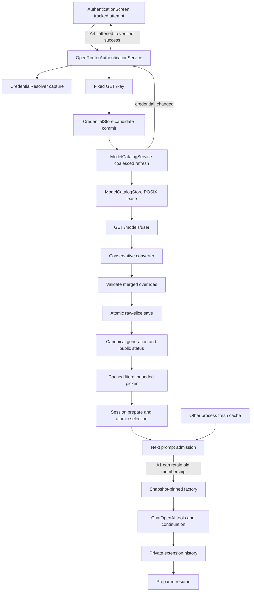

# Feature 86 — Independent review, section A

Date: 2026-10-03. Scope: F86-01–14, plus the assigned catalog/auth/provenance/refresh/store/permission/concurrency/picker-status obligations in the six engineering slices. Review-only; no implementation or specification changes.

## Executive summary

**REVISE.** Current code contains a cross-process catalog-admission defect, a cancellation ownership gap around lock-file opening, and missing required authentication failure distinctions. The prior R2/R3/R4 corrections remain accepted. The former monolithic `_refresh_openrouter_owned` has been split within the existing service; this report does not recycle the old line-range finding against that corrected method.

This report is not broad-suite approval or a whole-feature completion assessment. All fourteen assigned IDs are dispositioned below, but evidence depth differs: several transport/history IDs have only boundary inspection and retained test evidence, explicitly marked PARTIAL rather than approved by inference. No fresh pytest, live provider, external network, credential lookup, installation, or environment repair was performed. Two fresh in-memory source-extracted probes reproduced bounded behavior; their scope is stated precisely.

## Stack, inputs, and preservation

Python/asyncio/Pydantic, httpx, LangChain ChatOpenAI, filesystem catalog/history, Typer and Textual. No SQL/FastAPI/Vue/DBOS changes are implicated. The feature-specific fixed-origin/no-raw-body/no-retry contracts take precedence over generic client examples.

Inputs consulted: supplied AGENTS/SLO/CLAUDE and docs/RESEARCH instructions, root RESEARCH, exact Code-Test-Review workflow and review-feature-code skill, immutable overview/request/task index and all six `86.a.*` contracts, independent-functional-review-final, remediation-r2-r3-r4, current-status, remaining-requirements and implementation-log. The long implementation-log read initially truncated; it was continued from the displayed cutoff. KB Welcome, Slo README (there is no `slo/index.md`), gotchas, feature-86 status, authentication, architecture and model-pool pages were consulted. KB status is historical and is not treated as stronger evidence than current code.

Convention review used named inputs/types, declarative structure, method-docstrings, test-verification, external-client/application-service and Textual guidance, plus the hard-rules checklist. Some large combined convention reads truncated; not every example in every applicable CLI/TUI skill was read. This is a prerequisite/coverage limitation, not a claim of clean convention certification.

Read-only `git status --short` included actual untracked producers, not just HEAD-diff files. Inspected untracked shipping files include `auth/openrouter_authentication.py`, `integrations/openrouter/*`, `model_catalog/openrouter.py`, `providers/openrouter.py`, and current catalog/auth/client/integration tests. Existing scratch/baseline trees were preserved. No Git mutation occurred. Only this report was deliberately written. Oversized tool reads automatically spilled output to `/tmp/slo-bash-yywsmruh.txt` and `/tmp/slo-bash-wrf9f713.txt`; these were not intentional test artifacts and were left untouched. This deviation is disclosed rather than described as perfect write-boundary compliance.

## Findings — glaring gaps / must fix

### A1 — High: fresh disk evidence authorizes stale in-memory membership

**Where:** `src/agents/model_catalog/service.py:373–384`, `_prepare_openrouter_admission`; `sessions/service.py:4062–4086`, `_prepare_run_snapshot`.

**Contract:** overview §§7.4–7.5 and 7.10a; 86.a.2 §§7.3–7.4; 86.a.4 §7.3. Successful complete removal must affect the next admission, and capability consumers must adopt a coherent generation. This is within section A's explicitly assigned cross-process catalog/removal obligations and affects F86-05/12/14 boundaries.

**Causal trace:** process P has published snapshot S1 containing route X. Process Q completes a same-key refresh and atomically writes S2 that removes X or lowers its limits. P's next admission reads S2 from disk, but tests route membership against its memoized S1. If S2's key/list timestamps are fresh, it returns S1 immediately. The new disk evidence and old membership/capabilities are never compared. `_prepare_run_snapshot` then legitimately pins/reuses the wrong snapshot; its credential equality check cannot detect same-key metadata changes.

This is not the accepted repeated-page defect. S2 may be a perfectly valid complete list. The defect also applies to metadata-only changes while X remains listed.

**Fresh bounded reproduction:** an in-memory execution of the unchanged AST body of `_prepare_openrouter_admission` supplied old membership, a newly read empty same-key slice, and usable evidence. It returned the old snapshot without invoking refresh. Output: `REPRO: fresh same-key disk evidence returns old in-memory membership without adopting disk removal.` This proves the branch composition, not a fresh two-OS-process integration run.

**Existing evidence does not close this branch:** `test_catalog_process_ordering.py` tests two explicit refresh owners and correctly proves a waiting force caller adopts the winner. `test_openrouter_final_compositions.py::test_complete_removal_during_run_rejects_prepared_resume_with_readable_history` publishes in the same process, so global `_snapshot` already changes. Neither asserts warm-process next admission after another process replaces disk.

**Correction:** within the existing catalog owner, reconcile/adopt the current same-key durable slice before the admission fast return, validating overrides and publishing a coherent generation. Do not authorize old rows using another snapshot's timestamps. Preserve already-admitted runs and last-good-on-failure behavior.

**Required regression:** warm P with X, complete same-key S2 from another process (or a deterministic real-store external-writer seam), then next admission rejects removed X; a separate cap-change case adopts S2's limits. Assert old run/history remains intact and no unnecessary HTTP is required merely to adopt a fresh committed slice.

### A2 — Medium: cancellation can orphan a newly opened catalog lock descriptor

**Where:** `src/agents/model_catalog/store.py:148–157`, `refresh_lease`; `_open_private_lock_file` at lines 72–94.

**Contract:** 86.a.2 §7.4 / overview §7.4: cancellation releases owned lease resources, and total lock/HTTP work is bounded.

`descriptor = await asyncio.to_thread(_open_private_lock_file, ...)` precedes the `try/finally`. If cancellation/timeout arrives while that worker is running, Python does not stop the worker. It can finish opening the FD after the coroutine has exited, and no owner closes the returned descriptor. Separately, `os.chmod(lock_path, ...)` failure after successful `os.open` raises without closing that descriptor. These are resource leaks, not proof that an advisory lock remains held—the flock has not yet been acquired in the first case.

Current shutdown tests drain the threaded **cache writer**, and client tests drain HTTP closure. They do not cover cancellation during descriptor allocation. Source-traced finding; no real FD fault experiment was run here.

**Correction:** retain/drain the allocation task and close any resulting FD before propagating cancellation; close the local FD on all post-open failures, preferably applying mode through the owned FD. Keep this in ModelCatalogStore, not a new lock framework.

**Required regression:** barrier in test-owned lock opener, cancel before it returns, release worker and assert descriptor closed; inject post-open chmod failure and assert cleanup. Use only verified tmp_path descendants. Preserve existing lock-wait/process-ordering tests.

### A3 — Medium: invalid key and timeout have the same user-facing result

**Where:** `src/integrations/openrouter/client.py:238–265` (`_make_request`), `src/auth/openrouter_authentication.py:100–108,194–200`; modal `auth_screen.py:276–287`.

**Contract:** immutable request §2 explicitly says to distinguish an invalid key from network timeout; F86-02, overview §7.2, 86.a.5 §§7.2–7.3.

Client transport/deadline failures become generic `OpenRouterAPIError`; auth catches every ordinary exception and renders `OpenRouter authentication failed; retry authentication.` Both 401/403 rejection and timeout/protocol failure therefore look identical. Old credential bytes are preserved correctly, but the operator cannot distinguish replacement required from retry-later failure.

`test_verification_failure_preserves_bytes` parameterizes unauthorized/forbidden/protocol/timeout/cancel but asserts storage, secret absence and `not key_verified`, not distinct failure categories/copy. Mounted tests also do not establish the missing distinction. Fresh source-extracted `_failure_message` execution confirmed the fixed generic pre-verification copy; it was not a complete UI execution.

**Correction:** preserve a bounded safe failure category at the existing client/auth boundary and translate it into fixed distinct rejection/timeout/protocol notices. Never expose raw exception text. Add service and painted-modal assertions for rejection versus timeout, preserving byte-identical prior store and retry controls.

### A4 — Medium: auth success copy survives credential change during discovery

**Where:** `src/auth/openrouter_authentication.py:118–121,174–191`; `src/tui/authentication/auth_screen.py:279–282`.

**Contract:** F86-02/03 and assigned provenance/status obligations, overview §7.2/§7.10: obsolete key evidence must not be presented as the current effective credential's verification.

After `/key` and persistence/source check, `_verified_credential` is set and `key_verified=True`. If effective A changes to B while `/models/user` is pending, catalog correctly returns `credential_changed`. `_refresh` flattens that result into `Key verified; catalog refresh failed.` For an environment capture it additionally says `Environment key is active`. It retains A as the successful dismissal credential, and the modal selects its success screen based solely on `key_verified`. Catalog's correct rejection is therefore not reflected in the auth result. The earlier accepted environment-race fix checks the interval **before** handoff; this is a distinct later boundary, not reopening that fix.

**Correction:** explicitly handle `credential_changed` from the existing refresh result. Retain factual `replacement_saved` when appropriate, but do not expose obsolete A as a currently verified dismissal. Paint credential-changed/retry copy and preserve current selection. Test rotation at the listing barrier, not only inside GET `/key`.

## Requirement matrix

PASS means the listed inspected boundary is supported; it is not full-suite certification. PARTIAL means this review has not independently established every assigned clause. REVISE names concrete findings. Test paths below are inspected assets or retained evidence, **not freshly executed pytest**.

| ID | Slice clauses reviewed | Current paths / test evidence | Status and limitation |
|---|---|---|---|
| F86-01 | a.1 §§7.1/7.4; a.5 §§7.1–7.3: enum/env/store/no legacy/API-key-only | `credential_dao.py`, `credential_resolver.py`, `provider_factory.py`, provider selector, auth screen; `test_credential_resolver.py`, auth capability tests | PASS at source boundary: dynamic env accessor and resolver precedence retained; no fresh direct-provider suite. |
| F86-02 | a.1 §7.2; a.5 §§7.2–7.3; a.6 §7.1: effective key, verify-before-save, Back/Cancel, timeout/rejection | Auth service → GET client → CredentialStore → catalog; service failure/rotation tests, mounted post-save cancellation and full-flow tests | REVISE A3/A4. Candidate ordering and saved-state cancellation credited; distinct error copy and listing-time rotation result are not covered. |
| F86-03 | a.1 §§7.1/7.3; a.2 §§7.3–7.5; a.4 §7.7; a.5 §7.7; a.6 §7.2: private state/public status | Repr-hidden credentials; private fingerprint slice; fixed client errors; AtomicFileWriter; operation capture boundary; picker status | PARTIAL. R2 accepted, no allegation of its former leak. Full child/capture sinks outside A's detailed audit. A2 resource cleanup and A4 evidence truth require correction. |
| F86-04 | a.1 §7.1; a.2 §7.2; a.3 §7.2: exact canonical/API/provider identity | `provider_for_model.py`, converter, factory `_build_openrouter`; identity tests and exact SDK tool request assertions | PASS for inspected route separation: prefix classified first, exact remote ID preserved, author never selects native builder. |
| F86-05 | a.4 §§7.2/7.4/7.5: unknown/removed selection and direct compatibility | Session prepare/build/selection, config fallback, dispatch resume precedence; removal composition and startup tests | REVISE A1 at warm cross-process next-admission boundary. Unknown routes otherwise fail with refresh/auth guidance; complete direct regression not rerun. |
| F86-06 | a.4 §7.4; a.5 §7.6: explicit model beats pool, atomic selection | Dispatch `_build_session_config` handles explicit model before pool parse; `_apply_model_override` clears pool; session prepares before commit/preference save | PASS for inspected wiring; selection-race/full-flow assets retained. No fresh CLI/TUI execution. |
| F86-07 | a.1 §7.4: comma/JSON/object and direct DAO invariant | `config/model_pool_config.py::_entry_from_dict`; `ModelPoolEntryDAO`; pool/config tests | PASS at parser/DAO boundary; format matrix execution retained, not rerun. |
| F86-08 | a.3 §§7.2–7.3: fixed Chat Completions constructor | `LLMFactory._build_openrouter`, prepared snapshot check, adapter request path; real SDK MockTransport assets | PARTIAL: fixed URL/model/key, retries zero, Responses false inspected; not every constructor/invocation control branch independently audited here. |
| F86-09 | a.3 §7.2: attribution and explicit caching | Factory fixed title/categories, no Referer in constructor; OpenRouter dispatch caching policy; transport tests | PASS for inspected construction policy; no live headers/availability claim. |
| F86-10 | a.3 §§7.3–7.4; a.6 §7.1: text/tools/usage/length/refusal/cancel | Adapter stream wrappers, standard superclass conversion, refusal/length projection; `test_openrouter_transport.py`, session-commit assets, mounted full-flow | PARTIAL: inspected two-request tool ID/args/result assertions and wrappers; full usage/cancellation branch audit not completed in A. |
| F86-11 | a.3 §7.4; a.6 §§7.1–7.2: same-route private extension/history | Adapter final metadata-only chunk and exact-route attach; projector extension reconstruction; channels/fragments/full-flow test assets | PARTIAL: exact-route and one-extension seams inspected; not independently exhaustive over compaction/concurrent/OS-restart cases. F1 accepted at operation-scope boundary. |
| F86-12 | a.1 §7.2; a.2 §§7.2–7.4: authenticated-only discovery/provenance | Client allowlists `/key`, `/models/user`, no public fallback; converter/store/catalog | REVISE A1 for using fresh durable provenance with older membership. Endpoint authority itself passes inspection. |
| F86-13 | a.1 §§7.2–7.3; a.2 §7.2; a.5 §7.5: budgets/schema/pagination/labels | Client byte/record/total/deadline/redirect checks, converter literal labels, menu Content; client pagination and real refresh-retention tests | PASS for inspected bounded GET/conversion path; accepted R3 progress rejection is present at client lines 194–219. No claim of exhaustive fuzzing or fresh test run. |
| F86-14 | a.2 §7.2: explicit text/tools/context/batch/expiry eligibility | Converter `_is_eligible`, strict context/output helpers, exact batch segments, expiry; admission `_validate_admission`; converter/integrity tests | REVISE A1 for adopting changed cross-process eligibility. Converter filtering itself is conservative; passive picker expiry aging is not independently verified. |

### Additional assigned catalog/status clauses

| Clauses | Assessment / evidence |
|---|---|
| a.2 §7.3 raw schema-2 and override separation | Raw provider slice saved separately; `_build_publication_candidate` validates semantic overrides before write; invalid-override test asserts byte-identical disk/reference/generation. No merged writer remains. |
| a.2 §7.4 same-key freshness / last-good | TTL uses successful listing and separate key evidence; missing/future/exact-TTL tests exist. Failure/partial/repeated-page tests retain bytes. A1 prevents approval of next-admission coherence. |
| a.2 §7.4 coalescing / process lease / shutdown | Task key includes provider/fingerprint/loop/path; waiter cancellation preserves another subscriber; owner task cleanup/reset/shutdown exists. Real process ordering test inspects explicit refresh, not next admission. A2 allocation lifetime is uncovered. |
| a.2 §7.5 atomic save / permissions | Atomic writer uses private sibling temp, file fsync, replace and committed durability-warning outcome. Catalog publishes after commit; writer drain retains lease under cancellation. Credential store remains existing owner. Read paths do not mkdir/chmod. Not all permission/symlink race branches independently certified. |
| a.2 §7.3 removal/tombstones/history | Complete empty list removes membership; 30-day tombstone prune occurs on publication; history identity survives same-process removal composition. A1 is the missing cross-process adoption branch. |
| a.2 §7.6 projections | Defaults/reasoning/picker read views delegate to canonical snapshot; ModelPickerRowDAO accepted (R4). Supplied snapshots thread into session/factory. |
| a.5 §§7.4/7.6 public status/refresh | Public lifecycle DTO excludes fingerprint; revision invalidates picker; cold historical status does not claim current-key check; manual refresh delegates through session. A4 blocks auth status truth. Warm `checked` status/row cache has no clock component, so passive TTL aging is not certified; do not infer it from cold-clock tests. |
| a.2 §7.4 declarative correction | Current `_refresh_openrouter_owned` delegates leased work, with separate freshness, discovery, candidate, persistence/publication helpers. Credit correction. Other large methods remain multi-decision (notably public `refresh` and `_prepare_openrouter_admission`); no exhaustive hard-rules clean claim. |

## End-to-end trace

- Happy path is genuinely wired, not a disconnected converter: modal service carries the same private capture and key evidence into forced refresh; catalog converts/persists/publishes; picker inserts canonical identity; session prepares before switching; factory uses exact API ID.
- Same-route tool continuation uses ordinary tool call IDs/results plus one private extension; public status has no key/fingerprint. Existing mounted full-flow assets exercise a new prepared session, not merely a direct SDK replay helper.
- Last-good behavior is correct in the inspected failed refresh path. A1 is a later read/admission mismatch, not a save-before-publication failure.
- F1 impact inspected only at session boundary: admitted credential is retained through `_session_run_scope`, lazy build and cleanup. R2's separate terminal-owner fix is credited, not reaudited as a new finding.

## Tests and evidence

### Fresh execution

1. `git diff --check`: exit 0, no output (tracked whitespace check only).
2. `/root/.pyenv/versions/slo-harness/bin/python -I -B -` with an inline AST-only probe: exit 0. It parsed source and compiled only `_prepare_openrouter_admission` and `_failure_message`; collaborators were in-memory synthetic objects. No project imports, filesystem writes, credentials, network, or subprocess workloads. It reproduced A1's old-snapshot fast return and A3's generic copy. This is **not pytest** and **not end-to-end proof**.

### Retained execution, not fresh review runs

Independently read `.f86-declarative-final-c9fexr/full-non-e2e.log` tail: **5047 passed, 15 deselected, 201 warnings in 329.49s**. The implementation ledger identifies this as the post-refactor full run. Remediation report records R2/R3/R4 focused and full gates. None is relabelled as this reviewer's execution, and a passing aggregate cannot refute the specific untested A1–A4 branches.

### Assertion assessment

- `test_atomic_publication.py`: real cache bytes and generation checks cover invalid override, rotation across override await, equal-metadata publication and last-good retention. New delegation test checks exact arguments to `_refresh_openrouter_under_lease`; it does not itself observe that the lease remains held inside the delegate.
- `test_status_admission_takeover.py`: checks old A versus B status, listing 401/403 invalidation, all-exact pool membership and admission rotation before cache read. It does not cover same-key S2 disk versus warm S1 membership.
- `test_catalog_shutdown.py`: strong threaded-writer drain assertions; no allocation-worker cancellation assertion.
- `test_catalog_process_ordering.py`: actual process barriers and winner-byte equality, scoped to explicit refresh.
- `test_openrouter_authentication.py`: ordering, no duplicate handoff verification, unchanged bytes on failure, source races during verification, saved-state cancellation; missing error-category and listing-time rotation-result assertions.
- `test_pagination_completeness.py` and `test_openrouter_repeated_page_retention.py`: accepted repeated full-page refusal, valid exact-multiple termination, byte-identical last-good cache after repeat/HTTP/partial failures.
- Mounted status tests paint historical/requires-auth at 80×24 and 60×15; they use explicit lifecycle publication and do not establish passive warm TTL aging.

No tests were run that could create system/PATH stubs or touch real credential locations. No broad suite approval is given.

## Convention adherence and ubiquitous language

Single owners remain recognizable: resolver/store for credentials; fixed GET client for metadata; canonical catalog for publication; session for admission; factory for transport; engine/menu for search/paint. `model_name` (canonical route), `api_model_name` (wire identity), `provider`, `credential_fingerprint` and `catalog_generation` remain distinct concepts. R4's presentation name is corrected rather than a second canonical entity.

Mandatory structure is **not wholly clean**: new cache/status/tombstone/result fields in `model_catalog/dao.py:368–435` and verification fields in `integrations/openrouter/dao.py:15–16` omit the explicitly required `Field(description=...)`; `refresh_lease` has no return annotation. These are not Black/mypy execution failures. Complete them within current DTO/store owners, without introducing new entities. Larger multi-decision admission/refresh methods also deserve a precise follow-up hard-rules pass while implementing A1; the corrected `_refresh_openrouter_owned` itself is credited.

Formatting and mypy are expressly waived. No requirement for a new generic provider framework, live provider smoke, native interpreter-startup equivalence, argv equality, arbitrary FD raw-body filtering, or removal of authorized private continuation is introduced.

## Findings tiers and completion checklist

### Glaring gaps

- [ ] A1: adopt coherent same-key disk membership/capabilities at next admission; add external-writer removal/cap-change regressions.
- [ ] A2: retain allocation-worker ownership and close FD on cancellation/post-open error; add deterministic contained regressions.
- [ ] A3: distinguish safe invalid-key and timeout outcomes in service and painted UI.
- [ ] A4: honor credential-changed refresh outcome in auth result/dismissal and paint.
- [ ] Complete mandatory new-field descriptions / lease return annotation; do not call the structural posthook clean before the remaining scoped audit is finished.

### Nice-to-haves

- Correct factory docstring claiming prepared-snapshot integration is still future work (`base.py::_build_openrouter`).
- Strengthen delegation test to observe lease ownership within the awaited delegate, matching its name.
- Reconcile current-status pointers without deleting historical evidence. `remaining-requirements.md` still opens with the pre-refactor orchestration finding; the implementation-log/current-status top entries supersede it.

### Temporary shortcuts / limitations

- No fresh pytest or full gate; retained evidence explicitly separated.
- F86-08/10/11 remain PARTIAL for this reviewer because full adapter/history branch inspection was not completed, not because their implementations are declared absent.
- Passive warm status aging and all permission-fault branches lack independent certification here.
- Not every shipping test body/call-site or every applicable convention example was inspected. This report must not be presented as the exhaustive section-A approval the original request sought; it provides concrete blockers and an honest per-ID disposition for the completed inspection.
- Product/specification decisions required: none. Fixes fit existing owners. Broader reviewers retain their exclusive areas; R2/R3/R4 and qualified capture evidence are not reopened.

## Terminal verdict

REVISE
