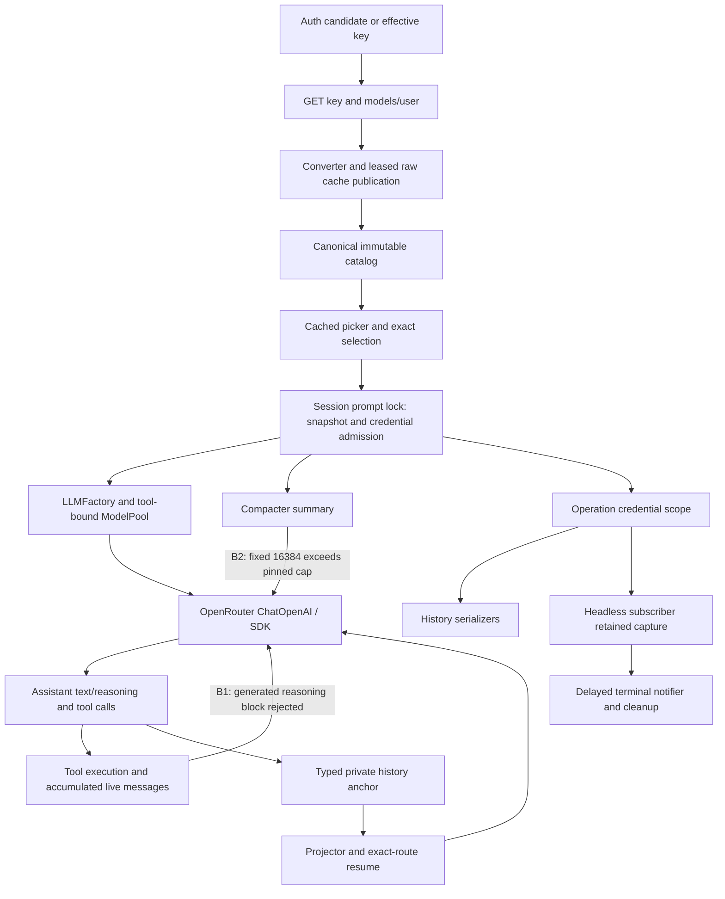

# Feature 86 — Independent review, section B

Date: 2026-10-03. Workflow Step 2 only. **REVISE.**

## 1. Scope, stack, and evidence boundary

Allocation: **F86-15 through F86-28**, including the assigned adapter, request controls, streaming/tools, private history, session admission, pools, resume, direct-provider compatibility, and F1 lifetime boundaries. Other requirement IDs below identify dependencies, not an approval of another reviewer's allocation.

Stack: Python/Pydantic, asyncio/ContextVar, LangChain/OpenAI Chat Completions, LangGraph, filesystem catalog/history, Typer and Textual entry-point integration. No SQL/FastAPI/Vue/DBOS implementation is involved.

This review inspected dirty tracked files **and untracked production/test files**, not just HEAD or the tracked diff. It used read-only Git status/diff/check. No source, tests, specifications, existing review reports, status or implementation-log files were deliberately modified. This file is the only deliberate write. No network, live provider, credential inspection, installation, or Git mutation was performed.

Evidence labels:

- **Source-confirmed**: a concrete branch and call chain inspected in the current worktree; not a freshly executed reproduction.
- **Existing test**: current assertions inspected; not executed by this reviewer.
- **Retained result**: earlier execution log, explicitly not a fresh run.
- **Review limitation**: not evidence that functionality is absent.

Read inputs included the exact Code-Test-Review workflow, review-feature-code and hard-rules posthook, named-argument/type, declarative-method, docstring, graph-gateway, external-client and application-service conventions; supplied AGENTS/SLO/CLAUDE/research instructions; root RESEARCH; KB Welcome, relevant Slo gotchas/status and index pointers; immutable request, overview, dependency index and **all six 86.a.1–86.a.6 contracts**. Current/prior independent review, remediation, remaining-requirements and status/log entries were consulted. The historical ledger and every historical report were not read line by line, nor was every matching layer skill loaded in full. This is a prerequisite-reading limitation, not a claim to have completed that part of the request exhaustively. KB `slo/index.md` does not exist; `slo/README.md` is its index. KB's old failure/static status is superseded by current repository evidence and the user's static waiver.

Some initial oversized read commands caused tool-managed output spills (`/tmp/slo-bash-501nrnn4.txt`, `/tmp/slo-bash-ek0v88_8.txt`, `/tmp/slo-bash-qr1tdv6h.txt`). These were not intentional test writes; they were left untouched. Subsequent reads were bounded. This disclosure matters because the requested write boundary was stricter than the tool's automatic output behavior.

## 2. Executive summary

The principal owners are connected: authenticated catalog publication feeds exact selection, session admission pins the generation and credential, the factory constructs the gateway adapter, and private extensions traverse actual history/replay seams. F1's operation scope and true same-key agent reuse now have meaningful current assertions; R2/R3/R4 remain credited and are **not reopened**.

However, two source-confirmed runtime failures remain: **plaintext reasoning emitted by the adapter is rejected when that same assistant message returns in a live tool conversation**, and **compaction unconditionally requests 16,384 output tokens even on admitted routes whose enforced cap is 4,096 or less**. Mandatory new-field/type/declarative conventions also remain violated outside the waived Black/mypy gates. All fourteen assigned IDs are mapped below; passing retained suite totals do not disprove these concrete missing compositions.

## 3. Glaring gaps — must fix

### B1 — High: live reasoning/tool continuation rejects the adapter's own output

**Requirements:** F86-17, associated F86-10/11; overview §§7.6–7.7; 86.a.3 §§7.3–7.4 and §9.

**Locations:** `src/agents/providers/openrouter.py:403–408, 450–480, 843–855`; `src/agents/slo_agent/agent.py:622`; `src/agents/slo_agent/graph/service.py` agent node.

**Causal chain:**

1. `_project_visible_reasoning` changes an inbound raw `reasoning` string or detail `summary` into an assistant content block with `type="reasoning"`.
2. The actual agent appends the completed AIMessage to `accumulated_messages`; it does not round-trip that message through the history projector between tool iterations.
3. The next SDK request runs `_validate_message_modalities` over **every** message, including that assistant message.
4. `_validate_message_block` accepts strings, `text`, and advertised images only. Its own `reasoning` block falls into `OpenRouterAPIError(error_type="invalid_request")` before HTTP.

**Impact:** an otherwise valid tool call accompanied by visible reasoning fails on the tool-result request. Restart/replay can conceal this because persisted `payload.content` is answer-only and the private extension is reconstructed separately. Thus a replay test is not a substitute for the live continuation composition.

**Current tests and why they miss it:** the mounted full-flow test uses encrypted-only reasoning details; `test_openrouter_channels.py` live tool flow also uses encrypted-only details. `test_openrouter_fragments.py::test_fragmented_tool_response_continues_without_metadata_duplication` includes a summary but explicitly replaces the assistant with a projector-reconstructed message before request two. `test_openrouter_reasoning_semantics.py` tests visible reasoning/length in a single request. These are useful tests, but none of those assertions establishes the missing live path.

**Correction:** at the existing adapter/codec boundary, distinguish internally generated assistant thinking blocks from unsupported input modalities. Create detached outbound messages that keep ordinary answer text/tools and reconstruct private same-route continuation through the existing extension. Do not simply permit arbitrary user/tool `reasoning` blocks, mutate original messages, remove private signatures, or stringify thinking into ordinary answer content.

**Required regression:** real factory + SDK MockTransport + `SloAgentSession.invoke`, harmless bound tool, first SSE response with (a) raw reasoning plus tool call and (b) plaintext detail summary plus tool call. Assert two requests, preserved tool IDs/results and exact private extension, visible thinking separate from answer, and successful terminal state. Add the corresponding nonstream public invocation continuation. Preserve text-only image rejection and different-route stripping.

**Evidence:** source-confirmed; no fresh execution in this review.

### B2 — High: compaction bypasses the admitted OpenRouter output cap

**Requirements:** F86-15, F86-18, F86-23/25/28 consumer coherence; overview §7.5 explicitly includes compaction output caps; 86.a.2 §7.6; 86.a.4 §7.3.

**Locations:** `src/agents/slo_agent/sessions/service.py:4650–4656`; `src/agents/slo_agent/compaction/compacter.py:185–189, 508–560`; `compaction/constants.py:26`; `src/agents/base.py:668–683`; `src/agents/providers/openrouter.py:511–519`.

**Causal chain:** session compaction passes the pinned snapshot to `Compacter.compact`, but it uses that snapshot only to calculate context capacity. `_invoke_llm_summary` receives no snapshot/output budget and always supplies `max_tokens=RESERVED_TOKEN_LIMIT`, i.e. **16,384**. `adapt_chatgpt_backend_request` leaves OpenRouter kwargs unchanged. The gateway adapter correctly rejects limits greater than its pinned output ceiling. A catalog record with absent output ceiling has a hard ceiling of **4,096**, so its real summary request always fails locally. Smaller advertised ceilings fail too. Pool summary requests forward the same oversized value to whichever member is selected.

**Impact:** valid selectable models cannot compact via manual, automatic, or overflow paths once a summary request is required. The stricter new adapter exposes an existing generic constant as an integration defect; the adapter cap must not be weakened to accommodate it.

**Correction:** derive the summary budget from the selected lane's pinned policy, bounded by the summary reserve. Preserve native direct-provider and Codex shaping. For pools, apply the budget per selected member so fallback cannot carry the prior lane's larger cap. Keep this in existing compaction/request-adaptation owners; no new catalog or retry service.

**Required regression:** a history-backed admitted OpenRouter route with missing ceiling and one with a ceiling below 4,096; invoke real summary construction through local SDK transport and assert the actual legal output field, committed summary and retained-tail replay. Add mixed-pool summary fallback to a smaller-cap OpenRouter member. Exercise automatic/overflow delegation to the same seam and retain existing Codex/no-output-cap tests.

**Existing coverage limitation:** private retained-tail tests construct or persist a compaction result; that is not proof that the real summary SDK request respects the new cap. The inspected snapshot-admission tests assert capacity/retry/rebuild, not a real compacting request.

**Evidence:** source-confirmed; no fresh execution.

### B3 — Mandatory convention/specification blocker: new declarations and adapter internals are not compliant

This is **not** a mypy/Black finding; those tools are waived. The specification and mandatory review rules are not waived.

- `src/agents/model_catalog/dao.py:362–428`: new discovery fields, tombstone fields, provider-cache/envelope, lifecycle and refresh result fields lack the required `Field(description=...)`. Some use bare declarations; others use Field without descriptions.
- `src/agents/providers/openrouter.py:370–372`: new adapter Pydantic fields are excluded, correctly, but lack descriptions required by overview §7.10a and 86.a.3 §7.3.
- `OpenRouterMessageCodec` internal `details`, `indexed`, `_merge_field` use `dict[str, Any]` beyond the unavoidable SDK override signature. 86.a.3 explicitly requires bounded JsonValue and localized documented third-party casts, not broad internal Any propagation.
- `_validate_invocation_options` combines dispatch, cap validation, support validation and exception conversion in a loop; `_project_visible_reasoning` nests choice/message/detail projection. These do not satisfy the required single-decision/named-step structure. The earlier catalog lifecycle extraction is credited; this is a different current owner, not a resurrection of its superseded line-range finding.

**Correction:** document all newly introduced Pydantic fields in these assigned owners, narrow codec state to validated JSON types, localize SDK boundary casts with rationale, and extract small named validation/projection steps in the same provider module. Do not refactor graph topology or add a competing provider abstraction. Check schema field descriptions and retain existing fragment/conflict/size/control/transport tests plus B1/B2 regressions. Complete Args/Returns/Raises where currently omitted on nontrivial public helpers. These are finite owner-local corrections, not authorization to repair whole-project static debt.

## 4. Requirement matrix — every assigned ID

“Implemented (inspected)” is an owner/contract assessment, **not fresh test-green certification**. “Partial” names a specific gap or inspection limit. All paths are current repository paths; test paths are under `tests/`.

| ID | Clauses/slices | Current implementation trace | Existing test evidence and actual assertion scope | Status / limitation |
|---|---|---|---|---|
| F86-15 | overview 7.3/7.6; a.2 7.2; a.3 7.2/9 | converter `_output_cap`/reported ceiling → factory `_openrouter_output_ceiling` → adapter invocation caps/modality gate | `agents/model_catalog/test_openrouter_converter_metadata.py` strict/absent ceilings; `agents/providers/test_openrouter_capability_recovery.py` constructor/invoke bounds, user/assistant/tool image refusal and supported image wire | **Partial: B2** real compaction cap. Image tests do not establish every multimodal tool/replay combination; no live capability claim. |
| F86-16 | overview 7.3; a.2 7.2 | exact ID converter; batch suffix segments, openrouter router and `~` excluded; `prepare_models` exact membership | converter metadata tests; `test_openrouter_review_contracts.py` exact `:batch` versus `:batching`; residual duplicate tests | Implemented exclusion/membership inspected. Unlisted variants receive generic preparation/refresh copy, not the overview's explicit “unsupported variant” wording; see notes. |
| F86-17 | overview 7.3/7.6/7.7; a.2 7.2; a.3 7.2–7.4 | converter reasoning profile → clamp → request policy → stream codec → next request/history | `test_openrouter_reasoning_semantics.py`, `test_openrouter_semantic_controls.py`, fragments/transport tests | **Partial: B1**. Also incomplete metadata policy differs from spec: known efforts with missing `mandatory` are all disabled as controls; existing test codifies that behavior. See B4. |
| F86-18 | overview 7.3/7.6; a.2 7.2; a.3 7.2 | local RPM20/TPM None separated from remote ceiling; supported controls; require_parameters; retries zero | converter profiles, semantic controls real SDK bodies and zero-request rejection, pinned retry test | **Partial: B2** consumer coherence; normal inference policy is present. No remote entitlement asserted. |
| F86-19 | overview 7.4–7.5; a.2 7.6; a.4 7.2 | `load` cold seed/cache/overrides; warm pure visibility; compatibility views; async preparation separate | `test_catalog_read_views.py`, `test_offline_store_reads.py`, `test_historical_status.py`; full-flow network tripwire | Implemented offline read seam inspected. Cold disk reads are allowed; offline does not mean no filesystem I/O. No fresh help/import/TUI gate. |
| F86-20 | overview 7.2/7.9; a.4 7.2; a.5 auth | auth captured verification → catalog refresh; dispatch pending build → mounted task → `prepare_startup` | `integration/test_openrouter_full_flow.py`; `tui/test_openrouter_startup.py` mounted pending/failure/cancel/recovery | Implemented ordinary dispatch/auth path inspected. Supplied-ready-session mount has no independent stale refresh worker; standard TUI dispatch builds OpenRouter pending without supplied snapshot. Pending direct-switch restriction differs from recovery prose; see notes. |
| F86-21 | overview 7.10; a.5 7.6 | SlashRouter exact `refresh` before selection → session `refresh_model_catalog` → service force/coalesce | `tui/test_slash_router.py`, startup recovery test | Implemented routing inspected. Result is fixed safe copy; required counts/check-time are not returned by CatalogRefreshResultDAO or rendered by this action (note below). |
| F86-22 | overview 7.9; a.4 7.6–7.7 | materialized config ID → HeadlessRunner preparation task → session gateway; scheduled/child model path reuses headless | `cli/test_openrouter_preparation.py`, terminal lifetime tests; scheduled active-inbox integration; retained process/capture evidence | Implemented core preparation trace; **not separately certified for every child/capture failure path in section B**. R2 accepted. No new native-startup/argv-equality requirement. |
| F86-23 | overview 7.4–7.5; a.2 7.4–7.6; a.4 7.3 | convert complete slice → build validated candidate → shielded atomic writer under lease → publish → pinned session | `test_atomic_publication.py`, `test_catalog_integrity.py`; actual removal composition; repeated-page retention | Publication structure inspected, R3 fixed. **Partial consumer contract: B2**. Retained full gate is not proof all profile consumers agree. |
| F86-24 | overview 7.4; a.2 7.3–7.4 | typed failure leaves prior cache/snapshot; independent verification/list time; same-key stale admission only with usable verification | lifecycle/status/admission-security tests; `integration/test_openrouter_repeated_page_retention.py` byte-identical cache/generation/time | Implemented inspected. R3 remains closed; no counterexample to current repeated-page fix. All historical failure cases not freshly rerun. |
| F86-25 | overview 7.4–7.5/7.9; a.2 7.4; a.4 7.3 | task key/waiter count + lease + drained write; session lock/run snapshot/rebuild | process ordering test uses two independent processes and barrier; prompt admission test pins capacity/retry and rebuilds only if relevant data changes; key-rotation integration preserves A and next B | Implemented concurrency/admission seams inspected; **Partial: B2** for compaction use of pinned output policy. Process test retained, not executed here. |
| F86-26 | overview 7.4; a.2 7.3–7.4; a.4 7.3 | lifecycle fingerprint capture/filtered view; precommit/prepublish comparisons; TTL; prompt credential recheck/factory binding | atomic-publication rotation; refresh credential contracts; actual SDK A→B→B integration asserts two builds for three requests; F1 session-scope tests | Implemented principal lifetime/provenance path inspected. No old manual writer binding used as sole evidence; see F1 assessment. No fresh execution. |
| F86-27 | overview 7.4–7.5/7.9; a.2 reconciliation; a.4 resume | complete list reconciles/prunes tombstones; entry expiry at admission; exact resumed route preparation, no substitution | `integration/test_openrouter_final_compositions.py` removal during actual blocked SDK request, old run completes, next prepare fails, history bytes unchanged; tree/flat resume precedence tests | Implemented observed composition. Full history remains readable independently of tombstone retention. Ordinary removal branch credited, not labelled missing. |
| F86-28 | overview 7.1/7.3–7.5/7.10; a.2 7.1/7.6; a.4 consumer threading | provider-scoped compatibility delegation; no merged cache writer; live defaults/reasoning/picker views; ProviderName grouping; snapshot into graph/factory/rate/context | discovery delegation/read views/factory snapshot; picker row identity; prompt-generation tests | **Partial: B2/B3**. R4 corrected presentation row remains accepted. Single catalog owner is present; remaining defects are integration/declaration issues, not missing dynamic discovery. |

## 5. End-to-end verification and architecture

### What is genuinely wired

- Factory dispatch is by canonical provider, not upstream author. OpenRouter receives exact remote ID, fixed origin, Chat Completions, zero SDK retries, fixed attribution, no explicit caching and required-parameter routing. Direct builders remain separate.
- Session `_prepare_run_snapshot` validates all configured routes and compares actual relevant entries; `_adopt_prepared_snapshot` invalidates changed lazy state. Graph construction and pool creation receive the snapshot. Usage/rate/context consumers read the admitted snapshot. The compaction output seam is the exception (B2).
- ModelPool re-applies RunnableBinding tool kwargs, preserves snapshot through bind_tools cloning, and switches only before first chunk. Session commit tests cover role, usage, text, reasoning and partial tool frames; each asserts one request, no audit switch/retry/recovery, and closed stream on failure/cancellation.
- Adapter ContextVar assembly is invocation-local and reset in finally; complete private extension is attached once on successful exhaustion. Runtime trace copies it only to the first tool-call anchor; session persists that typed field; projector reconstructs it; token/rate estimates count the extension. Encrypted-only live continuation and new-session resume have meaningful composed tests. Plaintext-reasoning live continuation has B1.
- Error normalization precedes successful result conversion for HTTP/SDK/top-level/nested/SSE errors. Shared classifier retains terminal auth/policy/unavailable/invalid distinctions and exact temporary-402 predicates. Route audit uses fixed gateway codes. Direct-provider audit behavior is deliberately preserved. No adapter retry owner was added.
- Existing tests include sync/async nonstream normalization, concurrent shared-adapter cancellation, refusal/length visibility, exact body controls, pool pinned cooldown, and retained-tail history. They should not be collapsed into a blanket claim that all second-request compositions work.

### F1 and credential/agent lifetime assessment

`_session_run_scope` binds the admitted capture around the entire yielded prompt operation and clears admitted snapshot/credential/running state in finally. `_ensure_agent_ready` may return immediately for an existing agent, but it executes **inside** that outer operation scope. Therefore cached-agent reuse no longer loses history protection when the narrow build scope is absent.

Current `test_key_rotation_admission.py` includes a same-key second-run case that asserts **build_count == 1**, writes a synthetic key-bearing terminal payload through actual session history methods, checks populated redacted bytes, raises cancellation and checks ContextVar/running-state reset. This is stronger than the earlier A→B two-build test, although it drives the production scope/readiness methods rather than a complete SDK turn. `integration/test_openrouter_key_rotation.py` separately drives real public session invocation and SDK HTTP: A survives rotation after admission/before build or during request; next run uses B; third run reuses B with exactly two builds total. It returns ordinary text, so its scans alone would not prove secret-bearing writer protection.

These complementary tests are real-path evidence, not a test-owned `bind_build_credential` held around each write. The older manual writer test remains utility coverage only. R2 independently bridges the child-task-to-parent terminal lifetime with a private capture and finally reset; its accepted remediation is not reopened. No global secret archive or persisted credential field is warranted.

## 6. Unit-test assessment and verification actually performed

### Fresh commands/results

- `git status --short`: inventoried extensive tracked and untracked work, including provider adapter/codec, converter, integration tests and lifetime tests.
- `git diff --stat`: tracked summary only; **90 files, 8062 insertions, 1010 deletions** at inspection. This excludes untracked shipping files, which were read separately.
- `git diff --check`: **exit 0**. This does not check every untracked file and is not a functional test.
- `command -v python`: `/root/.pyenv/shims/python`.
- `ls /root/.pyenv/versions/slo/bin/python`: **No such file or directory**. Required repository interpreter absent. No pytest, Python probe, Black or mypy was executed, and no interpreter/host repair was attempted. Existing reports use `/root/.pyenv/versions/slo-harness/bin/python`; that is retained evidence, not a fresh run under this review.
- `tail -3 .f86-declarative-final-c9fexr/full-non-e2e.log`: independently read retained **5047 passed, 15 deselected, 201 warnings in 329.49s**. Not rerun, not newly attributed to this review.

### Assessment by test family

| Family | Useful current assertions | Finite correction needed |
|---|---|---|
| Controls/capability/converter | Metadata-based supported controls; invalid controls send zero HTTP; strict caps; image-capable body | Real compaction output-budget assertion (B2); reconcile missing-mandatory/none-only reasoning (B4) |
| Stream/tool/history | Exact encrypted anchor, fragment assembly, conflicting/oversized metadata, new prepared session resume, private/public separation | Live plaintext reasoning + tool result without projector laundering (B1) |
| Failure/pool | Real SDK safe failure envelopes; first role/usage/text/thinking/tool barrier; bounded attempts; pinned retry cap | Preserve these during fixes; no generic replacement matrix requested |
| Session/F1 | Real scope/history writes, one-build reuse, reset, A→B→B actual SDK wire | Preserve scope across new compaction/continuation paths; no manual binding substitute |
| Catalog lifecycle | Atomic precommit preservation, lease/drain, rotation, same-key stale evidence, process ordering, removal | No new functional counterexample found in inspected lease/publication path; no exhaustive branch certification |
| Mounted flow/resume | Auth candidate → unseeded route → picker → tool loop → new session, active scheduled target route | B1 expands actual flow; read-time confidence is not a fresh full suite |

No assigned production owner was found wholly without tests. The issue is **missing combinations at real boundaries**, not absence of test files. All assigned IDs were considered after identifying B1/B2. Every method/test across these large modules was not independently enumerated; this report does not falsely certify exhaustive lexical or decision-path coverage.

## 7. Convention adherence and ubiquitous language

Mandatory posthook applied to inspected assigned owners. Spec-specific ownership takes precedence over generic examples: no new graph gateway/framework rewrite, generic application-service hierarchy or retry client is required to satisfy Feature 86.

| Convention | Assessment |
|---|---|
| Single owners | Resolver, catalog/store, factory, extension, session, pool remain distinct and wired. R4 presentation identity corrected. |
| Named inputs/signatures | Principal new entry points use keyword inputs and typed signatures; SDK protected overrides necessarily mirror third-party calling conventions. No every-call-site certification. |
| New Pydantic declarations | **B3:** explicit required descriptions missing across new catalog/adapter fields. |
| JsonValue boundary | Shared extension DAO correctly uses JsonValue; codec's internal Any containers violate the narrower requirement (B3). |
| Declarative structure | Catalog extraction credited. Adapter validation/projection remains multi-decision/nested (B3). |
| Documentation | Principal owners have docstrings, but some public helper docs lack applicable sections; factory `_build_openrouter` still describes a.2 integration as future despite current integration. |
| Test policy | Existing tests are substantial and offline/local by design; B1/B2 decision-path compositions missing. No fresh full-suite claim. |
| Black/mypy | Explicitly waived as gates. Not run; neither called green nor used as blockers. |

Canonical vocabulary trace: `model_name` stays Slo route through config/session/history/picker; `api_model_name` is remote wire identity; `provider` is credential/transport owner; `credential_fingerprint` remains private provenance; `catalog_generation` is publication identity, not discovery time; `safe_error_code` deliberately enters legacy history `error_message` for schema compatibility. `ModelPickerRowDAO` is presentation-only, not a second catalog entity. No new synonym finding is asserted.

## 8. Additional findings — tiers and exact disposition

### Glaring gaps / mandatory product-contract correction

**B4 — Medium: reasoning conversion over-restricts supported metadata.** `src/agents/model_catalog/openrouter.py:280–325` requires `mandatory` to be explicitly bool before allowing *any* effort control. Overview §7.3 says missing mandatory prevents advertising **disable**, not known enabled efforts. It also maps `none` to off, whereas `_recognized_efforts` removes off and does not translate none: `supported_efforts=["none"]`, mandatory false, reasoning advertised yields controls unavailable rather than a known disable-only control. The test case with `["low"]` and no mandatory in `test_openrouter_reasoning_semantics.py` asserts the implementation's no-control result, not the specified enabled-only behavior.

Correct within converter/profile/request policy: represent effort support separately from permission to disable; map none explicitly; keep unknown effort omission and mandatory clamping. Add converter→factory→wire tests for missing mandatory + known effort, none-only optional, and malformed/unknown metadata. Do not invent effort-to-budget mappings. This is source/spec mismatch, not live-provider availability evidence.

### Nice-to-haves / should fix in this change

- Manual `/model refresh` returns only fixed text (`CatalogRefreshResultDAO` and session method); a.5 §7.6/overview §7.10 require bounded count/time/status. Add safe counts/timestamp from the catalog result, not TUI wire parsing; assert command rendering. Existing status elsewhere does not supply this command's missing details.
- Unlisted suffix selection fails safely but receives generic preparation copy rather than explicit unsupported-variant guidance. Preserve exact ID; improve the error without stripping suffixes or fetching a new endpoint.
- Pending startup rejects even a direct-model escape (`prepare_model_selection:2212`), while recovery prose allows choosing a direct model. Existing pending tests intentionally require rejection; failed-state direct selection is permitted. Clarify whether only *failed* preparation needs the escape or implement safe cancellation/selection under existing session ownership. Do not silently waive the prose through a contradictory test.
- Correct stale factory/docstrings and status pointers. Current retained status says the catalog declarative correction is complete, while the top remaining-requirements section still names its old line range. Preserve historical evidence, but point current readers to the corrected owner.

### Temporary shortcuts / explicitly bounded debt

- Third-party override signatures may require localized Any/casts; internal codec state does not share that exemption.
- Only offline synthetic/local provider contracts are evidenced. No live entitlement, current authenticated catalog availability, or paid inference was tested.
- Retained process/capture evidence remains qualified as shipped-body/native-I/O testing, not native interpreter-startup equivalence. This review does not request an argv-equality gate or arbitrary FD-body filtering.
- The complete historical documentation and every shipping test branch were not reread. That limitation is not recast as missing product code or a new unbounded acceptance matrix.

## 9. Completion checklist and handoff

### Must-fix code

- [ ] B1: outbound assistant reasoning projection compatible with live tool continuation.
- [ ] B2: summary request uses pinned per-lane output budget, including pool fallback.
- [ ] B3: mandatory new declarations, narrowed internal codec types and declarative adapter steps.
- [ ] B4: enabled effort support independent of disable permission; explicit none mapping.

### Required tests

- [ ] Real live streaming and nonstream reasoning/tool second request, without history-projector substitution.
- [ ] Real OpenRouter compaction request with absent/small ceiling, committed summary, and mixed-pool smaller-cap fallback.
- [ ] Converter→wire missing-mandatory and none-only reasoning cases.
- [ ] Retain F1 true reuse/lifetime, R2/R3/R4, private anchor, first-chunk barrier and direct-provider regressions.
- [ ] Run focused then full non-E2E gates under an explicitly approved existing environment; state actual failures/results. No static gate reintroduced.

### Product/specification decisions and documentation

- [ ] Resolve pending direct-switch recovery wording versus intended behavior.
- [ ] Restore required manual refresh count/time guidance and variant-specific copy, or record an explicit accepted deviation.
- [ ] Reconcile only current-facing status pointers after remediation; preserve historical review artifacts.

No source/test/spec correction was made by this reviewer. No Step 3, completion percentage, whole-feature approval, or approval of uninspected sections is implied.

**Final verdict: REVISE.**
