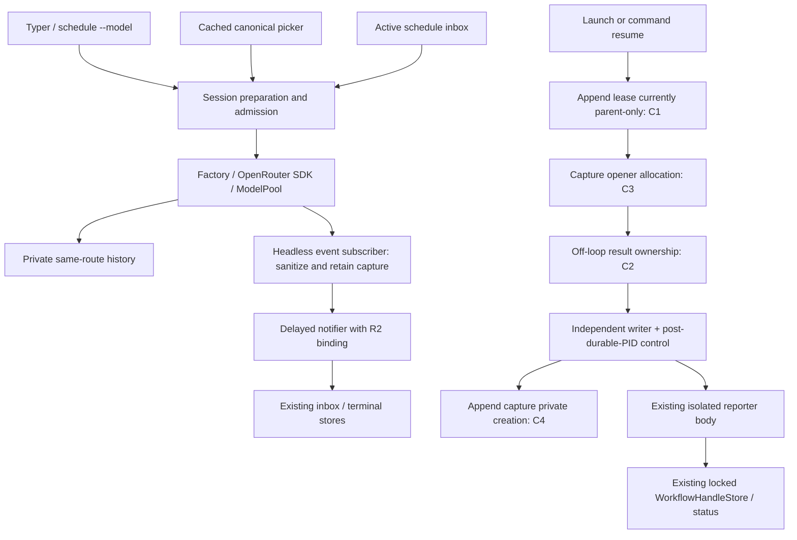

# Feature 86 — Independent review, section C

Date: 2026-10-03. Scope: **F86-29–42**, including their a.6 verification/documentation clauses and the assigned CLI/headless/scheduler/inbox/child/capture/notifier boundaries. **Verdict: REVISE.** This is not a review or approval of sections A/B, not a whole-feature Step 2 approval, and not Step 3.

## Executive summary

The current implementation has substantial, meaningful offline evidence: mounted discovery/selection/tool/resume, committed-stream barriers, active inbox route preservation, delayed headless notification with the accepted R2 credential handoff, and qualified shipped-writer/native-I/O EBADF reporting after launcher reap. Those are credited below rather than resurrecting superseded findings.

There are nevertheless current capture-lifetime defects. The append lease is owned only by the launcher, so it does not survive that launcher's exit with the independent writer. Cancellation of the off-loop capture opener can lose ownership of its eventual result. Pipe-allocation failures also leak the already-acquired lease descriptor. A fresh, non-writing source-body probe reproduced the latter two decisions. Private capture creation and current delivery documentation also do not satisfy the specified contracts. Formatting/mypy are waived, not these behavioral or mandatory structural findings.

## 1. Scope, method, and evidence vocabulary

Reviewed the actual dirty tracked files and actual untracked shipping source/tests, not merely HEAD or implementation reports. Read-only Git status distinguished source under `src/`, `config/`, and `tests/` from historical scratch/baseline copies; no scratch content was deleted or used as shipping implementation. No source, test, specification, shared final review, KB, or status ledger was edited. This file is the sole deliberately written review artifact.

Inputs read include the complete repository Code-Test-Review workflow and exact `skills/design-and-analysis/review-feature-code/SKILL.md`, immutable request/overview/dependency index/all six a.1–a.6 contracts, root RESEARCH, supplied AGENTS/SLO/CLAUDE/docs RESEARCH, the prior independent final review, remediation report, implementation ledger, current status, and remaining-requirements ledger. Ancestor instruction-file probes found no additional files at the queried checkout ancestors. KB Welcome, Slo README/gotchas/current F86 status and architecture/pool context were consulted; the KB's old failing-gate statement is not treated as current evidence. Relevant product CLI, Textual, client, application-service, named-input/type, docstring, declarative, test-verification and hard-review rules were consulted. Not every example in every ancillary convention/KB page was reread; no exhaustive every-line convention certification is claimed.

Stack: Python 3.11, asyncio/threads/ContextVar, Pydantic, Typer, Textual, LangChain/OpenAI SDK, filesystem history/inbox, POSIX pipes/flock/processes. SQL/FastAPI/Vue/DBOS rules do not apply here. The specific product CLI and F86 contracts take precedence over operator-Make-command templates; no new Command class, retrying GET client, or raw-response logging is requested.

Evidence labels:

- **Fresh inspection:** source and test assertions inspected in this review; not execution.
- **Fresh probe:** unchanged production function AST executed in an isolated namespace with fake I/O; no project import, credential lookup, filesystem mutation, OS child, or network. This proves the named decision, not a full process topology.
- **Retained execution:** previous logs/ledgers, explicitly not rerun by this reviewer.
- **PASS:** allocated behavior supported by inspected implementation/assertions, subject to the stated execution boundary; not universal branch coverage.
- **PARTIAL:** specific acceptance evidence/delivery limitation, not an allegation that all implementation is absent.
- **REVISE:** a current finding requires correction.

No pytest suite, live discovery, paid inference, formatter, mypy, package installation, or host-environment modification ran. The only Python probe used `/root/.pyenv/versions/slo-harness/bin/python -I -B` with bytecode disabled and stdlib only. Read-only `git diff --check` passed. There were no Git write operations. Several oversized context reads caused tool-managed `/tmp/slo-bash-*` spill files; this was an unintended tool-output side effect outside the requested artifact boundary, not a test write. They were left untouched. Subsequent reads were bounded. No system/PATH files were changed.

## 2. F86 requirement matrix

Paths below are checkout-relative. `a.N` refers to immutable `86.a.N-*` in `/root/Code/specifications/projects/slo/specifications/86-openrouter-intergration`.

| ID | Slice clauses / behavior | Actual shipping paths | Inspected test evidence | Fresh vs retained / limitation | Status |
|---|---|---|---|---|---|
| F86-29 | Overview §7.4; a.2 §§7.3,7.6; a.6 §7.4: seed/raw-cache/override separation | `model_catalog/service.py::_merge_seed_and_provider_cache`, `_validate_candidate_overrides`, `_apply_manual_overrides`; `discovery.py::ModelCatalogOverrideService`; `store.py::write_provider_cache` | `test_model_catalog_store.py` removes merged writer and round-trips raw slices; `test_model_catalog_overrides.py` rejects broader limits/reasoning; `test_atomic_publication.py` rejects invalid merged candidate before save | Fresh inspection supports raw persistence and last-applied restrictions. Exact remove-override→reload restoration assertion was not established by the inspected tests; no behavioral failure asserted | PARTIAL |
| F86-30 | Overview §7.10; a.5 §7.5; a.6 §7.1: substring/display/case/rank/exact insertion | `tui/slash_suggestion_engine.py::_bounded_model_rows`, `_model_rank`, `evaluate`; app suggestion acceptance | `test_openrouter_picker.py`: display-only match, exact ranking, canonical argument insertion; `test_picker_g8.py`; mounted full flow | Fresh source/assertion inspection; execution retained, not rerun. Leading argument offsets adjusted from original buffer; ghost suffix is case-sensitive | PASS |
| F86-31 | a.5 §§7.4–7.6; a.6 §7.3: 25 candidates, viewport/count, active/recent, no typing I/O | `ModelSuggestionProjection.rows`; engine `record_selection`; menu `_paint_window`; router bounded listing | `test_picker_g8.py` resolver tripwire/cache/active-recent; `test_picker_viewport_acceptance.py` compositor 8→3 rows, last/first wrap, empty/single; `test_picker_status_publication.py` highlight identity | Fresh inspection, retained execution. `window_start` is widget-owned rather than state-DAO-owned; behavior covered, no second catalog. Structural finding C5 is separate | PASS |
| F86-32 | a.5 §§7.2,7.4; a.6 §§7.1,7.5: honest evidence status | `tui/model_catalog.py::_catalog_status_summary`, `refresh_authentication`; catalog lifecycle read model | `test_catalog_status_revision.py`, `test_picker_status_publication.py`, historical-status tests; mounted auth result in full flow | Fresh inspection distinguishes historical/checked/stale/configured from inference. R4 presentation rename present. Warm passive clock aging is not independently certified here | PASS |
| F86-33 | a.3 §§7.5–7.6; a.4 §7.3; a.6 §7.1(5): sole fallback owner, tools, canonical audit | `providers/model_pool.py::_unwrap_member`, `_should_switch_after`, `_record_route_switch`; session audit drain | `test_model_pool.py` fixed OpenRouter audit; `test_openrouter_pinned_retry.py` actual factory-created pool clone; `test_openrouter_errors.py` real mixed SDK lanes; `test_openrouter_session_commit.py` session composition | Fresh inspection supports ownership/tool forwarding/commit barrier. Successful mixed-pool **durable** audit+bound-tool composition is not established by the named inspected assertions (code-only audit test and no-switch compositions are different proofs) | PARTIAL |
| F86-34 | Overview §7.8; a.3 §7.5; a.6 §7.1: error taxonomy | `credit_exhaustion_policy.py::_classify_openrouter`, `_openrouter_402_kind`; shared exception/normalizer | `test_openrouter_errors.py`, `test_openrouter_review_contracts.py`: security precedence, statusless errors, exact budget+positive Retry-After, SDK headers; local HTTP/SSE | Fresh classifier/assertion inspection; retains ordinary 402, 401/403/404 terminal, 429, bounded transient paths; no new status ladder in UI. Not all SDK versions executed here | PASS |
| F86-35 | a.3 §§7.3–7.6; a.4 §7.8; a.6 §§7.1–7.2: normalized errors, no committed replay, secrecy | OpenRouter adapter; shared classifier/recovery; session originating-provider continuation gate; headless `_emit`/terminal; child/capture writers | `test_openrouter_session_commit.py` role/usage/text/reasoning/tool × failure/cancel; `test_openrouter_final_compositions.py` actual HTTP400→one terminal/status/inbox; R2 lifetime tests; child secrecy tests | Fresh inspection credits no-replay and normalized-body secrecy, and R2 remains accepted. Capture resource/privacy defects C1–C4 prevent whole allocated cross-channel sign-off | REVISE |
| F86-36 | a.3 §§7.5–7.6; a.6 §7.1: bounded retry ownership, no independent-quota assumption | Factory `max_retries=0`; pool first-chunk barrier and `_retry_advice_seconds`; existing session retry/continuation policies | `test_openrouter_pinned_retry.py` pinned 7s cap after binding; session commit test asserts exactly one request/no retry/recovery/reconnect; existing pool exhaustion tests | Fresh inspection of named contracts; retained execution. No adapter retry loop/account quota manager introduced. This does not claim a fresh exhaustive retry-budget suite | PASS |
| F86-37 | a.4 §§7.4–7.8; a.6 §7.1(7–8): CLI/preferences/resume/headless/schedule/child | `TyperDispatch` config/resume; `HeadlessRunner`; schedule executor/subprocess runner; app inbox; launch/relaunch/store/capture | `test_openrouter_preparation.py`, `test_resume_route_precedence.py`; active scheduled integration; terminal lifetime; detached FD, control, contained-lifetime, relaunch/lease tests | Fresh inspection plus two fresh probes. Main route and R2 paths supported; C1–C3 show resource/drain contract failures. Independent reservation test is two OS processes, not two full CLI workloads | REVISE |
| F86-38 | a.6 §§7.3,7.8,8–9: offline tests/test-first/full gate | Tests, existing harness env, current ledger/logs | Latest full log `.f86-declarative-final-c9fexr/full-non-e2e.log`: **5047 passed, 15 deselected, 201 warnings, 329.49s**; R2/R3/R4 red/green ledgers | Log tail independently read; this is **retained then-current execution**, not reviewer full approval. Fresh probes reproduce uncovered failures; no fresh pytest. Black/mypy expressly waived | PARTIAL |
| F86-39 | a.6 §§7.1–7.3,7.6–7.7,8: local full flow, provenance, live limits | Actual untracked integration/provider/paint/capture tests | Mounted full flow; committed SDK tests; native-I/O capture receipts; inline fixtures explicitly synthetic/documented | No live work needed or authorized. Required `tests/fixtures/openrouter/` provenance artifacts and opt-in live-test file are absent (C6). Synthetic inline descriptions are useful but not the prescribed observed-public/documented fixture bundle | PARTIAL |
| F86-40 | a.6 §§7.5–7.6,9: truthful current docs/exact commands/evidence | README, AGENTS, root/docs RESEARCH, headless/scheduler guides, delivery reports | Current source/document comparison; retained logs and remediation/ledger | C7: current-facing guides still describe non-green full gates and generic already-superseded blockers; scheduler test name also conceals lost historical headless composition. Correct bounded provenance, not blanket completion | REVISE |
| F86-41 | a.6 §7.4/§9; all slice non-goals: ownership and exclusions | Existing resolver/catalog/factory/session/pool; narrow adapter and stdlib writer; R4 `ModelPickerRowDAO` | Current source and dirty-path inventory | No new SDK, graph topology, gateway model-array fallback, OAuth, pricing, generic endpoint platform found in allocated paths. Preserve R2/R3/R4. C5 remains mandatory structural noncompliance, not a formatting/mypy objection | REVISE |
| F86-42 | a.5 §§7.2–7.6; a.6 §7.1(1): unseeded route and explicit choice | Auth→GET→converter/store/catalog→picker/router→session/factory | `test_mounted_openrouter_auth_picker_router_session_and_resume_flow`: candidate verification before store; discovered `vendor/mounted-unseeded`; canonical insertion; actual SDK tool/answer; newly prepared session exact anchor/result | Fresh assertion inspection, retained execution. NEW session in the **same process**, not an OS interpreter restart. No arbitrary first remote model selected; no live availability assertion | PASS |

All fourteen allocated IDs have a disposition. PARTIAL rows describe exact evidence limits; they must not be silently promoted to PASS using the aggregate full-suite count.

## 3. End-to-end flow verification

### Interactive and resume

`AuthenticationScreen → OpenRouterAuthenticationService → local /key → CredentialStore → /models/user → converter → raw cache commit → canonical snapshot → cached picker → canonical /model selection → SloAgentSession → LLMFactory/OpenRouterChatOpenAI → tool → same-route continuation → private history → newly prepared session`.

The mounted test crosses real production owners with injected HTTP transport, not a Faux-only transport substitute. It asserts the third request contains the persisted reasoning anchor and original tool result. Auth paint is compositor-checked; subsequent transcript checks use the copyable transcript. It is a same-process new-session resume. The separate removal composition publishes removal while an actual SDK request waits, completes the old admitted run, then rejects prepared resume with unchanged readable history. These are distinct, useful assertions.

### CLI/headless and delayed notifier

`app.py parse → TyperDispatch precedence/session ID → HeadlessRunner preparation task + SIGTERM controller → prepared session → subscribed stream task → _emit → terminal status → delayed _notify_terminal → real inbox`.

Explicit model bypasses invalid configured-pool parsing. Resume metadata is read before runner construction; the synchronous CLI boundary uses its async helper, not nested asyncio.run inside the runner. Pool metadata resumes as the last routed single model unless a current pool is configured. Preparation failure/abort uses the materialized identity, zero inference, and existing status/notifier paths.

**R2 remains accepted:** `_emit` reads the actual operation ContextVar, retains its private credential, sanitizes the public event before retaining terminal content, and `_notify_terminal` binds the retained capture after the stream task exits. `invoke` clears it in finally. The lifetime tests exercise completed/failed × rotation/resolver failure × cleanup success/error/actual cancellation, with populated ordinary inbox/stdout controls. Concurrent handoff is a two-session seam test, not two whole concurrent CLI processes. The actual normalized HTTP400 composition asserts exactly one parent `run_failed`, one terminal inbox item, failed status/exit1 and one inference request; its pre-session-event variant covers fallback emission. No private replay field is added to the public event.

### Scheduled active inbox versus inactive child

`ScheduleExecutor → active target lease → SessionInboxStore queued item/report → mounted SloTUI poll/claim → ordinary target-session invoke → ack` is currently composed and asserted. The definition uses a **different** schedule-only model. Both actual SDK bodies keep the target model, both authorizations retain admitted A after the first transport switches effective lookup to B, and the second body retains the exact private anchor/tool result. The HTTP400 variant carries A/B/raw marker only through the actual SDK error-normalization boundary. Public events/transcript exclude opaque reasoning; events.jsonl intentionally retains exactly one private extension. Queue/report files precede rotation and are not post-rotation redaction proof. Transcript export is explicitly performed by the test.

Inactive scheduling remains source-wired through `ScheduleSubprocessRunner._base_argv → slo run --model → HeadlessRunner`; argument/result tests exist. **The current `test_openrouter_scheduled_preparation.py` contains only the two active-inbox variants.** Its opening docstring explicitly excludes headless child/fleet/notifier. Historical reports about an earlier in-process spawn→HeadlessRunner composition are not assertions in this current file. Do not describe those old test counts as current inactive-schedule composed proof; retain their historical provenance.

### Child capture, append, and reporter

`LaunchWorkflowTool → capture opener (two writers) → workload spawn → durable store.write(pid) → activate(control FD) → parent endpoint close → writer drain → failure reporter → locked existing WorkflowHandleStore → fresh status` is **wired**. Command resume similarly reserves, enters `spawn_for_adoption`, durably calls `store.relaunch`, then activates. The private frame contains only history root/owner/workflow/expected PID; malformed/duplicate/oversize frames and no-adoption EOF are inert. The existing store rejects stale PIDs and preserves lifecycle identity when marking capture degradation.

The inspected late-failure test reaps the launcher using `communicate` before releasing workload output. Two writer PIDs differ from workload PID; successful first flush precedes replacing FD1 with a read-only FD to the **same test-owned inode**. Shipped `_drain_capture_input` runs over native BufferedWriter/FileIO and encounters kernel EBADF. Reporter bootstrap executes the exact shipped reporter body; receipts check body hash, environment, resource limit, store return, one reporter, and fresh safe handle/status. Workload remains live, non-zombie, same PID/PGID and launching state. Clean test asserts no reporter receipt. **Credit this bounded proof.** Audited runpy/exec wrappers are not native interpreter-startup equivalence; literal argv equality is not a product requirement.

Append ordering test proves exact `old-tailnew-first-byte` while the original parent remains alive. Refusal test proves bounded rejection without output. Two-interpreter reservation test proves one durable admission and a refused second reservation; its `{"workloads": 1}` result is written by the admitted test script, not an independently counted full `slo run` workload. Existing cancellation test proves no replacement **workload** spawn after cancelling a waiting opener; it does not assert eventual writer/control/lease ownership. C1–C3 identify those precise distinctions, not an invented broad matrix.

## 4. Findings — glaring gaps / must fix

### C1 — High: append lease does not survive launcher exit

**Where:** `src/agents/slo_agent/orchestrator/spawn_env.py:330,353–365,375–386`; `_CapturePipe._close_append_lock_fd` and daemon reaper; `capture_writer.py::_drain_capture_input`.

The launcher acquires the flock descriptor, retains it on `_CapturePipe`, and passes only ACK/control FDs to the independent writer with `close_fds=True`. The writer never inherits the append lease. When the launcher exits, the kernel closes its lease FD even if the independent writer still has buffered tail/output to append. A later resumed opener can acquire the now-free lease and write before that tail. This defeats the stated purpose of Plan B precisely in the detached lifecycle the writer was introduced to support.

**Evidence:** fresh source/FD ownership trace. The existing ordering test keeps the parent and `_CapturePipe` alive; the reaped-parent test does not start a competing append writer. Neither disproves this lifetime counterexample. No fresh OS-process reproduction was run.

**Correction:** transfer/retain the existing narrow append lease in the independent writer until its drain/terminal cleanup completes, with unambiguous parent/child FD ownership and failure cleanup. No second registry/status/lock framework. Add one finite test where launcher is reaped while old tail is held and replacement readiness is blocked until old drain, then assert exact byte order. Keep workload PID/group and the qualified reporter evidence unchanged.

### C2 — High: cancelled off-loop opener loses its eventual endpoint; reservation is not rolled back before yield

**Where:** `relaunch.py:94–109,122–123`; `workflow_registry.py:1332–1361`.

Cancelling `await asyncio.to_thread(_open_capture_file, ...)` does not stop its worker. The returned endpoint has not yet entered `capture_files`. Finally closes an empty/already-registered stack; a worker that later acquires the lease and returns an endpoint has no explicit owner to close it. Real `_CapturePipe` cleanup cannot safely be delegated to GC: ACK/control/lease are extra integer FDs, and a writer's non-daemon control reader can remain waiting for EOF. Separately, the command cancellation branch immediately re-raises when `ownership is None`, leaving the already-persisted pid-zero reservation instead of restoring the original resumable state.

**Fresh probe:** executed the unchanged `spawn_for_adoption` AST with a barrier-controlled fake synchronous opener and fake endpoint. Cancelled the owner, then released the opener. Result: endpoint `closed == False`. No filesystem/process action. This establishes missing explicit cleanup, not a measured real orphan process.

**Existing evidence limitation:** `test_spawn_for_adoption_cancellation_while_append_lease_waits_never_spawns_workload` asserts no asyncio workload spawn and later lock availability. It does not assert the writer never starts, endpoint/control cleanup, or command reservation rollback.

**Correction:** retain a joinable/shielded opener future and close any successful late result before cancellation cleanup completes; handle errors without leaking ownership. Roll back a reserved pre-adoption command even when the context has not yielded, while preserving the accepted post-adoption no-kill behavior. Test cancellation on both stdout/stderr acquisition boundaries, eventual result closure/control EOF/reap, and original durable state restoration. These are the existing cancellation boundary, not new product behavior.

### C3 — High: pipe-allocation failures leak the acquired append-lock FD

**Where:** `spawn_env.py:330–350` versus cleanup at `393–404`; `_acquire_capture_append_lease:425–438`.

The lock is acquired before the first pipe, but the outer cleanup starts only after all three pipe allocations. First-pipe failure closes nothing; second/third failures close pipe pairs but not the append lease. Unexpected flock failure likewise has no general descriptor cleanup. A leaked flock descriptor can keep future attempts refusing for the remaining parent lifetime, in addition to leaking resources.

**Fresh probe:** unchanged `open_capture_file_append` AST, fake path/no-op mkdir, fake lease FD 901, first `pipe()` raising OSError and recording fake `close`. Assertion: `closed == []`. Output below. No real FD was closed or opened.

**Coverage gap:** `test_pipe_allocation_failure_closes_every_allocated_fd` tracks only the synthetic pipe pairs. Its expected list omits the actual acquired lease. The later destination-open failure test correctly includes a fake lease FD, but that branch starts after the leak window.

**Correction:** establish cleanup ownership immediately after lease acquisition, including all allocation and lock-acquisition error paths; transfer ownership only on successful handoff. Expand the existing allocation test to include the lease and prove subsequent acquisition remains possible. Do not weaken the six-pipe assertions.

### C4 — Medium/security contract: capture artifacts rely on ambient permissions

**Where:** `spawn_env.py:329,333,352`; `process.py::_open_capture_file` around 333–334.

New capture directories use default mkdir mode and files use `Path.open('ab')`, without explicit private creation. Under ordinary umask 022 these are 0755/0644 rather than a.6 §7.2's 0700/0600. Other private stores do not set a process-wide umask for these opens. Capture content includes user/workflow diagnostics even after literal credential redaction. A private ancestor can reduce access, but does not satisfy the explicit artifact-mode contract and is not guaranteed by these APIs.

**Evidence:** fresh source inspection, not a live permission experiment. Existing capture assertions inspected scan contents, not creation modes. Lock creation requests 0600, which does not fix capture files/directories.

**Correction:** private creation in the existing capture owner before writes, without changing global umask or unrelated paths. Test modes at creation under a permissive test-local scenario, constrained to verified owned paths. Preserve append semantics and old artifact contents.

### C5 — Medium/mandatory: new capture and picker orchestration still violates declarative structure

**Where:** `spawn_env.py::open_capture_file_append:321–404`; `relaunch.py::spawn_for_adoption:90–123`; `slash_suggestion_engine.py::_model_argument_state` around 245–290; `slash_suggestion_menu.py::_paint_window` around 80–108.

New code mixes credential resolution, path creation, lease/pipe allocation, process spawn, acknowledgement, handoff and cleanup in one function; picker methods similarly mix ranking/window/clamping/render assembly with nested conditional expressions. This is not Black or mypy debt. Mandatory declarative rules require named single-responsibility steps; a.5 explicitly prescribes separate empty-query/matching/bounding helpers. The resource bugs above demonstrate why ownership should be legible.

**Correction:** extract private steps in the same existing owners, with explicit lifetime/transfer contracts and tests per decision. Do not create a parallel capture/search framework. Stdlib positional-only FD APIs are not flagged as keyword violations. The stdlib-only writer's dataclass is not a request to import Pydantic into its isolated bootstrap. R2/R3/R4 and the later catalog extraction are not reopened by this finding.

### C6 — Medium/verification: prescribed fixture provenance bundle is missing

**Where:** absent `tests/fixtures/openrouter/` and `tests/integrations/openrouter/test_live_openrouter.py`; a.6 §§7.6–7.7,8.1; overview §7.11.

Current tests honestly identify many inline responses as synthetic/documented and provide valuable local SDK coverage. They do not supply the prescribed representative observed-public/documented fixture set with adjacent provenance metadata. The opt-in procedure is specified, but the named credential/authorization-gated test is absent. This is a deliverable gap, **not authorization to fetch data or run paid tests** and not a claim that live evidence is required for offline acceptance.

**Correction:** retain sanitized already-available research shapes with explicit public-versus-documented/synthetic provenance and reuse them in local tests. Add the disabled-by-default, explicit-authorization live procedure/test or obtain a recorded scope disposition for that artifact. No live call is requested by this review; no SDK upgrade/install is needed. Report available tested SDK versions versus lock separately.

### C7 — Medium/documentation: current-facing delivery claims contradict current evidence

**Where:** `README.md:86–92`, `docs/SLO_HEADLESS_README.md:102–108`, `docs/SLO_SCHEDULER_README.md:88–96`; `remaining-requirements.md` latest heading; root/docs RESEARCH's current F86 summaries.

These present non-green current full gates and generic populated scheduler/notifier/capture/adverse matrices as remaining blockers even though later logs and named compositions supersede them. The latest retained full run is 5047 pass; formatting/mypy are expressly waived. `remaining-requirements.md` still leads with the old catalog orchestration finding despite the newer extraction entry. This does not mean the feature is ready—C1–C6 remain—but the reasons must be current and finite.

The current active-schedule module no longer contains the earlier headless scheduled composition described in dated ledger sections. Historical results may stay, but current docs must not imply those old assertions still execute in that file. Likewise preserve the difference between actual CLI process, in-process HeadlessRunner, injected child pumps, same-process resume, and qualified native-I/O writer/reporter proof.

**Correction:** one dated current evidence table linking exact current test symbols/logs, keeping historical reports unchanged and recording this review's new findings. State no live validation, no native-startup equivalence, no argv-equality gate, and no whole-feature approval from aggregate tests. Include precise cache stale/mismatch/removal/variant and capability limitations in operator docs rather than only historical ledgers.

## 5. Test assessment and fresh execution record

### What existing tests actually establish

| Boundary | Positive evidence | Limit |
|---|---|---|
| R2 delayed headless notifier | Real admitted session scope/history, runner child task ends, real inbox, completed/failed, resolver rotation/failure, cleanup cancellation/reset | Synthetic secret-bearing terminal payload; not live SDK disclosure; concurrent case is handoff-only |
| Actual normalized HTTP400 | Real factory/SDK/session/runner, one request, one run_failed, status and terminal inbox populated | No cross-process CLI startup; different from arbitrary old-key output |
| Active schedule | Real executor/lease/inbox/app/session/SDK, distinct scheduled route, A-pinned continuation after B, exact private anchor | Not inactive child preparation; queued artifacts precede rotation |
| Child public artifacts | Actual SubAgentProcess pumps/result/status/registry/fleet over injected streams, ordinary content controls, A capture with rotated/failing resolver | Raw marker removed through normalizer before pipe; no arbitrary FD raw-body filter; no OS child in that test |
| Detached FD/private history | Controlled finite child, env/store credential variants and escaped serialized history; opaque anchor preserved | Does not by itself certify append-parent-exit ordering or all terminal notification paths |
| Post-reap EBADF | Two shipped writer bodies, native IO, same-inode kernel failure, exact reporter body, fresh safe health/status, live stable PID/group | Audited wrappers; no native-startup equivalence; no competing new append writer |
| Append tests | Same-parent exact ordering, bounded refusal, two independent reservation processes, no workload after cancellation | C1–C3 are not asserted; no fresh rerun here |
| Picker | Actual compositor viewport/count/wrap/empty cases and cached no-I/O search/insertion | Component paint is not an entire interactive manual smoke |

Fresh probe command prefix: `PYTHONDONTWRITEBYTECODE=1 /root/.pyenv/versions/slo-harness/bin/python -I -B -` (stdin script). It parsed current files with `ast`, compiled only `open_capture_file_append` and `spawn_for_adoption` unchanged, and supplied fake namespace dependencies. No fake method replaced the production bodies under test. First probe forced pipe failure after fake lease acquisition; second used a threading Event to let a cancelled opener return a fake endpoint. Both assertions reproduced defects; exit 0 is **not acceptance green**.

Exact output:

```text
REPRODUCED: first pipe allocation error leaves acquired append lease FD unclosed (fake FD 901; no OS write).
REPRODUCED: cancelled off-loop capture opener returns an endpoint that the shipping lifetime never closes (fake endpoint; no process/file).
```

Retained gate independently read: `.f86-declarative-final-c9fexr/full-non-e2e.log` ends with `5047 passed, 15 deselected, 201 warnings in 329.49s (0:05:29)`. The earlier remediation full log/report records 5045. Neither is this reviewer's fresh suite. No skips were introduced, no assertions weakened, and no broad gate result is used to erase the reproduced uncovered branches.

## 6. Mandatory conventions and ubiquitous language

Hard-rules post-hook applied to allocated owners: functional/resource ownership and per-decision coverage are not clean (C1–C4); declarative structure is not clean (C5). Formatting/mypy waived and not run. Public APIs generally have typed inputs and docstrings; some test helpers lack return annotations and short public docs omit Args/Returns. Those are not evidence of a functional failure, but no blanket convention-clean certification is made.

| Concept | Trace/result |
|---|---|
| `model_name` | Exact canonical route across config/session/picker/history; `api_model_name` only at provider wire boundary |
| `provider` | Credential/transport owner remains OpenRouter regardless of upstream author |
| `safe_error_code` | Pool audit field; legacy persisted `error_message` deliberately carries fixed code |
| `ModelPickerRowDAO` | Presentation-only; R4 rename retained, canonical DAO not duplicated under that name |
| operation credential | Private task capture → runner private handoff → delayed notifier; no public DTO/persisted secret owner |
| capture append lease | Name/documentation implies writer-lifetime serialization; actual parent-only FD lifetime contradicts it (C1) |
| resume admission | Durable reservation is not itself a spawned workload; tests/docs must preserve that distinction |

### Nice-to-haves

- Update stale test module docstrings that say later tests in the same file remain pending (`test_capture_contained_lifetime.py`, `test_openrouter_full_flow.py`).
- Remove or clearly mark test-only compatibility render helpers such as menu `_render_lines`; mounted `_paint_window` is the actual paint owner.
- Improve missing test annotations and compact public method documentation while touching their owners; do not conflate this with the waived formatter/type gate.

### Acknowledged limitations / temporary debt

- No fresh full or targeted pytest; only the two no-write source-body probes and read-only diff check.
- No live authenticated catalog or inference, no second SDK environment installed/tested.
- Same-process resume and independent reservation-process proof are not full cross-process inference-resume proof.
- R2/R3/R4 accepted remediation remains accepted absent a counterexample; no such counterexample was found here.
- This report is an allocated review, not an exhaustive audit of sections A/B or every old project convention violation.

## 7. Architecture and correction boundaries



## 8. Completion checklist for the allocated correction

### Must-fix code

- [ ] Retain append lease through independent writer lifetime, including parent exit (C1).
- [ ] Join/close late opener results and roll back unadopted reservation on cancellation (C2).
- [ ] Own lease cleanup from acquisition through every pipe/lock error (C3).
- [ ] Create capture directories/files privately before writes (C4).
- [ ] Extract named lifecycle/search/render decisions in existing owners (C5).

### Required bounded tests

- [ ] Reaped-parent old-tail versus replacement-first-byte ordering, without changing workload identity.
- [ ] Cancel before opener return on each endpoint; assert eventual resource cleanup and durable reservation truth, not only no workload spawn.
- [ ] Include lease FD in first/second/third pipe failure assertions and verify reacquisition.
- [ ] Capture modes at creation on owned paths.
- [ ] Retain exact R2 notifier, normalized HTTP400, active-inbox/private-anchor, and qualified EBADF regressions.
- [ ] Establish exact override-removal/reload and successful mixed-pool durable tool/audit acceptance evidence before upgrading their PARTIAL rows; use existing tests if they already assert those outcomes.

### Product/specification decisions and documentation

- [ ] Supply prescribed fixture provenance/disabled live procedure artifact or obtain explicit disposition; no live execution authorized (C6).
- [ ] Reconcile current docs with current source/tests, the 5047 retained gate, static waiver, and C1–C7, preserving dated history (C7).
- [ ] Do not invent native startup or argv equality requirements, remove private anchors, add raw-body FD filtering, or create alternate lifecycle owners.

**Final section-C verdict: REVISE.**
