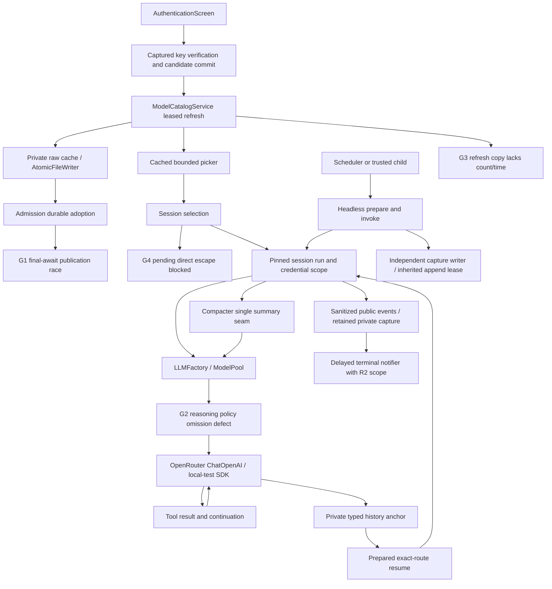

# Feature 86 — independent Step 2 review after the 5065-pass corrections

Date: 2026-10-03. Branch: `feature-86-openrouter-implementation`.

## Executive summary

**REVISE.** The retained complete non-E2E log supports the reported 5065-pass gate. It does not establish specification compliance: current reasoning tests positively assert prohibited behavior, and the corrected admission publication helper still permits a stale publication across its final asynchronous cache read. Manual-refresh output and pending-startup recovery also remain incomplete.

This is Code-Test-Review **Step 2 only**, not a formal completion assessment. No implementation, tests, specifications, prior reports, or Git state were modified. This report is the only deliberate file write. No agents, network requests, project imports, credential reads, installs, or paid inference were launched. One oversized specification read caused the tool to spill its output to `/tmp/slo-bash-ipxalx5l.txt`; that automatic tool artifact was left untouched.

## Stack, inputs, and inspection level

Python 3.11, asyncio/threads/ContextVar, Pydantic, httpx, LangChain/OpenAI SDK, LangGraph, Typer, Textual, filesystem history/catalog/inbox, and POSIX capture ownership. SQL, Vue, Go, TypeScript, and DBOS rules do not apply. Personal skill names were inspected; none adds an applicable Python review convention here.

Consulted supplied global/repository SLO/AGENTS/CLAUDE instructions, root RESEARCH and supplied docs/RESEARCH, the exact review skill and Code-Test-Review workflow, relevant portions of the hard-rules, named-input/type, declarative-method, docstring, test-verification, external-client, application-service, product-Typer, Textual and graph-gateway skills. Consulted KB Welcome, Slo README (there is no `slo/index.md`), gotchas and Feature-86 status. The KB's old failed gate and no-waiver statements are superseded by current evidence and the user's waiver.

Read the immutable overview allocation table F86-01..42 and implementation/acceptance clauses from a.1–a.6, latest owner A–D evidence, integration verification, full29 inventory, corrective evidence, current-status/remaining-requirements, implementation-log excerpts, section A/B/C reviews and final/rereview excerpts. Historical reports are evidence pointers, not findings automatically carried forward.

**Coverage honesty:** all 42 allocations are mapped below, but this is not an exhaustive line-by-line inspection of every shipping file, test method, historical ledger, or convention example. Source-level scrutiny was deepest at current corrections and their cross-boundary handoffs. Some allocations retain prior evidence only. Thus the requested exhaustive independent audit is not represented as completed. Uninspected is not synonymous with unimplemented. Confirmed defects below independently require REVISE regardless of that limitation.

## Test-gate verification

- Independently read the beginning and terminal summary of `.f86-step1-full-XyirL9/full-non-e2e.log`: **5065 passed, 15 deselected, 202 warnings in 352.33s**.
- The corrective report records **exit 0**, `timeout 1200`, approved Python 3.11 harness, `env -i`, isolated HOME/SLO_HOME/TMPDIR/auth file, bytecode disabled, no pytest cache, and only `-m 'not e2e'` deselection. A plain retained pytest log cannot independently attest the historical shell exit status or immutable source identity; no source-hash manifest was verified.
- Reviewed the finite 29-failure accounting: ten route-message expectations, one FD-number assumption, eighteen plugin tests suppressed by invocation-level `SLO_PLUGINS_DISABLED=1`. The new autouse fixture removes that switch; explicit kill-switch tests must set it after setup. The FD test correction validates identity/forwarding rather than an allocation number.
- Fresh `git diff --check`: exit 0.
- Fresh **non-writing stdlib AST probes**, using `/root/.pyenv/versions/slo-harness/bin/python -I -B` under `env -i`, reproduced G1 and G2 from unchanged shipping method bodies. These are bounded decision-path reproductions, not pytest, SDK, OS-process or full-store acceptance tests.
- No pytest suite was rerun by this reviewer. Black/mypy were not run and are explicitly waived, not claimed green. No live provider or SDK cross-version equivalence is claimed.

## Glaring Gaps — must fix

### G1 — High: admission publication rechecks before, not after, its final await

**Immutable contract:** overview §7.4: “Before persistence and before publication, recompute effective credential fingerprint; mismatch discards result”; a.2 §7.4: “Recompute effective fingerprint before save and before publish; mismatch discards the candidate.” a.4 §7.3 requires capturing the newest valid snapshot and adopting changed metadata at next admission. Allocations F86-23/25/26/27.

**Location:** `src/agents/model_catalog/service.py:489–495`, `_publish_admission_candidate_if_current`.

**Cause:** the helper checks the credential, then awaits `asyncio.to_thread(ModelCatalogStore.load_provider_cache)`, then publishes solely on cache equality. A worker can read the old cache, after which a concurrent refresh publishes a newer cache/snapshot before the awaiting coroutine resumes. Equality with the old candidate's cache still succeeds. Credential rotation during this same await also bypasses the just-completed credential check. There is no generation/reference check after the await.

**Impact:** older membership/caps can overwrite a newer in-process publication with a higher numerical generation; an obsolete credential's candidate can be published. This is a publication/provenance failure, not a claim of paid inference with an unauthorized key.

**Fresh reproduction:** executed the unchanged helper with fake collaborators. The fake `to_thread` returned an already-read old cache after changing effective A to B and installing a newer publication. Result: `REPRODUCED: shipping publish helper publishes old candidate after key rotation/new publication during its final cache-read await.` No real files, locks, resolver, or network were involved.

**Why current tests miss it:** `test_openrouter_admission_security.py:230–405` blocks `_build_publication_candidate`, then changes state before the helper's fingerprint check. It covers the earlier await, not the newly added final cache-read await. Owner A's “immediately before” claim is stronger than the implementation.

**Minimal correction:** keep ordering in the existing catalog owner; validate effective identity and an observed publication generation/reference after asynchronous work and before the no-await swap, retrying/rejecting stale candidates. Coordinate durable adoption with the existing lease/order contract rather than adding a new publication owner.

**Exact verification:** barrier at the final cache loader after it has read old bytes but before its result is delivered. Complete a newer same-key publication, release the old reader, and assert newer membership/caps and generation are not replaced. Independently rotate A→B at that barrier and assert no A candidate publication. Use real temp-store bytes for the composed regression; retain candidate-await, last-good, old-run pinning, and removal tests.

### G2 — High: missing reasoning metadata manufactures controls and disable permission

**Immutable contracts:** a.2 §7.2: “explicit null `supported_efforts` means documented full gateway vocabulary, omitted means controls unavailable.” Overview §7.3: “If mandatory is absent, do not advertise disable”; missing controls mean “off means no requested control, NOT `enabled=false`.” a.3 §7.2: “Unknown controls return `{}` rather than `enabled=false`.” Allocations F86-17/18.

**Locations:** `src/agents/model_catalog/openrouter.py:292,300–302,323–335`; `src/agents/providers/openrouter.py:93–107`; factory forwarding at `src/agents/base.py:644–645`.

**Cause:** `.get('supported_efforts')` conflates absent with explicit null; `_recognized_efforts(None)` expands to all efforts. Separately, missing `mandatory` produces an off-enabled profile with controls available, but the request policy has only `controls_available` and an optional effort. It converts every unavailable effort into `reasoning.enabled=false`, losing whether disable permission was actually advertised.

**Impact:** an otherwise eligible route with `reasoning={}` advertises invented controls. A route with known efforts but no mandatory flag sends an unadvertised disable directive for off. Gateway defaults are overridden contrary to the conservative contract; requests may be rejected.

**Fresh reproduction:** extracted unchanged converter helpers and request policy, using only synthetic dictionaries. All three inputs `{}`, `{'mandatory': False}`, and `{'supported_efforts': ['low']}` produced `controls=True` and off wire `{'reasoning': {'enabled': False}}`.

**False-confidence test:** `tests/agents/providers/test_openrouter_reasoning_semantics.py:22–27` explicitly expects this forbidden output, including absent and malformed mandatory metadata. The converter's “efforts omitted” test at `test_openrouter_converter_metadata.py:169` omits the entire reasoning object; it does not test an existing reasoning object missing `supported_efforts`. Owner C's assertion that absent mandatory does not authorize disable is contradicted by these shipping assertions.

**Minimal correction:** distinguish field absence from explicit null at conversion; preserve disable permission independently of enabled-effort availability in the existing profile/capability/request-policy owners. For unknown controls emit no reasoning payload; for absent mandatory permit known enabled efforts without exposing/sending disable. Do not restore the previous suppression of all known enabled efforts.

**Exact verification:** converter→resolver→real factory/MockTransport matrix for absent reasoning, empty reasoning object, omitted versus explicit-null efforts, known efforts with absent/invalid/false/true mandatory, and off plus an enabled level. Assert absent payload for unknown controls, no `enabled=false` without explicit permission, valid enabled effort transmission, and mandatory clamp. Correct the current wrong expected wire values first.

### G3 — Medium: manual refresh omits required count and check time

**Immutable clause:** a.5 §7.6: “It returns bounded count/time/status safe copy”; overview §7.10 requires a “bounded success/failure/count/time message.” Allocation F86-21, related F86-32.

**Locations:** `src/agents/model_catalog/service.py:1290–1293` returns only `OpenRouter catalog refreshed.`; `src/agents/slo_agent/sessions/service.py:2180–2195` returns `result.safe_message`; `src/tui/slash_router.py:740–749` forwards it unchanged. The fresh-result branch also has only fixed current-catalog copy.

**Impact:** the public action is wired but cannot show how many models were checked or when, as required. Owner D expressly left this outside its slice; the full gate did not supply it.

**Minimal correction:** derive bounded count/time/status from the catalog-owned outcome/evidence, including truthful last-good information on failure. Keep the router a consumer; do not parse cache/wire data there.

**Exact verification:** real session/router refresh success, empty success, fresh/coalesced result, and failure retaining last-good evidence. Assert printable output ≤240 characters, expected count/check-time, no raw labels/key/fingerprint, and no run-snapshot mutation.

### G4 — Medium: pending startup forbids the specified direct-model escape

**Immutable clause:** a.4 §4 scope text at line 81: TUI may mount pending “so users can run `/auth`, `/model refresh`, or choose a direct model. No prompt is admitted while pending.” Overview §7.9 repeats recovery via choosing a direct model. Allocation F86-20, related F86-05/37.

**Location:** `src/agents/slo_agent/sessions/service.py:2212–2213,2226–2227` rejects every selection while pending, including direct providers.

**Cause/impact:** a pending OpenRouter discovery blocks a valid direct-provider choice until preparation finishes. Owner D says a.4 §7.2 explicitly blocks all pending selections; the inspected immutable §7.2 does not say that. Prompt gating is not selection gating.

**Minimal correction:** allow prepared direct-model recovery while keeping pending prompts blocked. Coordinate/cancel or invalidate the tracked startup result so a late OpenRouter completion cannot overwrite the successful direct selection; do not simply remove the guard without lifecycle protection.

**Exact verification:** mounted pending startup held on an async barrier, select a credentialed direct route, assert successful exact selection/pool clearing/preference semantics, then release/cancel the old startup and assert it cannot restore the old route/snapshot/usage. Retain prompt rejection during genuinely pending state.

### G5 — Medium: required provenance artifacts and current delivery documentation are missing/stale

**Immutable clauses:** a.6 §8.1 explicitly lists `tests/fixtures/openrouter/README.md` describing provenance/sanitization and an e2e live-test file skipped without explicit credential/flag. a.2 §8.4 and overview §7.11 prescribe sanitized fixture artifacts. a.6 §7.5 requires “exact implementation truth” in current docs. Allocations F86-39/40.

**Locations:** `tests/fixtures/openrouter/` and `tests/integrations/openrouter/test_live_openrouter.py` are absent from the current shipping tree. `README.md:85–93` still says non-green current full/static gates and generic previously superseded matrices; `docs/implementation/86-openrouter/current-status-2026-10-02.md:3–9` still leads with the 29-failure gate. The newer corrective report and remaining-requirements entry correctly record 5065 passes.

**Impact:** inline synthetic fixtures provide useful tests but not the prescribed observed/documented provenance bundle. Current entry points misdirect reviewers/operators about which gate is current. This is not a demand to run live requests, nor a failure because remote availability is unproved.

**Minimal correction:** supply the sanitized/provenance-labelled fixture bundle and disabled opt-in test/procedure under the prescribed ownership, with paid and GET authorization separated. Reconcile current-facing pointers to the latest retained gate and actual finite review findings while preserving historical reports. Do not claim READY or live availability merely to update docs.

**Exact verification:** fixture provenance/schema tests and default collection prove no live execution without opt-in; tests verify the paid cap/request bound if the opt-in harness is added. Documentation check resolves one current gate with the actual log/count and expressly waived—not green—Black/mypy. No network execution is required for this correction.

## Current correction dispositions

| Correction | Independent disposition |
|---|---|
| F1 operation-owned history credential | Preserved at source: session `_session_run_scope` binds admitted credential through yield/terminal cleanup and resets in finally (`sessions/service.py:2500–2525`). Resolver redacts captured and current keys and fails closed without usable capture. Current key-rotation/reuse tests and retained green evidence credited; not rerun here. |
| R2 delayed notifier | Preserved: `HeadlessRunner._emit` retains task capture and sanitizes before retaining terminal content (`headless.py:413–429`); `_notify_terminal` binds capture (`:853–855`); `invoke` clears in finally (`:134–146`). Real runner/notifier tests are stronger than manual binding; concurrent seam case is not full concurrent CLI proof. |
| R3 repeated pages | Preserved: client rejects full pages with no unique progress (`client.py:194–219`). Current test asserts rejection at offsets None/0/500 and distinct pages accepting final empty 1000; last-good refresh test remains credited. |
| R4 picker DAO | Preserved: `ModelPickerRowDAO` is presentation-only and canonical catalog record remains separate; no ambiguous exported alias in inspected TUI module. |
| Owner A adoption and lock cleanup | Earlier candidate-await race addressed, but final-read await remains G1. Shielded lock allocation/late close and post-open cleanup are present; no resurrection of the old single-cancel leak finding. |
| Owner B capture | Lease now inherited in `pass_fds`; parent duplicate closes after handoff; setup ownership includes lease and pipe FDs. Relaunch retains/drains late opener and registers endpoint with ExitStack. Reaped-launcher ordering and private creation evidence credited. Not independently rerun. |
| Owner C continuation/compaction | Detached assistant projection and per-selected-lane summary cap mechanism exist; `_agenerate` consumes the internal summary marker before SDK. Ordinary explicit caps remain validated. Direct SDK and deterministic fallback-seam evidence credited; not falsely called full history-backed SDK fallback proof. Reasoning correction is incomplete (G2). |
| Owner D auth | Distinct rejection/timeout/protocol outcomes and listing-time credential-changed handling clear obsolete dismissal evidence while retaining saved-state truth. Current source supports those corrections. Count/time is still G3; pending-selection disposition is G4. |
| Latest test-only corrections | Descriptor identity replaces FD-number assumption; plugin fixture removes only invocation kill switch. These do not repair G1–G5, and the aggregate green suite must not imply that they do. |

## Feature requirements table

`S` = current source/selected assertions inspected; `R` = retained owner/section evidence, not a fresh full implementation audit; `B` = confirmed blocker. All test paths below refer to shipping `tests/`, not scratch copies. Clause numbering refers to immutable overview and a.N documents.

| ID | Immutable allocation / clause | Evidence and status |
|---|---|---|
| F86-01 | Authentication enum/env/store/no legacy; a.1 §§7.1–7.2 | R: credential resolver/DAO/factory, resolver and authentication tests; not independently exhaustive. |
| F86-02 | Effective GET key, failure/cancel/Back; a.5 §§7.2–7.3 | S: auth temporal service and changed-result handling; owner-D/modal evidence retained. No new counterexample. |
| F86-03 | Secrets/private state/child allowance; a.6 §7.2 | S/R: F1/R2 scopes, client fixed errors, capture FD transfer; not an exhaustive all-artifact security certification. |
| F86-04 | Exact canonical/API/provider identity; a.1 §7.1 | S/R: converter exact prefix and factory flow; identity tests retained. |
| F86-05 | Unknown/actionable/direct identifiers; a.4 §§7.2/7.4 | B G1/G4; exact variant catalog message correction credited. |
| F86-06 | Explicit model clears pool; a.4 §7.4 | R: Typer precedence and session selection tests, mounted exact selection; not fresh all-branch inspection. |
| F86-07 | Pool comma/JSON/object validation; a.1 §7.4 | R: config parser/DAO invariant and parser tests. |
| F86-08 | Fixed ChatOpenAI, no native lane; a.3 §7.2 | S/R: mounted transport and factory request seams; test bodies prove local Chat Completions, not live provider. |
| F86-09 | Attribution/cache false; a.3 §7.2 | R: factory/header/cache assertions in transport suite. |
| F86-10 | Stream/tools/IDs/usage/truncation/cancel; a.3 §§7.3–7.5 | S/R: mounted tool/resume assertions and length tests; complete cancellation matrix retained. |
| F86-11 | Reasoning/history continuation; a.3 §7.4 | S/R: private anchor on resumed SDK request and detached projection; visible-reasoning session composition not newly executed. |
| F86-12 | Authenticated models/user, no entitlement; a.1 §7.2 | S: client path and mounted candidate GET→list flow; synthetic evidence only. |
| F86-13 | Bounded schema/pagination/labels; a.1 §7.2 | S: R3 progress/terminal-page code and assertions; other bounds R. |
| F86-14 | Text/tools/context/batch/expiry; a.2 §7.2 | S/R: converter eligibility tests; next-admission coherence B G1. |
| F86-15 | Caps/images/history; a.2 §7.2, a.3 §7.2 | S/R: cap helpers and compacter consumer correction; image matrix retained, not fresh complete audit. |
| F86-16 | Exact variants versus routers/latest; a.2 §7.2 | R: integrity/read-view tests and exact-message correction; no suffix fabrication reported. |
| F86-17 | Optional/reasoning/mandatory/off; a.2 §7.2 | **B G2:** shipping tests encode incorrect omission/disable behavior. |
| F86-18 | Local defaults vs entitlement/endpoint; a.2/a.3 §7.2 | S/R: local 20 RPM/unknown TPM, require_parameters; B G2 controls. |
| F86-19 | Offline seed/cache reads; a.2 §§7.3/7.6 | R: offline store/read views and transport tripwire tests. |
| F86-20 | Auth/stale startup refresh; a.4 §7.2 | S/B G4: mounted startup owner exists, pending direct recovery rejected. |
| F86-21 | Manual refresh first; a.5 §7.6 | S/B G3: routing exists, count/time absent. |
| F86-22 | Headless/scheduled/child preparation; a.4 §§7.6–7.7 | S/R: runner terminal capture and scheduler --model wiring; preparation suite retained. |
| F86-23 | Atomic coherent publication; a.2 §§7.4–7.5 | B G1; normal save-before-publish and atomic tests retained. |
| F86-24 | Last-good snapshot/time on failure; a.2 §7.3 | S/R: repeated-page retention and ordinary failure evidence; no new failure-retention counterexample. |
| F86-25 | Coalescing/pinning/no racing rebuild; a.2 §7.4, a.4 §7.3 | B G1; admitted run pinning/removal composition credited. |
| F86-26 | Fingerprint/TTL/credential changes; a.2 §§7.3–7.4 | B G1; auth listing race fix retained, not confused with final adoption await. |
| F86-27 | Removal reconciliation/readable resume; a.2 §7.3 | S/B G1: real blocked-run removal test exists; final-read stale publication remains. |
| F86-28 | Remove placeholder/projection duplication; a.2 §7.6 | R/S: R4 rename verified; discovery/read-view evidence retained. |
| F86-29 | Seed/raw cache/override precedence; a.2 §7.3 | R: override/store/atomic tests; raw-versus-overridden adoption equality remains an inspection caveat. |
| F86-30 | Search/display/case/rank/exact insertion; a.5 §7.5 | S/R: mounted canonical insertion; ranking/offset matrices retained. |
| F86-31 | Cap/viewport/recent/count/no typing I/O; a.5 §§7.4–7.5 | R: picker/viewport/publication tests; no new full painted 1000-row execution. |
| F86-32 | Honest statuses; a.5 §7.4 | S/B G2/G3: auth obsolete-success correction present; reasoning control truth and refresh copy incomplete. |
| F86-33 | Sole pool owner/tools/audit; a.3 §7.6 | S/R: selected-member cap integration and existing pool tools/audit evidence; complete durable fallback composition not newly inspected. |
| F86-34 | Explicit status taxonomy; a.3 §7.5 | R: classifier/error matrix; no new classifier defect alleged. |
| F86-35 | HTTP200/nested/SSE/no committed replay; a.3 §§7.3–7.6 | S/R: normalized headless artifact composition and F1/R2 preserved; complete matrix retained. |
| F86-36 | Retry ownership/quota assumptions; a.3 §7.6 | R: SDK retries zero, pool/session barriers and pinned retry tests. |
| F86-37 | Preferences/resume/headless/schedules/children; a.4 | S/R and B G4: scheduler --model and active inbox path; same-process resume distinguished from OS restart. |
| F86-38 | Offline/test-first/full gate; a.6 §7.3 | S: retained 5065/15 log inspected; fresh suite not rerun, static gates waived. |
| F86-39 | Provenance/paint/opt-in cost bounds; a.6 §8.1 | **B G5:** specified fixture/live harness artifacts absent; local mounted evidence credited. |
| F86-40 | Exact docs/report/evidence; a.6 §§7.5–7.6 | **B G5:** current pointers contradict newer corrective gate. |
| F86-41 | Existing owners/non-goals; a.6 §7.4 | S/R: no new catalog/SDK/pool owner in inspected paths; exhaustive deletion/convention audit not completed. |
| F86-42 | Unseeded selection after auth; a.6 §7.1(1) | S: mounted real auth→discovery→selection→SDK tool→new-session resume assertions; not live entitlement. |

## End-to-end flow verification

1. **Interactive/auth:** mounted test uses production screen/service, candidate verification before persistence, authenticated listing, converter/store/catalog, display search and exact canonical selection. Tool execution and subsequent new-session request retain private anchor/tool result. This is real owner composition with MockTransport, not Faux-only transport proof. The resume is same-process; encrypted-only reasoning in that fixture does not prove every plaintext live-continuation branch.
2. **Catalog/admission:** normal refresh is leased and save-before-publish. Run admission adopts durable evidence and pins it. The final asynchronous adoption recheck breaks ordering (G1). Tests of the earlier await are not proof of the final await.
3. **Provider/compaction/history:** the existing factory builds the gateway adapter; detached assistant wire projection preserves private exact-route extension. One summary seam marks pool requests for selected-lane capping. Direct SDK cap tests plus a fake-member fallback test are complementary but not a complete persisted compaction/fallback SDK test. Reasoning metadata→wire is concretely wrong for omissions (G2).
4. **Headless/scheduler/capture:** scheduler subprocess argv passes its exact model into ordinary headless preparation; active inbox preserves target session route. F1 protects session history; R2 transfers admitted capture through delayed notifier. Independent writer now inherits append lease through final drain. Existing reaped-launcher EBADF proof runs instrumented shipped bodies over native I/O; it is not native interpreter-startup equivalence. No exact-argv requirement is introduced.

## Unit tests and missing-path assessment

- **Confirmed wrong oracle:** reasoning-semantic tests expect disable for missing permission; green is evidence of the defect, not compliance.
- **Confirmed missing race placement:** Owner A barriers precede the final cache-read await; add the exact G1 interleavings, not an unbounded concurrency matrix.
- **Verification distinction:** SDK continuation tests directly feed returned messages into another SDK call; mounted full flow uses encrypted-only reasoning. Do not call either a new raw/summary session-loop proof.
- **Verification distinction:** pool summary cap test is a deterministic member seam; direct summary test is real SDK wire. Neither alone proves successful durable summary plus smaller real SDK fallback.
- **Verification distinction:** current scheduled-preparation integration file covers active inbox variants, not every inactive subprocess lifecycle. Inactive wiring/argument tests and separate headless/capture tests remain useful.
- **No assertion of zero test coverage for entire production modules:** corresponding tests exist across the major owners. No branch-coverage report or exhaustive method-to-test enumeration was generated here.
- **Harness caveat:** the new global plugin fixture assumes isolated HOME but does not enforce it itself. Its full-gate invocation is isolated; ordinary developer pytest invocations should not be described as isolated solely because that fixture exists.

## Convention adherence and ubiquitous language

The existing resolver, catalog, factory, ModelPool, session/history and typed extension remain the appropriate owners. Product-specific fixed-origin/no-body-logging/no-retry requirements take precedence over generic client examples. No new Command class or graph rewrite is warranted.

| Concept | Cross-layer trace | Result |
|---|---|---|
| `model_name` | picker insertion → session → catalog → history/audit | Canonical qualified identity retained in inspected flow. |
| `api_model_name` | converter → entry → factory/SDK | Distinct remote wire identity, not a synonym violation. |
| `ModelPickerRowDAO` | catalog projection → TUI | Correct presentation-specific name; R4 preserved. |
| `provider_message_extension` | adapter → private trace/history → projector | One private message extension, not public diagnostic data. |
| reasoning controls | converter → resolved effort → payload | Semantic information lost: disable permission is not preserved (G2). |

Hard-rules review is not a clean exhaustive certification. Current publication/selection orchestration still combines several decisions; e.g. `prepare_model_selection` lines 2212–2235 mixes readiness/busy checks, preparation error translation, locked commit and preference outcome, rather than named steps. Treat owner-local extraction as part of G4's minimal repair, preserving race semantics. New catalog/adapter field descriptions and codec JsonValue narrowing are credited. Formatting/type-tool debt is not used as a hidden blocker.

## Nice-to-Haves

- Make admission equality compare raw durable evidence with raw evidence rather than comparing raw entries with an override-applied snapshot; inspect unchanged repeated admission with relabel/lowered-cap overrides before claiming generation stability. No fresh failure reproduction is claimed here.
- Add a source-hash/command/exit receipt alongside full-gate logs so later reviews can independently bind results to dirty and untracked shipping files.
- Reduce competing “Latest” sections to a single current pointer while preserving dated history.

## Temporary Shortcuts / explicit limitations

- Local HTTP fixtures prove construction and orchestration, not remote entitlement or live provider behavior.
- Capture late-failure instrumentation is qualified shipped-body/native-I/O evidence, not native startup equivalence; accepted without inventing argv equality.
- Black/mypy are waived. SDK cross-version verification, exhaustive shipping-file/test inspection, and full convention-example reading were not performed by this reviewer.
- No Step 3 assessment, completion percentage, release approval, or implementation fix is included.

## Verdict

**REVISE — G1, G2, G3, G4 and G5 remain confirmed must-fix findings.** The current full non-E2E gate is credited, and F1/R2/R3/R4 are not reopened. Corrections require their named decision-path regressions and a subsequent full non-E2E gate. This report does not substitute an allocation table for the still-incomplete exhaustive review scope.
