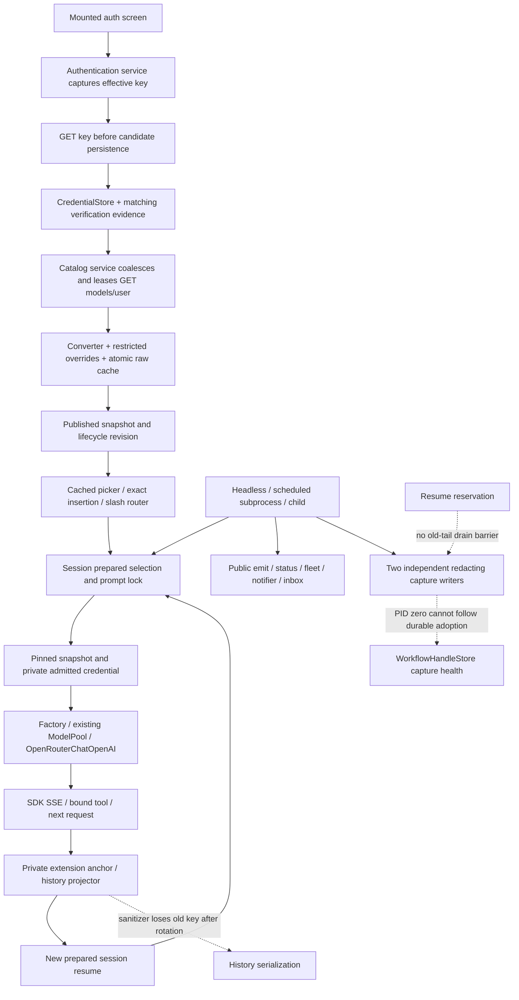
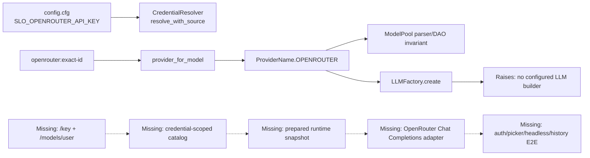
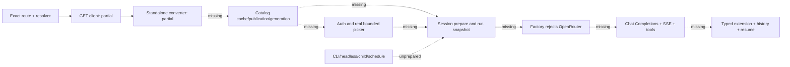
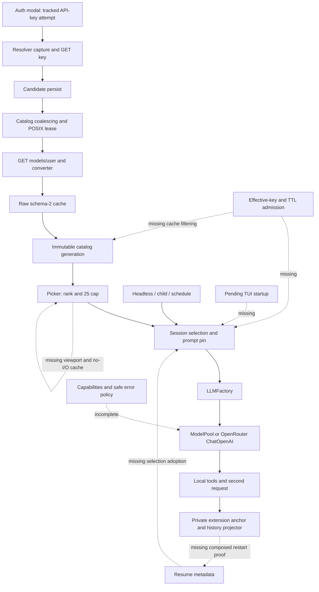
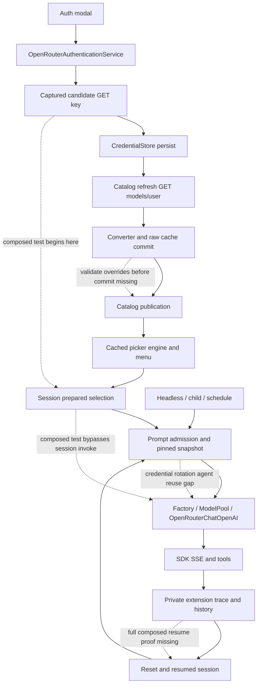
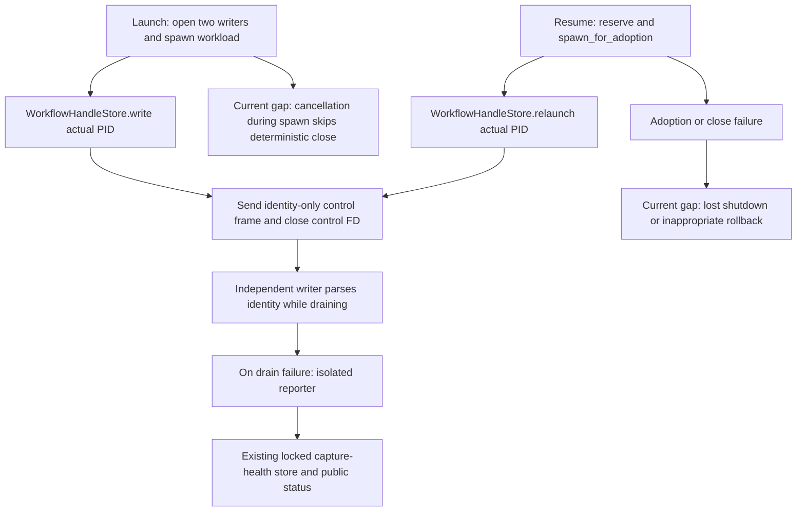
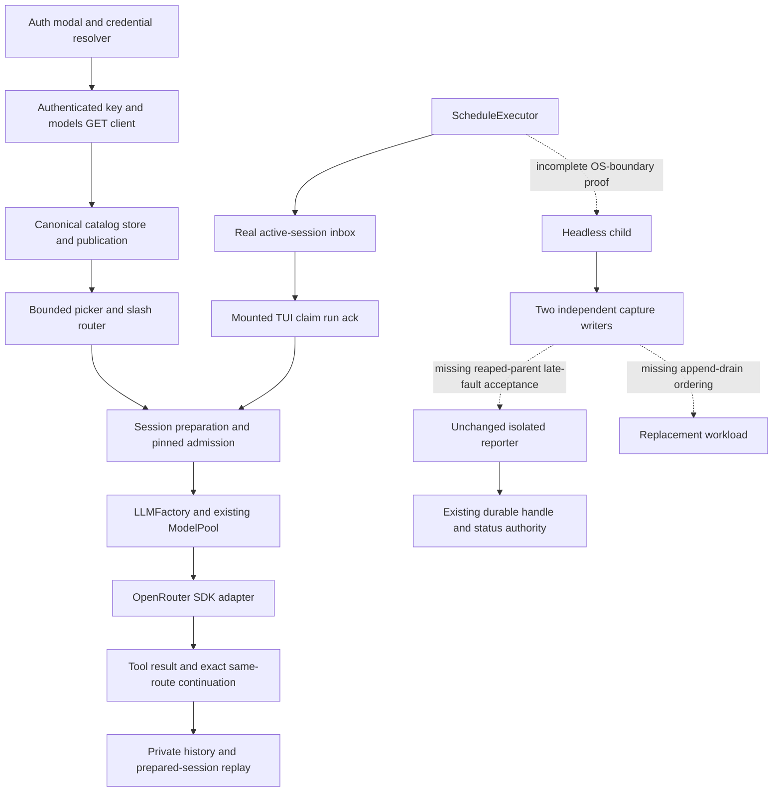

# Feature 86 — Independent full implementation review — 2026-10-02

## Executive summary

**Step 1 is NOT READY (REVISE). This is an independent implementation review, not Step 2 READY certification or a completion assessment.** Reviewed the dirty `feature-86-openrouter-implementation` worktree at `/root/Code/slo-openrouter-implementation/slo`. No production/test changes or Git mutations were made.

The implementation is substantially beyond the foundation described by the oldest report below. There is real authenticated discovery, catalog publication, a mounted auth/picker/router/session/tool flow, newly prepared session resume, credential-bound factory construction, and session-level committed-fragment tests. Those are meaningful implementation and test assets. They do not close the remaining capture lifetime, output protection, status truth, cross-context acceptance, documentation, and global-gate gaps.

**Principal blockers:** independent capture writers retain PID-zero completion context; relaunch never adopts their reporting lifetime; immediate capture failure is not durably reported; no old-tail/replacement append barrier exists; serialization protection loses an admitted old key after rotation; cold/stale picker status is not reliably effective-key-bound; required populated cross-channel/scheduler acceptance and current full gates remain incomplete. Findings below distinguish source-demonstrable defects from missing verification.

## Review authority and evidence limits

Read the full Feature 86 overview (including its truncated-read continuation), request, task-dependency-index, and all six `86.a.*` contracts at `/root/Code/specifications/projects/slo/specifications/86-openrouter-intergration`, read-only. In particular a.4 §§7.6–7.8 and a.6 §§7.1–7.5 govern lifecycle preservation and cross-channel proof. Repository AGENTS/SLO/CLAUDE and `/root/.slo/SLO.md` are supplied governing instructions; ancestor candidates were checked. Root RESEARCH and supplied docs/RESEARCH, KB Welcome/Slo README/gotchas, current recovery plan/log/remaining ledger and historical review sections were consulted. Applied `review-feature-code`, hard review rules, named arguments/types, docstrings, declarative structure, code-test-loop and ubiquitous-language guidance. This is not an assertion that every skill example or every historical appendix was exhaustively re-read.

Inspected actual source, test bodies, and HEAD/worktree diffs, including untracked implementation files (ordinary `git diff` alone omits them). Main source inspection covered auth/client, catalog publication/status, session credential binding, mounted integration/rotation/commit tests, history writers, launch/relaunch/capture/store/process/notifier and scheduler routing. This report maps the **whole acceptance inventory**, but is not exhaustive line coverage of all changed files or all test branches. No percentage is inferred from historical reports.

Fresh verification: `git diff --check` returned exit 0. `command -v python` returned `/root/.pyenv/shims/python`; the specified `/root/.pyenv/versions/slo/bin/python` executable was absent. No substitute interpreter, pytest, Black, mypy, real credentials, network, or workload subprocess was used in this review. The write restriction also precludes casually creating pytest artifacts outside the authorized documents. Historical results below are not fresh verification. Two oversized Bash reads caused tool-managed `/tmp/slo-bash-c_u4gl85.txt` and `/tmp/slo-bash-5jbdbz3h.txt` spills; they were not intentionally written, modified, or deleted. Subsequent output was bounded.

## Requirement completeness inventory

Legend: **Implemented** = concrete source and targeted test assertions exist, not fresh certification; **Partial** = required adverse/composed behavior or evidence remains; **Incomplete gate** = mandatory delivery check unmet. Paths are repository-relative; test filenames identify evidence, not an assertion they were run today.

| ID | Acceptance | Current implementation / test evidence | Assessment / remaining work |
|---|---|---|---|
| 01 | Provider/env/store/no legacy | `auth/credential_dao.py`, `credential_resolver.py`; resolver/auth tests | Implemented; retain direct-provider regression gate |
| 02 | Effective-key verification and cancellation | `auth/openrouter_authentication.py`, auth screen; auth tests and mounted rejection cases | Partial: full mounted pre/post-save cancellation and environment-race matrix |
| 03 | Cross-channel secrecy/private state | adapter normalizer, resolver sanitizer, history, process, notifier, independent capture writer | Partial, blocking B1–B5/B7 below |
| 04 | Exact canonical/API/provider identity | `auth/provider_for_model.py`, converter, factory; identity/transport tests | Implemented; no upstream-author reroute found |
| 05 | Unknown selection fails, direct IDs preserved | session preparation and CLI dispatch; preparation/resume tests | Implemented path; full removal/resume composition still required |
| 06 | Explicit model clears pool | CLI/session selection; dispatch and selection tests | Implemented path; selection-versus-prompt race acceptance retained |
| 07 | Pool syntax/provider invariant | `config/model_pool_config.py`, pool DAO; config/pool tests | Implemented |
| 08 | Fixed Chat Completions SDK lane | `agents/base.py`, `providers/openrouter.py`; transport/semantic-control tests | Implemented; complete constructor/bind-tools invalid matrix not independently established |
| 09 | Attribution/cache false | factory/request policy and transport tests | Implemented; no live availability claim |
| 10 | Stream/tools/IDs/usage/length/cancel | SDK tests, mounted full flow, session commit tests | Substantial implementation; cross-channel terminal matrix remains |
| 11 | Exact private continuation/history | extension DAO, trace/projector/codec; channels/concurrent/history tests | Partial: same-process prepared resume is present; rotated-key writer protection incomplete |
| 12 | Authenticated discovery only | `integrations/openrouter/client.py`, catalog converter/service; client tests | Implemented; no public entitlement fallback found |
| 13 | Bounded schema/pagination/labels | client limits/fixed paths, converter; client/converter tests | Implemented targeted matrix; no exhaustive fresh run |
| 14 | Eligibility | catalog converter; `test_openrouter.py` and converter metadata tests | Implemented targeted matrix |
| 15 | Output caps/image compatibility | converter/request policy; capability/semantic-control tests | Implemented targeted matrix; old default-versus-ceiling finding superseded |
| 16 | Concrete variants only | converter and exact admission | Implemented path; preserve exact-ID rejection regressions |
| 17 | Reasoning controls/mandatory/unknown | converter/reasoning policy/codec; reasoning and semantic tests | Substantial implementation, remaining branch audit before closure |
| 18 | Limits versus defaults/support | capabilities/local policy and request policy | Implemented targeted wire assertions, not account entitlement |
| 19 | Offline synchronous reads | `ModelCatalogService.load`, compatibility views; offline/read-view tests | Implemented purity path; public status qualification remains B6 |
| 20 | Async auth/startup | session pending preparation/app worker/auth refresh | Partial: actual startup/auth adverse lifecycle matrix required |
| 21 | Manual refresh routing | slash router delegates session refresh | Implemented; fresh full router/app regression required |
| 22 | Headless/child/scheduled preparation | headless gateway, trusted spawn, scheduler argv | Partial: capture defects and actual scheduled preparation proof |
| 23 | Atomic coherent publication | catalog service/store/AtomicFileWriter; atomic publication tests | Substantial implementation; post-replace rotation/cancel outcome integration unclosed |
| 24 | Failure preserves successful state | leased refresh/stale admission; lifecycle/security tests | Substantial implementation; composed stale failure acceptance remains |
| 25 | Refresh concurrency/run pinning | coalesced tasks/process lease/session lock; process-ordering and rotation tests | Partial: broader adverse reset/cancel/process combinations not freshly established |
| 26 | Fingerprint/TTL/rotation | catalog lifecycle, admitted credential; rotation tests | Partial: cold status/aging B6 and old-key serialization B5 |
| 27 | Removal/readable resume | tombstones/admission/metadata precedence | Partial: complete removal-during-run → next prepared resume failure composition |
| 28 | Consolidated owners/projections | async discovery delegate/live views/canonical service | Implemented direction; no second catalog owner required |
| 29 | Raw cache/restricted overrides | store/service candidate build before save; override/atomic tests | Implemented targeted assertions; final reload/adverse matrix gate |
| 30 | Search/rank/exact insertion | suggestion engine; picker/viewport/mounted full flow | Implemented targeted mounted assertions |
| 31 | Bounded/no-I/O picker | generation cache/menu viewport; 1000-row and viewport tests | Implemented targeted assertions; full resize/selection race regression |
| 32 | Honest evidence/status | public lifecycle DAO + picker summary | Partial, source defects B6 |
| 33 | Sole pool fallback/tools/audit | existing pool + safe code; mixed SDK/session tests | Implemented substantial proof; populated pre-output audit scan still required |
| 34 | Error taxonomy | shared classifier/normalizer; error tests | Implemented matrix exists; no newly demonstrated taxonomy defect in this review |
| 35 | HTTP200/nested/SSE/no postcommit replay | adapter commitment → agent/session barriers | Implemented session role/usage/text/reasoning/tool tests; cross-channel security remains |
| 36 | Bounded attempts/pinned cooldown | SDK zero retries, pool/session policies; pinned retry tests | Implemented direction; complete composed attempt matrix not freshly certified |
| 37 | Resume/preferences/all contexts | dispatch metadata precedence/headless/scheduler/inbox | Partial: genuine scheduler/inbox consumers and capture resume lifetime |
| 38 | Offline/test-first/full gates | extensive deterministic tests and historical logs | Incomplete gate B8; scoped green is insufficient |
| 39 | Fixture/paint/full-flow evidence | MockTransport mounted flow and real FD tests | Partial: process/scheduler/security composition, runtime/lock SDK evidence limits |
| 40 | Truthful operator/developer docs | README/AGENTS/RESEARCH partially updated | Incomplete B9; headless/scheduler documentation missing OpenRouter coverage |
| 41 | Scope and single ownership | existing factory/catalog/session/pool retained | Mostly respected; finish narrow capture lifetime, not generic framework |
| 42 | Unseeded after-auth choice | mounted full-flow test discovers and selects new route | Implemented happy flow; stale/removal/cancel variants remain |

## End-to-end flow and architecture



**Verified by test-body inspection:** `tests/integration/test_openrouter_full_flow.py:296` drives real mounted screen/service, candidate verification before storage, discovery, canonical picker insertion, slash selection, session invocation, bound tool and a newly prepared session sharing durable history. It observes three SDK requests and exact private anchor/tool result on the resumed request. It is not a true OS restart; the final history scan at the end explicitly skips `events.jsonl`. Separate prepared-resume/retained-tail tests in `test_openrouter_channels.py` strengthen history evidence without turning this into complete all-artifact proof.

**Pinning:** `tests/integration/test_openrouter_key_rotation.py` holds the first actual SDK request or pre-build barrier, publishes equal B metadata, and requires A for that admitted request and B for the next. Session `_ensure_agent_ready` uses the admitted credential for synchronous factory construction. This corrects the old stale-factory claim. It does not pin the history sanitizer for the run.

**Committed failures:** `test_openrouter_session_commit.py` exercises real session/agent/pool/SDK with role-only, usage-only, text, reasoning and partial-tool frames, with both failure and cancellation. It asserts one inference request; concurrent-session and retained-tail tests exist. Older claims that these tests do not exist are withdrawn, not repeated.

**Catalog atomicity:** `_refresh_openrouter_owned` validates the publication candidate before persistence, rechecks identity before and after write, then publishes. `_write_cache_under_lease` and AtomicFileWriter are existing owners. A post-replace credential change returns `credential_changed` after disk commit without publishing that candidate: this must be reported/tested as the committed-disk boundary, not falsely described as byte-identical rollback. It does not itself prove a wrong-key inference path because admission revalidates provenance. Real process catalog lease testing exists; it is not resume-contention testing.

## Blocking findings and smallest corrective plan

### B1 — High: writer-side completion identity never adopts the workload (F86-03/22/37)

**Source:** `launch_tool.py:298–344`, `spawn_env.py:98–124,296–323`, `capture_writer.py:33–39,65–89,140–148`.

Launch supplies a context with `expected_pid=0` to each writer **before spawn**. The writer receives a serialized environment snapshot. After `store.write(real_pid)`, `_CapturePipe.activate` replaces only the parent's Python context. It sends no data to the already running process. After parent exit a writer fault invokes the isolated reporter with zero; `WorkflowHandleStore.record_capture_failure_sync:627–628` rejects it against the real PID. Before adoption, zero may instead match the placeholder and mutate health prematurely; the later unconditional patched-handle write can erase that evidence. Parent-side `_failure_pending` does not retain the independent writer's result after parent exit.

**Correction:** retain two explicit private endpoints and add the recovery plan's bounded one-shot parent→writer control handoff **after durable PID adoption**. Writer input draining must continue before activation; keep an early terminal result in memory until activation/control EOF. Report fixed-safe failure through the existing handle store only after identity is adopted. Test actual launch parent exit, preactivation failure, delayed read/write/final-flush failure, clean EOF and stale-PID rejection with fresh handle/status reload.

**Scope clarification:** the spec requires secrecy and preserved lifecycle, not a particular FD protocol or universal durable log service. A control FD is the minimal selected recovery design, not an independently invented product requirement. Source-only sanitation cannot replace the real-FD redactor already needed by the concrete byte-split leak regression. An equivalent narrow lifetime solution could satisfy the contract; a mutable parent object alone cannot.

### B2 — High: relaunch and prompt close lose durable capture health (F86-22/37)

**Source:** `relaunch.py:47–111`; `workflow_registry.py:1303–1359`; `spawn_env.py:142–187`.

The command calls relaunch with no completion context. Relaunch closes its captures and returns only PID/error/warning, then the command persists the replacement PID. No private ownership survives to activate at that point. `_relaunch_sync` clears previous health. Independently, a promptly exited writer follows `_observe_writer_exit`, which returns failure but never calls `_handle_failure`; launch/relaunch surface a warning rather than durable health. A timeout/reaper test therefore does not cover immediate-close reporting.

**Correction:** expose one private context-managed relaunch lifetime (or equivalent typed private owner) across command-owned `store.relaunch` and activation; keep public result DTO serializable. Route both immediate and delayed writer failures into the same idempotent store mutation after adoption. Do not change workload PID/group to a supervisor's. Test immediate failure, preactivation retention, store-adoption failure, cancellation at each await, parent exit, and warning/status consistency.

### B3 — High: resume admission does not serialize old capture tails (F86-22/37; regression introduced by async writers)

**Source:** `workflow_registry.py:1303–1359`, `spawn_env.py:284–310`, `capture_writer.py:_drain_capture_input`.

The resume docstring promises old drain completion, but there is no drain operation or append lease. A dead old workload may leave its independent writer with queued bytes. A replacement writer opens the same file in append mode and can write new output before that tail. Handle reservation excludes some duplicate starts; it does not order capture writes. The two-service test is not a two-OS-process test. No source-based claim that all reservation concurrency is broken is made.

**Correction:** a bounded per-existing-capture append-drain lease, acquired in fixed order before replacement readiness/spawn and held by the old writer through terminal drain/reporting. Do not hold the handle lock while waiting for a writer that reports through that lock. Test exact `old tail → new output` bytes using real delayed old/replacement writers, refusal/cancellation, and independent-process reservation contention proving exactly one workload. No generic new registry or status files.

### B4 — High: capture/spawn failure cleanup is not closed under cancellation

**Source:** `launch_tool.py:288–341`; `process.py:390–403`.

Launch's capture allocation/spawn block catches only `OSError`; its closing `finally` starts in the later PID-persistence block. `CancelledError` at `await spawn(...)` bypasses that explicit close lifetime. In child execution, default `asyncio.gather` propagates one reader exception without cancelling/awaiting its sibling; the exception handler returns a failed result without explicitly waiting/reaping a still-running workload. These are lifecycle risks, not evidence that a real host child was leaked during this review.

**Correction:** put acquired resources under one cancellation-safe ownership scope; on failed reader, cancel/await sibling and use the existing owned-child shutdown/reap path before terminal publication. Add event-barrier tests at allocation/spawn/read/wait/adoption boundaries and prove only fixture-owned processes are affected. Keep existing successful cancellation semantics and no-double-terminal invariant.

### B5 — High: output sanitation is not pinned to the admitted key (F86-03/11/26)

**Source:** `credential_resolver.py:49–90`; `sessions/service.py:4147–4148`; `history/filesystem_store.py:621,779,791,1137`; `orchestrator/notifier.py:217`.

`redact_openrouter_text` queries the current effective credential plus `_build_credential`. The binding is reset as soon as synchronous `_build_agent()` returns. After A→B rotation while the admitted A run continues, history/notifier serialization sees B and no task-bound A. A literal A in output is consequently not replaced by this sink protection. The real writer-secrecy test covers current env/store keys, not rotation. Resolver missing/corrupt behavior and returned-event-versus-reloaded-event consistency also need explicit acceptance. This does not allege every normalized SDK error currently leaks; it demonstrates the advertised persistence defense lacks its run identity.

**Correction:** bind the operation's captured protection credential across serialization using existing resolver/session/history/notifier seams, not a historical secret registry. Preserve exact unrelated opaque anchor JSON. Test A admitted, B effective, A-bearing output through append/rewrite/transcript/metadata/notifier plus fresh projector→SDK replay; test resolver failure and supported escaped forms. Scan raw credentials in private events too. Opaque reasoning is allowed in private replay, never public channels; do not delete it to make scans pass.

### B6 — High: catalog status can overclaim cold verification and loses stale time (F86-26/32)

**Source:** `model_catalog/service.py:169–260`, `:77–94`; `tui/model_catalog.py:190–241,252–269`.

Cold `_hydrate_cold_lifecycle_status` publishes `checked` from cache timestamps without effective credential binding when there is no operation context. Picker rows unconditionally prefer this summary over resolver-derived authentication status. Thus a cached A slice can label rows `catalog checked` when current key is absent/B until a later lifecycle operation reconciles it. Stale timestamps are dropped entirely, rather than retained as `stale catalog <time>`; warm `load` and `lifecycle_status` do not age a previously checked status. The consumer still separately infers verification from credential dismissal. Tests now cover public revisions/passive paint: status is not wholly unwired, but these source paths do not meet the entire truth contract.

**Correction:** cached timestamps remain historical evidence until a lifecycle-captured effective identity qualifies them. Preserve successful timestamps independently of freshness; render stale/future/unknown without claiming verification. Central catalog lifecycle remains the authority; remove redundant modal verification inference after the safe evidence seam covers it. Add injected-clock cold A/no-key/B, exact TTL/future, mounted passive repaint and no-keystroke-I/O tests. No network/resolver call inside ordinary typing.

### B7 — High acceptance gap: populated cross-context security is not established

**Sources/tests:** `test_openrouter_full_flow.py` excludes private events from its scan; `test_openrouter_capture_secrecy.py` uses mocked child spawn/pipes and mocked preparation; scheduler tests verify enqueue/argv rather than real target consumption/preparation. Real detached FD/store-key tests and notifier pending-file tests are useful but not the complete chain.

Required a.6 proof must first assert populated expected ordinary content in logs, stream events, private events, metadata/transcript, switch audit, headless output, handle/status/fleet/child results/captures, scheduler definition/state/run report and pending/processed inbox. Exercise completed and failed notifier paths, stored/env keys, rotation, actual inactive scheduled headless preparation and active inbox consumption retaining the target route. Preserve the private anchor only in authorized replay and same-route wire. Verify private modes: `open_capture_file_append` uses ordinary `mkdir/open('ab')` without establishing 0700/0600 itself; do not infer privacy from the current machine umask. No arbitrary-encoding detector or intentional secret-in-user-argv guarantee is requested.

### B8 — High delivery gate: no current full regression/static green

Historical `evidence/call2-full-pytest.log` ends **4821 passed, 15 deselected, 176 warnings**, `COMMAND_EXIT=0`; it predates later capture edits. Latest implementation log reports **181 passed** for the selected orchestration partition, not whole-feature readiness. Historical `serial-call4-stop-black.log` reports **5 files would be reformatted, 620 unchanged**. Historical `serial-call4-stop-mypy.log` ends **305 errors in 51 files (619 checked)**. These were read, not rerun. The last mypy diagnostics include `tests/cli/test_headless.py:792` and `:808`, `Cannot assign to a method [method-assign]`.

Confirm the approved interpreter without changing shared environment, audit fixture containment/network/process ownership, then run affected partitions and full non-E2E/Black/mypy gates. Attribute inherited diagnostics with evidence and obtain any needed scope authorization; do not silently waive or weaken checks. No current test failure is asserted solely from an old log.

### B9 — Medium mandatory delivery/convention gap

`README.md:70–78` still says full inference/auth/catalog work is future despite implemented paths. `docs/RESEARCH.md` contains contradictory foundation and later integration statements; headless/scheduler READMEs have no OpenRouter guidance. Reconcile exact commands, env/store/child exception, explicit model/pool/resume precedence, stale/removal/variants and offline-versus-live evidence. Do not mutate canonical specs.

Hard-rules pass also finds concrete new mixed-decision orchestration (`service.py:_refresh_openrouter_owned`, roughly 130 lines combining lease/freshness/client/conversion/commit/publication; capture opener combines allocation/spawn/ACK/cleanup) and untyped dynamic activation via `getattr` on `IO[bytes]`. Extract named steps/private typed lifetime interfaces inside existing owners, with tests intact; no new competing manager. Public `RelaunchOutcomeDAO.warning` lacks the required Field description. The obsolete ExitStack-private introspection finding is **withdrawn**: current launch uses explicit endpoint references. Do not reintroduce unrelated framework requirements such as a new graph gateway, DB domain pattern, API envelope or CLI Command class; these contracts explicitly preserve the existing graph/CLI architecture.

## Test evidence quality / false confidence

| Evidence inspected | What it actually proves | What it does not prove |
|---|---|---|
| Latest activation test (`test_capture_writer.py:664`) | fake endpoint activation after fake store PID write | shipped writer receives new identity or survives parent death with health |
| Actual launch late-fault test (`:502`) | two real writer processes, retained workload, parent reaper/store completion | parent-exit reporter, all read/write/flush branches, immediate close |
| Actual parent-exit test (`:734`) | capture bytes still redact after helper process exits | durable late-failure report tied to adopted workload |
| Durable-completion helper test | manually supplied correct context reaches store/status | actual launch PID-zero handoff or command-owned resume |
| Relaunch append test | append after prior completed output | overlapping old tail/new writer ordering |
| Two-service reservation test | separate service instances serialize the tested reservation | two OS processes, cancellation/reservation expiration, writer drain |
| Mounted full flow | real UI→SDK tools→fresh prepared-session happy path | OS restart, removed route, all private/public files, schedule execution |
| Session committed matrix | actual one-request barrier for five fragment types and cancellation | complete populated failure/audit/artifact scan |
| Catalog process-ordering test | actual process lease and newer-success reuse | workflow resume contention or all post-replace rotation outcomes |

No blanket claim that tests are shallow: several are strong real-boundary tests. The error is treating their narrower boundary as the full acceptance boundary. No authenticated live discovery or paid inference was performed; that absence is not a blocker because the spec makes live checks optional.

## Convention and vocabulary assessment

Canonical `model_name` versus `api_model_name`, `catalog_generation`, provider ownership and the single typed provider extension are substantially consistent. Safe route codes replace raw OpenRouter audit copy. Resolver/catalog/factory/session/pool ownership is largely maintained. Capture completion context is a private lifetime carrier, not a new public status authority; preserve that distinction. Mandatory remaining issues are typed lifetime/cleanup structure, accurate lifetime docstrings, Field documentation, per-decision acceptance and global gates, rather than a broad rewrite of legacy style.

## Exact next Step 1 sequence

1. **Must-fix code:** implement B1/B2 together as one bounded private activation lifetime across actual launch and command-owned relaunch adoption. Tests must start red on current shipped writer context, not only a fake `activate` callback. Cover preactivation/immediate/late faults, real parent exit, unchanged PID/group, stale identity and clean success.
2. **Must-fix code/tests:** close cancellation/resource ownership (B4), then add B3 old-tail lease/order proof and independent-process resume admission. Preserve fixed-safe existing handle/status authority.
3. **Security acceptance:** pin sink protection to admitted credential (B5), complete populated artifact/private-replay matrix (B7), fix reproduced leaks at their existing writers. Establish private capture modes without relying on umask.
4. **Catalog/status acceptance:** repair B6 cold identity/freshness projection and complete stale/removal/selection/pool/cancel/post-replace adverse compositions. Do not reopen already repaired supplied-auth candidate validation or equal-metadata factory binding without contrary evidence.
5. **Docs/gates:** reconcile B9, confirm interpreter/fixture safety, then run current affected and full non-E2E/static gates (B8). Only then request a fresh independent full review and separate completion assessment.

Non-blockers: no live provider smoke; no arbitrary endpoint framework; no generic crash-proof capture transaction; no claim of PID-reuse-proof identity. These are not reasons to expand scope. The report does not demand removing valid private continuation metadata.

**Independent verdict: Feature 86 Step 1 remains REVISE / NOT READY.**

REVIEW BLOCKERS FOUND

---

## Historical review archive (superseded where contradicted above)

The following prior reports are retained verbatim for provenance, not current findings or current test results.

# Feature 86 — Independent Step 2 Code Review

**Review scope:** current uncommitted work only (`git diff HEAD` at review time)  
**Repository:** `/root/Code/slo-openrouter-implementation/slo`  
**Date:** 2026-09-30  
**Reviewer model disclosure:** The intended reviewer is **`gpt-6-astra` at medium reasoning**, as corrected by the user after this run. The original request used an incorrect Astra identifier, which the harness rejected. This review actually used **`gpt-5.6-terra` at medium reasoning** as fallback.  
**Verdict:** **REVISE — Feature 86 is not ready for Step 3.**

## Stack summary and review preconditions

This review covers Python configuration/authentication, model routing and factory construction, model-pool configuration, canonical model catalog/runtime preparation, LangChain provider transport, CLI/headless runtime, and Textual authentication/model-picker surfaces.

I read the repository instructions (`AGENTS.md`, `SLO.md`, `CLAUDE.md`), root and `docs/RESEARCH.md`, the Code-Test-Review workflow, `review-feature-code`, hard review rules, named-arguments/type-hints, declarative structure, docstrings, naming, and test-verification conventions. I also read the KB entry point plus Slo README/gotchas/model-pool/auth/architecture pages. The repo, installed, and personal skills collections were all accessible, so the review could proceed.

I read Feature 86's request, overview, dependency index, context bundle, all six task specifications, completion summary, final review, independent verification report, and the existing implementation log. Those documents establish requirements, but the report treats their claimed/planned work as **not implemented unless current source and executable tests prove it**.

## Executive summary

The work implements a useful part of slice **86.a.1**: `ProviderName.OPENROUTER`, structural `openrouter:<id>` ownership, environment/store credential precedence reporting, factory delegation to the canonical route classifier, and parser/DAO pool-provider agreement. Focused tests, formatting, and the full non-E2E suite pass.

However, this is only a partial foundation. The required OpenRouter GET boundary does not exist, and none of the catalog lifecycle, OpenRouter transport/reasoning/history/error handling, runtime preparation/pinning, auth UI, bounded picker, integration verification, or mandated documentation are implemented. These are required deliverables across all six Feature 86 slices, not optional future work. The implementation log correctly describes the work as in progress, but that does not convert missing required implementation into completion.

## Requirement-completeness table

| Requirement area / ordered slice | Status | Evidence in current uncommitted work | Required remediation |
|---|---|---|---|
| **86.a.1 identity:** canonical provider enum and structural exact route classification | **Partial** | `credential_dao.py:33`; `provider_for_model.py:20-43`; tests at `test_provider_for_model.py:58-81` | Keep, then add the required route grammar boundary cases (controls/non-ASCII/whitespace/URL/512 edge) and catalog-membership preparation behavior. |
| **86.a.1 credentials:** env → store → no OpenRouter legacy source; provenance | **Partial** | `CredentialResolver.resolve_with_source()` at `credential_resolver.py:57-79`; env mapping at `:206-214`; secret fields repr-hidden at `credential_dao.py:79-80,105` | Add whitespace-only rejection and operation-time behavior tests; prove public serialization/repr safety for both `CredentialDAO` and `ResolvedCredentialDAO`. |
| **86.a.1 HTTP boundary:** fixed `/api/v1`, `/key`, `/models/user`, bounded pagination/schema/redaction | **Missing** | No `src/integrations/openrouter/` or `tests/integrations/openrouter/` exists; source search finds only enum/prefix/resolver additions. | Implement the specified injected async GET client, wire DAOs, fixed safe exception family, bounded full-list/pagination semantics, timeout/redirect/size limits, and MockTransport tests. |
| **86.a.1 pool invariant and existing syntax compatibility** | **Partial** | Parser guard `model_pool_config.py:243-255`; programmatic Pydantic validator `model_pool.py:62-76`; tests in `test_model_pool.py:33-43`, `test_model_pool_config.py:114-130` | Add all required comma/JSON string-array/object-array regression scenarios and ensure supplied enum values as well as strings are accepted consistently. |
| **86.a.2 credential-scoped discovery/cache/offline lifecycle** | **Missing** | `ModelCatalogService.load()` remains memoized and can invoke synchronous discovery (`model_catalog/service.py:34-66`); placeholder returns empty discovery (`discovery.py:81-100`). | Implement converter, schema-2 credential-scoped provider slices, atomic persist-before-publish, coalescing/lease, tombstones, snapshot-aware projections, offline `load()`, and required deterministic tests. |
| **86.a.3 Chat Completions transport, tools/reasoning/history preservation** | **Missing** | `LLMFactory.create()` determines `OPENROUTER` at `base.py:188`, then immediately raises at `:198`; no adapter or message-extension files exist. | Implement `OpenRouterChatOpenAI`, request/reasoning policy, local transport tests, exact-route reasoning continuation/history extension, image compatibility, usage/truncation/refusal/cancellation behavior. |
| **86.a.3 safe error policy and pre-commit-only retry/fallback** | **Missing / security-critical** | Existing raw audit seam remains: `RouteSwitchRecordDAO.error_text` at `model_pool.py:89-105`; `str(error)[:500]` at `:536-548`; persisted at `sessions/service.py:3940-3953`. | Implement one safe OpenRouter error normalizer/classifier, terminal kinds, safe audit codes, retry-after cap ownership, redaction tests, and no post-commit switch/replay/continuation. |
| **86.a.4 runtime preparation, selection precedence, generation pinning** | **Missing** | `TyperDispatch._build_session_config()` parses configured pool before override (`typer_dispatch.py:398-452`); `_apply_model_override()` changes only `model_name` (`:457-481`); no session `prepare` method. | Add async preparation gateway, run snapshot adoption, explicit-selection clears pool, resume/headless/child/schedule semantics, and race/cancellation tests. |
| **86.a.5 auth, refresh, bounded picker** | **Missing** | Provider widget has only three choices and index conditionals (`provider_select.py:27-68`); auth screen special-cases only Kimi and persists API key immediately (`auth_screen.py:105-124,192-208,215-222`); picker resolves credentials per entry (`tui/model_catalog.py:95-125`), prefix-matches (`slash_suggestion_engine.py:239-263`), prints `ready` (`:265-280`), and router has no refresh path (`slash_router.py:695-798`). | Implement capability-driven OpenRouter API-key verification, tracked cancellation, `/model refresh`, cached generation-backed substring picker, 25-candidate/window bounds, literal rendering, and painted TUI tests. |
| **86.a.6 integrated offline E2E, docs, KB, AGENTS** | **Missing** | Only `docs/implementation/86-openrouter/implementation-log.md` exists before this review report; no OpenRouter integration test/fixtures/docs/AGENTS/RESEARCH changes are in the diff. | Add local full-flow test and fixture provenance; run consolidation/security/offline checks; then update AGENTS, README, docs/RESEARCH, headless/scheduler docs and KB with actual behavior. |

### Implemented partial-foundation trace



## End-to-end flow verification

### Current actual flow

1. A qualified `openrouter:<id>` reaches `provider_for_model()` and returns `ProviderName.OPENROUTER` after structural checks (`src/auth/provider_for_model.py:41-43`). This correctly avoids classifying `anthropic/...` as direct Anthropic.
2. `CredentialResolver.resolve_with_source()` can identify an effective environment or store credential (`src/auth/credential_resolver.py:57-79`).
3. The pool parser and direct `ModelPoolEntryDAO` reject an explicitly mismatched provider (`config/model_pool_config.py:247-252`, `src/agents/providers/model_pool.py:62-76`).
4. The factory resolves the OpenRouter provider but has no build branch and fails with `Provider 'openrouter' has no configured LLM builder.` (`src/agents/base.py:188-198`).

**Verdict:** the route cannot authenticate, discover, select, build, invoke, continue tool conversations, persist/replay reasoning, run headless, or refresh. The required end-to-end flow is disconnected after identity classification.

### Existing direct-provider behavior

The full suite passed, which is meaningful regression evidence for existing providers. Still, no OpenRouter implementation may rely on that success: direct-provider test success does not prove the missing OpenRouter transport, catalog, UI, and lifecycle behavior.

## Test assessment

| Verification | Result | Meaning |
|---|---:|---|
| Focused changed-area pytest | **93 passed** | `tests/auth/test_provider_for_model.py`, `tests/auth/test_credential_resolver.py`, `tests/config/test_model_pool_config.py`, `tests/agents/providers/test_model_pool.py`; verifies only implemented foundation branches. |
| `poetry run black --check` on all changed files | **Pass** | The 11 changed implementation/test files are formatted. |
| `make test` | **4328 passed, 15 deselected, 152 warnings** | Full non-E2E regression suite is green in 254.66 seconds. |
| `make lint` | **Fail: 343 errors in 55 files** | Full mypy gate is non-green. The output includes broad pre-existing test/TUI typing failures; the implementation log reports an earlier unrelated baseline too, but no baseline comparison was run during this review, so this cannot be claimed non-regressive. |
| OpenRouter client/catalog/transport/history/TUI/headless integration tests | **Not present / not run** | No behavioral evidence exists for the central feature requirements. |

### Test-quality findings

The added tests are meaningful for the narrow added branches: route provider selection, invalid examples, source selection, pool mismatch. They are not constructor-only assertions. But the suite omits required decision coverage for whitespace-only credentials, operation-time environment rotation, source-bearing result serialization, client rejection/pagination/cancellation/redaction, and every later slice.

The implementation log’s baseline and focused result are useful progress evidence, but it explicitly states “Step 1 is incomplete” and says slices 86.a.2–86.a.6 are not started. The report’s planned test map is therefore not evidence that tests exist.

## Convention adherence

### Satisfied

- Keyword calls and annotations are generally present in changed production code.
- `LLMFactory._provider_for()` delegates to the canonical classifier (`src/agents/base.py:567-579`), removing the prior reverse ownership.
- `ModelPoolEntryDAO` provides a local import to avoid the documented cycle and enforces programmatic caller invariants.
- Changed public types/methods have docstrings, and the changed files pass Black.

### Violations / concerns

1. **Feature-wide code-test evidence is incomplete (blocker):** the diff contains no production units or tests for most stated Feature 86 deliverables. The code-test loop cannot be demonstrated for work that was never implemented.
2. **Error redaction hard rule remains unresolved for this provider:** the Feature 86 specification explicitly requires replacing `error_text`; raw exception text remains persisted. This is both a requirement miss and a security-sensitive audit path.
3. **Ubiquitous language is not yet end-to-end:** `openrouter:<id>`, `api_model_name`, credential fingerprint, catalog generation, and safe error code have no runtime/catalog/UI/history representation. This is principally because the feature is incomplete.
4. **Minor convention drift:** `config/model_pool_config.py` retains broad `Any`/bare collection annotations (`raw: list`, `data: dict`, `kwargs: dict`) in changed path signatures/locals. This is inherited style in part, but the always-on convention prefers concrete types. This is non-blocking compared with missing deliverables.

## Findings summary

### Glaring Gaps — must fix before Step 3 / merge

1. **[Critical] Required OpenRouter authenticated HTTP boundary is absent.**
   - **Where:** Missing `src/integrations/openrouter/{dao,client,exceptions}.py` and corresponding tests.
   - **Impact:** There is no `/key` verification, authenticated `/models/user` discovery, credential-bound evidence, safe provider error type, pagination, timeout, or redaction boundary. The feature cannot authenticate or discover a usable route.
   - **Required remediation:** Implement slice 86.a.1’s client/DAOs/exceptions using injected `httpx.AsyncClient` and MockTransport tests covering valid/401/malformed/pagination/exact-multiple/limits/cancellation/no-secret output.

2. **[Critical] OpenRouter model construction and provider compatibility are absent.**
   - **Where:** `src/agents/base.py:188-198` resolves OpenRouter then raises; missing `src/agents/providers/openrouter.py` and `message_extension.py`.
   - **Impact:** A syntactically valid route fails before inference. Tools, streaming, usage, reasoning, same-route continuation, images, and history replay are impossible.
   - **Required remediation:** Complete slices 86.a.2–86.a.3 before exposing the enum as a supported provider: prepared catalog entry → Chat Completions adapter → tool continuation/history tests on local transport.

3. **[Critical] Credential-scoped catalog lifecycle and runtime generation pinning are absent.**
   - **Where:** `src/agents/model_catalog/service.py:34-66`, `discovery.py:28-100`; no async refresh/prepare/snapshot path.
   - **Impact:** Dynamic discovery, cache provenance, stale behavior, credential rotation, removed-route handling, coherent limits, and in-flight generation safety are unimplemented. An OpenRouter route cannot become selectable without a release.
   - **Required remediation:** Implement slices 86.a.2 and 86.a.4 with explicit async refresh/preparation, raw provider slices, atomic publication, same-key stale rules, and a per-run snapshot.

4. **[Critical] Existing raw route-switch audit remains a secret/error-body leak once OpenRouter is wired.**
   - **Where:** `src/agents/providers/model_pool.py:89-105,525-548`; `src/agents/slo_agent/sessions/service.py:3940-3953`.
   - **Impact:** `str(error)[:500]` is written into a route record and durable history. OpenRouter upstream payloads may contain request/account/provider details. This contradicts Feature 86’s explicit fixed safe-code contract.
   - **Required remediation:** Rename/replace the field with `safe_error_code`, normalize OpenRouter failure shapes once, and add sentinel tests through pool/history/headless/log paths. Retain direct-provider behavior deliberately and test it.

5. **[High] User-facing auth, picker, refresh, and runtime context deliverables are absent.**
   - **Where:** `provider_select.py:27-68`, `auth_screen.py:105-124,192-222`, `tui/model_catalog.py:95-125`, `slash_suggestion_engine.py:239-280`, `slash_router.py:695-798`, `typer_dispatch.py:398-481`.
   - **Impact:** OpenRouter does not appear in `/auth`; API keys are not verified; `/model refresh` does not exist; search is unbounded prefix-only with per-entry resolver calls; explicit override does not clear a configured pool; headless/resume/child/schedule flows cannot prepare routes.
   - **Required remediation:** Implement slices 86.a.4–86.a.5 and their painted/CLI/headless race tests. Do not advertise the provider until this flow is wired.

6. **[High] Required integration evidence and documentation are absent.**
   - **Where:** no OpenRouter fixtures/integration tests; no changes to `AGENTS.md`, README, `docs/RESEARCH.md`, headless/scheduler documentation, or KB.
   - **Impact:** There is no deterministic proof of verify → discover → select → local Chat Completions tool continuation → history/resume, and operators have no truthful usage/limitation documentation.
   - **Required remediation:** Complete 86.a.6 after all preceding slices; run its required offline test and documentation/consolidation gate, then update durable project/KB records based on actual implementation.

### Nice-to-Haves — should fix in the next remediation pass

1. Add exact tests for `ResolvedCredentialDAO` repr and public serialization, not only `CredentialDAO` repr (`tests/auth/test_credential_resolver.py:137-147`).
2. Add the specified config accessor tests: operation-time OpenRouter env updates, empty-as-absent, and whitespace-only rejected before any HTTP. Current tests reload config and do not cover the whitespace policy.
3. Expand structural-route tests to directly cover tabs/newlines/control characters, non-ASCII, and exactly 512 accepted vs. 513 rejected.
4. Replace broad `Any`/bare `dict`/`list` annotations introduced/touched in `config/model_pool_config.py` with typed JSON-compatible aliases where feasible.

### Temporary shortcuts / acknowledged debt

- `make lint` is non-green (343 errors). The implementation log identifies prior provider-related baseline errors, but this review has no clean baseline comparison. Preserve the full captured failure output and either establish a baseline comparison or fix errors attributable to the final diff before claiming final completion.
- No live OpenRouter call was run, appropriately. Live authentication/inference remains explicitly out of scope unless separately authorized; it cannot substitute for local deterministic tests.

## Required Step-1 remediation order

1. Finish 86.a.1: client/wire/safe exception boundary plus all deterministic tests.
2. Implement 86.a.2 and 86.a.3 (safe parallel lanes only after the foundation is green); reconcile their shared factory contract.
3. Implement 86.a.4 preparation/generation/runtime contexts.
4. Implement 86.a.5 auth and bounded picker only through the session/catalog service boundaries.
5. Complete 86.a.6 integrated test, redaction/consolidation audit, documentation, AGENTS/RESEARCH/KB updates, then rerun Black, mypy, and the full non-E2E suite.

## Completion checklist

### Must-fix code
- [ ] Fixed-origin, credential-captured OpenRouter GET client and safe exceptions.
- [ ] Credential-scoped catalog conversion/cache/publication and snapshot reads.
- [ ] Prepared OpenRouter Chat Completions adapter with history/reasoning/error policy.
- [ ] Safe route-switch audit and committed-output no-replay barrier.
- [ ] Session preparation/generation pinning; explicit model clears pool; headless/resume/child/schedule paths.
- [ ] Verified API-key auth, `/model refresh`, bounded substring picker, literal rendering.

### Required tests
- [ ] Client/pagination/redaction/cancellation tests.
- [ ] Catalog rotation/stale/removal/coalescing/atomicity tests.
- [ ] Local HTTP/SSE transport, tools, continuation, history/replay, errors, mixed-pool tests.
- [ ] TUI painted auth/picker/viewport tests and CLI/headless/session race tests.
- [ ] One real offline full-flow integration test plus no-network/security assertions.
- [ ] Full format/type/non-E2E gates with exact results.

### Documentation and decisions
- [ ] Update AGENTS, README, docs/RESEARCH, headless/scheduler docs, and KB from actual behavior.
- [ ] State no authenticated discovery or paid inference occurred unless future explicit authorization changes that.

**Step 2 conclusion:** 6 Glaring Gaps remain. Return to Step 1; do not proceed to Step 3.

---

# Independent continuation review — 2026-09-30, 15:46–15:50 UTC

**Verdict: REVISE. Step 2 is not ready.**

**Model disclosure:** actual intended model for this continuation: **gpt-6-astra, medium reasoning**. Backend identity cannot be independently attested from the tools available to this reviewer. Historical model disclosures above are preserved, not rewritten.

## Executive summary and evidence boundary

Fresh inspection confirms that Feature 86 remains an incomplete foundation, not a working provider. Pagination and the route-audit field rename are real improvements. They do not connect authentication, catalog publication, runtime preparation, inference, or history. None of the six slices meets its full acceptance contract.

Reviewed branch `feature-86-openrouter-implementation`, HEAD `f63df0a4958eedb4bc603f1946ba4591dd181fff`, including tracked diff and untracked OpenRouter source/tests. Read the required root/repository instructions, both RESEARCH files, workflow, review/completion/cadence/hard-rule/typing/docstring/declarative/test skills, client/security/domain/application-service/graph/agent-test/CLI/TUI/environment skills, KB Welcome and Slo README/gotchas/architecture/auth/pool pages, immutable overview/request/task index and all six child specs, and all three implementation reports. Repository, installed, and user skill directories exist. No dedicated history skill was supplied; immutable a.3 and actual trace/projector seams govern that review.

Scope is Python/Pydantic/httpx, LangChain/LangGraph, Textual and Typer. Database/password/JWT conventions do not introduce new requirements into this API-key feature. Feature-specific no-body/no-retry client requirements supersede generic client examples that log responses or retry.

This is a blocker audit of the actual affected owners and call sites, not a claim that every line of every large legacy module was audited. Fresh tests are identified below; prior full-suite results remain historical only. No implementation, test, specification, KB, other-worktree or shared-environment changes were made. Only this report is updated. No live provider requests, installation, staging, commits, process killing or publication occurred.

## Reconciliation with prior evidence

- **Resolved narrow finding:** `RouteSwitchRecordDAO.error_text` is now `safe_error_code` (`src/agents/providers/model_pool.py:94–106`); session persistence reads it at `sessions/service.py:3947`. The former `str(error)[:500]` route-audit implementation is gone. Do not repeat the prior report's claim that it remains.
- **Improved, not complete:** client now restarts offset/limit=500 pagination and fetches the final empty page for an exact multiple. Four client tests exist, not two.
- **Still disconnected:** converter, request policy and bounded-picker helper have no production integration into discovery/factory/actual model completion.
- **New compatibility deviation:** route audit now changes direct-provider exception text to generated codes too (`model_pool.py:558`). a.3 explicitly preserves direct-provider audit behavior. Restore that behavior or obtain an explicit specification decision; safer data is desirable but does not authorize silently changing another provider's contract.

## Glaring Gaps — must fix

### G1 — Critical: no executable catalog-to-provider path (a.2/a.3/a.4)

**Evidence:** `model_catalog/discovery.py:81–100` still returns an empty placeholder; `service.py:34–66` still memoizes a schema-1 merged snapshot and optionally calls synchronous discovery. `_merge_provider_result` ignores the newly added `entries` and `complete` fields. `base.py:188–198` dispatches only three providers, then raises. A fresh isolated probe of `LLMFactory.create(model_name='openrouter:vendor/unseeded')` returned exactly `ValueError Provider 'openrouter' has no configured LLM builder.`

`providers/openrouter.py:57–71` is a bare subclass: its constructor does not enforce its docstring's no-retry/Chat-Completions promise, fix origin, supply headers, validate capabilities, or override any conversion/normalization seam. The policy helper accepts arbitrary effort and output cap without catalog validation. No `ProviderMessageExtensionDAO`, runtime/history extension field, snapshot generation or preparation APIs were found by source-wide searches for the specification names and OpenRouter references.

**Impact:** no unseeded route can become a prepared executable model. Tools/SSE, second-request reasoning, images, truncation/refusal/usage, reset/resume, and exact-route signature stripping are unimplemented.

**Required correction:** complete existing catalog service/store publication and snapshot API; build the adapter only through LLMFactory; carry one typed extension through `agent.py:1725–1781`, runtime payload, session handler and `history/projector.py:326–402`. Test real local Chat Completions/SSE and the second request, not merely a payload dictionary.

### G2 — High/security: the new GET boundary accepts incomplete or malformed success and is not resource-bounded (a.1)

**Evidence:** `integrations/openrouter/client.py:73–77` returns an unpaged response without total/record validation. DAO `data` defaults empty and `total_count` is coercible (`dao.py:21–28`). `_raise_for_status` accepts every status below 400 (`client.py:202–208`). `_make_request` eagerly buffers the response; no aggregate byte cap or wall-clock deadline exists. The `httpx.Timeout` is per network phase, not a 30-second whole verification/list operation. Injected clients need not use even that timeout.

Fresh MockTransport probes returned:

```text
missing data ACCEPTED rows=0 total=None
negative total ACCEPTED rows=0 total=-1
boolean total ACCEPTED rows=1 total=1
count mismatch ACCEPTED rows=1 total=0
unpaged cap ACCEPTED rows=10001 total=None
redirect key ACCEPTED
```

The redirect probe was a local 302 with `{"data":{}}`; no redirect was followed, but it incorrectly became successful key evidence. Pagination also drops the initial total when restarting, terminates on a short page without requiring its `next` to be terminal, rejects equal duplicates rather than deduplicating them, and does not enforce a total 16 MiB budget. `_make_request` documents an allowlist but never validates `path`.

**Impact:** malformed/missing data can masquerade as a complete empty list and eventually erase membership; oversized replies can exhaust resources; incomplete lists can be published as success once wired.

**Correction/verification:** strict required envelope fields, strict non-bool totals, validate both unpaged and paged paths, carry initial totals/deadline/byte accounting, require documented termination, distinguish equal/conflicting duplicates, stream bounded bytes, accept only 2xx, and test every cap/cancel/owned-client branch. Use `OpenRouterDiscoveryIncompleteError` for incomplete-list outcomes as specified.

### G3 — Critical/security: safe error boundary is still porous; terminal recovery and committed-output rules are missing (a.1/a.3/a.4)

**Evidence:** `_make_request` propagates raw httpx exceptions. `_fetch_models_page` and `_parse_json` chain private parse errors using `raise ... from exc`. Fresh probes showed:

```text
schema chained error OpenRouterProtocolError chained_marker=True
transport exception ReadTimeout raw_marker= True
unchecked exception attrs: {'status_code': True, 'error_type': 'SENTINEL_RAW_BODY', 'retry_after_seconds': -99}
auth recovery: RecoveryClass.LLM_RECOVERABLE
raw 403/context conflict: CONTEXT_OVERFLOW
```

The first assertion inspected a formatted traceback of a malformed `data` value containing the synthetic marker. Fixed `str` alone does not sanitize a chained traceback. Exception constructor attributes (`exceptions.py:12–29`) are not allowlisted/validated and omit `limit_source` entirely.

`credit_exhaustion_policy.py:235–243` performs broad raw-text context classification before OpenRouter security rejection. The new auth/policy/unavailable/invalid enum values are not included in `RecoveryPolicy._terminal_provider_rejection_kind` (`recovery/service.py:122–146`), so the tested 401 becomes LLM-recoverable. All 402s are credit exhaustion; temporary budget metadata/Retry-After and statusless typed errors are not handled. Pool cooldown (`model_pool.py:480–499`) has no pinned model-policy Retry-After cap.

`PromptAttemptResultDAO` (`sessions/service.py:410ff`) has no originating provider. `_is_stream_continuation_eligible` (`:3000–3013`) authorizes committed transport continuation solely from action/commit/budget, with no OpenRouter exclusion. Pool's first-chunk barrier remains intact (`model_pool.py:383–403`); that alone does not block session continuation.

**Cross-channel residuals:** route records now use safe codes, but session terminal formatting (`:3143–3147`) still interpolates other exceptions, headless `:198` emits `str(exc)`, and catalog `store.py:65–73` logs parse exception text. Without normalization before those consumers, UI/history/headless/capture safety is not established. No end-to-end leakage exploit through a production OpenRouter run is claimed—the factory is currently unwired—but isolated leakage at the new client boundary is reproduced.

**Correction:** normalize once before public boundaries, omit private exception chains, validate safe facts structurally, prioritize security-terminal signals, wire all terminal kinds to FATAL, capture originating provider and reject committed OpenRouter continuation. Test sentinel-bearing SDK/HTTP200/nested/SSE failures through real pool, session history, headless stdout/status/fleet and painted UI.

### G4 — High: converter manufactures unsafe capabilities and corrupts labels (a.2)

**Evidence:** `model_catalog/openrouter.py:36` explicitly discards `now`; `:58–68` manufactures defaults without checking top-provider ceilings, expiry, or reasoning. `_required_id` (`:74–80`) does not apply canonical whitespace/control/URL validation. `_display_name` (`:121–127`) inserts spaces between every printable character.

Fresh conversion of an expired row (2000-01-01), remote context 100/output cap 3, model context 64000 and label `Example Coder` produced:

```text
expired + low remote limits: True 64000 4096 'E x a m p l e   C o d e r'
```

Context exactly 2 is also incorrectly excluded (`_is_eligible` requires >2). Reasoning is always off-only with no controls-unavailable metadata. Generic capabilities are absent. Invalid rows can still be emitted in `available_model_names`.

**Correction:** implement a.2's full conversion matrix with strict wire DAOs, exact route validation, minimum context/output ceilings, injected expiry evaluation, truthful reasoning capability state, and literal sanitized display labels. Add real malformed/expiry/boundary/reasoning/label tests; current two tests do not assert those fields.

### G5 — Critical: cache provenance, atomic publication, and coherent pinning do not exist (a.2/a.4)

**Evidence:** `model_catalog/store.py` still persists merged schema-1 snapshots, uses its own PID temp writer, logs parse exceptions and judges freshness using `age <= TTL` without a nonnegative bound. No fingerprint slice, key/list timestamps, lease/coalescing, tombstones, restricted overrides or atomic-writer commit outcome. `service.py:250–254` hardcodes three provider buckets, so a visible OpenRouter entry would cause a KeyError. `config/ai_model_config.py:39,65–66`, `reasoning_capabilities.py:157–158`, and `tui/model_catalog.py:57–82` retain mutable projection owners.

**Impact:** no trustworthy key rotation/stale/removal behavior, no coherent defaults/reasoning/compaction/rate policy, and no guarantee a refresh leaves admitted work unchanged.

**Correction:** keep one canonical registry, replace—not supplement—schema-1/projection ownership, persist raw same-key slices before a single generation swap, and thread a captured snapshot through factory/pool/agent/session/rate/compaction. Prove cancellation, competing processes, commit faults and next-run adoption with barriers and temp stores.

### G6 — High: all operator/runtime entry points remain unintegrated (a.4/a.5)

- `/auth` has three radio choices only (`provider_select.py:33–40`); submission persists without verification (`auth_screen.py:192–207`). No OpenRouter auth service exists. Candidate-before-persist, env shadowing, evidence reuse, Back/Cancel/late results are absent.
- Actual `_model_argument_state` (`slash_suggestion_engine.py:278–310`) still uses case-sensitive prefix matching with no cap. `_bounded_openrouter_rows` is called only by its own test. `tui/model_catalog.py:108–122` resolves credentials per row; menu (`widgets/slash_suggestion_menu.py:49,88–92`) paints all rows through markup-enabled Static. No viewport, count, recents, literal labels or generation cache; details still say `ready`.
- `/model refresh` is not parsed (`slash_router.py:709–716`); no-argument catalog dumps all rows. Selection mutates through synchronous `switch_model` before preference save. Session sets active route before reasoning validation (`sessions/service.py:1984–1992`), allowing partial state on failure.
- CLI config parses pool first (`typer_dispatch.py:443`); override changes only model name (`:475`). Unknown preferences still fall back; resume does not adopt persisted route under the specified precedence.
- Headless constructs synchronously before lifecycle/SIGTERM/status setup (`headless.py:143`); preparation failure cannot follow the required single-identity terminal path.
- Trusted spawn still rejects every KEY variable including OpenRouter (`spawn_env.py:84–100`). Scheduled subprocess correctly already sends `--model`; it leads to the same unprepared headless path, not a separate discovery path. Active inbox route semantics have not been changed or newly verified.

**Correction:** implement a.4 session gateways/pending state/lock admission first, then a.5 auth and picker delegation. Do not add another registry or scheduler discovery service. Verify full CLI precedence, tree/flat resume, preparation cancellation, trusted child environment and painted small-terminal flows.

### G7 — High: required verification/doc deliverables and gates are not met (a.6)

`tests/integration/test_openrouter_full_flow.py` has one GET→converter test. It neither persists a candidate/catalog nor drives selector/factory/tool/history/resume. Provider tests exercise two dictionaries, not the adapter. The new route-audit test never injects its named sentinel into an exception or creates/persists a route record: its assertion is vacuous as a cross-channel leakage proof.

Fresh full lint fails with **345 errors in 57 files (567 checked)**, including attributable issues:

```text
src/integrations/openrouter/client.py:146: error: Set comprehension has incompatible type Set[object]; expected Set[str]  [misc]
config/ai_model_config.py:53: error: Incompatible types (expression has type "int | None", TypedDict item "tokens_per_minute" has type "int")  [typeddict-item]
```

These are not dismissible as unrelated baseline: one is in the new client; the other follows the changed nullable TPM contract. No clean baseline execution was performed, so other errors are not assigned regression status here.

Fresh full Black check fails on eight unchanged files, listed in gate evidence below. README and RESEARCH truthfully describe incomplete foundations; AGENTS provider/runtime/history, headless/scheduler docs, fixture provenance and relevant KB delivery notes remain unfinished. Do not rewrite them to advertise a working feature prematurely.

## Requirement completeness map — all parent IDs

P = partial, M = missing, C = covered narrowly in current source; no entire slice is complete. Grouped IDs share the stated evidence and remediation; no accepted deferrals exist.

| F86 IDs | Status | Current evidence / missing acceptance |
|---|---|---|
| 01 | P | Enum/env/store source exists; modal absent |
| 02 | P | GET key mapping check exists; auth service/temporal contract absent, 302 accepted |
| 03 | P | Repr-hidden credentials and safe audit code; client chains/raw transport and other channels unproven |
| 04 | P | Qualified route ownership exact; no factory lane; converter grammar weaker |
| 05–06 | M | No preparation/actionable selection; explicit CLI override retains pool |
| 07 | C | Parser and programmatic provider invariant present; production pool preparation still separate missing work |
| 08–11 | M | No factory adapter, wire/tool/SSE/usage or extension/history implementation |
| 12–13 | P | Authenticated fixed GET endpoints and pagination subset; no catalog lifecycle/full validation |
| 14–18 | P | Text/tools/basic context/local limits and policy dictionary only; expiry/caps/reasoning/variants/images incomplete |
| 19 | P | Normal synchronous load currently makes no HTTP; still permits sync discovery option and stale projections |
| 20–29 | M | No async lifecycle, manual refresh, contexts, generation, provenance, reconciliation or restricted raw overrides |
| 30–31 | P | Isolated matcher helper only; actual search/paint unbounded and I/O-bearing |
| 32 | M | No truthful verified/catalog/stale status projection |
| 33 | P | Existing pool tools/first-chunk barrier and new safe codes; no prepared OpenRouter members |
| 34–36 | P | Partial status classifier; no exhaustive normalization, terminal recovery or committed continuation block |
| 37 | M | No preparation/resume/child/schedule integration |
| 38–39 | P | Small offline tests pass; required matrix/full-flow/gates/fixtures/paint missing |
| 40 | P | Honest incomplete README/RESEARCH only; delivery documentation incomplete |
| 41 | P | No SDK/graph/pool rewrite; duplicate TUI entity/projections remain, direct audit behavior deviates |
| 42 | M | Unseeded conversion alone is not publication→choice→inference |

| Slice | Result |
|---|---|
| 86.a.1 | Partial; pagination and identity exist but bounded validated safe HTTP contract fails |
| 86.a.2 | Partial isolated converter; lifecycle/publication missing |
| 86.a.3 | Partial helpers/classification/audit; inference/history/recovery missing |
| 86.a.4 | Missing runtime preparation/pinning and entry-point integration |
| 86.a.5 | Partial dead matcher; actual auth/refresh/picker missing |
| 86.a.6 | Partial smoke/documentation; required full-flow and final gates missing |

## End-to-end trace and architecture

Actual path: auth cannot choose OpenRouter → manual credential resolution can return its key → isolated GET client can verify/list → isolated converter returns entries → **no publication consumer** → ordinary picker has no new entries → **no prepare/pin gateway** → factory rejects OpenRouter → **no local Chat Completions/tool continuation/history/reset/resume path**. Pools and child/scheduled headless runs converge on the same blocked construction path. This is a disconnected flow, not an intermittently working integration.



## Fresh test and gate assessment

Execution used the existing Poetry-resolved **Python 3.11.7** at `/root/.pyenv/versions/3.11.7/bin/python`, not system Python. The named `/root/.pyenv/versions/slo/bin/python` is absent; no environment repair was attempted. Versions: pytest 9.0.3, httpx 0.28.1, langchain-openai 0.3.35, langchain-core 0.3.86, openai **2.38.0**, Black 26.5.1, mypy 1.20.2. Thus the previously reported installed OpenAI 2.54.0 mismatch is not current evidence.

Focused command used `PYTHONDONTWRITEBYTECODE=1 poetry run python -B -` with a `TemporaryDirectory(prefix='f86-review-tests-')`, resolved SLO_HOME under that directory, `SLO_ENV=test`, `SLO_AUTO_VISUALIZE=0`, `SLO_LOG_FORMAT=text`, then:

```python
pytest.main([
    '-q', '-p', 'no:cacheprovider', '-m', 'not e2e',
    'tests/integrations/openrouter/test_client.py',
    'tests/agents/model_catalog/test_openrouter.py',
    'tests/agents/providers/test_openrouter.py',
    'tests/agents/providers/test_openrouter_errors.py',
    'tests/tui/test_openrouter_picker.py',
    'tests/integration/test_openrouter_full_flow.py',
])
```

Exact summary: **12 passed, 2 warnings in 1.03s**. Warnings: pythonjsonlogger module move; LangGraph pending `allowed_objects` default change. All selected tests were read first; HTTP calls use MockTransport and no subprocess fixtures were selected. Bytecode and pytest cache writes were disabled. Adversarial probes were separate in-memory Python commands using their own temporary SLO_HOME and synthetic values; they are not committed regression tests. Their exact relevant observations appear in G2–G4.

Other fresh commands/results:

| Command | Result |
|---|---|
| `git diff --check` | exit 0, no output |
| `PYTHONDONTWRITEBYTECODE=1 MYPY_CACHE_DIR=/dev/null make lint` | exit 2; `Found 345 errors in 57 files (checked 567 source files)`; `make: *** [Makefile:41: lint] Error 1` |
| `PYTHONDONTWRITEBYTECODE=1 poetry run black --check --no-cache src/ config/ tests/` | exit 1; `8 files would be reformatted, 565 files would be left unchanged.` |
| full `make test` | **Not rerun in this continuation** |

Full lint output was retained by the tool at `/tmp/slo-bash-d8u_k5yn.txt` (104.1 KB); console output was truncated, not the command. Its first lines include missing yaml stubs and the new client typing error; its final summary is quoted above. No packages/stubs were installed. This temporary tool capture is not a durable deliverable.

Exact Black failing paths:

```text
config/timeout_resolver.py
src/agents/reasoning_capabilities.py
tests/agents/providers/test_openai_codex.py
tests/agents/slo_agent/orchestrator/test_spawn_tool.py
tests/cli/test_release_automation.py
tests/tui/test_replay_resume.py
tests/agents/slo_agent/test_session.py
tests/cli/test_install.py
```

These are outside this tracked diff; no baseline checkout/gate comparison was run. No formatter wrote files.

**Why no full pytest rerun:** this review forbids killing processes and touching shared/system/PATH files. The full gate includes installer/command-stub and process timeout/termination tests; this pass did not establish safe ancestry/subprocess behavior for every fixture. The global conftest prevents terminal windows but does not provide general filesystem/network isolation. `environments/tests.env` is absent; Makefile has a non-secret test fallback, which by itself is not whole-suite containment. Do not call the historical `4344 passed` run fresh evidence or treat it as proof for the new pagination/audit changes. A full safely isolated non-e2e gate remains required before READY.

## Conventions and naming audit

- Good ownership: provider prefixes moved out of base into auth classifier; existing resolver owns source; fixed-origin GET client does not perform inference; no new model registry was added.
- **Hard-rule gaps:** new `availability`, `complete`, `slo_model_name`, key-evidence fields and credential fields lack required Field descriptions; new adapter propagates bare Any without a localized boundary justification; pagination orchestration mixes multiple validations and mutation decisions. Refactor these as part of test-backed completion, not cosmetic churn of unrelated files.
- Ubiquitous identity `model_name`/`api_model_name`/provider is present in converter, but does not reach runtime. `safe_error_code` now reaches history's legacy `error_message` field as explicitly allowed. Duplicate TUI `ModelCatalogEntryDAO` remains rather than a presentation-only name. `_bounded_openrouter_rows` introduces an unused provider-specific search path instead of extending common model search.
- Docstrings overclaim: `_make_request` says allowlisted, adapter says pinned/no-retry, converter test module says publication. None of those guarantees is currently established.

### Nice-to-Haves

Remove stale `_record_route_switch(error=...)` argument/docstring after deciding direct-provider compatibility. Keep test names accurate: a test that never passes a secret-bearing error must not claim to test one. Consolidate whitespace-key validation in its canonical accessor rather than keeping the redundant resolver check.

### Temporary shortcuts / unaccepted debt

Pure policy/converter/matcher helpers are valid intermediate units, but are not accepted deferred feature scope. Broad pre-existing lint/format debt needs explicit baseline accounting; the two attributable lint issues above must be fixed regardless. No live inference is necessary for this offline review, and none occurred.

## Remediation order and compliant implementation examples

1. Finish a.1 strict safe HTTP boundary and negative tests (G2/G3), including complete-list accounting.
2. Complete a.2 catalog lifecycle and a.3 transport/history/error lane against the same prepared entry contract; no competing registry.
3. Integrate a.4 session preparation/pinning and CLI/resume/headless/child/schedule semantics.
4. Implement a.5 auth temporal flow and existing engine/menu/router integration.
5. Replace the narrow smoke with a.6 real offline full flow; add cross-channel sentinel and paint assertions, consolidate owners, update docs, and run safe full gates.

The following are **proposed shapes**, not implemented fixes or tested replacements:

```python
# Target seam on the existing session owner; requires the missing catalog API.
@classmethod
async def prepare(cls, *, config: SessionConfigDAO) -> 'SloAgentSession':
    """Prepare all configured routes before capability-dependent construction.

    Args:
        config: Resolved caller selection and optional pool.

    Returns:
        SloAgentSession: Session built against one validated snapshot.
    """
    model_names = cls._configured_model_names(config=config)
    snapshot = await ModelCatalogService.prepare_models(model_names=model_names)
    return cls.build(config=config, catalog_snapshot=snapshot)
```

```python
# Strict envelope fields at the existing wire DAO boundary.
data: list[OpenRouterModelWireDAO] = Field(
    description='Required model records from an authenticated list response.'
)
total_count: Optional[int] = Field(
    default=None, strict=True, ge=0, le=10_000,
    description='Optional strict total reported for the complete model list.'
)
```

The proposed model wire DAO must retain only the specified fields; list completion, cumulative bytes/deadline and equal/conflicting duplicates remain client/service decisions. Do not merely add strict fields and declare pagination safe.

```python
# At a narrow public boundary after extracting only validated safe facts:
try:
    payload = response.json()
except ValueError:
    raise OpenRouterProtocolError(status_code=response.status_code) from None
```

Use the same no-private-chain discipline for mapped httpx/SDK failures; let cancellation propagate unchanged. This snippet does not replace the missing streaming byte budget or typed error normalizer.

## Completion checklist

### Must-fix code
- [ ] Strict bounded GET and safe exception contracts; no chained/raw-error escape.
- [ ] Credential-scoped cache/publication/views and complete conservative capabilities.
- [ ] Factory adapter, typed extension, history and exhaustive terminal/retry policy.
- [ ] Preparation/pinning/atomic selection and all runtime entry points.
- [ ] Verified auth, refresh command and actual bounded literal picker.
- [ ] Resolve direct-provider audit deviation and attributable typing failures.

### Required tests
- [ ] Each client/converter/policy decision and failure branch.
- [ ] Real local SSE/tool second-request/history/reset/resume flow.
- [ ] Rotation/stale/removal/coalescing/lease/atomic-save/pinned-run races.
- [ ] Secret-bearing errors through record, event, log, history, headless/capture and UI.
- [ ] Painted auth/navigation/search/resize; CLI/headless/child/schedule contracts.
- [ ] Safely contained full non-e2e, full lint and formatting gate evidence.

### Documentation and decisions
- [ ] Update AGENTS/headless/scheduler/help/fixture provenance/KB from executable truth.
- [ ] Keep prior reports historical and disclose limitations; no live access/inference claim.
- [ ] Do not advance Step 2 to READY while any Glaring Gap remains.

**REVIEW VERDICT: REVISE**

---

# Independent Step 2 review — resumed Feature 86 — 2026-10-01

## Executive summary

**REVISE. The feature is substantially implemented but is not an executable, verified authenticate-to-resume feature across the required contexts.** The earlier reports' claims that there is no factory, auth service, catalog publication, or continuation history are now obsolete. Current code contains those components and meaningful local SDK tests. Remaining blockers are concrete: credential-unaware admission/publication, incomplete runtime entry points, missing request capability enforcement, incorrect reasoning/failure policies, incomplete picker behavior, and missing composed acceptance evidence. Both supplied full gates are non-green.

Review baseline: branch `feature-86-openrouter-implementation`, HEAD `f63df0a4958eedb4bc603f1946ba4591dd181fff`, including existing tracked and untracked changes. Paths below are relative to this repository. Line numbers identify the reviewed worktree, not the old reports. This appended review preserves all historical report bytes above; historical verdicts and model disclosures are not current evidence. No independent backend-model identity claim is made.

### Scope and method

Python/Pydantic/httpx, LangChain/OpenAI SDK, LangGraph runtime/history, Typer dispatch/headless lifecycle, and Textual auth/picker are in scope. Requirements were derived from the immutable overview's F86 table and the request, dependency index, and six implementation sub-specs, not from `remaining-requirements.md`. Root/repository instructions and research notes, review/hard-rule/type/docstring/client/testing/CLI/TUI conventions, and KB Slo orientation/gotchas/auth/pool/architecture were consulted. Repository-specific feature contracts supersede generic examples suggesting response-body logging, client retries, new graphs, or CLI Command classes.

Read-only diff/source review and examination of existing gate captures were performed. `git diff --check` returned exit 0. **No pytest, mypy, provider, credential-resolution, or application execution was performed by this reviewer.** This avoids incidental persistence, real credential lookup, and unverified fixture side effects under the single-artifact write restriction. Accordingly, test evidence below distinguishes assertions inspected from commands executed by Step 1; none is presented as a fresh reviewer test pass. The review inspected changed owners by layer and relevant new test bodies/assertions; it is not a coverage measurement or a claim that every legacy line/test method was exhaustively executed.

Only this report was deliberately changed. No code/test/spec/KB edits or Git mutations were made. Several oversized read-only Bash outputs were automatically spilled by the tool to temporary files; those are tool-generated captures, not requested deliverables, and were not edited or removed. This is disclosed rather than claiming zero incidental filesystem output.

## Feature completeness — all mandatory F86 IDs

**Covered** means the named bounded requirement has concrete implementation and corresponding inspected assertions; it does not mean the full gate passed. **Partial** means code exists but required behavior/proof is missing or contradicted. **Not Covered** means the required delivery itself is absent. A passing helper test does not promote its surrounding flow.

| ID | Status | Current source and test evidence; residual |
|---|---|---|
| F86-01 | Covered | `credential_dao.py`, `credential_resolver.py`, operation-time `config/cfg.py::openrouter_api_key`; `tests/auth/test_credential_resolver.py::TestResolveWithSource`; provider tuple and API-key-only capabilities are wired. Whole auth temporal behavior is evaluated separately below. |
| F86-02 | Partial | `auth/openrouter_authentication.py:88–169` verifies before persist; auth tests preserve bytes and simulate cancellation/source races; modal tests paint safe results. Timeout/rejection copy is collapsed into one failure; real modal-to-catalog integration is absent (G1/G6/G10). |
| F86-03 | Partial | Repr-hidden credential fields, safe adapter exceptions/log scope, private catalog writer, `test_openrouter_channels.py` real session/flat-history/emitter/replay proof. Child key forwarding is absent; provenance and complete public status/fleet/capture matrix remain open (G1/G2/G10). |
| F86-04 | Covered | `provider_for_model.py:38–79` recognizes exact qualified identity before native families; converter qualifies once; factory uses entry API ID; identity/factory/transport tests assert OpenRouter ownership. |
| F86-05 | Partial | Unknown qualified names survive config fallback and yield preparation guidance; `test_catalog_integrity.py` rejects invalid membership. Startup fails before UI mounts and direct unauthenticated selection guard was removed (G2/G3). |
| F86-06 | Partial | Explicit headless model bypasses invalid pool parsing and override clears pool; `test_openrouter_preparation.py` proves this. Session selection lacks the complete validated atomic commit and auth contract (G3). |
| F86-07 | Covered | Config parser and `ModelPoolEntryDAO` both enforce route/provider agreement; existing comma/string-array/object-array tests plus new mismatch cases cover the invariant. |
| F86-08 | Partial | `base.py:595–655` constructs fixed-origin Chat Completions, no SDK retries/native Responses; real MockTransport tests exist. Per-call forbidden options bypass validation (G4). |
| F86-09 | Covered | Factory sends the two Slo attribution headers, no Referer, explicit caching false; `test_openrouter.py` inspects construction/payload. |
| F86-10 | Partial | Real SDK SSE/tool second requests in `test_openrouter_transport.py`, `fragments`, `channels`; required usage/truncation/refusal/cancel and complete public-flow matrix not established (G5/G10). |
| F86-11 | Partial | Typed extension crosses trace → session → history → projector, anchor once, second same-route wire proof. Codec reorders fragments and visible reasoning is dropped; actual reset/resume/compacted-tail proof absent (G5/G10). |
| F86-12 | Covered | GET client allowlists only `/key` and authenticated `/models/user`; no public fallback. `test_client.py` and local integration smoke assert endpoints/bearer use. Lifecycle provenance remains F86-26. |
| F86-13 | Partial | Required envelope, strict total, redirect rejection, converter sanitization exist. Aggregate byte bound, initial pagination total, duplicate policy and complete deadline/client teardown are deficient (G6). |
| F86-14 | Partial | Converter tests cover text/tools/context/expiry/batch filtering. Malformed expiry is classified expired rather than ineligible; modality fidelity and conservative reasoning conversion still need correction (G4). |
| F86-15 | Partial | Conservative converted default output cap exists; explicit cap and user/tool/history image checks are absent (G4). |
| F86-16 | Partial | Listed concrete suffixes survive; batch/router/latest excluded. `:batch` substring over-excludes non-batch suffix names; unlisted variants have generic refresh guidance, not specified variant guidance (G4). |
| F86-17 | Partial | Recognized/null effort conversion exists; mandatory off uses Astra semantics, optional off never disables, missing mandatory implies disable support, default_enabled ignored (G4). |
| F86-18 | Partial | Local 20 RPM/None TPM/2 retries/60s and require_parameters are present; actual sampling/tool parameter enforcement absent (G4/G7). |
| F86-19 | Partial | Synchronous catalog reads have no HTTP and read-view tests exist; memoized load bypasses deprecated True rejection, completion reads credentials per row, no complete startup/help tripwire (G8/G9/G10). |
| F86-20 | Partial | Auth delegates refresh with captured evidence; no tracked stale/pending startup worker or recoverable pending session (G1/G2). |
| F86-21 | Covered | `slash_router.py:710–752` parses exact refresh before selection and delegates through session; `TestSlashRouterModelPreparation` asserts exactly that routing. |
| F86-22 | Partial | Headless calls prepare and safe failure uses existing terminal owners; no cold refresh, preparation SIGTERM lifecycle, or trusted child exception (G1/G2). |
| F86-23 | Partial | Immutable nested snapshots, atomic writer outcome, persisted provider slices, generation/barrier tests. Post-save override failure and publication races can split disk/memory; timestamp-only refresh does not publish freshness (G1/G9). |
| F86-24 | Partial | Tests preserve old cache/timestamp on failed/incomplete fetch. Real client protocol/API exceptions are not all converted into safe refresh results; independent key evidence is lost on listing failure (G1/G6). |
| F86-25 | Partial | Shielded same-key coalescing, real process ordering and drained writer cancellation tests are meaningful; supplied capture bypasses checks, freshness shortcut/publication await races remain (G1/G9). |
| F86-26 | Partial | Fingerprints persisted and ordinary pre-save checks exist. Load/admission never hide mismatched slices; supplied capture and removed credentials bypass effective checks (G1). |
| F86-27 | Partial | Complete empty list reconciliation and tombstones, next-prompt removal tests exist; CLI resume does not restore persisted route and cold preparation cannot discover (G2). |
| F86-28 | Partial | Live read-only defaults/reasoning/picker views replace mutable maps. Old synchronous placeholder discovery and merged-cache API still exist; tuple/list regression (G9). |
| F86-29 | Partial | Raw slices and hide/lower-cap checks exist; override can replace mandatory reasoning policy/mappings and nullable TPM restriction is reversed; override removal/reload full proof absent (G9). |
| F86-30 | Partial | Real engine casefolded substring/ranking/canonical insertion implemented; tests cover display-only/normal insertion. Leading whitespace offsets remain wrong (G8). |
| F86-31 | Partial | 25 candidates and total count exist; no viewport/window/resize/recents/active-first/highlight preservation; per-row credential I/O and unbounded no-argument listing remain (G8). |
| F86-32 | Partial | Replaced autocomplete `ready` with `key configured; not checked`; no verified/stale/changed generation-backed status or context detail; no-argument list still says available (G1/G8). |
| F86-33 | Partial | Existing pool/tool binding and first-chunk barrier retained; synthetic committed test and snapshot factory tests exist. Real mixed-provider safe audit/tool flow missing; direct audit changed without contract authorization (G7/G10). |
| F86-34 | Partial | Several statuses and exact temporary-budget helper work; real normalizer loses Retry-After, typed auth/policy/context cases fall through, unknown errors can enter LLM recovery (G7). |
| F86-35 | Partial | New sync/async normalization and SDK log tests are real; originating-provider continuation predicate added. Entire committed role/reasoning/tool/no-retry chain and public raw-error audit matrix absent; taxonomy defects remain (G7/G10). |
| F86-36 | Partial | SDK retries zero, no new retry loop. Retry-After signal lost and pool cooldown not capped from pinned model policy (G7). |
| F86-37 | Partial | Exact names/config headless selection partly wired; persisted-route resume, child env and scheduled-context proof missing (G2/G10). |
| F86-38 | Partial | Many local/Faux tests and test-first log evidence. Full test failed; lint failed; no default external-network blockade; fixture ancestry convention uneven (G10/G11). |
| F86-39 | Partial | Real local transports and some compositor assertions exist. No `tests/fixtures/openrouter/` provenance corpus, full painted user journey or complete context matrix (G10). No live calls are required for offline readiness. |
| F86-40 | Partial | README/AGENTS/RESEARCH honestly label bounded work incomplete; some statements now stale. Headless/scheduler delivery docs and final evidence reconciliation not done (G12). |
| F86-41 | Partial | No new SDK/dependency, graph topology rewrite, OAuth/pricing/gateway model pool. Transitional duplicate discovery/cache/picker owners survive; mandatory convention violations remain (G9/G11). |
| F86-42 | Partial | Real GET→converter smoke introduces an unseeded ID; refresh tests publish it; auth primes search. No composed authenticate→publish→choose→infer→restart/resume test (G10). |

## Current implementation inventory and verification owners

This inventory includes untracked files; `git diff --stat` alone would omit most new transport/auth/tests. Directories abbreviate paths only within their row.

| Layer | Current changed/new production files | Test owners inspected / principal evidence |
|---|---|---|
| Identity/config | `config/{cfg,model_pool_config,ai_model_config}.py`; `src/auth/{credential_dao,credential_resolver,provider_for_model,provider_factory,openrouter_authentication}.py` | `tests/auth/{test_provider_for_model,test_credential_resolver,test_openrouter_authentication}.py`; `tests/config/test_model_pool_config.py`. Source/store/no-legacy, mismatch, candidate-before-persist and env-arrival tests. Missing auth-failure distinction/real catalog handoff. |
| GET boundary | `src/integrations/openrouter/{__init__,dao,client,exceptions}.py` | `tests/integrations/openrouter/test_client.py`: seven tests for key envelope, restart paging, exact multiple, missing data, redirect, transport privacy, unauthorized. Not a complete resource/paging/cancel matrix. |
| Canonical catalog | `src/agents/model_catalog/{dao,seed,discovery,service,store,openrouter}.py`; `src/agents/reasoning_capabilities.py` | `tests/agents/model_catalog/test_{openrouter,openrouter_converter_metadata,openrouter_lifecycle,openrouter_refresh_credential_contract,openrouter_residuals,catalog_integrity,catalog_process_ordering,catalog_read_views,catalog_shutdown,factory_snapshot,snapshot_construction}.py`; modified seed/store/override tests. Immutable values, process lease, write failure, shield/cancel, expiry, coherent reads. Some tests encode the wrong supplied-capture and mandatory-off contract. |
| Factory/transport/pool | `src/agents/base.py`; `src/agents/providers/{openrouter,message_extension,credit_exhaustion_policy,model_pool}.py` | `tests/agents/providers/test_openrouter{,_transport,_errors,_fragments,_channels,_log_scope,_nonstream_boundary,_runtime_boundaries}.py`, modified `test_model_pool.py`. Real SDK local transport, private metadata and specific failure shapes; capability validation absent. |
| Runtime/history | `src/agents/slo_agent/agent.py`, `graph/{dao,service}.py`, `events/runtime.py`, `history/{atomic_io,dao,projector}.py`, `sessions/service.py`, `recovery/service.py`, `rate_limit/service.py`, `compaction/{compacter,compaction_checker,context_window,token_estimator}.py` | New `test_catalog_generation.py`, `test_prompt_catalog_admission.py`; changed graph/session-compaction/atomic writer tests; provider channel tests cross actual session/flat persistence. Injected/Faux admission barriers do not prove credentials or cold preparation. |
| CLI/headless | `src/cli/{typer_dispatch,headless}.py` | `tests/cli/{test_typer_dispatch,test_openrouter_preparation}.py`; failure identity/status assertions and prepared injected success. No preparation signal/resume metadata matrix. |
| TUI | `src/tui/{app,model_catalog,slash_command_registry,slash_router,slash_suggestion_engine}.py`, `widgets/slash_suggestion_menu.py`, `authentication/{auth_screen.py,auth_screen.tcss}`, `authentication/widgets/{api_key_input,provider_select,success_widget}.py` | `tests/tui/test_openrouter_picker.py`, `test_slash_router.py`, `authentication/test_openrouter_authentication.py`: capability navigation/cancel, painted synthetic result, 60×15 one-row insertion. Most use replaced projection/service, not real no-I/O/1,000-row menu. |
| Composed/docs | `tests/integration/test_openrouter_full_flow.py`; `AGENTS.md`, `README.md`, `RESEARCH.md`, `docs/RESEARCH.md`, implementation artifacts | Full-flow file still stops at GET+conversion. Reports are historical or bounded implementation evidence, not full acceptance. Unchanged spawn/scheduling/headless/scheduler-doc surfaces were also checked for required integration. |

## End-to-end flow verification

1. **Authenticate:** provider tuple → API-key capability path → tracked screen task → `OpenRouterAuthenticationService` → effective env capture or candidate → real `/key` client → candidate source recheck → existing store → catalog refresh. Candidate-before-persist is present. Generic failure copy obscures rejection versus timeout. Auth passes a capture **after** candidate persistence, so the catalog's justification for bypassing its final effective-key checks is invalid for this caller.
2. **Discover/cache/publish:** service coalesces, leases, rereads, verifies/lists, converts, writes schema 2, applies overrides and swaps immutable snapshot. This is wired, not a standalone converter anymore. However it loses provenance at the published read model, merges all cached entries regardless of effective key, and lacks authorization invalidation. Ordinary cold prepare does not invoke this flow.
3. **Picker/select:** auth dismissal can prime `/model ` without choosing a paid route. Actual engine ranks/caps; projection still resolves credentials for every row every edit. Selection delegates to session, but no longer validates credentials. A saved OpenRouter preference makes next TUI startup fail at strict build before the user can open `/auth` or refresh.
4. **Run/pin:** config-backed OpenRouter prompt calls offline `prepare_models` under session lock; admitted snapshot feeds lazy factory, rate/context/compaction. Four Faux submission tests meaningfully prove metadata rebuild/reclamp/removal and run pinning. They do not validate credential changes or full retries/compaction/pool concurrency with real auth provenance.
5. **Factory/Chat Completions:** real gateway adapter uses exact API ID and fixed origin. It does not retain capabilities on the adapter; explicit extras/sampling are ignored by construction while invocation kwargs are blindly forwarded. No pre-HTTP image or output-cap policy exists.
6. **SSE/tools/private replay:** actual local SDK tools → second request → one durable private anchor → projector is demonstrated. Log-scope lifetime fixes are real. Codec reorders indexed/whole blocks and never maps plaintext reasoning to visible thinking. Replay paint is not process reset/resume preparation.
7. **Explicit/pool/headless/child/scheduler:** explicit headless model precedence works; all pool members receive snapshot. Headless preparation begins before lifecycle/SIGTERM installation. CLI resolves resume ID but not persisted model. Child env filters out the required key; scheduling continues to call `slo run --model`, inheriting cold-preparation defects. Active-inbox route semantics were not newly proven. No separate scheduler discovery should be added.



## Glaring Gaps — must fix before advance

### G1 — Critical: credential provenance does not govern catalog use or inference

**Requirements:** F86-02,03,20,22–27,32,37.

**Evidence:** `model_catalog/service.py:102–141` explicitly implements only offline membership validation; no effective capture/TTL refresh. `:775–803` merges every cached provider slice without fingerprint matching. `:628–656` returns False for *all supplied captures* and also for a now-missing effective credential. The fresh-slice fast return at `:321–328` skips final checks. `_publish_provider_cache` awaits override work after the last check and then swaps. `base.py:617` resolves a key independently, while a reusable session agent is invalidated only by entry changes (`sessions/service.py:3924–3950`), not credential changes. Thus key B can select key A's catalog, or a previously built client can keep key A after rotation. A 401/403 refresh preserves cache but records no state that blocks subsequent admission.

`test_openrouter_refresh_credential_contract.py:59–96` explicitly forbids *any* resolver recheck for supplied captures and labels a candidate not yet persisted; this contradicts the required precommit/prepublication comparison, not merely missing coverage. `test_openrouter_lifecycle.py:148–196` tests cache preservation after 401, but never asserts inference is blocked.

**Correction:** retain private provenance/status in the canonical catalog owner; capture once per operation for fetch, compare effective fingerprint at commit/publication even for auth captures, treat credential disappearance as change, and apply checks to fresh-cache adoption. Hide mismatched rows from new selection, invalidate verification on explicit auth/policy rejection, and refresh once at stale/missing/mismatch admission. Bind agent reuse to credential identity as well as relevant metadata without exposing fingerprints. Add barrier tests for supplied auth rotation, fresh lease winner rotation, removal, same-key stale transient use, 401 block, and agent rebuild on key change. Do not move precedence into the TUI or factory.

### G2 — High: required runtime startup, resume and cancellation paths are missing

**Requirements:** F86-03,05,20,22,27,37.

**Evidence:** `typer_dispatch.py:96–104` calls strict `SloAgentSession.build(config=config)` with no snapshot; `sessions/service.py:674–709` rejects every OpenRouter route without one. There is no `allow_pending_preparation`, pending status/unknown usage, or mounted startup preparation worker. This affects even a cached saved OpenRouter choice. Dispatch's config assembly never reads resumed metadata.model_name. `headless.py:146` awaits preparation before lifecycle and signal setup; the ordinary SIGTERM handler is installed only after success. `_prepare_session` catches Exception, not cancellation; cancellation during preparation misses the terminal path. `orchestrator/spawn_env.py:94–100` rejects every KEY variable, including `SLO_OPENROUTER_API_KEY`.

**Correction:** implement the specified pending TUI construction and tracked recovery worker; one asynchronous gateway must actually prepare cold routes. Read tree/flat metadata through the existing protocol with explicit model > pool > resumed route > preference > cfg precedence. Install preparation cancellation/lifecycle before await under the materialized identity, restore signals in all exits and use existing terminal owners. Add only the exact trusted child credential exception, never visualizer/argv/definitions. Prove scheduled subprocess and active-inbox behavior through existing owners. Current headless injected tests are insufficient for these cases.

### G3 — High: moving selection into the session removed authentication validation and left partial commits

**Requirements:** F86-05,06,23,37.

**Evidence:** old router credential guard was deleted; `sessions/service.py:2109–2141` validates catalog only, then assigns snapshot and calls switch. No credential check replaces it. `switch_model` at `:2167–2180` mutates active name/config/pool before reasoning validation. It is still a public synchronous mutation seam. In `tests/tui/test_slash_router.py::test_model_requires_auth_when_provider_missing_credentials`, the expected auth failure is now supplied by an AsyncMock, so the test cannot catch the removed real behavior. The preference-persistence test similarly became delegation-only.

**Correction:** session selection should own credential/membership validation, recheck/reacquire the prompt lock after preparation, derive all state into locals, then commit and persist preference. Keep router delegation tests but add real-session no-credential, reclamp-failure, prebuilt-session rejection, submission-race, pool-clear and preference-failure tests. Preserve direct-provider auth behavior rather than silently saving an unusable preference.

### G4 — High: capability and reasoning policy are not enforced at the request boundary

**Requirements:** F86-08,13–18.

**Evidence:** `base.py:595–655` ignores explicit `temperature` and `model_kwargs`; forwards max_tokens without positivity/ceiling validation. Adapter `_get_request_payload` (`providers/openrouter.py:234–258`) delegates arbitrary kwargs with no forbidden-field, tools/strict/tool_choice/parallel, or modality checks. Capabilities are not stored on the adapter. Converter `:105–106` collapses modalities to text-only even for explicitly image-capable entries.

Converter `:280–346` treats mere supported_efforts presence as controls available; includes off for every recognized profile; mandatory uses `provider_reasoning_required` plus off→default effort (the Astra-preserving contract explicitly prohibited here). It ignores `mandatory` absence, `default_enabled`, reasoning parameter support, and `supports_max_tokens`. `OpenRouterReasoningPolicy.build` only emits effort, so optional off becomes no instruction rather than enabled=false. `test_openrouter_converter_metadata.py::test_convert_when_reasoning_is_mandatory_clamps_off_to_default_enabled_effort` codifies the wrong default-effort behavior. `:351` rejects any ':batch' substring, not suffix segments.

**Correction:** implement pure metadata→generic profile translation per matrix, preserve advertised modalities, and put validated supported request policy on the existing factory/adapter seams for every invocation. Reject unsupported explicit inputs rather than ignore them; validate exact cap and images in user/tool/replayed messages before HTTP. Test allowed and rejected kwargs plus request count zero on rejection, mandatory off→lowest supported with changed active level, unknown controls, optional disable, missing mandatory and default_enabled. Do not add upstream-author rules.

### G5 — High: continuation ordering and visible reasoning contracts are incomplete

**Requirements:** F86-10,11,17,35.

**Evidence:** codec `providers/openrouter.py:192–202` sorts numeric indexes then appends unindexed details, instead of preserving first-seen interleaving. An arrival sequence index 2, whole block, index 0 is emitted index 0, index 2, whole block: opaque ordered signatures are changed. `_convert_chunk_to_generation_chunk:418–448` only accumulates private extension and returns base generation; it emits no visible plaintext reasoning blocks. `_attach_result_extension:501–533` handles only the first generation. No new explicit length/refusal surface exists; `_get_request_payload:257` adds stream_options even to nonstream requests. The local synthetic transports do not validate server rejection of that nonstream field.

**Correction:** use one first-seen ordered accumulator with index lookup for merges, preserve unindexed placement, and emit only permitted text/summary through existing thinking normalization while retaining encrypted details privately. Pair all nonstream generations by choice index or reject unsupported multiplicity safely. Add mixed-order/concurrent/sync/cancel and retained-tail/reset/resume tests; assert usage, visible refusal and 'Output limit reached' with no retry, including reasoning-only length termination. Set stream-specific fields only on streaming requests.

### G6 — High: metadata HTTP resource, pagination and teardown contract remains incomplete

**Requirements:** F86-02,13,24,38,39.

**Evidence:** `integrations/openrouter/client.py:224–256` uses eager `client.get`; size is checked only after the whole response is allocated and only per response, not aggregate pages. Pagination (`:81–119`) discards initial total_count when restarting; `_append_page_records:172–186` rejects equal duplicates rather than deduplicating while rejecting conflicts. `/key` has no total operation deadline at its own public boundary. `model_catalog/service.py:335–351` creates an owned client but never enters/closes its context manager on success/error/cancel. The public refresh catch (`:230–238`) omits general `OpenRouterAPIError`, `OpenRouterProtocolError`, and `OpenRouterDiscoveryIncompleteError`; those real failures escape instead of returning the promised safe outcome. Auth `_failure_message` does not distinguish invalid credential from timeout/protocol.

**Correction:** bounded incremental body reading and aggregate bytes/deadline across verification/list, carry initial total through restarted paging, distinguish equal/conflicting records and repeated pages, and own client context teardown in discovery. Normalize the fixed exception family at public refresh without catching cancellation as success. Keep fixed but category-specific auth copy. Add real local tests for over-limit streaming body, total drift from initial page, equal duplicates, exact multiple, operation deadline, owned close and every safe result/error path. No retries/public fallback.

### G7 — High: normalized errors lose policy facts and can enter the wrong recovery path

**Requirements:** F86-33–36,41.

**Evidence:** normalizer `providers/openrouter.py:638–661` reads retry_after_seconds only as a body integer and never response Retry-After headers or documented nested metadata. `ProviderErrorClassifier.inspect:197–216` then reads only headers from the normalized exception, losing even that retained retry value. `_classify_openrouter:281–347` recognizes only a subset: statusless authentication/permission_denied/context_length_exceeded and unknown/invalid_prompt are not terminally handled; generic OTHER remains LLM-recoverable. Raw transport errors normalize to generic OpenRouterAPIError with no timeout/transient signal. `model_pool.py:498–503` uses uncapped retry seconds, with no pinned policy argument. `:559–566` also replaces direct-provider audit text with new generated codes despite the explicit preserve-direct behavior contract.

**Correction:** preserve only validated safe header/body facts once in the adapter, classify all exact types with security-terminal precedence and terminal unknowns, project retained retry advice into shared signals, and cap cooldown by the failed member's pinned policy. Preserve direct audit behavior or obtain an explicit approved contract change; do not silently waive it. Test real SDK headers/nested metadata, statusless and contradictory cases, generic protocol/transport failure, exact bounded pool/session request counts and public safe code persistence. Current synthetic temporary-402 helper test does not prove the wire path.

### G8 — High: bounded picker is only partially integrated and still does per-keystroke secret-store I/O

**Requirements:** F86-19,30–32,42.

**Evidence:** `tui/model_catalog.py:119–156` calls CredentialResolver.resolve inside the row loop; `_model_argument_state:294` invokes it for each evaluation. No generation/auth-revision row cache. Menu `widgets/slash_suggestion_menu.py:49,83–91` uses markup-enabled Static and paints every candidate; no window_start, terminal-height viewport or resize handling. 25 long rows can still obscure a 15-row terminal. `_render_model_catalog` (`slash_router.py:760–785`) dumps all entries. `evaluate` strips leading whitespace, while replacement_start remains literal len('/model ') (`slash_suggestion_engine.py:103,297–300`), corrupting replacement offsets. Empty search is lexical, not active/recent/first-class. Zero matches hides rather than shows guidance. Highlight resets on every evaluation. Status lacks key/catalog timestamps, stale/changed outcomes and context.

**Correction:** cache presentation rows by generation/auth revision/active route; resolve provider status at bounded lifecycle points, never on keypress. Implement windowed literal Content/markup=False paint, resize/highlight retention, useful empty ordering, offset preservation and bounded no-argument rendering on the existing owners. Replace the helper-only 1,000-row test and mocked projection assertions with actual projection/menu/app paint at 80×24 and 60×15, credential/network tripwires and malicious printable markup labels.

### G9 — High: consolidation and publication integrity defects remain

**Requirements:** F86-18,19,23,25,28,29,41.

**Evidence:** old synchronous `ProviderModelDiscoveryService.refresh/_discover_provider` still exists (`discovery.py:28–100`) and claims successful empty placeholder results. `ModelCatalogStore.write_cache:277–297` still writes merged snapshots to the canonical cache, rather than a delegating/no-state compatibility shim. `load(enable_discovery=True)` returns memoized state before rejecting True (`service.py:89–93`). Publication applies potentially invalid overrides only **after** disk commit (`:373–415`); override failure leaves disk ahead of memory. It returns early on equal entries, ignoring updated provenance/freshness. Store imports fcntl unconditionally (`store.py:6`), so unsupported platforms cannot even import the offline/direct catalog rather than reporting refresh unavailable.

`discovery.py:445–477` restricts reasoning only by supported-level subset: the override may clear mandatory flags or change an existing effort mapping into unsupported controls. `_increases_optional_limit:440` rejects adding a finite cap when the base is None, despite allowing lower local limits. `reasoning_capabilities.py:161` compares tuple supported_levels to list ['off'], so off-only profiles are always marked reasoning_supported=True after this diff's tuple conversion. Duplicate TUI ModelCatalogEntryDAO and unused `_bounded_openrouter_rows`/ranking remain.

**Correction:** finish replacement/delegation of obsolete owners, validate the complete merged candidate before persistence, then publish committed state with credential checks and provenance generation semantics; use guarded POSIX import. Enforce override semantic restrictions, not just set membership, fix tuple comparison, and test direct off-only regressions. Remove the dead duplicate matcher/entity ownership. Add publication fault tests for invalid overrides and timestamp-only refresh, plus override removal/reload and unsupported-lock import tests.

### G10 — High: required composed proof and full gates do not support Step 2 advance

**Requirements:** F86-03,10,11,19,20,23–27,30,31,33–40,42.

**Evidence:** `tests/integration/test_openrouter_full_flow.py` has one GET→converter test only. No actual candidate store → real refresh/cache → real picker/selection → factory/tool continuation → process reset/resume chain. `test_openrouter_channels.py` is valuable real SDK/session/flat-history proof, but injects a prepared agent and directly subscribes `HeadlessRunner._emit`; it does not run headless invoke, heartbeat/status/fleet/notifier/child capture or cold/resumed preparation. Its TUI check is replay paint. The pool secret test (`test_model_pool.py:34–67`) never injects its named sentinel into an error or creates/persists a route record; absence from a fixed code is not leakage proof. `tests/fixtures/` is absent. Root conftest prevents terminal windows, not external network generally.

Independently read gate captures confirm full non-E2E failure and lint failure (next section). No clean baseline comparison exists in this review. A narrow isolated pass does not supersede full failure.

**Correction:** after owner fixes, add the required local complete flow without mocking catalog/session internals, plus removal/rotation/stale, mixed-pool first-role/text/reasoning/tool barriers, exact-route tree/flat restart and compacted-tail continuation, and sentinel checks through actual public headless/status/fleet/capture/UI/error channels while positively asserting private metadata preservation. Add fixture provenance and default network tripwire. Resolve failures, run full non-e2e/lint/format gates and retain exact output; if an exception to a required gate is sought, obtain explicit policy approval rather than labeling it baseline.

### G11 — High: mandatory conventions and fixture-safety proof are not satisfied

**Requirements:** F86-38,39,41; overview §7 mandatory types/Fields/declarative structure and repository hard rules.

**Evidence:** `ModelCatalogStore.refresh_lease:120–125` lacks a return annotation. New codec state (`providers/openrouter.py:148–149,181`) uses unlocalized Any; `_create_chat_result:472` has dict[str, Any] | Any, not a narrowed SDK boundary. `_refresh_openrouter:294–400` mixes freshness, evidence, network, conversion, reconciliation, persistence and publication in a long branching body, rather than the specified named typed steps. New fields such as `ModelCatalogEntryDAO.availability/capabilities`, cache/tombstone fields and `CatalogRefreshResultDAO` fields lack required descriptions (`dao.py:244–405`). Keyword conventions are not consistently applied where supported, e.g. new `os.chmod(temporary_path, _FILE_MODE)` in atomic_io and lock helpers. Public helper docstrings such as codec.build/validate omit applicable return/argument/raises contracts; load and factory docstrings contain obsolete lifecycle statements.

New filesystem tests `test_schema_two_provider_cache_round_trips_without_merged_snapshot` and atomic directory-fsync test write tmp_path descendants without the required explicit resolved-ancestry assertion before write. Some newer channel/process tests correctly do assert it. This is a missing mandated guard, **not evidence that these tests modified the host**. Runtime type-gate failures include new contract fallout (below).

**Correction:** tighten new code at the boundary with concrete JsonValue/SDK types and localized documented casts, annotate contextmanager return, add Field descriptions, extract typed capture/fetch/commit/publish decisions, use supported keyword calls and accurate docstrings. Add resolved-path guards before fixture writes and test all new atomic writer failure decisions. Do not reformat unrelated legacy files to hide the scope. Mandatory rules are not optional cleanup debt.

### G12 — Medium: delivery documentation is not yet reconciled with implementation

**Requirements:** F86-40 (and evidence reporting in F86-38/39).

**Evidence:** root RESEARCH still says routes must not be represented runnable until factory/runtime/TUI wiring; docs/RESEARCH foundation section says history/auth absent while later bounded sections describe them. AGENTS labels picker/refresh incomplete although the refresh command now exists; those broad notes need precise residual wording. `docs/SLO_HEADLESS_README.md` and `docs/SLO_SCHEDULER_README.md` have no Feature-86 changes in this worktree. KB scoped SDK-filter gotcha is useful and does not claim full completion; older architecture pages must not be used as current runtime proof. Completion-assessment's 13%/absent-factory findings are historical, not an assessment of this source.

**Correction:** once behavior is fixed, reconcile AGENTS/README/root and docs RESEARCH, headless/scheduler/help and KB with exact syntax, credential execution environment, cache/rotation/removal, explicit/pool/resume precedence, support limitations and precise executed gate/live scope. Preserve historical reports labelled historical; add a current completion assessment after Step 2 is actually clear. Reviewer made no KB/doc changes outside this authorized report.

## Test assessment and actual gates

### Captured Step-1 evidence independently examined

`docs/implementation/86-openrouter/takeover-full-test.txt` contains the full collected run, not just an agent success exit. Relevant exact failure:

```text
FAILED tests/tui/test_selection_scroll_highlight.py::TestPilotVisibleSelection::test_selection_paint_and_scroll_remain_native_for_every_visible_body_and_theme[slo-default-thinking]
E       AssertionError: offset Offset(x=6, y=0) was not visible

tests/tui/test_selection_scroll_highlight.py:54: AssertionError
======================= 1 failed, 4557 passed, 15 deselected, 159 warnings in 259.07s (0:04:19) ========================
make: *** [Makefile:19: test] Error 1
```

At test line 159, `_location_for_offset` cannot find a visible thinking-body native Content offset after scroll/layout. The source/assertion and captured traceback agree. Root cause and regression attribution are **unresolved**; do not call it harmless/flaky/baseline from the isolated 8-pass rerun reported in the implementation log.

`takeover-lint.txt` begins `poetry run mypy src/ tests/` and ends:

```text
Found 354 errors in 56 files (checked 590 source files)
make: *** [Makefile:41: lint] Error 1
```

It includes broad legacy errors and also contract fallout directly relevant to this diff, for example:

```text
tests/agents/test_reasoning_capabilities.py:346: error: Argument "supported_levels" to "ModelReasoningProfileDAO" has incompatible type "list[str]"; expected "tuple[Literal['off', 'minimal', 'low', 'medium', 'high', 'xhigh', 'max'], ...]"  [arg-type]
tests/agents/model_catalog/test_model_catalog_discovery.py:118: error: Argument "family_patterns" to "ProviderModelTemplateDAO" has incompatible type "list[str]"; expected "tuple[str, ...]"  [arg-type]
tests/agents/model_catalog/test_model_catalog_store.py:136: error: Name "Path" is not defined  [name-defined]
```

The tuple API changes are visible in this diff; a complete baseline split of all 354 errors has **not** been established. Full captures remain at their existing paths; they were not rewritten or replaced. The reported 47 OpenRouter passes, scoped two-file Black check and isolated rerun are useful bounded Step-1 observations, not full green gates. No current full-format passing artifact was established in this review.

### Quality assessment

- Strong local proof: actual SDK rather than payload-only mocks; actual harmless bound tool; same-route wire preservation and different-route stripping; one private anchor; actual flat persistence and replay paint; scoped SDK filters across overlapping/nested/threaded lifetimes; deterministic process lease ordering; immutable snapshot mutation rejection; admission barriers.
- Weak/missing proof: component mocks disconnect auth from catalog, selector from credential validation, and headless emitter from lifecycle. Mandatory-off and supplied-capture tests currently assert noncompliant behavior. The 1,000-row helper test bypasses the actual credential-bearing projection. Existing tests passing these units cannot refute the identified handoff failures.
- No evidence of live discovery, paid inference, real key inspection, model sweep, package installation or system-write testing in this review. Synthetic endpoints/keys in inspected new tests are not account credentials. No optional live smoke is needed to resolve these offline blockers.

## Convention adherence and ubiquitous language

| Convention | Assessment |
|---|---|
| Ownership / layering | Good single factory, typed extension and session router delegation; incomplete deletion of placeholder discovery/cache/picker paths (G9). |
| Named arguments | Most domain calls are keyword-only and clear; new supported stdlib calls still positional; third-party/positional-only signatures should be explicitly distinguished rather than mechanically rewritten. |
| Types / Pydantic | Immutable catalog values are a real improvement; Any spreads beyond SDK seam; missing annotations/descriptions and tuple consumer fallout are blockers (G11). |
| Docstrings | Many new methods explain caller/timing; several stale claims and missing applicable sections remain. |
| Declarative structure | Auth `_authenticate` largely reads as named steps; catalog refresh owner is a large mixed-decision procedure requiring decomposition without creating a new service. |
| Test-first / decision paths | Implementation log records narrow red/green sequences, corroborated by targeted tests. Full matrix and full passing gates absent; temporal order cannot be independently reconstructed from a dirty diff alone. |
| TUI | Semantic widget events/capability-based API-key navigation preserved; literal/windowed menu and bounded cached status not implemented. |
| CLI | Existing parse→dispatch→runner separation retained; no new Command needed. Preparation signal/identity ordering remains wrong. |
| Security | Public typed auth result and narrow log redaction are good; private extension intentionally persists. No claim of complete redaction across all required channels. |

Canonical `model_name` → exact route, `api_model_name` → remote ID, and `provider` → credential/transport owner are generally preserved across converter/factory/history. Adapter `slo_model_name` is the explicitly specified private SDK field, not a new model identity. `safe_error_code` → legacy history error_message is the explicitly permitted schema compatibility mapping. Remaining vocabulary defects are the duplicate TUI `ModelCatalogEntryDAO`, global snapshot field `generation` versus result `catalog_generation` without consistently retained provenance, and status words such as available that do not explain verification state. Do not introduce further synonyms or another registry while fixing them.

## Nice-to-Haves

1. Keep separate small transport, auth, catalog and full-flow tests; once the full chain exists, avoid repeatedly re-proving the already-correct narrow log filter in isolation as a substitute for missing integration.
2. Rename the pool helper sentinel test to describe what it actually proves until it injects a real sentinel-bearing failure and inspects the audit record.
3. Remove unused imports/parameters such as the route-switch raw error argument after resolving direct-provider compatibility; do not bundle unrelated formatting.
4. Add bounded refresh timing/count observability with fixed event names after correctness, never remote labels/fingerprints/body data.

## Temporary Shortcuts / unaccepted debt

- Offline-only `prepare_models` and strict TUI construction are intermediate implementations, **not accepted feature deferrals**.
- Prepared synthetic snapshots and emitter-only headless tests are useful test layers, not substitutes for real startup/auth/resume boundaries.
- Narrow SDK record-template filtering is version-coupled; keep its positive privacy/payload tests when dependencies change. No SDK upgrade was requested or performed.
- Full lint/format debt requires independent baseline accounting or approved gate policy; a scoped pass cannot make the required full gate green.
- No live check was run; this is intentional, not a blocker. No inference availability/entitlement claim is made.

## Required disposition

Return to Step 1 in dependency order: G1/G6 catalog and HTTP correctness; G4/G5/G7 transport/policy; G2/G3 runtime contexts; G8/G9 picker/consolidation; G10/G11 full safe proof and conventions; G12 documentation reconciliation. Preserve the already-useful bounded tests and add regression cases at the actual failed seams. A subsequent Step 2 should reconcile these numbered findings against concrete deltas rather than replay obsolete missing-factory findings.

**Enumerated blockers:** G1 credential-scoped admission/publication; G2 runtime startup/resume/child/cancellation; G3 authenticated atomic selection; G4 capabilities/reasoning; G5 continuation order/visible semantics; G6 bounded HTTP/teardown; G7 normalized failure/retry policy; G8 picker no-I/O/viewport/status; G9 catalog consolidation/publication/overrides; G10 composed evidence and non-green gates; G11 mandatory conventions/fixture guards; G12 truthful complete delivery documentation.

REVISE

---

# Independent Step 2 reassessment — 2026-10-01, after the three bounded units

## Executive summary

**REVISE. Step 1 global READY is not established; Step 2 READY is not met. Do not run Step 3.** Requested reviewer model: `gpt-6-astra`, medium; backend identity cannot be independently attested. This entry supersedes earlier *current-state* assertions only where explicitly reconciled below; historical entries remain intact.

The implementation is substantially beyond the original foundation. Authentication, asynchronous catalog admission, pending startup, exact selection, factory/SDK transport, private continuation, and a bounded literal picker exist. The newest sampling check is independently green. The headless SIGTERM test exercises a captured handler, not a real signal, and correctly checks coroutine cancellation. The integration test now crosses real authentication, persistence, discovery/publication, search, selection and factory SSE, but **does not invoke the selected session**, execute a tool, or resume history. Its final reset is a catalog reset/reload, not a resumed conversation.

Current code still violates several mandatory contracts. Particularly important: stale-list fallback fails closed even after successful key verification; fresh-cache missing routes never trigger discovery; agent reuse ignores credential rotation; catalog override validation follows persistence; discovery-owned clients are not closed; mandatory reasoning still preserves `off`; visible reasoning is not emitted. These are current source findings, not repetition of obsolete missing-factory findings.

### Scope and evidence limits

Read authoritative overview and dependency index, and implementation/test/acceptance sections of all six children at `/root/Code/specifications/projects/slo/specifications/86-openrouter-intergration/`. Repo `specifications` is absent. Repository, user and installed skill directories were present/readable. Repository instructions and RESEARCH, workflow/review skills, named arguments, declarative structure, docstrings, verification policy and hard-rule checklist informed this pass. Consulted KB Welcome, slo README and gotchas, including private SDK logging and stale architectural notes.

Inspected the dirty-file inventory, relevant diffs and current owner/test sources. This is a requirements-wide review, **not a claim that every line or every decision path of the very large dirty worktree was exhaustively executed**. `git diff --stat` reports 62 tracked changed files; it excludes the substantial untracked provider/client/auth/test files. No source/test/spec edits or Git mutations were made. Only this report is appended.

Two oversized read commands caused tool-managed output spills to `/tmp/slo-bash-8_4u1i1y.txt` and `/tmp/slo-bash-_3884_1i.txt`. No scratch redirect was requested and neither file was subsequently touched. This is a disclosed tool-side deviation from the requested no-outside-write boundary, not a claim of zero temporary activity.

## Implementation and test inventory by owner

| Layer | Current production owners (repo-relative) | Corresponding inspected test families |
|---|---|---|
| Identity/config/auth | `config/{cfg,model_pool_config}.py`, `src/auth/{credential_dao,credential_resolver,provider_for_model,provider_factory,openrouter_authentication}.py` | `tests/auth/test_{credential_resolver,provider_for_model,openrouter_authentication}.py`, pool config tests, modal auth tests |
| GET boundary | `src/integrations/openrouter/{client,dao,exceptions}.py` | `tests/integrations/openrouter/` |
| Catalog/publication | `src/agents/model_catalog/{dao,openrouter,service,store,discovery,seed}.py` | `test_openrouter*`, `test_catalog_{integrity,process_ordering,read_views,shutdown}`, snapshot/factory tests, existing seed/store/override tests |
| Factory/provider/pool | `src/agents/base.py`, `src/agents/providers/{openrouter,message_extension,model_pool,credit_exhaustion_policy}.py` | capability recovery, errors, review contracts, pinned retry, transport, fragments, channels, runtime boundaries, nonstream boundary/log scope tests |
| Runtime/history | `src/agents/slo_agent/{agent,graph/service,graph/dao,sessions/service,events/runtime,history/dao,history/projector,history/atomic_io}.py`; compaction and rate-limit consumers | catalog generation, prompt admission, graph, history atomic, compaction tests; provider channels/fragment tests cross these owners |
| CLI/child/schedules | `src/cli/{headless,typer_dispatch}.py`, `orchestrator/spawn_env.py`; unchanged scheduler subprocess/inbox paths | `test_openrouter_preparation`, `test_resume_route_precedence`, existing headless/dispatch; no complete new scheduled/child channel proof established |
| TUI | `src/tui/{app,model_catalog,slash_router,slash_suggestion_engine,slash_command_registry}.py`, menu and authentication widgets/styles | `test_picker_g8`, `test_openrouter_{picker,startup}`, auth modal tests and existing app/router/suggestion tests |
| Composed delivery | README/AGENTS/root and docs RESEARCH | `tests/integration/test_openrouter_full_flow.py`; historical gate captures under this directory |

## G1–G12 reconciliation and Glaring Gaps

“Partial” means some original sub-findings are corrected, but the finding is not closed. No G item is treated as closed merely because its earlier failing test now passes.

### G1 — Partial, High: admission/provenance is still incorrect (F86-20,23–27)

`model_catalog/service.py:188–210` returns the already captured snapshot whenever disk key/list evidence is fresh. It receives no requested route names: an absent route in an otherwise fresh cache goes straight to rejection, never the specified one refresh. Stale evidence calls refresh, but any `failed` result rejects admission even with a same-key eligible stale record. `:418–430` verifies the key then fetches the listing; listing failure does not retain the successful verification timestamp independently. Thus a transient listing outage blocks an otherwise authorized stale model, contrary to overview 7.10a.

Also, `sessions/service.py:4073–4099` invalidates the lazy agent only when entries differ. A→B credential rotation with identical model metadata leaves the old SDK client/key in place: the snapshot has no credential-revision comparison in this reuse decision. Fix in the catalog admission/session owners; keep credential provenance private. Prove fresh-cache missing-ID discovery, stale same-key transient fallback versus explicit 401/403, and two sequential prompts with identical entries but rotated synthetic keys. Existing rejection and snapshot-barrier tests are useful but insufficient.

### G2 — Partial, High: runtime contexts have bounded, not complete, proof (F86-22,27,37)

Pending-capable TUI dispatch and tracked startup work now exist; resumed metadata and exact child-key forwarding are no longer absent. `headless.py:130–365` now materializes lifecycle before preparation and races the task with the abort event. The new `test_sigterm_during_preparation_cancels_work_and_emits_one_abort` captures `signal.signal`, calls that handler, observes cancellation, checks one abort and no invoke. It does not send a process signal or prove child/status/fleet/capture secrecy. Its patched `SloAgentSession.prepare` does not exercise catalog single-flight teardown. Complete real cold/resumed headless, scheduler subprocess, active-inbox route retention and trusted child/visualizer exclusion tests remain required in 86.a.4/6. Do not revive the old claim that the exact child exception is missing.

### G3 — Partial, High: two selection mutation paths remain (F86-05,06,25,37)

`prepare_model_selection` now checks credentials and calls `_commit_model_selection`, which resolves reasoning before assignments (`sessions/service.py:2194–2290`). This corrects much of the prior finding. However public `switch_model` at `:2291–2338` still changes active/config/pool before clamping. A clamp failure leaves partial selection. It is not the sole validated internal commit described by the spec. Consolidate callers onto the prepared commit contract and prove failure retention, preference-write failure, and selection/submission race with real session state. Credential validation before an await also needs final identity validation rather than assuming the pre-await source remains valid.

### G4 — Partial, High: capability/reasoning contracts remain wrong (F86-08,15,17,18)

The new invocation sampling range guard (`providers/openrouter.py:332–371`) is good and independently tested below. Images are now retained as capability evidence; exact batch segments are fixed. Nevertheless:

- `model_catalog/openrouter.py:280–349` treats presence of supported_efforts as controls; it ignores advertised reasoning parameter, missing mandatory, and default_enabled. Mandatory profiles explicitly prepend `off`, map it to the default effort and set the Astra off-preserving flag. Unknown efforts can still claim controls and generate `enabled=false`. This is the opposite of mandatory off→lowest-enabled clamp and unavailable-controls omission.
- `base.py:619–648` validates explicit caps against `runtime_profile.max_tokens`, the conservative default (often 4096), rather than the separately specified reported/context ceiling. A permitted explicit larger cap is rejected. The existing test expecting 322 to fail with reported ceiling 500 and default 321 codifies that conflation.
- `OpenRouterRequestPolicy.validate_sampling:128–145` allows only temperature/top_p, rejecting other advertised permitted controls such as seed, penalties, stop and logprobs. Invocation admits stop without checking metadata and does not validate nested strict tool support; tool_choice/parallel values are only membership checked.

Fix converter and policy at their existing boundaries. Add a full strict capability/reasoning matrix and actual allowed-wire assertions, not only rejection tests.

### G5 — Partial, High: private continuation works, visible reasoning does not (F86-10,11,17)

Mixed indexed/unindexed first-seen ordering is fixed and has a focused regression. Nonstream stream_options and multi-choice rejection are corrected. But `providers/openrouter.py:531–562` only appends reasoning into the private codec then returns the base chunk. It never emits plaintext thinking blocks, and base ChatOpenAI drops gateway reasoning. There is no corresponding visible projection in nonstream conversion. Preserve encrypted metadata privately while emitting permitted text/summary through the existing normalizer. Add visible reasoning, reasoning-only length termination with “Output limit reached”, cancel/concurrent stream, retained-tail compaction and actual restart/resume second-request tests. Current transport/fragment/channel tests do not collectively establish all these cases.

### G6 — Partial, High: catalog leaks owned metadata clients (F86-02,13,24)

Incremental response/aggregate bounds, initial total propagation and GET deadlines now exist (`integrations/openrouter/client.py:69–138,255–310`); do not repeat their earlier absence. However `model_catalog/service.py:415–430` constructs a client and calls verification/listing without entering its async context manager. `client.py:64–67` closes an owned AsyncClient only on context exit. Authentication's verification does enter a context; the separately constructed catalog client does not. Fix discovery ownership for success/error/cancel and prove closure using an owned local client, not the caller-owned integration transport. Service source contradicts the checklist's earlier context-use claim.

### G7 — Partial, High: error policy and direct-provider compatibility (F86-33–36,41)

Retry headers/nested budget, timeout normalization, safe terminal unknowns and pinned retry caps now exist. `test_openrouter_review_contracts.py` and `test_openrouter_pinned_retry.py` cover these bounded improvements. Still, `_classify_openrouter` (`credit_exhaustion_policy.py:280–330`) recognizes model_not_found rather than required not_found and has no explicit refusal/server typed branches; verify allowlisting and every documented statusless/contradictory case at the wire boundary. `model_pool.py:533–588` records generated fixed codes for direct providers too, while the spec explicitly preserves their previous audit text behavior. Correct or obtain explicit approval for that contract change; do not silently classify it as harmless cleanup. Full mixed-pool sentinel/audit and committed role/text/reasoning/tool no-replay call-count proof remains incomplete.

### G8 — Partial, High: bounded picker improved; status contract missing (F86-19,30–32,42)

`ModelSuggestionProjection` now caches rows and resolves credential presence at lifecycle boundaries, not each keystroke. `test_picker_g8.py` exercises real projection, literal viewport, resize and canonical insertion. Earlier all-rows/markup/per-row-resolver findings are superseded. But `tui/model_catalog.py:137–195` only projects presence as “key configured; not checked”/“requires /auth”, plus context and generation. Verified time, catalog time, stale/failure and credential-changed evidence are not wired. Reasoning summary joins levels and does not communicate unknown controls. Add status evidence from the canonical owner and painted tests after auth/refresh/rotation, plus highlight preservation and narrow-terminal/no-argument/blank-catalog cases. The composed integration test uses engine data only, not a mounted menu or router.

### G9 — Partial, High: persistence and consolidation (F86-23,25,28,29,41)

`service.py:457–480` persists before `_publish_provider_cache` merges and validates overrides (`:510–520`). Invalid overrides can leave new disk state with unchanged memory and a failed result. `_publish_provider_cache` awaits override work after the final fingerprint check, leaving another credential-change window before swap. Derive/validate the complete candidate before persistence, and recheck identity immediately before the no-await swap. Add faults/barriers for both paths.

`discovery.py:28–100` still exposes synchronous all-provider placeholder refresh claiming success. `store.py:293–313` still writes merged snapshots to the canonical cache; it is not a delegating compatibility shim. Delete/rewire these owners as required. Improvements acknowledged: load(True) now rejects before memoized return, guarded fcntl import exists, off-only tuple comparison is fixed, timestamp-only publication increments generation. Do not repeat those resolved findings.

### G10 — Partial, High: complete-flow and fresh full gates absent (F86-03,10,11,23–27,33–39,42)

`tests/integration/test_openrouter_full_flow.py` is now a real multi-owner test, not GET→converter only. It verifies store-before-discovery order, one /key, one /models/user, unseeded publication, canonical search, real session selection, direct factory SSE and disk catalog reload. It explicitly sets `enable_history=False`, directly streams the factory model and returns one text answer. No selected-session invoke, tool execution, second tool request, history restart/resume or mounted auth/menu/router is present. Keep this test; extend with the missing composed scenarios in 86.a.6. Separate channel tests use injected agents and `_emit`, not the complete headless lifecycle.

Required observed/documented fixture artifacts and full default-network blocking are not established; root conftest only blocks terminal launch. No fresh full non-e2e/lint/format gate exists in this review. Historical failed gates remain failed evidence, not current reruns.

### G11 — Partial, High: mandatory conventions and test safety (F86-38,39,41)

`OpenRouterMessageCodec` retains non-boundary `dict[str, Any]` state (`openrouter.py:186–187,223`); `_create_chat_result:586` remains `dict[str, Any] | Any`. Catalog refresh `service.py:368–489` combines capture freshness, fetch, reconciliation, save and publication in one branching procedure, contrary to required typed declarative steps. New `CatalogRefreshResultDAO` and cache fields (`dao.py:390–408`) lack required Field descriptions. `refresh_lease` still lacks an explicit return annotation. New sampling test has meaningful assertions, but that does not close these rules.

The headless cancellation fixture passes tmp_path into persistence without an explicit resolved-ancestry guard. This is a missing mandated guard, not evidence it wrote to the host. I did not run filesystem/headless tests in this pass because their complete write-path safety was not established. The composed integration fixture does establish its private descendant and blocks default HTTP, a material improvement.

### G12 — Partial, Medium but required: documentation truth (F86-40)

New bounded integration notes accurately disclaim tools/history/resume. Nevertheless broad root/docs RESEARCH and AGENTS sections still mix obsolete foundation claims with current implementation, and headless/scheduler documents have no Feature-86 update. Reconcile syntax, precedence, credential execution environment, stale/rotation/removal, status and limitations after fixes. No canonical spec change is authorized or needed.

## Exact F86-01..42 completeness table

Covered denotes bounded source/test support for the complete named requirement, not fresh whole-suite certification. Partial includes missing required integration evidence. Missing denotes no established implementation/evidence for that requirement as a whole; missing subcases are spelled out under G findings. Test names below are repo-relative families from the inventory, not claims all were rerun.

| ID | Status | Production / test evidence and remaining action |
|---|---|---|
| F86-01 | Covered | credential enum/resolver/env accessor; resolver source/env/no-legacy tests; API-key provider choice exists. |
| F86-02 | Partial | auth service + client + modal tests; G6 owned refresh cleanup and complete painted cancel/failure matrix. |
| F86-03 | Partial | repr-hidden credentials, private SDK log scope, channels/nonstream tests, exact spawn exception; G2/G10 complete public capture/status/fleet proof. |
| F86-04 | Covered | provider_for_model exact grammar, converter API identity and factory transport tests; no author-provider dispatch. |
| F86-05 | Partial | preserved CLI route and session selection; G1 missing-ID refresh and G3 mutation path. |
| F86-06 | Partial | dispatch bypasses invalid pool, async selection clears it; real race/preference failure proof incomplete (G3). |
| F86-07 | Covered | config parser plus pool DAO validate explicit provider; config/pool tests retain formats. |
| F86-08 | Partial | fixed factory Chat Completions SDK path; capability bypass/rejection matrix incomplete (G4). |
| F86-09 | Covered | factory fixed title/categories, no Referer, explicit caching false; OpenRouter factory/transport tests. |
| F86-10 | Partial | real transport tool continuation/refusal tests; visible reasoning/truncation/cancel complete contract absent (G5). |
| F86-11 | Partial | codec/typed extension→trace→history projector, fragments/channels; reset/resume/compacted tail proof missing (G5/G10). |
| F86-12 | Covered | fixed authenticated models/user client; new integration asserts exact bearer and no duplicate key request; no public fallback. |
| F86-13 | Partial | incremental client bounds, converter sanitation and paging tests; owned cleanup/full deadline/cancel matrix (G6). |
| F86-14 | Partial | converter eligibility tests; full boundary/expiry matrix and composed selection exclusion not established. |
| F86-15 | Partial | output cap and image rejection tests; default versus explicit ceiling bug and supported-image wire proof (G4). |
| F86-16 | Partial | exact batch segment/router/latest filters and residual tests; full concrete/manual variant matrix not established. |
| F86-17 | Partial | converter and request policy exist but mandatory/off/unknown/default-enabled semantics wrong (G4). |
| F86-18 | Partial | local nullable TPM/RPM and require_parameters; sampling strict pre-HTTP test green; remaining supported controls/caps (G4). |
| F86-19 | Partial | load offline, load(True) rejection, cached projection tripwires; complete offline help/import/direct mount proof and consolidation (G9/G10). |
| F86-20 | Partial | auth refresh and tracked pending startup tests; stale startup/admission failure policy wrong (G1). |
| F86-21 | Covered | router parses refresh first and delegates session refresh; slash-router tests. This does not close freshness/status outcomes. |
| F86-22 | Partial | headless gateway, SIGTERM coroutine cancellation, trusted env exception; scheduler/child full path (G2). |
| F86-23 | Partial | immutable views/atomic writer, integrity/process tests; precommit override validation and final publication identity race (G9). |
| F86-24 | Partial | failed refresh retains raw cache; independent key evidence and usable stale admission missing (G1). |
| F86-25 | Partial | coalescing/lease/prompt barriers exist; final-publication and selection races remain (G1/G3/G9). |
| F86-26 | Partial | fingerprint cache/TTL and admission rejection tests; equal-entry credential rotation retains old agent (G1). |
| F86-27 | Partial | tombstones and next-run rejection plus resumed metadata tests; complete readable tree/flat resumed tool conversation absent (G10). |
| F86-28 | Partial | read-only projections and no landing model; obsolete discovery/write owners remain (G9). |
| F86-29 | Partial | raw cache and restrictive override tests; validate-before-save and complete removal/reload faults (G9). |
| F86-30 | Partial | engine ranking/display/canonical insertion and mounted tests; publication highlight matrix not established (G8). |
| F86-31 | Partial | real 1000-row cached projection/viewport/no-I/O tests; blank/narrow no-argument/publication matrix remains (G8). |
| F86-32 | Partial | honest presence/pending text; verified/catalog/stale/changed times and controls-unavailable status missing (G8). |
| F86-33 | Partial | existing pool tools/barrier + runtime-boundary tests; mixed-pool sentinel persistent audit and direct audit regression (G7/G10). |
| F86-34 | Partial | errors/review-contract matrix and safe exceptions; all exact statusless/security contradictory wire shapes not covered (G7). |
| F86-35 | Partial | SDK HTTP/nonstream/SSE normalization, origin continuation rejection; complete committed role/text/reasoning/tool chain absent (G7/G10). |
| F86-36 | Partial | SDK retries zero, existing budgets, pinned retry cap test; composed bounded all-lane/session attempts remain (G7). |
| F86-37 | Partial | CLI precedence/resume/headless tests, pending TUI; scheduler/inbox/child/reset-resume matrix remains (G2/G10). |
| F86-38 | Partial | fresh bounded 35-test pass; historical full suite and lint failed; full decision coverage not demonstrated (G10/G11). |
| F86-39 | Partial | synthetic local transport and some painted tests; complete fixture provenance/full composed/manual smoke absent (G10). No live run authorized. |
| F86-40 | Partial | bounded updated README/AGENTS/RESEARCH; headless/scheduler and contradictions remain (G12). |
| F86-41 | Partial | no SDK/graph/provider-platform rewrite; prohibited transitional ownership and direct audit change remain (G7/G9). |
| F86-42 | Partial | real unseeded auth→publication→engine→selection→factory test; mounted full prompt/tools/history/resume chain not present (G10). |

## End-to-end verification



Real path wiring is present across separate owners; the diagram is not an assertion of a single passing full flow. Auth result primes search without selecting a default. Selection is real in the new test, but factory streaming is called separately. History and exact-route second-request metadata have separate SDK/agent/projector evidence. Catalog reset alone does not cover N. Scheduler/child reuse is an architectural route, not newly proved execution/security evidence.

## Fresh independent test assessment

Used the required executable with an empty inherited environment (no real provider credentials), test mode, bytecode disabled, no pytest cache. No filesystem fixture or process termination test was run. Commands:

```text
env -i HOME="$PWD/.cache/review-unused-home" PATH=/usr/bin:/bin PYTHONPATH="$PWD" PYTHONDONTWRITEBYTECODE=1 SLO_ENV=test /root/.pyenv/versions/slo-harness/bin/python -B -m pytest -q -p no:cacheprovider tests/agents/providers/test_openrouter_capability_recovery.py::test_invocation_sampling_outside_advertised_range_rejects_before_http
1 passed, 1 warning in 1.14s

env -i HOME="$PWD/.cache/review-unused-home" PATH=/usr/bin:/bin PYTHONPATH="$PWD" PYTHONDONTWRITEBYTECODE=1 SLO_ENV=test /root/.pyenv/versions/slo-harness/bin/python -B -m pytest -q -p no:cacheprovider tests/agents/providers/test_openrouter_capability_recovery.py tests/agents/providers/test_openrouter_errors.py
35 passed, 1 warning in 1.23s
```

The first test is included in the 35; do not count 36 unique cases. Warning: pythonjsonlogger import deprecation. `git diff --check` returned exit 0. No current full suite, full typing, full formatting, SDK-version matrix or live test was run. Headless and composed-flow newest tests were source-reviewed, not independently rerun here.

Historical captures independently reread:

```text
FAILED tests/tui/test_selection_scroll_highlight.py::TestPilotVisibleSelection::test_selection_paint_and_scroll_remain_native_for_every_visible_body_and_theme[slo-default-thinking]
1 failed, 4557 passed, 15 deselected, 159 warnings in 259.07s (0:04:19)
make: *** [Makefile:19: test] Error 1

Found 354 errors in 56 files (checked 590 source files)
make: *** [Makefile:41: lint] Error 1
```

These are historical artifacts, not reruns of today's source. Their baseline/regression attribution remains unresolved. The prior isolated pass does not establish full green readiness.

False-confidence risks: sampling rejection alone does not prove allowed sampling; the cap rejection test encodes default/ceiling confusion; synthetic mandatory-off test encodes the wrong spec policy; a named sentinel absent from a fixed exception never supplied that sentinel proves little; the integration test's honest module docstring is narrower than its `full_flow` filename. Preserve useful bounded tests and add actual handoff assertions.

## Convention adherence

Identity vocabulary and the single typed message extension are generally consistent. Existing factory, resolver, session, pool and history owners are reused. Mandatory failures remain: nonlocalized Any, incomplete new Field descriptions, missing return annotation, obsolete docstrings and long mixed-decision refresh implementation (G11). This is not permission to rewrite unrelated legacy code or introduce a new manager. Test-first temporal claims remain implementation-log history; a dirty diff cannot independently attest their ordering.

## Nice-to-haves

- Rename the bounded integration case to make catalog reload versus conversation resume unmistakable, while retaining the requested full-flow filename for its eventual complete scenarios.
- Consolidate duplicated narrow fixture builders after full behavior proof; do not sacrifice independent wire assertions to reduce line count.
- Add fixed safe refresh duration/count events once correctness is settled, never raw labels, key material or continuation payloads.

## Temporary debt (not accepted requirement waivers)

- Synthetic prepared snapshots and emitter-only headless tests remain useful lower-layer tests.
- SDK private logging-template filters are version-coupled; retain concurrency and positive payload-preservation tests.
- Offline-only evidence is intentional. No real credential reading, live authenticated discovery or paid inference occurred, and none is necessary to fix these blockers.
- Historical typing/suite debt needs resolution or an explicit authorized policy decision, not a scoped-green substitute.

## Required next disposition

- **Must-fix code:** 86.a.2 catalog/session credential lifecycle and publication (G1/G9); 86.a.1/2 owned GET cleanup (G6); 86.a.3 capability/reasoning/visible semantics/error compatibility (G4/G5/G7); 86.a.4 atomic selection (G3); 86.a.5 truthful statuses (G8).
- **Required tests:** 86.a.4/6 actual lifecycle/child/schedule paths (G2), full mounted auth→selection→session tools→history reset/resume, rotation/stale/removal/mixed-pool/committed-failure and all public channels (G10), safe fixture guards and per-decision proof (G11), then authorized safe full gates.
- **Decisions:** no scope deferral or direct-provider audit change has been approved; no canonical spec edits.
- **Documentation:** 86.a.6 reconcile all delivery docs and exact fresh evidence (G12).

All twelve G findings remain **Partial**, with concrete corrected subcases acknowledged. Global readiness is not an aggregation of bounded worker successes. No fixes implemented; no Step 3 performed.

**Terminal verdict: REVISE.**

## 2026-10-01 — Call 2/4 independent integration review addendum

Requested **gpt-6-astra medium**, backend identity unattested. Completed bounded independent review of the three fresh deliveries; whole-feature Step2 review and Step3 completion remain **blocked / REVISE**. Historical findings above are not automatically reopened or reaffirmed: closed catalog lifecycle/status-provenance A–D scope is preserved. No implementation was changed.

Detailed current findings, source locations, requirement mapping, exact commands and safety audit: [`evidence/call2-review-findings.md`](evidence/call2-review-findings.md).

| Priority | Finding | F86 mapping | Required correction |
|---|---|---|---|
| High | Detached launch sends stdout/stderr straight to files; new redactor is never called. Independent controlled-child reproduction persists a synthetic credential in both files. Mock-spawn absence assertions inspect empty files. | 03/22/35/37/39 | Implement an actual safe capture boundary and real FD-content tests, including stored-key and nonpipe paths. |
| High | Consumer retains credential-dismissal verification inference, lacks cold status hydration and injected-time TTL/future aging. Equal-entry status-only test still manually refreshes. Compact row-data assertions do not establish complete narrow painted details. | 19/26/30–32/42 | Complete canonical read-view consumer contract and mounted passive/no-I/O/time/detail/race tests without duplicating or reopening closed provenance ownership. |
| High | Scheduler tests stop at fake inbox enqueue or mocked argv; actual target route preservation/headless preparation and complete child artifact/committed-fragment/cancel/history chains remain unproved. | 03/10/11/22/33/35–39 | Actual isolated lifecycle and cross-channel acceptance matrix, including raw-key absence from private events. |
| High gate | Fresh full Black and mypy fail. | 38/40 | Resolve diagnostics, do not waive as baseline, rerun full gates. |

Bounded provider policy is supported by current code and passing actual-wire tests: exact ceiling, advertised strict controls with zero HTTP for tested invalid inputs, and security-first taxonomy. No new reproducible provider defect was found. Constructor-invalid/bind_tools proof is not exhaustive.

Fresh required full pytest: **4821 passed, 15 required e2e deselections, 176 warnings, 301.35s**, exit 0, timeout 1200. Focused partition: **155 passed**. Full Black: **4 would reformat / 608 unchanged**, exit 1. Full mypy: **305 errors in 51 files / 612 checked**, exit 1. All output retained in `evidence/call2-*`; no baseline waiver. `dpkg -V coreutils` returned empty output/exit 0; diff check passed. No production/test fix was small enough to safely close the demonstrated detached ownership gap in this review.

Next: targeted Step1 remediation, fresh gates, then independent whole-feature review and completion assessment. No requirement is deferred by approval, no F86 ID closes, and no whole readiness or 100% claim is made.

**Call 2/4 verdict: REVISE.**

---

## 2026-10-02 — Independent Step-2 review of current Plan A capture adoption

### Executive verdict

**REVISE**

Plan A has real implementation progress: production launch and command-owned resume now send a private control-FD identity after the existing store adopts the workload PID. It is no longer accurate to say that production only mutates a parent object or that resume has no adoption seam. However, the implementation loses important failure/cancellation semantics, its tests bypass the new production seam, and the bounded protocol is not enforced end to end. These are Plan A defects in their own right; this verdict does **not** depend on completing Plan B append leases or Plan C cross-channel sanitation.

This is an independent Step-2 source review, not implementation, Step 3, release approval, or a whole-Feature-86 completion assessment. Stack: Python orchestration, subprocess FD ownership, asynchronous command coordination, and filesystem-backed workflow state. The relevant hard rules are explicit typed ownership, flat orchestration, single implementation ownership, safe errors, and decision-path tests.

### Scope, authority, and evidence limits

Read the workflow's Step 2, `review-feature-code`, and `code-review-rules`; repository AGENTS/SLO/CLAUDE instructions supplied in context; root RESEARCH and supplied docs/RESEARCH; KB Welcome, slo/README and gotchas. Read the immutable overview and a.1/a.3/a.4/a.6 at `/root/Code/specifications/projects/slo/specifications/86-openrouter-intergration/` (the checkout has no `specifications` link). Read recovery-plan.md, current implementation-log entries, and remaining-requirements, including its final second-iteration entry. No specification was changed.

Inspected all five requested production files, relevant tracked HEAD/worktree diffs, and actual untracked `capture_writer.py`, `test_capture_writer.py`, `test_capture_ack_cleanup.py`, and `test_detached_fd_capture.py`; also read command-service/relaunch tests and root test fixture protection. Broader Feature 86 files were inventoried through read-only git status, not exhaustively reviewed. Scratch/cache directories are not evidence of acceptance and were not executed or treated as source.

**Tests and static tools run in this review: none.** No application import, credential access, network request, process inspection/termination, or workload subprocess was performed. Read-only shell commands were limited to source/document/git inspection. The sole intentional write is this appended report. No git mutation, production/test edit, KB edit, or spec edit occurred.

Latest implementation-log evidence is historical, not independently reproduced here: direct writer module **25 passed** after isolated-reporter repair; seven-module partition **timed out at 1200 seconds**; command-service isolation also timed out; Black **12 unchanged**; mypy **4 errors** in registry tests. The earlier one-case direct-writer failure is therefore not asserted as a current failure. Those passes do not cover actual command-owned resume adoption, and the timeouts cannot be interpreted as safe execution. No inference about surviving descendants or actual external network activity is made.

### Concise requirement–code–test map

| Plan A / specification obligation | Current code evidence | Actual test evidence read | Status |
|---|---|---|---|
| Identity-only control handoff after durable launch PID; F86-03/22/37, a.4 §§7.6–7.8 | launch_tool.py:341–344 writes PID then activates; spawn_env.py:101–140 sends context over control FD; writer env no longer contains pre-adoption completion identity | `test_launch_activates_capture_writers_after_persisting_workload_pid` asserts fake store/endpoint order, not writer adoption | Partial, genuinely wired |
| Command retains capture ownership through `store.relaunch` | workflow_registry.py:1338–1349 enters `spawn_for_adoption`, adopts PID, activates before context exit | Existing resume tests still patch `invoke`; no exercised command-owned handoff proof | Partial, unsafe test boundary |
| Independent drain and retained early terminal failure | capture_writer.py:150–176 runs drain concurrently with control reader, waits for control on failure | Legacy direct completion test supplies environment identity, not the control pipe | Partial |
| Independent durable failure after actual parent exit | writer calls isolated reporter; `record_capture_failure_sync` uses existing flock/atomic store and PID guard | Parent-exit test proves successful bytes only; late-fault launch test uses replacement writer and living parent reaper | Not acceptance-proved |
| Immediate/control failure retains durable health and live workload identity | Immediate parent close path does not report; failed activation can leave endpoint unactivated; command rolls back on all OSError | Buffered-close test checks reap/raise only; compatibility invoke close test is not command resume | Defective |
| Bounded valid one-shot protocol, malformed/duplicate handling, no-adoption EOF | Receiver has nominal 4096-byte limit; sender lacks size validation and complete-write check | No actual control-FD rejection/oversize/duplicate matrix found in reviewed capture tests | Defective / missing proof |
| Cleanup on cancellation and adoption failure; preserve existing abort/race semantics | Launch has no outer finally around spawn; command removed post-spawn shutdown on rejected adoption | Existing race test retains shutdown assertion but mocks obsolete seam | Defective |
| One typed private capture lifetime; no public FD/process DTO | Public `RelaunchOutcomeDAO` remains serializable; private ownership object exists | Tests largely exercise the parallel compatibility implementation | Partial; duplicate implementation remains |
| Literal split-FD redaction and ordinary output preservation | Independent writer is used by capture opener | Real FD test asserts populated safe stdout/stderr and private-history anchor preservation | Credited existing coverage, not rerun |
| Plan B old-tail lease / independent-process reservation; Plan C wider sink matrix | Separate recovery-plan units | Not a prerequisite imposed by this bounded review | Outside this verdict; remain separately pending |

### End-to-end flow verification



Normal launch ordering and normal resume ordering are connected. Workload PID/group is not replaced with a writer PID; exactly two capture opens remain. Readiness ACK is separate from adoption and is not drain success. Clean drain sends no health degradation. The existing store is still the sole durable health authority; no parallel status registry was introduced. The private context vocabulary (`history_root`, `owner_session_id`, `workflow_id`, `expected_pid`) is consistent across sender, writer and reporter; no key is in that frame. `new_pid` versus `expected_pid` accurately denotes adoption versus stale-writer validation, not a naming defect.

### Glaring gaps — must fix

#### A1 — Critical: obsolete resume mocks can execute real agent workloads

**Evidence:** `test_workflow_command_service.py:678–680, 695–698, 743–745, 765–769, 788–791` patches `WorkflowRelauncher.invoke`. Production `workflow_registry.py:1338` instead calls `spawn_for_adoption`, which reaches real `asyncio.create_subprocess_exec` at `relaunch.py:117`. Root conftest only blocks visualizer terminals; no agents conftest supplies a workload-spawn guard. The new two-service test then waits indefinitely on `first_spawn_entered`, which only the bypassed fake can set.

**Consequence:** a nominal unit test can run `src.cli run --orchestrator`, inherit allowed runtime environment and HOME, and reach real runtime/credential paths. Temp capture files alone do not contain that child. This explains a concrete timeout mechanism without claiming any live activity was observed. Historical green results from before this seam change are not current containment evidence.

**Required correction:** patch/inject the actual workload boundary, add an explicit fail-closed real-spawn tripwire for command unit tests, and use bounded event waits with task cleanup. Audit all callers of both relaunch entry points. Before rerunning affected process partitions, have the authorized machine owner verify descendants from the historical timed-out runs; this review did not inspect or signal them. Preserve race, state and PID assertions rather than weakening them to match the broken path.

#### A2 — High: command resume drops existing post-spawn rejection cleanup

**Evidence:** `workflow_registry.py:1342–1354` obtains the real child PID, awaits adoption, then simply returns on `WorkflowStateTransitionError`/missing handle. The HEAD diff explicitly removes `_request_group_shutdowns(pids=[outcome.pid])`. `spawn_for_adoption` finally closes captures only, not the spawned workload. `test_resume_reaps_process_when_relaunch_transition_loses_race` still expects SIGTERM plus escalation but is insulated by the wrong mock.

**Consequence:** an abort or competing state transition between spawn and adoption leaves an executing resumed workload outside the intended adopted handle. Closing the parent's capture copies does not stop it.

**Required correction:** keep private spawned-process ownership until adoption succeeds; restore existing owned-PID shutdown/escalation behavior when adoption is rejected, without ever targeting the writer PID. Test the real command path with injected finite/fake workload and an adoption barrier, including abort/missing-handle/transition rejection. This is preservation of Plan A lifecycle semantics, not Plan B.

#### A3 — High: capture failures after adoption are treated as failed spawn and can roll back a live run

**Evidence:** `workflow_registry.py:1350–1352` catches OSError from the entire context, including `ownership.activate` and context-exit capture close, then rolls back. `_rollback_relaunch_sync:738–749` checks state `launching` but does not require PID zero; it can change a successfully adopted positive-PID run back to the old failed/stalled state. The successful outcome created at 1343 never receives the capture warning supported by `_resume_confirmation`. In `spawn_env.py:120–126`, activation is marked only after sending control; a broken control pipe skips that mark. `_observe_writer_exit:196–211` returns failure without `_handle_failure`, so a promptly dead writer/control failure may produce no durable health. Launch conflates activation OSError with handle-write failure too (`launch_tool.py:343–357`).

**Consequence:** operator copy says resume failed even though the workload is running; durable state can be false, and capture degradation can be lost. Writer-side reporting covers caught drain faults with a valid context, but cannot substitute for reporting a writer that died before consuming control.

**Required correction:** distinguish pre-spawn, spawned-unadopted, and adopted states. Roll back only a proven unadopted reservation; preserve adopted PID/state and report fixed-safe capture health/warning for activation or close failure. Add idempotent parent reporting after confirmed adoption for control/immediate-close failures. Test first/second endpoint activation failure, immediate nonzero writer exit, and close failure through actual command ownership, fresh-store reload and public status.

#### A4 — High: cancellation does not own cleanup across every adoption await

**Evidence:** launch_tool.py:290–341 opens an ExitStack without an enclosing finally for the `await spawn` phase; only OSError closes it there. Cancellation skips the later finally at 358. Resume has a capture finally, but `_resume_locked` has no cancellation branch to release an unadopted reservation or account for a spawned workload. Its store methods run filesystem work with `asyncio.to_thread`, so cancelling the await does not prove the underlying durable mutation did not finish. `await asyncio.to_thread(capture_files.close)` also is not joined against repeated cancellation.

**Consequence:** parent pipe/control references can be retained without deterministic cleanup, writers can wait for EOF/adoption, a reservation can remain abandoned, and a spawned workload can outlive an aborted command without a reconciled identity. Garbage collection and daemon threads are not an ownership contract.

**Required correction:** one explicit private lifetime spanning open, spawn, adoption and close, with cancellation-safe cleanup that is awaited and distinguishes committed adoption from uncommitted spawn. Add barriers at spawn, store adoption and threaded close; assert controls/FDs closed, owned cleanup joined and truthful store/process state. Do not claim to make the crash window atomic; prove the narrower in-process cancellation guarantee required by Plan A.

#### A5 — High: control frame is not bounded/validated symmetrically

**Evidence:** `spawn_env.py:128–140` JSON-encodes arbitrary-length identity fields and calls `os.write` once without checking length or return count. `capture_writer.py:235–269` reads only up to 4096 bytes, then performs a zero-length read when the buffer reaches the cap. It can accept a valid 4096-byte JSON prefix while ignoring trailing bytes, or silently discard an oversized legitimate identity. Invalid/duplicate input becomes `context=None` with no protocol-failure signal. Field validation only checks keys and `expected_pid > 0`; JSON booleans/floats and non-string owner/workflow values are not strictly rejected. A no-deadline control reader also depends on parent closure to finish.

**Consequence:** successful parent activation is not evidence that the writer adopted the same identity. Oversized context can lose parent-independent reporting; malformed/duplicate frames silently disable it. A sufficiently large blocking write can stall the async caller until rejection/EOF. The present claim of a bounded one-shot protocol is not established.

**Required correction:** enforce one shared byte cap before send, check complete transmission, distinguish clean no-adoption EOF from invalid control, and validate exact field types/positive integral PID. Detect overflow/trailing second frames rather than accepting a prefix. Keep failures fixed-safe and route known post-adoption control failure to the existing store. Add boundary-size, oversize, split-write, short-write, malformed, duplicate, wrong-type, clean-no-adoption and failure-before-control tests. No generic protocol framework is needed.

#### A6 — Medium, must fix: new third pipe allocation leaks ACK descriptors

**Evidence:** `spawn_env.py:318–324` allocates ACK and control pipes in one try, but its exception handler closes only the previously allocated data pair. If control-pipe allocation fails after ACK allocation, both ACK descriptors leak. `test_second_pipe_failure_closes_first_pair` covers failure of the ACK allocation, not this newly added third allocation.

**Required correction:** own every allocated descriptor immediately in a single cleanup boundary; add deterministic third-allocation failure coverage checking every owned FD is closed and no writer/workload started. Resource exhaustion is precisely when repeated leaked descriptors are most damaging.

#### A7 — High: tests still do not prove Plan A's actual independent adoption contract

**Evidence and distinction:**

- `test_durable_completion_after_launch_helper_returns:27–127` directly starts the writer with `SLO_CAPTURE_COMPLETION`; it does not send a control frame or run launch/command resume. It is useful isolated-reporter/stale-PID coverage, and the latest log reports it repaired.
- `test_launch_activates_capture_writers_after_persisting_workload_pid:665–732` proves fake endpoint call order only.
- `test_launch_reaps_post_acknowledgement_writer_after_spawn_boundary:503–662` substitutes a script that does not read activation control or invoke the writer-side terminal reporter; the live parent reaper performs reporting. It cannot prove reporting after that parent exits.
- `test_capture_writer_survives_actual_parent_exit:735–791` uses the opener directly, supplies no completion context/adoption, and checks successful output only.
- `test_relaunch_appends_redacted_real_fd_output` and tests/relaunch still call the compatibility `invoke`, not the new command-owned context.

**Required correction:** after A1 containment repair, add actual launch and command-resume tests with both real production writers, controlled finite workloads, durable PID barriers, parent exit after activation, and genuine preactivation/postactivation read/write/final-flush failures. Assert no premature PID-zero health, retained early failure after adoption, clean/no-adoption behavior, stale writer rejection, exact ordinary bytes and redaction, fresh store/status health, and owned cleanup. These are required Plan A tests, not a demand for the separate old-tail lease or full Feature 86 artifact matrix. Do not replace these assertions with helper-only passes.

### Convention and consolidation findings

**Medium / must fix within Plan A:** `relaunch.py:76–128` and `:132–189` implement separate spawn/open/close algorithms. The recovery plan explicitly requires compatibility `invoke` to delegate; it currently does not, and its completion_context never gets activated. The private ownership object's `close` is unused while the context manager independently owns close. Both activation loops use `getattr` on `IO[bytes]` instead of an explicit typed capture-pair interface. Consolidate one small private owner with typed adoption/close behavior, keeping public outcome serializable and ordinary direct files supported. This is not a request for a second service or general capture framework.

The hard-rules pass also finds long multi-decision orchestration in launch/relaunch/control parsing, missing full lifetime/error Args/Returns/Raises documentation on new public seams, and dynamic `__import__` where ordinary stdlib imports suffice. Extract focused steps as part of correcting ownership rather than undertaking unrelated refactoring. No SQL/router/Vue rules apply. No new broad provider/catalog owner was found in this Plan A slice.

### Nice-to-haves and explicitly separate debt

- Replace stale `_resume_locked` documentation claiming old captures are drained before replacement output: the current lock/reservation does not drain an old writer. This is a documentation correction now; implementing Plan B is separately pending, not a condition used to reject Plan A here.
- Name ACK versus activation-control descriptors consistently in docstrings; `_acknowledge_startup` still calls ACK a control FD.
- Historical full-suite/static results predate this seam; retain them as historical. After safe fixture repair and authorized execution, collect the affected partition and required broader gates. No global green claim follows from this read-only review.
- Plan C rotated-key/source sanitation and full scheduler/inbox/fleet/history acceptance remain outside this bounded verdict. No canonical spec change or scope expansion is requested.

### Required disposition checklist

**Must-fix code**
- [ ] Restore post-spawn adoption-rejection cleanup and truthful adopted-run error/warning behavior.
- [ ] Implement deterministic cancellation-safe private ownership across all await boundaries.
- [ ] Enforce and validate bounded one-shot control semantics; durably report known post-adoption control/immediate writer failure.
- [ ] Close ACK descriptors when third pipe allocation fails.
- [ ] Consolidate compatibility invoke and command context on one typed private lifetime.

**Required tests / safety**
- [ ] Replace obsolete invoke-only mocks and add actual workload-spawn tripwires before any rerun.
- [ ] Obtain separately authorized verification of historical timeout descendants; do not assume tool timeout reaped detached workloads.
- [ ] Preserve existing rejection-shutdown assertions and add adopted-close/control/cancellation/FD-failure cases.
- [ ] Prove actual production launch/resume parent-exit and early/late failure handoff, with fresh durable/public status checks.

**Product/specification decisions**
- [ ] None required to address these defects; preserve immutable contracts and the Plan A/B/C separation.

**Documentation**
- [ ] Correct stale claims that control handoff is entirely absent, and equally avoid calling wired happy-path order complete acceptance.
- [ ] Record fresh safe execution results only after the containment blocker is fixed; retain historical evidence.

**Step-2 disposition: REVISE.** Return these bounded findings to implementation; no Step 3 or formal whole-feature completion claim is made.

---

## 2026-10-02 — Independent Step 2 after static provenance and active-inbox updates

### Executive summary

**Verdict: REVISE. Whole Step 1 is not READY.** Deliverable 1 corrects the earlier tracked/untracked scope mistake but retains failing typing results. Deliverable 2 adds a meaningful mounted scheduler/inbox/session/tool composition, not the missing OS-child, capture-failure, or complete security-artifact acceptance. Neither bounded result supersedes the workflow requirement for complete decision-path coverage and a current green full non-E2E gate.

The feature has substantial working implementation assets across all six layers. This review credits current wiring and repairs rather than repeating the historical foundation-only assessment. Remaining source-level lifetime/status defects and unproved required integration boundaries prevent acceptance independently of baseline static debt.

### Authority, independence, and scope

Read the repository Code-Test-Review workflow, review-feature-code skill, mandatory hard-rules post-hook, named-argument/type, declarative-structure, docstring and verification conventions. Consulted supplied AGENTS/SLO/CLAUDE/docs-RESEARCH instructions, root RESEARCH, KB Welcome and Slo README/gotchas (no slo/index.md exists), the exact Feature 86 overview/dependency/a.4/a.6 contracts under `/root/Code/specifications/projects/slo/specifications/86-openrouter-intergration/`, and current status, implementation log, remaining requirements, recovery, review and continuation/completion records.

Read-only Git inventory covers the whole dirty Feature-86 surface: 89 tracked changed files plus untracked implementation/tests and evidence. The retained provenance inventory enumerates 150 Python paths; the new scheduled composition is an additional current source path, not generated scratch. Reviewed actual implementation seams, selected test bodies, tracked diffs and retained results across identity/auth/client, catalog, SDK/history, preparation/headless, TUI, capture and scheduler layers. **This is a blocker-oriented whole-feature review, not exhaustive line-by-line or every-test-method certification of all dirty files.** Long historical records were inspected selectively; no acceptance is inferred from unread historical assertions.

No tests, Black, mypy, application imports, provider calls, credential reads, workload processes, system operations or Git mutations ran. The only intentionally authored file is this additive report. Two oversized read outputs caused tool-managed `/tmp/slo-bash-cnx38hax.txt` and `/tmp/slo-bash-gxwk8_do.txt` spills; they were not edited or removed. All execution results below are retained Step-1 evidence, **not fresh reviewer execution**.

### Stack and completeness table

Python 3.11/Pydantic/httpx; LangChain/OpenAI SDK and LangGraph; Typer/headless; Textual; filesystem catalog/history/inbox/status; POSIX subprocess captures. SQL/FastAPI/Vue/DBOS rules do not apply. Existing Slo gateway and owner contracts take precedence over generic examples requiring a new graph or service architecture.

| Slice and requirements | Implementation evidence | Completeness / remaining acceptance |
|---|---|---|
| a.1 identity and credentials: F86-01,04,07 | `provider_for_model.py`, resolver/credential DAOs, pool parser/invariant; dedicated auth/config tests | Implemented assets: exact qualified identity, environment/store precedence and pool-provider checks. No new defect established here. Not a fresh test certification. |
| a.1/a.5 verification: F86-02,03,13 | `OpenRouterAuthenticationService`, fixed-origin GET client, API-key-only modal; mounted full-flow/rejection tests | Partial: verify-before-persist and bounded local flow exist; full cancellation/source-race and cross-artifact secrecy acceptance remains. |
| a.2 metadata: F86-12–18 | catalog converter/DAO/store and request-policy adapter; converter/capability/reasoning tests | Implemented assets for authenticated conversion, eligibility, exact variants and capabilities. Complete branch/SDK-version acceptance is not established by this review. |
| a.2 lifecycle: F86-19,23–29 | offline load, refresh/admission, publication/provenance, immutable snapshots and compatibility projections; atomic/lifecycle/order tests | Partial: current cold status overqualifies historical cache evidence (R5). Do not reopen previously repaired supplied-capture/publication cases without new evidence. |
| a.3 transport/history: F86-08–11,15,17–18 | factory, OpenRouter adapter/codec, one provider extension, projector and private history; channels/fragments/full-flow tests | Partial: real local SDK tool continuation and prepared-session resume exist. Full OS restart, admitted-key serialization lifetime and complete public/private artifact proof remain. |
| a.3/a.4 failures/pools: F86-33–36 | classifier, ModelPool safe audits, originating-provider/commit barriers; session-commit/concurrency/pinned-retry tests | Partial: committed-output and fallback test assets are real; complete persisted mixed-pool/error/channel matrix and current direct regressions remain required. |
| a.4 runtime: F86-05–06,20,22,25,27,37 | session prepare/admission/snapshot threading; dispatch precedence; headless lifecycle; trusted spawn exception | Partial: substantive wiring exists. OS-child, capture lifetime/order/contention and adverse cross-context acceptance are not closed. |
| a.5 picker: F86-21,30–32,42 | router → session refresh/selection; bounded engine/menu and mounted unseeded-route tests | Partial: search/select/paint assets exist; honest cold effective-key status remains defective. |
| a.4/a.6 active scheduling: F86-22,37,11 | new `test_openrouter_scheduled_preparation.py` | Bounded positive active-inbox/tool proof credited; mismatched schedule-vs-target route, rotated key/error sentinels and OS child are not proved. |
| a.6 verification/documentation: F86-03,38–40 | static provenance, current status and delivery guides, retained focused results | Blocked: complete security/lifetime acceptance, current global static and full non-E2E gates missing/failing. |
| ownership/non-goals: F86-28,29,41 | existing resolver/catalog/session/pool remain owners | Partial: duplicate relaunch allocation/spawn paths and weak private ownership typing remain; no reason to introduce a second catalog, status authority or provider platform. |

### End-to-end wiring review

1. **Interactive:** auth service captures/verifies → persists candidate → refreshes canonical catalog → picker/router selects → session prepares → factory builds SDK lane → bound tool → private continuation/history → new prepared session resume. `test_openrouter_full_flow.py::test_mounted_openrouter_auth_picker_router_session_and_resume_flow` is genuine mounted composition; it is not merely selector-helper coverage. Its resume is same-process, not an OS restart.
2. **Active schedule:** new test creates a prepared real session, mounts SloTUI and checks its real lease; actual ScheduleExecutor selects `session_inbox`, actual store enqueues, app poll claims/runs/acks. Two MockTransport SDK requests carry a real tool result and exact private reasoning anchor. Positive report/pending/done/history/transcript assertions precede scans. This closes the old claim that no active consumer composition exists.
3. **Inactive schedule/child:** current new module is only the active test (260 lines). It imports HeadlessRunner but does not invoke it. Earlier ledger descriptions of two in-process headless success/failure cases are historical, not current executable cases in that file. Existing scheduling executor tests at approximately 396–498 use `_FakeRunner`; they establish report persistence, not real preparation. Actual OS spawn/CLI/preparation/result/fleet/capture composition remains unproved.
4. **Detached capture:** launch writes the real workload PID before activation; command resume uses `spawn_for_adoption`, awaits durable relaunch and then activates. Two independent capture writers and the existing isolated reporter/store mechanism exist. This is not the old parent-object-only wiring. However the decisive reaped-parent genuine late I/O-fault chain is still missing, and the opener has no old-writer append-drain lease.



### Tests and static evidence assessment

| Evidence | Credit | Limit |
|---|---|---|
| Deliverable-1 provenance | Retained 797 manifest reconciles as 82 tracked + 715 untracked; 715 = 68 actual + 565 baseline copies + 82 generated scripts. Explicit producer classifications replace the earlier erroneous blanket exclusion. | Historical snapshot, not a timeless complete current inventory. The new scheduled test is absent from `actual-static-scope-paths.txt`; refresh the final union rather than rejecting the old count retroactively. |
| Corrected 150-path Black | `provenance/black-actual-scope.log`: 150 unchanged, exit 0 | Scoped recorded pass only. |
| Corrected 150-path mypy | `provenance/mypy-actual-scope.log`: **17 errors in 3 files** | Failing, not READY. Full output retained; no waiver here. |
| 68 untracked paths | Recorded Black/mypy pass | Does not replace tracked-plus-untracked scope. |
| Global static | Retained **5 Black files would reformat / 624 unchanged**; **288 mypy errors in 48 files / 629 checked** | Baseline attribution is useful but does not turn failure into success. |
| New active composition | Status reports **1 passed**, surrounding known-source partition **195 passed**, scoped Black/mypy pass | Reviewer did not rerun. Not full non-E2E, not OS subprocess, not full artifact/security coverage. |
| History resolver failure | Real event/transcript/metadata tests now reject unbound serialization with byte-identical artifacts after refusal | Closes historical raw passthrough on resolver exception; does not retain admitted A through later B rotation. |
| Current full non-E2E | No qualifying current result | Required gate remains unverified. Historical 4821-pass and other earlier partitions cannot certify later edits. |

**Diff-aware attribution correction:** the six earlier `test_session.py` diagnostics at 358, 533, 985–986 and 1006–1007 are not demonstrated Feature-86 introductions. The retained baseline file contains the same `order.append(...) or ...`, optional `history_store.read_metadata`, and optional `_config` accesses; current Git hunks start much later (1532 onward). Classify them as unchanged expressions/context-dependent typing debt unless a changed type contract is demonstrated, rather than requesting fixes as six proven new bugs. This does not assert baseline execution of precisely the same scoped command and does not waive the 17-error gate.

### Glaring gaps — must fix before READY

#### R1 — High: resumed workload can be shut down for a post-adoption capture failure

`workflow_registry.py::_resume_locked` (approximately 1338–1362) sets `adopted_pid` **before** awaiting store adoption. Its encompassing `except OSError` calls `_shutdown_rejected_relaunch` whenever ownership/PID exists, including errors from `ownership.activate` or the context manager's capture close after successful adoption. The handler cannot distinguish rejected adoption from an adopted workload with degraded capture.

**Impact:** a capture failure can terminate the real successfully adopted workload instead of preserving its PID/group/lifecycle and reporting fixed-safe degradation. Historical “rejected adoption never shuts down” is stale: shutdown was added, but its scope is now too broad.

**Correction:** track confirmed adoption separately from spawned PID, keep cleanup on genuine rejected adoption, and handle adopted activation/close failures as capture degradation through the existing authority. Test first/second endpoint faults and close failure through actual command ownership with fresh handle/status and unchanged workload identity.

#### R2 — High: capture lifetime, late-fault acceptance, append ordering and process contention remain open

`launch_tool.py::_spawn_and_patch` opens endpoints and awaits spawn before entering its later close-finally; cancellation of that earlier await still lacks the enclosing deterministic cleanup boundary. `relaunch.py` closes private captures in finally but does not establish complete cancellation reconciliation/joined cleanup. `spawn_env.py::open_capture_file_append` uses ordinary append opens; neither it nor `capture_writer.py` holds a destination drain lease. `_resume_locked` still claims old drain is complete without a drain barrier.

Required acceptance remains exactly: **two actual independent production writers → durable workload identity → launching parent exits and is reaped → genuine late production writer I/O failure → unchanged reporter → fresh durable health/status retaining workload PID/group/state**. Clean drain and isolated reporter preconditions do not compose into this proof. Then prove Plan B old-tail-before-new-output, bounded refusal/cancellation and two-OS-process reservation contention. Same-loop services are insufficient. Audit containment and finite owned descendant cleanup before authorized execution; this review authorizes no process experiment.

#### R3 — High: output protection is not bound to the admitted operation for its full lifetime

`CredentialResolver.bind_build_credential` is entered only around synchronous lazy `_build_agent()` at `sessions/service.py:4147–4148`. `redact_openrouter_text` uses the live effective credential plus that ContextVar, which is reset before ordinary later serialization. History/notifier sinks therefore do not gain retained A merely because inference was admitted with A before B became effective.

The new resolver-failure correction is real and must be retained: absence of a usable capture on lookup exception now refuses serialization safely. That correction is different from operation-owned rotated-key protection.

**Correction:** retain the admitted capture at the existing operation/sink owner through terminal persistence, without a second credential registry. Add actual admitted A→B and resolver-failure compositions over populated history, notifications, status/fleet/child/report/capture outputs; preserve opaque reasoning exactly in authorized private replay and same-route SDK wire. Assert private file/temp/lock modes as well as sentinel absence.

#### R4 — High: new active composition does not establish the full route/security/artifact contract

In `test_openrouter_scheduled_preparation.py`, the schedule `model` and pre-existing target route are the **same value** (approximately 186–219). The unchanged-route assertion would pass even if the consumer incorrectly switched to the schedule model. The resolver always returns A; B and the raw-body marker are declared and scanned but never injected into an exercised output/error path. Those two negative scans cannot establish rotation or raw-error normalization. The test asserts exact SDK reasoning on request two, but does not positively assert the private extension in durable history or resume it after reload. It creates no status/fleet/child result artifacts.

**Correction:** use a deliberately different schedule route and assert zero preparation/switch to it; retain the positive inbox/tool proof. Add separate real admitted-rotation/failure and populated headless/child cases, with explicit expected artifact sets and ordinary content before scans. Restore or relocate the earlier scheduled success/failure composition if it remains required; do not cite historical tests no longer present as current coverage. These are proof gaps, not a claim that the active happy path is broken.

#### R5 — High: cold catalog status can claim another credential's checked evidence

`model_catalog/service.py:169–260` hydrates `state="checked"` from fresh persisted timestamps without captured effective-key qualification. `tui/model_catalog.py:225–269` then prefers that lifecycle summary over authentication-derived `requires /auth` or configured status. A cold A cache with no key/B can advertise checked evidence until a qualifying lifecycle operation runs. Old timestamps are dropped by the fresh-only parser rather than retained as stale historical evidence.

**Correction:** keep offline load free of resolver/network I/O, distinguish historical timestamps from effective-key-qualified status at bounded lifecycle points, and prove cold A/no-key/B, TTL/future and mounted repaint behavior. Admission validation alone does not make the initial UI claim honest.

#### R6 — High: mandatory current delivery gates are unmet

Deliverable 1 itself remains REVISE: corrected scope mypy fails. Global Black/mypy remain failing even where diagnostics are baseline debt. The full current non-E2E suite has not been established green; helper safety exclusions and selected partitions are not substitutes. Refresh the final static union to include the new composition and retain exact command/output provenance. Obtain explicit authority for unrelated baseline remediation or a formal scope decision; no exception is granted here and no failed gate may be described as green.

### Convention assessment and hard-rules post-hook

**Mandatory ownership correction:** `WorkflowRelauncher.invoke` and `spawn_for_adoption` still independently allocate/open/spawn/close rather than sharing one lifetime by delegation (`relaunch.py:76–193`). `_RelaunchCaptureOwnership.activate` uses `getattr` on generic IO endpoints; command cleanup accepts `object` and recovers process identity dynamically. These violate the selected explicit typed private ownership contract and make R1 harder to prevent. Consolidate inside the existing owner, retain serializable public results, and document actual adoption/cancellation lifetime. Do not build a new capture platform.

Long multi-decision launch/resume orchestration remains a declarative-structure violation; split by lifecycle responsibility while correcting R1/R2, not by unrelated refactoring. The new test uses `pilot: object` and `entry: object` with type ignores instead of available concrete types, and dynamic `__import__('json')`; use explicit test boundary types and ordinary imports. New public lifetime seams need complete error/teardown documentation. Scoped Black success does not certify these rules.

**Ubiquitous language:** canonical `model_name` → exact wire `api_model_name` is a deliberate identity distinction, not a synonym defect. Provider stays OPENROUTER regardless of author. `expected_pid` identifies stale-writer matching; workload PID is not writer PID. Catalog generation, key verification, catalog check and inference availability must remain distinct; R5 violates their evidence meaning rather than their spelling. No new synonym defect is alleged without evidence.

### Nice-to-haves / should fix

- Give the active-composition module an accurate docstring: it currently describes an in-process HeadlessRunner transport that its present sole test does not execute. Remove unused headless/redirect imports when that scope is settled.
- Use a deterministic completion event or bounded awaited state predicate rather than an arbitrary 80-pause loop where practical; retain actual mounted consumer assertions.
- Reconcile current-facing status paragraphs that still say active consumption is wholly unproved with the bounded credit above. Keep earlier log entries historical, not rewritten.

### Temporary shortcuts / explicitly unclosed evidence

MockTransport SDK injection and in-process new-session resume are appropriate offline boundaries, but cannot certify OS child/restart behavior. Utility credential bindings and fake process pumps are useful unit seams, not retained-operation or process-boundary proof. Synthetic sentinel values absent from all inputs are negative controls only. Live provider calls remain optional and were not performed; their absence is not itself a blocker.

### Historical findings not carried forward unchanged

- Tracked paths are no longer universally omitted: the 150-path provenance union repairs that older error for its recorded snapshot.
- Eleven old tuple-consumer diagnostics are not reasserted after the later repair; the current retained set is 17 scoped errors with attribution limits above.
- Unbound resolver exceptions no longer silently pass raw serialization through.
- Active schedule inbox consumption and same-route SDK tool continuation now have a mounted positive test.
- Production capture activation after durable PID and command-owned resume are wired; old claims that they are absent are false.
- Third-pipe allocation cleanup now explicitly closes both ACK descriptors; the old leak finding is not current.
- Headless/scheduler shell placeholders are now quoted and selection precedence is explicit; those prior documentation findings are closed.

### Prescribed next action / completion checklist

**Must-fix code**
- [ ] Separate spawned/unadopted/adopted resume outcomes; never kill an adopted workload solely for capture degradation.
- [ ] Consolidate typed capture lifetime/delegation and cancellation cleanup; implement the existing Plan B append-order boundary.
- [ ] Retain operation-owned credential protection through serialization; correct cold status qualification.

**Required tests**
- [ ] Audit finite child/write containment before execution, then prove reaped-parent genuine late-fault production writer/reporter/status chain.
- [ ] Prove actual OS child preparation/artifacts, command-resume fault/cancellation and independent-process contention.
- [ ] Strengthen active-route mismatch and durable private-anchor assertions; populate every required artifact before A/B/raw-body scans.
- [ ] Run current affected partitions, final-union static checks, whole-project Black/mypy and full non-E2E gates without presenting skips/history as full acceptance.

**Decisions and documentation**
- [ ] Obtain explicit disposition for unrelated baseline static debt; no automatic waiver or broad repair is implied.
- [ ] Append evidence corrections for retired headless test cases and updated provenance scope; reconcile current-facing status, preserving historical ledgers.
- [ ] Return for independent Step 2 only after blockers have fresh source/test evidence. Do not promote bounded Deliverable-2 success or Deliverable-1 provenance completion into whole Step-1 READY.

**Final verdict: REVISE.** No Step 3 completion, release, merge, deployment, live availability or full-feature security certification follows from this review.

