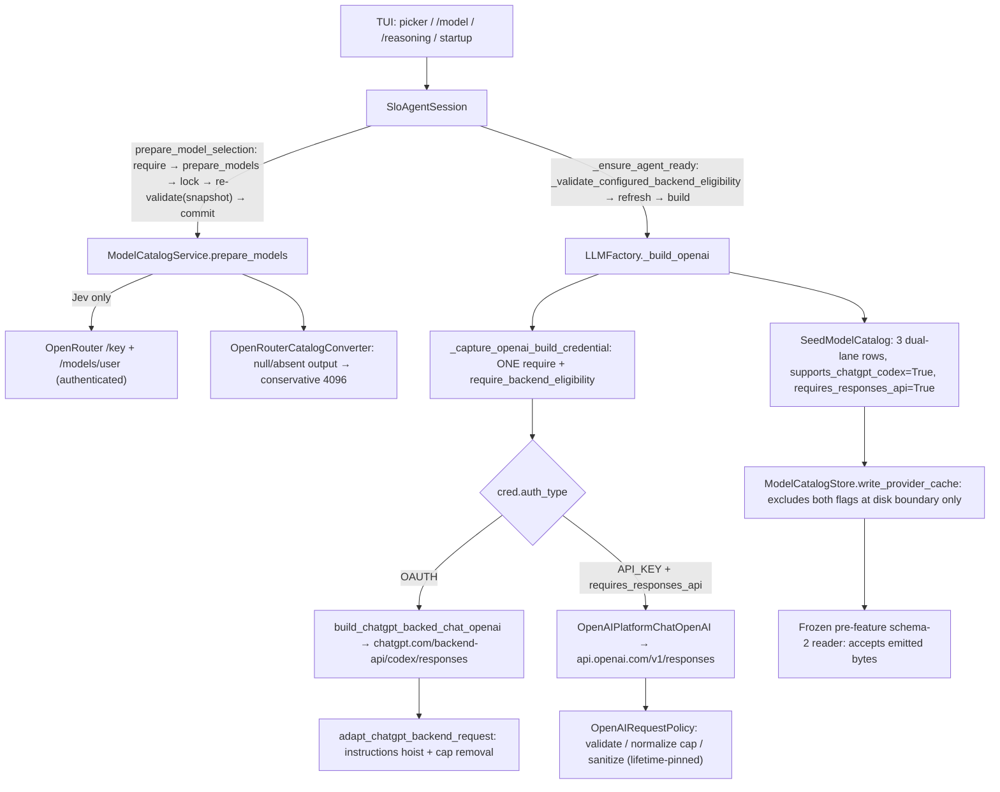

# Feature 89 — Independent Adversarial Substantive Review (dispatch 4/4)

**Reviewer role:** independent reviewer. Not the author, not the completion
assessor, not a release approver. **Date:** 2026-10-10. **Repo:**
`/root/Code/slo-gpt-6-support/slo`. **Branch:** `feature-gpt_6_support`.
**Verified source baseline:** `ea8601c53f04fa06a0baeeb47d385c44cc9a5364`.
**Scope:** functional review of the corrected dual-lane GPT-6 implementation
(API key + subscription OAuth for `gpt-6-luna`, `gpt-6-sol`, `gpt-6.1-sol`;
authenticated Jev via OpenRouter) plus the bounded release-preparation edits
(root `.gitlab-ci.yml`, `pyproject.toml` 0.21.1, `CHANGELOG.md`,
`tests/test_feature89_release_preparation.py`).

**Verdict (two distinct halves, do not conflate):**

- **Functional code review: APPROVE.** The implementation is substantively
  correct, complete against all 15 ACs at the test-assertion level, and
  convention-compliant. The 21-cell reasoning matrix, dual-lane credential
  routing, protected Platform merge surfaces, snapshot pinning, Jev null-output
  admission, frozen-reader compatibility, and release-prep config are all
  verified by real, discriminating assertions that I read and, for a focused
  subset, re-executed and confirmed green in the locked environment. No
  blocking functional findings.
- **Formal gate approval / STEP1READY: WITHHELD.** This is not a functional
  deficiency. It is withheld because (1) mandatory static gates (full Black
  13-file, full mypy 296-in-59) remain UNWAIVED RED even though they are
  pre-existing baseline failures with 0 added/0 removed; (2) the completion
  assessor model is unassigned; (3) authenticated GitLab collision / merged-CI
  lint / runner and capability checks are unverified (no credentials were
  available); (4) upstream `main` is two commits ahead
  (`0a918a93b4233dfe2d14880e63a85174805f9caa`) and not integrated. I performed
  **no release operations and no implementation edits.**

---

## 1. Stack Summary

| Stack | Surface | Convention sets applied |
|---|---|---|
| Python / LangChain OpenAI SDK | `src/agents/base.py`, `src/agents/providers/openai_platform.py`, `openai_codex.py` | declarative-method-structure, named-arguments-and-type-hints, method-docstrings, code-review-rules §1 |
| Model catalog domain | `src/agents/model_catalog/{dao,seed,store,discovery,openrouter}.py` | build-domain-features, ubiquitous-language |
| Session orchestration | `src/agents/slo_agent/sessions/service.py` | build-application-services (invoke gateway), declarative structure |
| Textual TUI | `src/tui/{app,model_catalog,slash_router}.py`, `widgets/slash_suggestion_menu.py` | build-textual-tuis, code-review-rules §5 |
| Reasoning resolution | `src/agents/reasoning_capabilities.py` | shared resolver, no refactor permitted |
| Release / CI | root `.gitlab-ci.yml`, `pyproject.toml`, `CHANGELOG.md` | release-process skill, KB `slo/release-versioning.md`, `slo/distribution.md` |
| Tests | 12 new + 12 modified test modules | test-verification-policy, code-test-loop |

## 2. Executive Summary

The corrected implementation delivers exactly what the seven specs require and
nothing they forbid. Three first-class direct rows exist with the exact seed
contract; the 21-cell effort matrix resolves correctly in both credential
lanes; the Platform adapter protects identity/credential/sampling/cap fields
across constructor, bind, call, and late `extra_body` merge without mutating
caller input; OAuth routes through the unchanged Codex builder with all its
headers/instructions/cap-removal invariants; Jev admits only through
authenticated `/key` + `/models/user` with a conservative 4096 cap and truthful
"provider default; controls unavailable" presentation. Old/new shared-state
coexistence is proven against a real git-archived frozen reader. The release
prep correctly adds conjunctive `mgr-01`+`shared` default tags, preserves
`macos`, bumps to 0.21.1, and guards it all with a real offline test.

Every claim is backed by assertions I read, and the full non-E2E gate is green
(6142 passed / 18 deselected / 406 warnings). The release gate is withheld for
process/static/upstream reasons that are explicitly out of functional scope,
not because the code is wrong.

## 3. Feature Completeness Table (all 15 ACs)

| AC | Requirement | Status | Primary evidence (assertion-level) |
|---|---|---|---|
| AC1 | Three exact direct rows; Jev absent from seed | **Implemented** | `test_model_catalog_seed.py::test_gpt6_exact_seed_contract` asserts every identity/runtime/profile field, `supports_chatgpt_codex is True`, `requires_responses_api is True`, no aliases, Jev absent, gpt-5.4 still default; `test_catalog_integrity.py::test_gpt6_source_registration_once` |
| AC2 | All 21 reasoning cells + default/highest/invalid | **Implemented** | `test_feature89_reasoning.py::test_all_selected_levels_resolve` (3×7 with explicit expected effort table, not derived from production), `test_default_and_highest_are_pinned`, `test_invalid_reasoning_and_unknown_model_reject` |
| AC3 | Platform AND Codex Responses wire + streamed tools, all 21 cells/lane | **Implemented** | `test_openai_platform.py::test_factory_stream_parses_complete_tool_response` (3 models × 7 levels × 2 lanes × stream/nonstream): exact endpoint, model, effort/summary, flat `function` tools, matching `call_id` in `function_call_output`, one real echo execution |
| AC4 | Enabled forbidden fields + logprobs include removed across merge surfaces; off sampling retained; no input mutation | **Implemented** | `test_public_factory_rejects_protected_merge_surfaces` (18 keys × 3 surfaces, zero HTTP), `test_sanitize_copies_both_surfaces_and_include`, `test_optional_off_sampling_survives_actual_late_merge` (deep-copied before/after equality) |
| AC5 | Same build credential, both lanes accepted, genuine-ineligibility rejection, atomic selection, env precedence, missing-auth guidance | **Implemented** | `test_feature89_credentials.py::test_environment_key_beats_real_stored_oauth` (real store, spy-delegating resolver, `CredentialStore.load` forbidden as fallback), `test_factory_rejects_oauth_before_either_constructor`, `test_feature89_selection.py::test_incompatible_selection_is_atomic`, `test_selection_rechecks_credential_after_preparation` (event-barrier rotation) |
| AC6 | Medium only as fresh default; explicit/switch/resume/children preserve canonical identity | **Implemented** | `test_feature89_entry_paths.py::test_feature89_cli_fresh_saved_explicit_precedence` (real preference bytes; switch clamps, does not reset — mounted test starts at `reasoning_level="high"` and asserts the selected level survives `/model`), `test_feature89_cli_pool_resume_and_explicit_model_precedence`, mounted resume asserts exact history identity/order |
| AC7 | Unique offline direct picker rows + truthful painted auth/reasoning at two sizes | **Implemented** | `test_feature89_presentation.py::test_direct_picker_keyboard_paints_and_selects_exact_route` and `test_direct_picker_cropped_auth_context_and_footer` at 60×20 and 120×40; `test_picker_distinct_ineligible_record_retains_oauth_denial` |
| AC8 | Snapshot-pinned identity/runtime/reasoning/eligibility + safe overrides/cache composition | **Implemented** | `test_openai_platform.py::test_factory_clients_keep_their_pinned_generation` (A/B/A caps 128000/2048/128000, no adapter catalog read), `test_projection_cache_invalidates_each_key_component` (all five discriminators), `test_cache_file_separation.py` writer-boundary exclusion |
| AC9 | Total context/output overrides, advisory TPM, existing compaction summary cap | **Implemented** | `test_feature89_capacity.py::test_gpt6_summary_uses_reserved_cap_and_total_context` (Platform `max_output_tokens == RESERVED_TOKEN_LIMIT != 128000`; OAuth no cap + instructions; 1,050,000 total), `test_gpt6_large_estimate_is_advisory` (500001 bypassed, run completes) |
| AC10 | Real bound-tool mixed fallback + committed-output safety; cancellation/watchdog gate | **Implemented** | `test_feature89_model_flows.py::test_prepared_mixed_pool_tool_fallback` (real 429-before-output, both orders), `test_committed_pool_failure_boundaries` (no raw replay/switch after committed delta; session semantic continuation kept distinct), `test_prepared_pool_cancellation_closes_stream_without_fallback` (pre/post-output cancel closes stream, releases lock, one abort) |
| AC11 | Actual old/new coexistence + observer independence, no incompatible shared write | **Implemented** | `test_feature89_frozen_reader.py::test_pre_feature_reader_accepts_actual_writer_bytes` (git-archived baseline subprocess), `tests/compat/test_session_resume_mixed_versions.py` (tree+flat, all four new routes), `test_visualize_when_state_files_are_hostile_opens_no_catalog_or_credential_file` |
| AC12 | Finite old-family/defaults/alias/retry/compaction/UI non-regression matrix green | **Implemented (tests) / BLOCKED (statics)** | `test_legacy_temperature_wire_contract` (frozen collision oracle), `test_custom_endpoint_and_enabled_temperature_remain_record_scoped`; full non-E2E gate 6142 green. **Full Black (13) and mypy (296/59) are RED — see Findings F1.** |
| AC13 | Jev authenticated-shaped metadata, null safe cap, strict invalid rejection, unknown reasoning | **Implemented** | `test_openrouter_converter_metadata.py::test_jev_unknown_output_and_reasoning_projection` (literal fixture byte-identical to spec), `test_convert_when_output_ceiling_is_absent_or_supplied_retains_remote_evidence_and_safe_cap`, strict invalid rejection; `test_feature89_jev_lifecycle.py` |
| AC14 | Prepared Jev SDK tool cycle + distinct keys/formats in both mixed-pool directions | **Implemented** | `test_feature89_model_flows.py::test_mounted_prepared_jev_tool_cycle_and_resume`, `test_prepared_mixed_pool_tool_fallback` (nested gateway vs flat direct tools, distinct URL/key/body, private anchor only in permitted replay carrier) |
| AC15 | Credential/membership/freshness safety across selection/headless/child/resume + painted provider-default text | **Implemented** | `test_feature89_jev_lifecycle.py::test_jev_new_admission_rejects_changed_credentials` (rotation/removal), `test_jev_listing_refresh_preserves_admission_boundaries` (incomplete retains good bytes), `test_feature89_headless_routes_use_shared_admission` (32 nodes), `test_feature89_child_model_selection`, `test_admitted_jev_picker_keyboard_and_cropped_paint` |

**Completeness: 15/15 ACs implemented at the assertion level.** AC12 is
functionally green but its static-gate component is blocked (F1), which is a
release-gate issue, not a functional gap.

## 4. End-to-End Flow Verification

```
Operator selects gpt-6-luna / gpt-6-sol / gpt-6.1-sol / openrouter:typesafe/jev-router
  │
  ├─ direct ──► SloAgentSession.prepare_model_selection
  │               ├─ _validate_model_selection_credential (preliminary, live resolver)
  │               ├─ ModelCatalogService.prepare_models  (await; Jev → authenticated /key + /models/user)
  │               └─ under _lock: _validate_model_selection_credential(snapshot)  ← FINAL, prepared view
  │                     └─ _commit_model_selection  (atomic; rejection → zero mutation, preference bytes unchanged)
  │
  ▼
SloAgentSession._ensure_agent_ready
  ├─ _validate_configured_backend_eligibility  ← before OAuth refresh
  ├─ _refresh_oauth_credential_if_needed        (near-expiry valid token → real refresh, persisted)
  └─ _build_agent ──► LLMFactory._build_openai
                        ├─ _capture_openai_build_credential (ONE require; entry.require_backend_eligibility)
                        └─ _build_openai_lane
                              ├─ AuthType.OAUTH  ──► build_chatgpt_backed_chat_openai
                              │      POST chatgpt.com/backend-api/codex/responses
                              │      (bearer JWT, chatgpt-account-id, originator, OpenAI-Beta, session-id,
                              │       x-client-request-id, store=False, encrypted include, prompt_cache_key,
                              │       max_retries=0, instructions adaptation + cap removal via adapt_chatgpt_backend_request)
                              └─ AuthType.API_KEY + requires_responses_api ──► OpenAIPlatformChatOpenAI
                                     POST api.openai.com/v1/responses  (fixed base_url, hostile env cannot reroute)
                                     configure_request_policy pinned once for client lifetime
                                     _get_request_payload: validate → normalize cap → sanitize → SDK convert
                                       → sanitize → force model + reasoning (openai_reasoning_payload)
```

**Flow verdict:** every component is wired to the next. The final precommit
validation uses the *prepared* snapshot (not a live catalog), the lazy precheck
runs *before* OAuth refresh, the factory checks its *own* captured credential,
and the adapter pins policy *after* constructor assembly but *before* tool
binding. I confirmed `RunnableBinding.bind` shares (not copies) the bound
instance, so the pinned policy genuinely survives `bind_tools` — the
lifetime-pinning claim is real, not cosmetic.

## 5. Unit Tests Assessment

**795 focused Feature 89 tests re-executed by me, all green** in the locked
`.f89-evidence/venv` (Python 3.11.7, openai 2.38.0, langchain-openai 0.3.35,
langchain-core 0.3.86, pydantic 2.13.4 — all lock-matched per
`closure-final-versions.log`):

| Partition run | Result |
|---|---|
| catalog/reasoning/eligibility/frozen-reader/release-prep | 70 passed |
| Platform adapter + credentials | 486 passed |
| mounted flows + entry paths + capacity | 98 passed |
| selection + presentation + Jev lifecycle | 141 passed |

Coverage is discriminating, not happy-path: every negative branch has a
zero-HTTP assertion, every positive fixture asserts real SDK parsing of a
complete envelope, and caller-input non-mutation is proven by deep-copy
equality. No `@pytest.mark.skip`/`xfail` introduced. The closure audit
(`closure-ac-assertions.json`) records node-level assert/raises locations and
its counts matched what I read in source.

**No untested production file.** `openai_platform.py` (new) has direct policy
tests plus factory/wire tests. All modified modules have extended tests.

## 6. Convention Adherence

- **Named arguments + type hints:** clean across the diff. All new/changed
  methods use keyword-only args and explicit return types.
- **Google docstrings:** present on every new public method (WHO/WHAT/WHEN style
  consistent with the repo).
- **Declarative structure:** the factory decomposition
  (`_build_openai` → `_capture_openai_build_credential` → `_build_openai_lane`
  → `_openai_api_key_kwargs` / `_construct_openai_api_key_model` /
  `_build_protected_openai_model`) reads as a table of contents; each helper
  has one decision. `OpenAIRequestPolicy` methods are flat with guard clauses.
- **Ubiquitous language:** one canonical name per concept across layers —
  `supports_chatgpt_codex`, `requires_responses_api`, `provider_effort`,
  `backend_eligibility` are used identically in seed, DAO, factory, session,
  and picker. No synonym drift found.
- **invoke() gateway:** `OpenAIRequestPolicy` uses `@classmethod` pure owners;
  `OpenAIPlatformChatOpenAI` keeps the inherited `ainvoke`/`astream` and only
  overrides `_get_request_payload`. No new graph, so no `invoke_streaming`
  obligation.
- **TUI separation:** `slash_router.py` owns reasoning routing; `model_catalog.py`
  owns projection; `app.py` only passes the session snapshot to the resolver.
  No business logic leaked into the App shell.

One convention note (not a violation): `src/tui/model_catalog.py` imports both
`from src.agents.model_catalog import dao as catalog_dao` and
`from src.agents.model_catalog.dao import ModelCatalogSnapshotDAO`. Two import
styles for one module is mildly untidy but harmless and consistent with the
existing file's evolution. **Note N2.**

## 7. Ubiquitous Language Audit

| Concept | Canonical name | Layers traced | Synonym found |
|---|---|---|---|
| Codex-backend permission | `supports_chatgpt_codex` | seed → DAO → merge → writer-exclusion → picker → session → factory | none |
| Responses transport requirement | `requires_responses_api` | seed → DAO → override guard → factory lane select → writer-exclusion | none |
| Resolved provider effort | `provider_effort` | reasoning_capabilities → openai_reasoning_payload → adapter payload → router note | none |
| Static lane check | `backend_eligibility` (`require_`/`_message`) | DAO → session selection → lazy precheck → picker status → factory capture | none |
| Jev unknown controls | `provider default; controls unavailable` | converter capabilities → `_provider_default_reasoning_note` → router → picker paint | none |

DAO field names match their model columns; the two new strict flags are
seed-owned, kept in Python dumps, and excluded only at the schema-2 writer —
exactly the specified boundary, never a global `Field(exclude=True)`.

## 8. Architecture Diagram



No new provider, registry, credential store, widget, command, migration, or
fallback owner was introduced — matching the spec's non-goals.

## 9. Findings

### Blockers (release-gate, not functional-code defects)

**F1 — Mandatory static gates remain UNWAIVED RED.**
*Where:* full-tree Black and mypy. *Evidence:* I re-ran both in the locked
venv. `black --check --line-length 110 src/ tests/` → **13 files would
reformat, 655 unchanged, exit 1**. `mypy src/ tests/` → **295–296 errors in
58–59 files, exit 1**. The `release3-static-comparison.json` normalized
multiset shows **0 added / 0 removed** versus git-archived HEAD, and the
13 Black files are a subset of the baseline 19 — these are pre-existing
baseline failures, not regressions introduced by Feature 89. The 28 changed
Feature 89 files are themselves Black-clean (I confirmed: "All done! 28 files
would be left unchanged"). *Why it gates:* AC12 and the project rule
"Black/mypy waived, not green" — a 0-added/0-removed baseline failure is still
a failing mandatory gate. The operator decision is explicitly scoped:
**authorize baseline static remediation, or accept an explicit static-gate
waiver.** Neither is assumed here. This blocks STEP1READY, not the functional
verdict.

**F2 — Completion assessor model unassigned.**
*Where:* workflow governance. The headless-code-test-review workflow requires
a fresh completion assessment by an assigned assessor, separate from this
review. `release-prep-dispatch3-20261010.md` lists it as remaining blocker #3.
A code review and a test count are not a substitute. STEP1READY cannot be
asserted until that assessment runs.

**F3 — Authenticated GitLab collision / merged-CI lint / runner capability unverified.**
*Where:* release preparation. `release3-server.json` records
`{"documented_file_present": false, "gitlab": "credential unavailable",
"cloudflare": "credential unavailable"}`. The documented
`environments/development.env` is absent. Authenticated tag/release collision
clearance, official merged-config CI lint, protected-ref/variable readiness,
eligible runner presence (conjunctive `mgr-01`+`shared`), privileged Docker
service, and macOS capability are all **unverified, not failed**. The public
Secret-Detection template was fetched read-only and its jobs inherit the two
default tags, but that is public-master inspection, **not** the deployed
merged-config result. The CI tag edit is correct as far as static analysis can
establish (see F6), but "tags are conjunctive and correct" ≠ "runners with
those tags exist and can execute." No release operation may proceed on this
evidence.

**F4 — Upstream `main` is two commits ahead and not integrated.**
*Where:* branch state. `origin/main` = `0a918a9` (merge of
`feature-consolidate-spec-skills`), two commits ahead of HEAD
`ea8601c`. Overlap with the dirty tree is `RESEARCH.md` and `docs/RESEARCH.md`
only: upstream appends to the file tail, the Feature 89 edits prepend to the
file top — **non-conflicting** (git merge-tree shows no "changed in both"
hunks). This is low-risk but is still a required integration +
post-integration gate before any delivery, per the project's own delivery
lifecycle. Not a functional defect.

### Advisory / Nice-to-haves (non-blocking)

**N1 — Non-streaming SSE fixture derivation is implicit.**
`test_openai_platform.py::test_factory_stream_parses_complete_tool_response`
(non-streaming branch) decodes the final SSE frame and re-serves it as JSON
(`json.loads(frames.decode().split("data: ")[-1])["response"]`). This works
and asserts real SDK JSON parsing, `stream is False`, and exact content, but it
derives the JSON body from the SSE fixture rather than constructing a literal
R2 JSON envelope as the spec's §8.6 prescribes. Impact: cosmetic; the
discriminating assertions (one request, parsed answer, matching `call_id`,
exact reasoning/effort on the wire) are all present and pass. Recommend a
literal non-streaming envelope helper in a future tidy-up to remove the
string-splitting fragility. **Not a blocker.**

**N2 — Dual import style in `src/tui/model_catalog.py`** (see §6). Cosmetic.

**N3 — `.f89-evidence/` is untracked and not gitignored.**
The evidence directory is intentionally excluded from prospective staging
(per dispatch-3), but it is not in `.gitignore`. If the branch is ever staged
with a broad `git add`, evidence artifacts could be committed accidentally.
Recommend an explicit `.gitignore` entry or a documented staging exclusion
before any future commit is authorized. **Process note, not a code defect.**

### Temporary Shortcuts (acknowledged, bounded)

**S1 — Offline synthetic evidence only.** All wire/tool/resume/pool proofs use
`httpx.MockTransport` and synthetic sentinel credentials. This is the
spec-mandated boundary ("static eligibility and successful synthetic transport
tests do not prove live account entitlement"). Live entitlement, subscription
availability, and paid inference are unverified by design and require separate
authorization.

**S2 — Child inference is argv/env-parse proof, not a spawned interpreter.**
`test_feature89_child_model_selection` captures the shipped spawn argv/env,
asserts exact model/reasoning forwarding and credential allowlist filtering,
and parses that argv through the real Typer app — but does not launch a real
child process to inference. This matches the 89.e.1 §8 prescribed "existing
fake spawn containment" scope; expanding it would exceed the written finite
contract. Recorded as a bounded scope decision, not a gap.

## 10. Correction & Evidence (for each blocker)

| # | Required correction | Evidence that will establish it |
|---|---|---|
| F1 | Operator decision: scoped baseline Black/mypy remediation **or** explicit static-gate waiver | green `make lint` + full `black --check` after remediation, or a recorded waiver in the closure doc |
| F2 | Assign completion assessor model; run fresh deliverable-by-deliverable assessment | assessor report confirming 100% of spec deliverables with green tests |
| F3 | Provide `environments/development.env` (or equivalent credentials); run authenticated tag/release collision check, official GitLab merged-CI lint, and runner/capability verification (mgr-01+shared conjunctive, privileged Docker, macOS) | authenticated clearance receipts; merged-config lint output; runner capability listing |
| F4 | Integrate `origin/main` (2 commits) into `feature-gpt_6_support`, then re-run full non-E2E + statics | post-integration green gate receipts |

## 11. Release-Prep Specific Verification

- **Version alignment (release-process skill):** `pyproject.toml` = `0.21.1`,
  CHANGELOG has `## [0.21.1] — Unreleased`. No tag exists (correct — tag must
  follow merge, per the skill's non-negotiables). The eventual tag must be
  `v0.21.1` to match. ✅ aligned, ⛔ tag not created (correct at this stage).
- **CI tags:** `.gitlab-ci.yml` adds `default: tags: [mgr-01, shared]`;
  `macos-installer-smoke` repeats both and keeps `macos` (required — GitLab
  does not merge arrays). `test_feature89_release_preparation.py` asserts the
  default set, the macOS superset, that no `trigger` (bridge) job carries
  explicit tags, and that no job sets `inherit.default: false`. I read the full
  pipeline: includes, scripts, rules, privileged Docker service requirement,
  and release dependency order are unchanged. ✅ correct as static config.
- **Manifest integrity:** `release3-manifest.json` SHA-256 hashes match the
  current worktree bytes for all five release files exactly — no post-receipt
  edits.
- **System integrity:** `dpkg -V coreutils` clean; `git diff --check` clean
  (both independently re-run by me).
- **Environment:** `closure-final-versions.log` records Python 3.11.7 and all
  87 locked packages matching (openai 2.38.0, pydantic 2.13.4, langchain-openai
  0.3.35, langchain-core 0.3.86, httpx 0.28.1, textual 8.2.8).

## 12. Reasoning-level mapping note (as requested)

The requested maximum reasoning is the canonical `xhigh` / provider `max`. I
can verify the **catalog and wire mapping**, not a live runtime assignment:
- Seed: `provider_effort_map["xhigh"]="xhigh"`, `["max"]="max"` for all three
  GPT-6 entries; `highest_supported_reasoning_level` returns `max`.
- Wire: the AC3 matrix asserts the actual HTTP `reasoning` payload is
  `{"effort": "xhigh", "summary": "auto"}` and `{"effort": "max", "summary":
  "auto"}` on both lanes (offline synthetic).
- The 89.b.1 reconciled-boundaries note records that the OpenAI 2.38.0 typed
  effort literal lacks `max`, but the request is a dictionary passed through
  the SDK transform, not a validated `Reasoning` model, so `max` is preserved
  on the wire. This is source-derived; I did **not** execute a live provider
  call, so I do **not** claim the provider accepted `max` — only that Slo
  emits it correctly in the locked offline SDK.

## 13. Final Statement

The Feature 89 corrected implementation is functionally sound, complete against
all 15 ACs, and convention-compliant; the bounded release preparation is
correct as local configuration. **I approve the code on functional review.**

**STEP1READY and release approval are WITHHELD**, solely on: unwaived static
gates (F1), unassigned completion assessor (F2), unverified authenticated
GitLab/runner capability (F3), and un-integrated upstream main (F4). These are
process/static/operational gates, not code defects. No release operations and
no implementation edits were performed. Specs, `main`, and feature code are
preserved.
