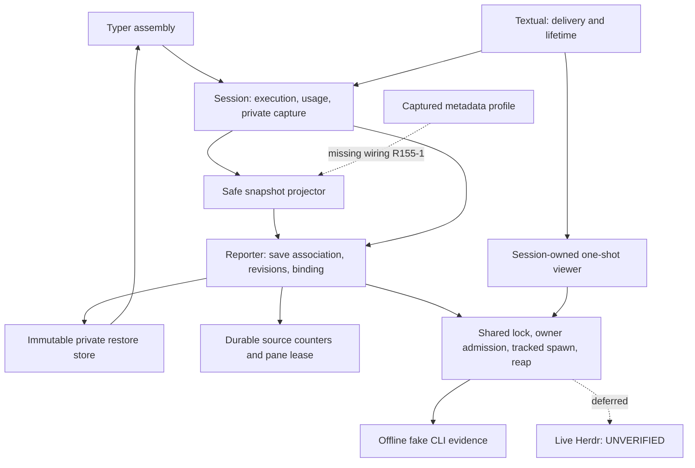

# Independent feature review — dispatch155

## Verdict: REVISE — confirmed product gap; full-scope audit incomplete

**Do not advance to Completion or delivery.** Independent examination found a reproducible production wiring defect: the documented detail metadata opt-in never reaches session publication. This report is deliberately **not** presented as a completed full-feature audit. The remaining canonical/sample, source/assertion and hard-rule coverage is enumerated below; no author read closure is substituted for independent reading.

Accounting preserved: wf-50f1/wf-2c68, turn1, started1/completed0/historicalpartial1/retries0, supplied dispatch155. Effective turn/dispatch limits unlimited. No subagents, fixes, Git mutations, installation, global/KB/specification/other-worktree edits, private transcript inspection or live integration actions. This reviewer did not implement the feature. Runtime model/reasoning not independently established and not inferred from the assignment.

Live acceptance is **explicitly DEFERRED; compatibility UNVERIFIED**. That accepted scope is not a blocker or a request for repeated approval. Independent Completion must be a separate later assessment after a complete passing Review.

## 1. Stack and authority

Python3.11/Pydantic2/asyncio support adapters and filesystem leases; existing LangChain/LangGraph agent usage handoff; Typer parse/assembly; Textual application lifetime and typed workflow rendering; Make/dependency metadata. No database, HTTP endpoint, new CLI Command hierarchy, editor redesign or upstream Herdr change is required.

Verified repository root `/root/Code/slo-94-herdr-integration`, product cwd `slo/`, expected feature branch and GitLab remote, HEAD equal to base `d0e3a756689f2675e5507034d43cd8b272d3c6b8`, before report writes. Runtime `SLO_SKILLS_DIR` points to the pipx installation. Its exact named workflow file is absent; the authoritative worktree `skills/design-and-analysis/workflows/code-test-review.md` was read in full. Also read full review-feature-code, mandatory Python code-review-rules, engineering routing/review/ownership/testing, generic coding-rules, Python root, shared/Python declarative and named-argument guidance. Specific canonical ownership overrides unrelated framework examples and mechanical splitting of atomic admission sections.

AGENTS was read first; its truncated tail was subsequently read. CLAUDE/root RESEARCH/Makefile and dependency declarations were read; maintained docs/RESEARCH was supplied in context. KB Welcome, actual slo README and gotchas were consulted. Routing/scope/integrated154/148/150/151/A–E/security132 were read; workflow-state and final-code-status current portions were read, not their complete historical tails. Remaining selected component recipes and full hard-rules enforcement are **not complete**.

## 2. Executive summary

The support owners inspected retain strong separation between private capture, remote-effect accounting, semantic acknowledgement and local resource cleanup. The frozen author test inputs are current, but green lower-level tests concealed a missing configuration-to-publication connection. A full independent approval cannot be inferred from those tests or the partial audit here.

## 3. Glaring Gaps — must fix

### R155-1 — High: detail profile is parsed but never applied to session publications

**Where:** `src/agents/slo_agent/sessions/service.py:2458–2476`, specifically the `HerdrSnapshotProjector.build` call; `src/agents/slo_agent/herdr/service.py:99–111,156–174`; `src/agents/slo_agent/herdr/dao.py:390–392`.

**Requirement:** canonical B §7 configuration (`94.b.1-herdr-reporting-adapter.md:228`) accepts `SLO_HERDR_METADATA_PROFILE=detail`; overview Display requires explicit detail opt-in. README:539 and INSTALL:25 advertise it.

**Causal chain:** environment gate correctly stores `metadata_profile="detail"` in the reporter configuration. Session `_publish_herdr_snapshot` calls the projector without `metadata_profile`. The projector's default is `"compact"`. Reporter consumes the already-projected snapshot and never reprojects it. A source-wide search finds no other production consumer wiring the captured profile into the session projection.

**Impact:** actual interactive/headless session publications always use compact mode. Fixed reasoning, turn input/output, cache, RPM/TPM, output cap and budget detail never appear through this opt-in. No live server is needed to demonstrate this defect.

**Independent reproduction:** `independent-review-155-receipts/test_profile_probe.py` builds a config-backed session with high reasoning, enables detail through the environment and the independently registered regular temp fake, activates actual reporting, asserts that reporter config is detail, then inspects the actual latest publication. Expected reasoning `high`; actual token map `{}`. `profile.log` reports **1 failed**, exit1. Reporting/retained cleanup runs in finally. This is review evidence only; no existing source/test was changed.

**Required correction:** carry the once-captured validated profile through the existing session-owned assembly/publication boundary. Do not reread arbitrary environment on every event, add another counter/projector, or let the reporter reach into the session. Preserve compact default, invalid-profile fallback and disabled zero-work behavior.

**Required tests:** activation through actual session publication and fake CLI for compact/detail/invalid profile; assert detail tokens and compact exclusions, clear-before-set behavior, unchanged lifecycle, fixed-vocabulary privacy, and no credential lookup. Include both interactive and headless activation paths or demonstrate their shared exercised publication seam. Keep projector unit tests; they do not replace this wiring test.

**False-confidence evidence:** `tests/agents/slo_agent/herdr/test_projection.py:53–99` passes `metadata_profile="detail"` directly. `test_attention_execution_composed.py:232–242` also constructs a detail projection explicitly. These prove projector behavior, not the environment-to-session connection. The independent existing selection passed80 while the wiring probe failed.

### R155-2 — Review gate incomplete (not an asserted implementation defect)

The requested entire base-to-worktree and T1–T6 audit is not complete. Remaining requirements cannot be marked Implemented merely from author tables. Required continuation is the unread canonical chapters/tasks/all allocated samples and accepted evidence; complete source/test assertion audit including process admission146/supervisor, two-process capability/trust cases, full session/app call sites, A–E test repairs and hard-rules post-hook. This is a disclosure of missing independent evidence, **not** a new dispatch budget or a claim that the implementation lacks all those behaviors.

## 4. Requirement coverage — independent status only

The IDs below come from scope-plan and must still be fully re-derived against canonical chapters/tasks. “Inspected” means source behavior examined, **not** full acceptance proven. This is not the complete requirement-to-test certification requested for READY.

| Requirement | Independent disposition and actual evidence | Remaining proof |
|---|---|---|
| R1 optional/nonblocking | Gate/null source inspected (`herdr/service.py:36–119`), session start2359–2404 | Full disabled/parity/stalled assertion bodies |
| R2 panes/product | Explicit live deferral accepted; overview read | No live placement/paint claim |
| R3 private atomic handoff | Session2458–2476 pairs frozen capture/snapshot; reporter91–104 replaces pending synchronously | Full call-site and public-channel audit |
| R4 configuration versus display | Reporter validation106–129; session2733–2768 separately advances capture generation | Mutation/commit tests fully reconcile |
| R5 G1 latest save | Reporter `_matches_save`, `_adopt_save`, `_consume_publication` read in full | Independent barrier assertion audit |
| R6 immutability/bounds | Entire dao.py read: frozen extra-forbid tuples; reporter bounded slots inspected | All schema bypass/error cases and bound tests |
| R7 reporting privacy | Fixed-only projector and diagnostic builders inspected;132 executor unchanged at base | Full cross-channel sentinel assertions; detail wiring R155-1 |
| R8 exact restore/current history | Entire restore.py read; CLI restore diff read: exact revision, canonical UUID, no preference merge | Complete two-process harness/current capability/trust/assertions |
| R9 local versus remote drain | Transport/reporter full close and retained drain read; session2492–2651 read | All session/app terminal paths and persistent quarantine tests |
| R10 lock-held admission | `service.py::_invoke_locked` checks owner and registers spawn without intervening await | Full G2/command-family evidence reconciliation |
| R11 cancellation/stale result | Transport shielded cleanup and reporter binding/ack split inspected | Complete cancellation matrix;151 narrower proof below |
| R12 report command inventory | Reporter full builder/reservation/admission/batch/shutdown read | Every decision's tests not yet audited |
| R13 G2 stale waiter | Source `_admission_policy` uses revision under lock | Real executable barrier assertions not fully read |
| R14 lifecycle/usage | Session operation/attention2359–2456 and run-scope diff inspected; agent pending usage diff read; independent usage tests executed | Full usage test bodies and interruption/attention paths |
| R15 environment exclusion | Scheduler diff explicitly filters case-insensitive HERDR_ only | Existing child/relaunch exclusions and test assertions |
| R16 identity | CLI diff uses strict UUID only on restore | Entire identity extraction/compatibility tests |
| R17 provenance | Bootstrap before/after snapshots and tool identity source inspected | Full invalidation/provenance branch tests |
| R18 viewer | Full visualizer.py: reserve-before-split, live admission, retained attempts, no retry; app viewer-registry diff read | Full launcher/renderer/currentness tests |
| R19 shared parser | Full context_reader.py inspected | Loader/eligibility callers and duplicate-removal reconciliation |
| R20 replacement/inbox | Complete app diff read: final no-await registration, captured claim/ack, retained replacement task, shutdown | Surrounding unchanged bodies and full 64-case/all-owner assertions |
| R21 numeric/security limits | DAO/projector/sequence/restore source read fully | Boundary tests fully reconcile; detail option fails R155-1 |
| R22 gates/conventions |843 current hashes; retained full/smoke/lint verified; independent80 passed and probe1 failed | Complete hard-rule pass and whole diff audit |
| R23 preservation | No existing product/source/test/spec edits by reviewer | Inventory retained |
| R24 no live/external actions | Observed reviewer scope obeyed | No live evidence implied |
| R25 independent review | **Partial / REVISE** | Complete review, then separate fresh Completion |
| R26 editor redesign | Excluded | No editor redesign requirement added |

B AC1–6 and C AC1–6 are not independently certified here; D offline AC1–3/automated AC4 also remain under review. B AC7 interoperability, D AC4 real-release portion and D AC5 actual panes are **Deferred**, not Missing or Passed. R155-1 specifically disproves the profile behavior irrespective of gate counts.

## 5. End-to-end flow traces examined

1. **Reporting:** session activation → gate → reporter construction/start → durable pane lease and activation release → session private publication → reporter save association → sequence reservation → shared lock → synchronous admission → tracked spawn → bounded output/wait → reap/accounting. Source examined through these support owners. Profile input is disconnected at publication (R155-1).
2. **Restore:** Typer dispatch special branch validates literal UUID/conflicts → existing history identity → immutable restore load → fresh SessionConfigDAO/pool → session/TUI. Store source verifies private records and bounded reads; full CLI-to-mounted-process proof remains unaudited.
3. **Viewer:** app attached/detached scheduling registry → async launch boundary → session-owned viewer → one-shot split reservation → shared transport → parse exact result.pane.pane_id → rename/run → typed outcome. Adapter source traced; complete destination/eligibility/renderer caller verification remains pending. Submission is not paint.
4. **Replacement/shutdown:** app closing/transition guards → retained commit outside submission gate → old delivery release/reporting close → candidate adoption → runtime initialization; retained local owner survives uncertainty. Complete app diff inspected, not all surrounding asynchronous callers/assertions.
5. **Headless/scheduler:** headless diff adds adopted reporting final cleanup and moves process signal/catalog lifetime; scheduler drops HERDR_ in copied env. Full original-result/cancellation proof not yet independently audited.
6. **Usage:** completed node delta captures fixed-size unconsumed aggregate; session drains rather than deduplicating equal token values. Incremental chunk and equal-submission regressions executed; all graph-failure boundary implications remain to be reviewed.

## 6. Tests, safety and evidence

Independent commands and outputs: [receipts/commands.md](independent-review-155-receipts/commands.md).

- Explicit harness Python3.11.7, VIRTUAL_ENV/PATH/PYENV_VERSION; `make test-env` fallback. No development secrets sourced.
- Read root conftest/state isolation fully before tests. The review probe explicitly loads root conftest, uses registered NEW regular temp fake executable, and retains guard identity/containment checks. No real Herdr/provider/window used.
- **Independent targeted:80 passed,34 warnings. Independent profile probe:1 failed,2 warnings.** Coreutils verification silent/exit0 after each invocation.
-151 observer helper read fully and exact full_flow observer/terminal assertions inspected by targeted excerpts. It records returned/cancelled/error separately, requires one terminal and exact returned-DAO count, callback count equals admission, child exit and owning task done. The four existing journey cases ran in independent80. This supports that bounded cancellation correction; it does not certify the whole T6 harness or every transport error path.
-843 author inputs still match after tests; digest `d75444038d2e52cbbb4511cb6312ac9b69e5b5d27d96d2643d981b29e5dc4313`. Added review receipts are outside that original manifest.
- Actual retained154 logs/exits read:8667 passed/19 deselected/777 warnings; smoke288; lint804 clean. Not independently rerun. Chapter/Black/surrounding summaries not fully re-audited here.
- Independent TOML comparison confirms all87 old lock package dictionaries identical, only types-pyyaml added. Dependency install inventory not independently reproduced; no install performed.
-132 scope: `tool_execution/executors.py` has zero base diff; current123–129 still turns exceptions into raw error messages and logs them. This supports pre-existing attribution, not resolution. Complete current privacy-channel proof remains pending; no new leak is silently waived.

## 7. Source inventory and actual read coverage

[tracked-inventory.txt](independent-review-155-receipts/tracked-inventory.txt) covers98 tracked changed paths at base. [untracked-source-tests.txt](independent-review-155-receipts/untracked-source-tests.txt) includes all new source/tests. These lists are inventory only, not read certification.

**Fully read production files:** all seven herdr package files except the one-line __init__ was only inventoried; dao.py, service.py, reporter.py (both chunks), restore.py, sequence_store.py, visualizer.py; orchestrator/context_reader.py; sessions/token_format.py.

**Complete tracked diffs read, not full-file review:** tui/app.py (three successive chunks); providers anthropic_claude_code/faux/openai_codex; skills/registry; assistant_chunk_normalizer; orchestrator/bootstrap; auth/oauth_flow; cli/headless and typer_dispatch; scheduling/runtime/subprocess_runner; tui/transcript_projector; agent.py; Makefile/pyproject/lock. Session service was read at340–859 and2359–2998 plus selected diff portions and terminal event source context, not completely.

**Assertions directly examined:** full test_projection.py, full transport observer helper, session_publication.py1–120, usage regression1–160, selected full_flow observation/cardinality/cleanup excerpts. Other test files appearing in inventory or author reports are **not claimed read**. Root conftest/state_isolation fully read. Process supervisor/bootstrap/entry and admission146 require independent completion before any whole-feature assurance.

**Canonical:** overview fully read; B selected configuration/admission/cancellation sections searched, with current authoritative cancellation wording examined. C/D/tasks/all72 samples/source historical docs/accepted review are **not fully independently read**. Scope-plan/148 maps were leads only. No full requirement derivation claimed.

## 8. Conventions and ubiquitous language

The mandatory hard-rules checklist was loaded in full, but the same-diff enforcement is incomplete. No complete hard-rules PASS is issued. Examined support code uses typed frozen boundaries, fixed error categories, instance-owned resource lifetimes and synchronous admission; no unrelated invoke/ORM rewrite is requested.

| Cross-layer concept | Trace examined | Result |
|---|---|---|
| configuration_generation | session → publication → saved restore → ticket/binding | Consistent; distinct from report_revision |
| restore_reference | stored revision → saved pair → five-word resume argv → CLI load | Consistent within inspected code |
| parent_session_id | app schedule → viewer request → attempt ledger/run command | Consistent within inspected code |
| replacement/resources | reporter close → session close → app adoption | Distinct remote uncertainty/local drain vocabulary retained |
| metadata_profile | environment gate → reporter config; absent from session projector call | Wiring defect, not a naming synonym |

A–E author reports were read and production diffs inspected as above. All corresponding assertion changes and scoped hard-rule exceptions are not yet fully reviewed. Annotation cleanup alone does not establish behavioral equivalence; the new Anthropic request-local binding fix and unknown tool-name fallback need their full regression bodies audited.

## 9. Findings tiers and continuation

### Glaring Gaps
- **High R155-1:** detail profile ignored by real session publication; independently reproduced.
- **Review evidence R155-2:** full-scope audit unfinished; no READY or delivery approval.

### Nice-to-Haves
- No independently established additional recommendation. Avoid speculative redesign while required audit remains incomplete.

### Temporary Shortcuts / acknowledged boundaries
- Live launcher/native restart/version/wire/TTL/wait/release/pane placement/paint are user-deferred, compatibility UNVERIFIED.
- Ordinary configured-credential tool-error disclosure132 remains separately open; not a Herdr redactor requirement.
- Retained author receipts establish their executed snapshot, not independent requirement completeness.

### Completion checklist

**Must-fix code (author, not this reviewer)**
- [ ] Wire captured metadata profile into actual session publication with existing owners.

**Required tests**
- [ ] Add composed profile activation/publication/argv regression and preserve all privacy/lifecycle/disabled guarantees.
- [ ] Rerun affected and full required gates after changes; old acceptance snapshot no longer suffices for changed inputs.

**Review/documentation decisions**
- [ ] Finish complete canonical/sample and entire tracked/untracked source/assertion audit, including A–E, process isolation146 and all T1–T6 failure paths.
- [ ] Complete mandatory scoped hard-rules and ubiquitous-name audit; produce full requirement/AC-to-assertion certification before READY.
- [ ] Keep live deferrals explicit; do not ask again for identical approval or imply certification.
- [ ] Obtain fresh independent Completion only after Review passes. No commit/push/MR in this phase.
