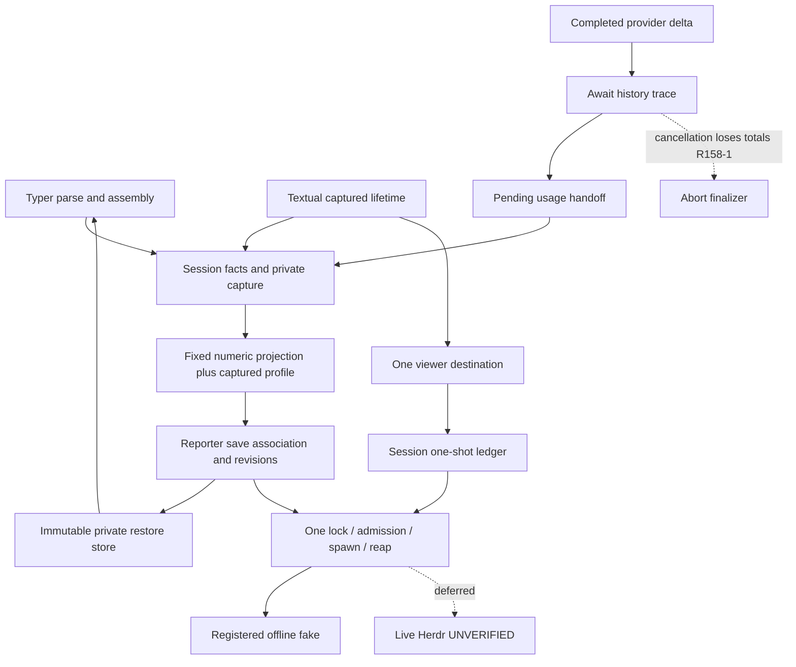

# Independent review158 — REVISE

**Do not advance to Completion or delivery.** The original profile defect R155-1 is independently closed. A new, reproducible completed-usage cancellation gap is open (R158-1), as are concrete hard-rule violations (R158-2). **The requested entire-feature audit is not complete; R155-2 remains open.** This report does not relabel partial reading, inventory, author closure or green receipts as complete independent approval.

Accounting preserved: turn2/current dispatch3/global158; started2/completed0/historicalpartial1/retries0; effective turn/dispatch budgets UNLIMITED. No numerical budget stop is asserted. No subagents, code fixes, existing test modifications, Git mutations, packages, global/KB/specification/other-worktree edits, private transcripts, actual providers, Herdr or pane operations. Reviewer outputs are this report and `independent-review-158-receipts/`. Runtime model/reasoning is unverified and not inferred from the assignment.

Live installed launcher/native restart/version/wire/TTL/wait/release/pane placement/paint is **USER-DEFERRED; compatibility UNVERIFIED**. That is accepted scope, not a new approval request or blocker. Fresh independent Completion remains a different later phase.

## 1. Stack and authority

Python3.11.7, asyncio, Pydantic2, LangChain/LangGraph completed-message accounting, Typer parse/assembly, Textual app lifetime/renderer, private files/advisory locks, existing atomic writer, Make/Poetry. No ORM/API/worker framework, new CLI Command hierarchy or editor redesign is introduced.

AGENTS was read first; truncated tail completed. CLAUDE, root RESEARCH, Makefile and supplied full docs/RESEARCH were consumed. KB Welcome, actual slo README and gotchas consulted read-only. Initial status/remotes/branch/HEAD matched the supplied base `d0e3a756689f2675e5507034d43cd8b272d3c6b8`, `feature-94-herdr-integration`, GitLab core-27/slo. All prior work retained.

Loaded complete authoritative worktree Code-Test-Review workflow, review-feature-code, Python code-review-rules, engineering routing/review/ownership/testing, generic coding-rules, shared/Python declarative, Python root/types/docstrings/application structure/domain/application services/Faux testing, product Typer and Textual recipes. Ubiquitous-language read through180 only; complete selected-routing companion closure is not claimed. Specific canonical instance lifetimes, no-await admission and app-owned replacement specialize generic invoke/splitting/run_worker examples. SQL/HTTP scaffolding and operator Make-variable requirements do not apply to this product option.

Read all requested author/review reports155–157, integrated154,148,150,151, A–E and132. These are leads, not independent correctness evidence. Canonical overview and D were read completely; tasks normative1–285 and complete sample inventory and accepted turn4 review read. B1–1050 read (initial truncation completed at655); C only targeted requirement excerpts. Full canonical/sample closure remains incomplete, explicitly listed below.

## 2. Executive summary

The inspected support code keeps publication, saved-policy identity, remote-effect accounting and local cleanup in distinct owners. The new metadata-profile wiring reaches real publication and survives environment changes. However, moving usage capture exclusively to completed node updates left an awaited history callback ahead of capture: cancellation there drops already completed provider usage, including when the assistant message has actually been persisted. Existing interrupted-update tests do not exercise this internal await.

## 3. Glaring gaps — required correction

### R158-1 — Medium correctness blocker: completed usage lost during trace/history cancellation

**Where:** `src/agents/slo_agent/agent.py:640–646`, `_process_updates_mode_chunk`; downstream `sessions/service.py:1329–1335,3433–3458,5700–5770`.

**Requirement:** overview requires observed usage before settlement; C §7.1/§8 and T5 require final usage across abort/cancellation without changing execution semantics. Shared engineering-testing requires cancellation at meaningful boundaries, not merely after a method returns.

**Current behavior:** the completed node delta is placed in accumulated messages and `turn`, then each trace event is awaited. Only afterward does `_capture_completed_update_usage` add usage to the pending accumulator. The actual session handler awaits canonical history append. If cancellation arrives during that await, the completed message's supplied totals never reach the accumulator. Final session refresh drains an empty value and reports unknown/undercounted usage.

**Independent deterministic proof:** `independent-review-158-receipts/test_usage_trace_probe.py` contains:

1. Actual Faux graph/agent with a completed response containing input2/output1/total3. Its assistant_message trace callback cancels. Completed usage drain is None instead of3.
2. Actual SloAgentSession + real FilesystemSessionHistoryStore subclass. It delegates the real assistant_message append, sets a barrier, then waits. The test externally calls `task.cancel()` on the public session consumer. Persisted history has exactly one assistant_message and one run_aborted; no run_completed. Final session total is None instead of3.

`usage-real-cancel.log`: **2 failed,4 warnings, exit1**, both at exact total assertions, not setup. This confirms the actual session path rather than only a synthetic graph delta. Source comparison shows base captured messages-mode usage before trace awaits; this branch removes that path. No historical baseline runtime is claimed.

**Required correction:** commit each completed node delta's usage synchronously before its first cancellable observer/history await, retaining completion-only accounting and exactly-once drain. Do not restore per-chunk summation, deduplicate by equal totals, swallow cancellation, or move accounting into Herdr. Preserve original history failure/abort behavior.

**Verification:** add permanent agent and session regressions for external cancellation while a completed-message append is pending/just committed, plus ordinary trace failure, eventless and multi-message updates. Keep existing partial-chunk exclusion/equal-total/tool/recovery tests; assert exact totals, terminal/history cardinality and no replay. Rerun affected and required final gates after correction.

### R158-2 — Medium mandatory-convention blocker: new signatures remain untyped; new Faux fields lack descriptions

**Evidence:** `tests/agents/slo_agent/herdr/test_reporter.py:730–732` leaves `fake_herdr` and `monkeypatch` untyped; its new `observed` helper768 has neither command/admission types nor return annotation. `test_cli_transport.py:139,157` and numerous other new tests repeat this. An AST inventory including varargs identifies **37 incomplete signatures** in new src/tests files; exact names/locations are in `missing-new-signatures.txt`. This is a finite mechanical candidate list with manually confirmed examples, not a claim every entire body was reviewed.

`src/agents/providers/faux.py:50–54` adds `Field(default_factory=...)` for queue/chunk_queue/bound_tools without required `description=`. The domain recipe explicitly applies Field descriptions to every BaseModel subclass, including internal models. Only these changed declarations are cited; unchanged model_name is not promoted to a new regression.

**Impact/rule:** Python hard-rules §1.1 and named-arguments/type-hints apply to tests too. Missing helper types let the most sensitive lock/admission test seams bypass useful static checking; a green configured mypy run is not proof of explicit-signature compliance. Field descriptions are a mandatory documentation contract. Canonical atomic-section exceptions do not waive these rules.

**Required correction:** annotate fixtures with Path, pytest.MonkeyPatch/FakeHerdrFixture and callbacks with their real command/admission/result contracts; retain all assertions and guard behavior. Add descriptions to changed Faux fields. No Any/ignore blanket suppression or production architecture rewrite. Recheck the finite signature inventory, scoped/full lint and affected tests.

### R155-2 — Still open: independent entire-feature coverage unfinished

This is a reviewer evidence gap, not an assertion that every unaudited behavior is absent. The exact remaining scope is in §9. No READY, completed hard-rule pass or full requirement certification is issued.

## 4. R155-1 resolution

**Closed independently.** Session606 initializes `_herdr_metadata_profile`;2668 retains the validated activation gate value;2475 passes it to the existing projector. No event-time env reread or second projector was added. Both activation modes use this gateway.

The unchanged independent155 probe now passes in `probes.log`. All148 lines of `test_session_metadata_profile.py` were read; its eight cases also passed in independent70. They assert exact compact/detail numeric maps, invalid→compact, retained profile after env mutation, absent-key clear order, fixed blocked state, private label/path omission, forbidden publication credential lookups, drained cleanup and disabled zero assembly/task/CLI work. They exercise both shared activation modes, not two separately parsed/mounted end-to-end profile journeys. Existing separate headless path was traced and its parity test rerun.

## 5. Requirement, acceptance and sample coverage

Statuses below describe **this independent evidence**, not a blanket Implemented certification. `Partial audit` means code/assertions examined but remaining chapter/branch closure prevents full approval.

| Requirement / task / AC | Independent evidence and disposition |
|---|---|
| R1 optional/nonblocking; T1/T2/T5; B1,C6 | Gate/null/start code fully inspected; disabled profile cases and actual headless parity pass. Full stalled/disabled write-attempt oracle not fully read: Partial audit. |
| R3–R6 private capture/generation/latest save/bounds; T1/T2/T5 | Full frozen DAO and reporter code; session capture2359–3005; full `test_session_publication_compositions` read and run, including actual G1 same-capture/new reasoning contrast. Partial audit of complete boundary ledger. |
| R7 privacy; B6 | Fixed-only projector, restricted child environment, private restore carriers, safe errors inspected; profile/G1 scans executed.151 observer/channel excerpts inspected. Full full_flow/parity/unified channel assertions remain unread: Partial audit, not global redaction certification. |
| R8 restore/current history; T3; C3 | Full restore store, CLI restore diff, two-process parent/bootstrap/entry read. Exact literal pool/scalar oracle, current credential refusal, current model capability refusal via mounted Enter, trusted→untrusted project transition and unchanged history/reference assertions confirmed in source. Source-entry evidence only; not independently rerun here. Full storage fault/security tests still unaudited. |
| R9–R12 close/admission/stale effect/command inventory; B2–4 | Full transport/reporter/viewer owners read. Lock→admit→tracked spawn remains synchronous. Complete64 matrix and all-owner cutoff test bodies read, plus headless retained test. Their helper closure and all lower failure assertions remain: Partial audit. |
| R13 G2 | Reporter test730–817 read: actual viewer fake owns lock, A reservation precedes B, log excludes A, B sequence exceeds gap; close/cancel/timeout variants. Already-admitted complementary tests not fully read: Partial audit. |
| R14 lifecycle/usage; C1,C2 | New usage regression module read fully and executed; actual run-scope/final-refresh/history trace inspected. **Fails R158-1** at missing internal await coverage. Other attention/compaction/preparation call sites not fully audited. |
| R15 environment | Scheduler diff and actual fresh/resume child env test assertions read; complete headless exclusions test read. Parent env equality and exact HERDR_ prefix preserved; no child/relaunch runtime redesign. |
| R16 identity; B5/C3 | Entire shared validator and formatter read; CLI/footer extraction diffs partly inspected. Strict UUID predicate delegates original parser; ordinary slug support remains. Full compatibility tests pending audit. |
| R17 provenance | Bootstrap diff and session exact identity checks read; bootstrap failure/custom/mutation tests in composition module read and pass. Broader mutable-policy matrix pending audit. |
| R18–R19 viewers/one parser; T4/T5; D1–3 | Entire adapter/context reader; complete launcher/workflow service/renderer/DAO/loader diffs; app registry diff read. Full canonical D read. Lower test assertion closure pending. |
| R20 replacement/inbox; T5; C4,C5 | Complete app diff; complete64 matrix and28 all-owner case bodies read. Exact claimed bytes/no ack; admitted work policy; captured old lease; two drain owners; no late notice are asserted. Surrounding app bodies/fixture helpers remain unaudited. |
| R21 limits | Source:16KiB pipes,1s deadline,.25s grace,2s remote close,2s refresh/5s TTL,18 keys/16 patch,64KiB/1024/64MiB restore, signed64 counter. Full boundary-test reconciliation pending. |
| R22 conventions/gates |844 hashes current; retained full/static receipts verified; independent70 passes plus new2 failures. Mandatory conventions fail R158-2; full post-hook incomplete. |
| R23–R24 preservation | Review-only outputs; no source/spec/global/live/Git mutation. |
| R25 independent gate | Partial / REVISE. Completion not performed. |
| R2,D5 and B7/D4 live portions | Explicitly Deferred; UNVERIFIED. |
| R26 editor redesign | Excluded; no TCSS/editor implementation requested. |

### Samples actually reconciled versus remaining

Complete task-sample inventory was read, but inventory is not sample-body reading. Canonical D01–D09 and O01–O03 bodies were read and traced to the existing destination/scheduling/ledger/parser/receipt owners. B01–B14 bodies read within B1–1050: gate/private publication/argv/token guard/join/save/admission/batch matched the inspected owners. B15 begins at1026 but is not completely read. **B15–B26, C01–C31 and allocated I02–I04 do not have complete independent body/prose closure here.** C excerpts provide targeted evidence only. No claim that all72 samples are certified. The historical excluded inventory remains subordinate; no unsupported --model restore, arbitrary labels, focus or editor behavior is reinstated.

## 6. End-to-end wiring verified within inspected scope

1. **Reporting:** session activation captures gate/profile → prepares private paths → real reporter start acquires pane lease and confirms activation release → synchronous safe snapshot/private capture pair → reporter save/adopt against exact config generation → newest display revision → durable sequence → transport lock-held admission → tracked spawn → bounded observation → reap/accounting. Failures are fixed categories; no direct CLI in publication.
2. **Native restore:** root Typer option → canonical literal UUID/conflict checks → existing exact history + immutable revision load → new validated mutable SessionConfigDAO/pool → ordinary build/TUI. Two-process source verifies changed preferences do not replace policy and current capability/trust still applies. No auto prompt submission.
3. **Viewer:** attached event or service-parsed detached result → typed effect/one captured app registry → one destination selector → eligibility read → session-owned one-shot adapter → split/rename/run under shared transport. Failed enabled Herdr cannot fall back to platform. Known pane and uncertain reservation survive repeats; submitted is not paint.
4. **Replacement/shutdown:** candidate prepared before predecessor revocation; retained commit joins viewers outside submission lock, closes old reporter, adopts candidate synchronously; uncertain predecessor suppresses all successors. Inbox continuation uses captured store/session and final registration check. Two final cleanup tasks start before either persistent retained owner is joined. Complete unchanged surrounding call-path audit is still required.
5. **Headless:** adopted session starts noninteractive reporting; outer finally joins close/final drain before dropping credential capture. Independent exact whole-JSONL parity passes. Source tests distinguish return/error cleanup and persistent retained process ownership; no native restore advertisement.
6. **Usage:** completed node delta currently awaits trace before pending capture; session drains pending at event/final boundaries. **This flow fails at R158-1.**

## 7. Test and false-confidence assessment

[Commands/receipts](independent-review-158-receipts/commands.md) records exact environment and runs. Approved interpreter explicitly selected via VIRTUAL_ENV/PATH/PYENV_VERSION; fallback reported; root fixtures explicitly loaded for review probes. Test writes are temp-owned; no system links. Coreutils checks silent after suites.

- Original155 independent profile probe: **passes**.
- Existing targeted profile/usage/G1/headless parity: **70 passed,24 warnings**.
- Final independent actual graph/session cancellation probes: **2 failed,4 warnings**, exact expected3/actualNone. Earlier direct-cancel version retained separately.
-156 before/after manifests:844 entries, identical SHA256 `375a9c4ab0b6550e9067b813dcf09fc988cebe3d4b83c218af72b4fb79a44e0f`; all entries still match after review tests.
- Actual retained156 command/exit/tail receipts verified:8675 passed/19 deselected/777 warnings; smoke288; lint805 clean; B1460/C1467/D1677/surrounding472; Black216. Not rerun as a redundant full suite. Those passes do not disprove the missing cancellation case.
- Dependency comparison rederived:87 existing lock package dictionaries identical, zero removed, only types-pyyaml added. Installed-distribution multiplicity/wheel provenance not independently checked here; no installation.

**False confidence identified:** existing usage interruption tests yield a completed update and only then raise/cancel at the next graph advance. By then `_process_updates_mode_chunk` has returned and committed usage. They do not interrupt its earlier awaited history callback. Passing that matrix therefore does not cover R158-1.

**151 oracle preserved:** observer tracks each invoke entry to exactly one returned/cancelled terminal; callback count equals admission; child returncode and owning task completion are required. Full_flow1423–1449 retains exact returned-observation==returned-DAO cardinality, entry/exit equality, required admitted cancellation and fixed-only cancellation metadata scan. No `>=` weakening or fabricated return is proposed. Full helper read; surrounding journey only selected excerpts read, so no whole privacy certification.

**Two-process safety:** bootstrap/entry/parent were fully read. Parent accepts isolated current interpreter with contained regular script and explicit env; retained supervisor pins unreaped group leader, joins adoptees and retains failed cleanup. Child installs mutation/network/subprocess accident guards before app imports; fake executable/capture registration checks identities. These are accident guards, not a sandbox. All2588 lines of safety regression assertions were not audited or rerun; production success cannot substitute for that closure.

**Security132:** `tool_execution/executors.py` has zero base diff; its ordinary tool exception disclosure remains separately open. No new public leak is waived. Full new reporting privacy-channel assertion review remains incomplete.

## 8. Mandatory hard-rules post-hook and naming

The full Python code-review-rules checklist was loaded and applied to inspected code after flow analysis; **a complete same-diff PASS is not issued** because the remaining inventory was not fully read.

| Checklist | Scoped outcome |
|---|---|
|1.1 explicit signatures / keyword calls | **Fail R158-2**;37 incomplete new signatures. Framework subprocess argv/callback/positional-only APIs are legitimate specific exceptions, not a blanket style waiver. |
|1.2 public contract docs | Support owners have purpose/lifetime docs; changed Faux fields violate required descriptions. Complete docstring audit pending. |
|1.3 declarative/cohesive structure | Single admission critical sections and retained cleanup remain intact as canonical requires. No mechanical splitting request. Complete nested-decision audit pending. |
|1.4 ubiquitous language | See trace table below; no demonstrated naming defect in inspected paths. |
|1.5 decision tests/cadence | Meaningful assertions present, but missing internal await case R158-1. Historical author RED/GREEN receipts exist; no independent reconstruction of full author cadence. |
|2 backend/ORM/router/DBOS | N/A. Support adapter does not need fabricated application invoke/SQL model. DAO structural validation applies; temporal admission/security remain with canonical owners. |
|3 Vue/TS | N/A. |
|4 Typer | Parse surface delegates; dispatch owns exact restore construction; store owns private format. Product flag, not Make-facing deployment verb. Full CLI error regression audit pending. |
|5 Textual | Existing app owns lifetime, workflow service parses once, renderer formats typed outcome, tracked tasks retained. Canonical app transaction overrides generic run_worker-only examples. No style/TCSS change. Full surrounding app audit pending. |
|6 graph | No new topology/gateway required; existing invoke retained. Completed usage boundary is defective R158-1. |
|7–8 evidence/output | Severity, cause, correction and verification stated; no completed/full coverage claim. |

| Concept | Cross-layer trace | Assessment |
|---|---|---|
|metadata_profile|environment gate → retained session profile → projector|Now connected; R155-1 closed|
|configuration_generation|session capture → publication → saved pair/ticket/binding|Distinct from report_revision; exact capture equality retained|
|restore_reference|store revision → saved association → fixed argv → CLI load|Opaque reference, never policy JSON on wire|
|parent_session_id|app schedule → selector → session eligibility → attempt ledger|Detached orchestrator ID explicitly becomes viewer parent; not child/owner substitution|
|replacement / resources|reporter outcome → session close → app suppression/retention|Remote certainty and local drain not conflated|
|completed usage|agent pending handoff → session totals → public snapshot|One totals owner, but pre-capture await loses evidence|

### Three tiers

**Glaring Gaps:** R158-1 correctness; R158-2 mandatory typing/field docs; R155-2 incomplete independent audit.

**Nice-to-Haves:** duplicate `assert isinstance(message.content, list)` at `tests/agents/slo_agent/tool_execution/test_executors.py:200–201` is harmless static-repair noise; remove opportunistically, not a correctness blocker.

**Temporary Shortcuts / explicit boundaries:** source-shim restore is not installed native restart; fake queue submission is not paint; persistent local drain intentionally keeps teardown pending; ordinary tool disclosure132 is separate and unresolved; user-deferred live evidence remains unverified.

## 9. Audit inventory and exact remaining work

`tracked-inventory.txt`, `untracked-source-tests.txt` and captured `base-source-test.diff` enumerate the full changed scope. Inventory/capture is NOT reading certification. New src/tests count123; changed/new src/tests paths212. No blanket claim that every production/test file passed review.

**Full production files read:** herdr dao/service/reporter/restore/sequence_store/visualizer; sessions identity/token_format; orchestrator context_reader. `herdr/__init__.py` only inventoried.

**Complete production diffs read:** app.py TUI (both sequential chunks); CLI app/typer_dispatch/headless; workflow DAO/service/renderer; visualizer launcher/loader; scheduler subprocess runner; provider anthropic/faux/codex; registry; agent; assistant normalizer; OAuth; transcript projector; bootstrap; session DAO; build/dependency/env diffs. Full unchanged surrounding files are not thereby certified.

**Session source directly read:**2350–3005,2240–2358,1310–1355,1600–1705,3390–3475,4595–4698,5690–5805; selected usage/trace call sites. Agent completed-message processing and trace gateway plus base messages capture inspected. **Remaining session ranges:**1–1309,1356–1599,1706–2239,3006–3389,3476–4594,4699–5689,5806–5877 need full relevant-call-path reconciliation; selected excerpts elsewhere do not close them. **TUI:** full diff read, but unchanged surrounding handlers/finalizers require complete source traversal.

**Full test/helper bodies read:** root conftest/state_isolation; metadata_profile; agent_usage_commit_regressions; session_publication_compositions; headless_parity/headless_retained/headless_exclusions/headless_herdr; two_process_restore parent + restore_process_bootstrap + restore_process_entry; transport_observer; lifetime_matrix; all_owner_cutoffs; new anthropic_binding and codex_wire regressions. CLI restore read1–220 only. Reporter read500–910 (including G2), not whole file. Full_flow read selected1260–1465 and observer-related excerpts only.

**Tracked test diff read:** all2065 lines of `static-test.diff` (agents/auth/integrations/scheduling/Feature89); A projector/partial diff. Remaining tracked test diff closure includes CLI/headless changes, TUI auth/selection/app/receive-path/workflow changes and their unchanged critical assertions. Broad static-D semantic equivalence is not certified merely because annotations look local.

**Exact remaining test set:** every path in the two inventory files under tests/ except the full-body list above remains either partial or unread for full assertion closure. In particular: all other `tests/agents/slo_agent/herdr/*.py`; `test_herdr_restore_harness_safety.py`; full_flow/parity124/unified141; all other new `tests/tui/test_herdr*.py` and fixture-helper dependencies (including viewer_retention_composed); context_reader/identity/formatter tests; complete CLI restore; all changed surrounding assertion bodies. The matrix's assertions were read but its retained-viewer helper and all referenced adapters are not yet certified.

**Exact remaining canonical set:** B1051–2221; entire C except targeted excerpts; tasks286–3816 attachments; both historical source documents; remaining accepted-evidence companions beyond turn4 report/inventory. Complete B15–B26/C01–C31/I02–I04 sample/prose reconciliation remains. D/O are fully read. No72-sample closure is claimed.

**Remaining convention pass:** finish same-diff checks over that finite source/test remainder; complete selected routing companion reads and ubiquitous-language tail. Do not accept this report as the requested finished whole-feature review.

## 10. Handoff checklist

### Must-fix code
- [ ] R158-1: make completed usage capture precede the cancellable trace boundary, without duplicate/chunk accounting.
- [ ] R158-2: explicit types for new signatures and descriptions for changed Faux fields.

### Required tests
- [ ] Permanent exact graph/session cancellation and trace-failure regression; retain existing usage and151 oracles.
- [ ] Fresh affected/full required gates after product fixes; preserve historical failing receipts.

### Review and documentation decisions
- [x] R155-1 independently closed by source, composed tests and original probe.
- [ ] R155-2 remains open: finish §9 before any READY.
- [x] Live deferred rows remain explicit; no repeated approval requested.
- [ ] Separate fresh Completion only after passing full independent Review.
- [ ] No commit/push/MR/delivery until those gates pass.
