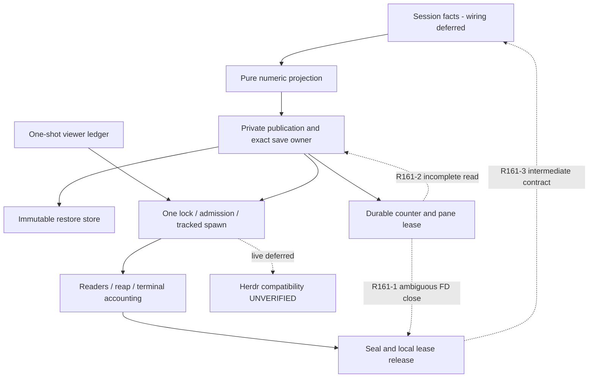

# Independent CORE/CONTRACTS review161 — REVISE

**The finite core partition is audited; it is not approved.** Two independently reproduced filesystem/descriptor defects and two contract/convention findings require revision. This completes the assigned core reading/assertion audit, not the full-feature Review or fresh Completion. Session/app/wiring and broader harness/static partitions remain explicitly unowned here.

Accounting: turn3/global161/current-turn dispatch3; started3/completed0/historical stopped partial1/retries0; effective turn/dispatch budgets **UNLIMITED**. No agents spawned. No product code, existing tests, specifications, global state, other worktree, Git index/branch/commit or live service changed. Only this report and its receipt directory were written. No private transcripts read. Branch `feature-94-herdr-integration`, origin `https://gitlab.com/core-27/slo.git`, HEAD/base `d0e3a756689f2675e5507034d43cd8b272d3c6b8` verified.

## Stack, authority and scope

Python3.11.7, Pydantic2, asyncio, private filesystem/advisory locks and a scoped CLI transport. Canonical overview, complete B/C/D, complete tasks and both subordinate source documents were read, including the 72 allocated samples. Final corrective prose governs examples. Full accepted independent specification review turn4 was read; its READY was specification-only. [Read ledger and complete sample allocation](independent-review-core-161-receipts/read-ledger.md).

Owned: all `src/agents/slo_agent/herdr/*.py`, `sessions/identity.py`, `sessions/token_format.py`, `orchestrator/context_reader.py`; every `tests/agents/slo_agent/herdr/*.py` except `test_session_*` and `test_attention_*`, plus identity/formatter/context-reader tests. Root safety helpers and the unchanged AtomicFileWriter were read as dependencies. Actual base-to-worktree inventory includes untracked additions; this is not a HEAD-only review.

Loaded the worktree Code-Test-Review workflow (not an installed substitute), complete review-feature-code and mandatory Python code-review-rules, engineering routing/review/ownership/testing, coding-rules, shared/Python declarative, Python root/types/docstrings/domain/application-service and ubiquitous-language guidance. Instance-owned lifetimes and no-await admission remain authoritative; no synthetic SQL, HTTP, Command hierarchy or generic process framework is requested. AGENTS/CLAUDE/docs RESEARCH supplied in full context; AGENTS first disk read1–220; root RESEARCH/Makefile/routing/scope and KB Welcome/slo README/gotchas consumed. Historical paths/status/budgets are not current authority.

## Findings by severity — Glaring Gaps

### R161-1 — High: a retained lease descriptor can close an unrelated reused FD

**Where:** `src/agents/slo_agent/herdr/sequence_store.py:108–112`, `HerdrFileLease.close`; retry through `reporter.py:847–861,898–907`. Applies to shared pane/restore lease mechanism.

`close()` clears `_fd` only after `os.close` returns successfully. An OS close error does not establish that the descriptor is still open. If close released it before reporting an error, the retained integer can be reused by another file/socket. The reporter's final local drain then blindly retries `os.close` on that integer. The optional integration can close an unrelated Slo resource. Restore `_locked_store` can also lose an unresolved operation-local lease on failure; its current close-fault test closes successfully before raising and checks only error privacy, not ownership.

**Reproduction:** [exact probes](independent-review-core-161-receipts/probes.md), retained `probes.log`: acquire a real temp-owned lease; inject close that delegates the real close, opens a NEW unrelated regular file under the same temp root (OS reuses the descriptor), then raises OSError. The lease retains the reused integer; its next `close()` closes the unrelated file. No real system file or process was touched. This models the ambiguous-close boundary, not arbitrary malicious mutation or a claim of spontaneous host damage.

**Required minimal correction:** make descriptor ownership/ambiguous-close disposition explicit in the existing lease owner. Never retry a raw descriptor merely because close raised. Preserve conservative cleanup evidence; reconcile demonstrably released/reused descriptors without closing the replacement, and retain unresolved original ownership rather than reporting drain or dropping an operation-local lease. Do not import the integration-test supervisor as production architecture or introduce a second global FD manager. Device/inode checks alone are not a universal generation proof; document the exclusive-ownership/platform assumptions.

**Tests required:** close-before-error, close-after-release, close-after-release plus reused regular FD, EBADF and inspection failure; both pane final-drain and restore operation cleanup. Assert unrelated FD remains usable, original outcome remains fixed/private, no repeated close of an ambiguous/reused slot, no false drained/safe result, and unresolved owner remains reachable. Existing `test_real_lease_close_fault_retains_owner` covers failure BEFORE real close only; `test_lease_close_fault_is_private` closes BEFORE raising but never tests reuse/retry. Neither disproves this defect. Violates B/C resource ownership and engineering ownership/testing.

### R161-2 — Medium: a short sequence read accepts and overwrites corrupt state

**Where:** `sequence_store.py:154–167`, `_read_state`, consumed by `_load` and `reserve:183–194`.

The counter reader calls `os.read(fd, 4097)` once and treats a short read as EOF. A regular-file read may return fewer bytes than requested. A valid JSON prefix followed by invalid bytes can therefore validate as a complete counter. `reserve` repeats the same incomplete read, accepts it as equal to `_state`, and atomically overwrites the corrupt file with a new sendable sequence. This violates B7.5's explicit corrupt-state refusal/no automatic reset or repair.

**Reproduction:** append `INVALID-TRAILING-BYTES` to an actual counter file, inject reads bounded to the valid prefix length, then call public `acquire` and `reserve`. Both succeed; reservation2 is returned and trailing corruption disappears. `probes.log` retains the result. The original bytes are entirely temp-owned.

**Required correction:** accumulate short reads through EOF or the overflow sentinel, bounded to4097 bytes; refuse overflow/invalid JSON without rewriting. Keep existing private validation, fd-finally and durable reservation ownership. A private reader inside the same owner is sufficient; no new storage framework.

**Tests required:** valid JSON split over multiple short reads, valid prefix with corrupt suffix, short reads through4096/4097 boundary, and read error after a prefix. Assert refusal leaves bytes unchanged, produces no sendable number and disables reporter/viewer admission when composed. `test_restore_faults.py::test_partial_reads_cannot_hide_trailing_bytes` proves the analogous restore reader, but the sequence reader does not use that loop. Existing sequence malformed/oversize tests use ordinary full reads.

### R161-3 — Medium contract blocker: intermediate close conflates remote uncertainty with the normally held lease

**Where:** `reporter.py:830–841`, `_close_outcome`; `test_t2_remaining.py::test_close_reports_retained_lease_before_transport_drain`. Canonical B7.9 explicitly says intermediate reporter.close reports remote/sticky defect evidence, defaults resources to drained, and a normally held lease does NOT make shutdown uncertain; only final close determines disposal permission. B19/B20 and C23 preserve that distinction.

Current `_close_outcome` includes `retains_external_resources`, so successful withdrawal returns uncertain/retained solely because correct ordering keeps the lease until transport close. Later final close becomes safe/drained. This is not a remote failure. Author receipt `t5-adoption-outcome-83.md` explicitly records the deviation and the consumer workaround: session ignores intermediate uncertainty when resources are retained, trusting the final aggregate. The inspected consumer fragment2531–2542 corroborates that special case. It mitigates normal replacement, but an author workaround is not approval to replace the canonical contract.

**Required correction:** separate intermediate remote/sticky evidence from final local-resource evidence in the existing reporter; keep the lease physically held until sealed/proven drain. Align consumer aggregation and affected assertions with the canonical semantics. Do not simply unlock early or erase genuine remote/cleanup uncertainty. Coordinate this correction with the later wiring reviewer; this report does not certify the whole session implementation.

**Verification:** successful activation/withdrawal → intermediate safe remote evidence while lease remains held → final safe/drained; release refusal/unsafe counter/cleanup defect stays uncertain; final undrained remains retained; existing normal /new and uncertain-successor suppression tests must stay valid. Reproduction is the existing passing retained-intermediate assertion plus direct source, not a speculative production failure.

### R161-4 — Medium mandatory convention blocker: complex public boundaries omit their contract documentation

**Where (concrete examples):** `HerdrCliTransport.invoke` service.py:433; `HerdrReporter.start/close` reporter.py:1004/787; `HerdrRestoreStore.save/load` restore.py:62/122; `HerdrFileLease.acquire/close` sequence_store.py:60/108.

These new public methods largely have a one-line summary, lacking applicable Args/Returns/Raises and ownership/error/teardown contracts required by Python method-docstrings and hard-rules1.2. In particular transport invoke's signature cannot tell callers that cancellation is re-raised only after joining, a timed-out waiter cannot touch another holder, and remote timeout does not bound OS reap. Lease.close's undocumented error disposition is directly relevant to R161-1. Store methods list a refusal but omit parameter/return/read-only/immutable semantics. Specific atomic-section exceptions do not waive public API documentation.

**Correction/test:** add concise truthful Google-style contracts to affected public boundaries, not a pasted spec or architecture rewrite. Document actual cancellation, fixed errors, remote-vs-local close evidence and caller preconditions. Audit the owned public APIs after R161-1/3 settle; no behavioral test substitute is claimed for documentation. All fields have descriptions and owned signatures are typed; R158-2's annotation repair is retained, not reopened.

## Requirement / AC → implementation → assertion map

Status “Implemented” is bounded source/assertion assessment, not whole-feature approval. Requirements with a finding are Partial. Tests listed here were read fully and executed in the1070-case owned selection.

| Requirement / AC | Owner and behavior | Concrete assertions | Status |
|---|---|---|---|
|R1; B1/C6 core|service gate/null; reporter build/start; zero disabled I/O, pure capture|test_gate; gate_diagnostics; reporter initial/build tests; test_test_isolation negative mounted/headless guard|Implemented core; session progress/parity deferred|
|R3/R4/R6; T1/T2|dao frozen tuples, closed shapes, exact generation/capture; reporter publish/_validate/_same_configuration|test_daos recursive mutation/privacy/strict generation; reporter publication_admission; t2_remaining session mismatch|Implemented core|
|R5 G1|reporter _ensure/_join/_adopt/_consume_publication; latest revision after same capture save|reporter test_usage_update_during_identical_config_save_reuses_reference; save_worker_closure newest token/ref count, changed capture gets2 records and only second advertised|Implemented core; real-store session G1 belongs later partition|
|R7; B6|projector only generated telemetry/fixed enums; private repr/errors; transport allowlist/DEVNULL|projection; privacy_closure four-provider actual argv/environment, credential lookups forbidden, rejected-output/sequence/log scans; daos structured error/traceback scans|Implemented owned channels; no global tool redactor claim|
|R8; C3 store|restore save/load, separate nonblocking lock, immutable exact reference/current config, unchanged writer|restore* suites: real bytes/modes, collisions, quota, identity, short reads, fsync, pre-replace and after-save process crash, concurrent save/load|Partial due R161-1 cleanup; CLI/current-history journey deferred|
|R9/R11; B2|transport retained spawn/readers/reap; reporter save/reservation and final drain|cli_transport join/cancel; transport_lifetime/read_failures/signals; final_lifetime_closure; retained_transport_composition; reporter_final_drain|Partial R161-1/3; process-task joins otherwise evidenced|
|R10/R12|service _invoke_locked lock→try_admit→create_task no await; reporter ticket identity/currentness/binding|t2_remaining all6 ordinary operations×7cutoffs; policy_accounting_closure; operation_results all9operations×6statuses×2staleness; shutdown admission/release tests|Implemented core|
|R13 G2|real viewer shares transport with report reservation/admission|visualizer_acceptance operational viewer→durableA→queuedA→B; exact no-A argv/higher B sequence; separate reservation-outlives-deadline; already-admitted A old effect/no B ack|Implemented core; no mocked-lock substitute|
|R16; B5|full shared validator closure; strict UUID predicate; single formatter arithmetic|test_session_identity ordinary slug/non-v4 normalization and CLI identity; token_format exact thresholds/delegates; context_reader ordinary IDs|Implemented extraction; all CLI admission consumers deferred|
|R18; D2/D3 core|viewer immutable one-shot attempt/current object, live authority, shared pending task, known/uncertain retention|visualizer/lifecycle/acceptance/lifetime_acceptance: split/rename/run, failed label continuation, cancelled waiter, repeated close, exact callback identity, stale/revoked/no further commands|Implemented core; destination/app notices deferred|
|R19|context_reader shared layout/schema/parser, no TUI import|test_context_reader valid UUID/slug, missing/invalid/OS, no private log; loader delegation diff inspected|Implemented extraction; mounted loader assertions deferred|
|R21; B3/B4|sequence strict signed64 durability; 18keys/16patch/5sTTL/2srefresh;1s command incl lock/.25s grace/2s remote close|sequence_store boundaries/restart/contention; batch_failures/refresh_timer/metadata_payload; transport pipe16384/16385; final_lifetime deadline joining|Partial R161-2; numeric/protocol bounds otherwise evidenced|
|R22|cohesive named owners, no duplicate writer/parser/formatter; public contracts|full owned bodies + hard-rules pass below|Partial R161-4|
|R23–25|preserve scope/source, independent review evidence|read ledger, inventories, unchanged835 manifest, independent probes|This partition complete; full Review/Completion not complete|
|R2/R14/R15/R17/R20|visual acceptance, lifecycle/usage/attention, child environments, provenance, app replacement/inbox|governing prose read; implementation ownership remains later partition|Unowned, not marked approved|
|R26|separate editor redesign|no editor changes reviewed/requested|Excluded|

## Full core flow verification

1. **Activation:** pure gate/build → executable off-loop → pane lease/counter load → durable activation-release ticket → shared-lock admission → tracked child → reap/accounting → worker/refresh. Failed activation retains unavailable evidence and drains locally. A contender cannot steal or release another publisher.
2. **Publication:** immutable handoff → single pending pointer/revision → one off-loop save → exact generation+capture adoption → newest display → binding release/claim → install opaque reference → explicit absent clears/set → semantic lifecycle. Initial restore precedes display; existing settlement follows display attempt even if display fails. Stale admitted effects update old remote knowledge, not newer ack. No credential resolution or session execution in this flow.
3. **Restore:** private root/lock validation → absent-name allocation (three draws) → bounded serialization/quota → unchanged atomic writer → only durable reference returned. Load validates syntax first, creates no state, opens verified private descriptor, reads bounded complete record, checks reference/UUID, returns independent frozen policy. No latest pointer, GC or history owner. Descriptor cleanup is R161-1; sequence persistence is separately R161-2.
4. **Viewer:** session-validated request (caller not audited here) → one shared task → persistent attempt before split → live reporter authority under same lock → strict bounded envelope → retain pane before rename → run once. Failure/uncertainty never grants retry/focus/query/close. Returned submitted is queue acknowledgement, not paint. No late core ordinary command after revocation; pre-admitted work remains owned and joined.
5. **Close:** revoke ordinary/viewer → cancel/join worker, refresh, save/reservation → one reserved shutdown release/optional16+2 clears → seal/drain transport → release pane lease → one final local-only attempt if retained. No repeated remote sends/accounting in final drain. R161-1 breaks safe descriptor retry; R161-3 misstates intermediate evidence. App retirement/reachability is deferred.

## Tests, receipts and false-confidence checks

Independent existing owned selection: **1070 passed,4 warnings,69.64s, exit0**. Exact expanded command/output/exit and silent coreutils check are in [receipts](independent-review-core-161-receipts/commands.md). This includes all non-session/non-attention Herdr tests and identity/formatter/context-reader tests, including actual fake CLI/OS child contention/crash cases. No full suite repeated. Independent probes reproduce R161-1/2 despite the1070 green cases; probe exit0 means reproduced defect, NOT desired behavior passed.

Frozen160 remains **835/835 matching** after tests/probes. Inspected retained commands/exits/tails: full8680/19deselected/780warnings, smoke288/2warnings, lint806 clean. These are author execution receipts on unchanged bytes, not an independent full-suite run or proof against missing cases. `manifest.log` reconciles156: ten existing paths excluded from160's scope and one added usage trace test; no removed-file claim. All stub/probe coreutils checks silent.

Meaningful existing assertions: actual executable argv not only invoke calls; durable A before queued-A signal; no A after B; exact terminal callback cardinality; process returncode and slot/task terminality; count/byte ±1 boundaries; old revision bytes preserved; separate remote binding and restore acknowledgement; no automatic pane resend after uncertain effects. False-confidence gaps are specifically lease close-before vs close-after error, and restore short-read coverage not covering sequence read. Unit enum/matrix volume alone does not close those paths.

## Hard-rules post-hook — owned scope completed

| Section | Result |
|---|---|
|1.1 typing/keyword calls|Owned production/tests have explicit signatures after159; no new bare Any. Framework subprocess argv, callbacks, gather, builtins/OS positional-only calls retain documented exceptions. Test decorator positional `pytest.mark.parametrize` and some monkeypatch calls remain style drift; they do not waive custom API keyword rules.|
|1.2 docs|**R161-4**. Fields documented; complex public method contracts incomplete.|
|1.3 declarative/depth|Reporter split into cohesive module rather than duplicate owner; transport owns mechanics, reporter policy, store durability/security, viewer attempt. Atomic lock/admit/spawn and retained teardown kept intact. No mechanical eight-line splitting required.|
|1.4 ubiquitous language|configuration_generation distinct from report_revision; saved.capture/reference distinct from binding certainty and restore_ack; parent_session_id stable through viewer; resources distinct from replacement but **R161-3 violates that semantic distinction at intermediate close**.|
|1.5 test evidence|Every owned production module has meaningful tests, no unexplained skip/xfail found. Missing decision boundaries R161-1/2. Historical author cadence not independently reconstructed.|
|2 backend|Pydantic transient validation applies; no SQL/model/router/DBOS scaffolding. Temporal admission and filesystem security properly remain owners, not DAO-only validation.|
|3 frontend|N/A.|
|4 CLI|No CLI implementation approval here; fixed resume argv builder audited. Product flag does not require invented Make/Command surface.|
|5 Textual|No widget/app audit here. Core imports no Textual; footer/loader extraction diff checked.|
|6 graph|No core graph topology changed. Usage159 repair belongs wiring/agent partition.|
|7–8 evidence/output|Owned requirement map, exact findings/repro/correction, three tiers and checklist supplied. No missing live blocker, no full-feature claim.|

### Three tiers

- **Glaring Gaps:** R161-1 High; R161-2/3/4 Medium, all must fix within their bounded scope.
- **Nice-to-Haves:** test comments still call the now-existing T4 adapter “future/absent” (`test_viewer_authority_closure.py`) and token formatter docstring still names the former footer helper. Update these when touching the relevant docs. Prefer named decorator/monkeypatch arguments consistently; not a substitute for the substantive fixes.
- **Temporary Shortcuts / explicit boundaries:** fake protocol acceptance is not live compatibility; local file/remote claim are not atomic; TTL is not ownership; same-user malicious mutation is outside filesystem confidentiality; exact saved policy is not historical plugin/provider behavior; no cross-process viewer discovery. Existing ordinary tool disclosure132 remains separate and open, not permission for a new Herdr leak.

## Handoff checklist

### Must-fix code/contracts
- [ ] Correct ambiguous descriptor-close ownership without retrying a reused FD (R161-1).
- [ ] Read counter bytes through EOF/bound rather than one short read (R161-2).
- [ ] Restore canonical intermediate/final close semantics and coordinate consumer aggregation (R161-3).
- [ ] Document complex public boundary contracts truthfully (R161-4).

### Required tests
- [ ] Add exact FD close/reuse and short-counter-read regressions described above.
- [ ] Retain all G1/G2, stale ack, quota/privacy, one-shot and final-drain tests.
- [ ] Run affected and required integrated gates after fixes; re-review changed core scope.

### Product/specification and documentation
- [x] Live acceptance remains USER-DEFERRED; compatibility UNVERIFIED. No renewed request or missing-live blocker.
- [x] Canonical specs remain read-only; resolved chapters supersede legacy examples.
- [ ] Later partitions audit session/app/CLI/provenance/usage/attention and harness/static/full-flow assertions, then combine Review; fresh Completion remains separate.
- [ ] Do not interpret this finished bounded audit as full-feature approval or close R155-2 globally.
