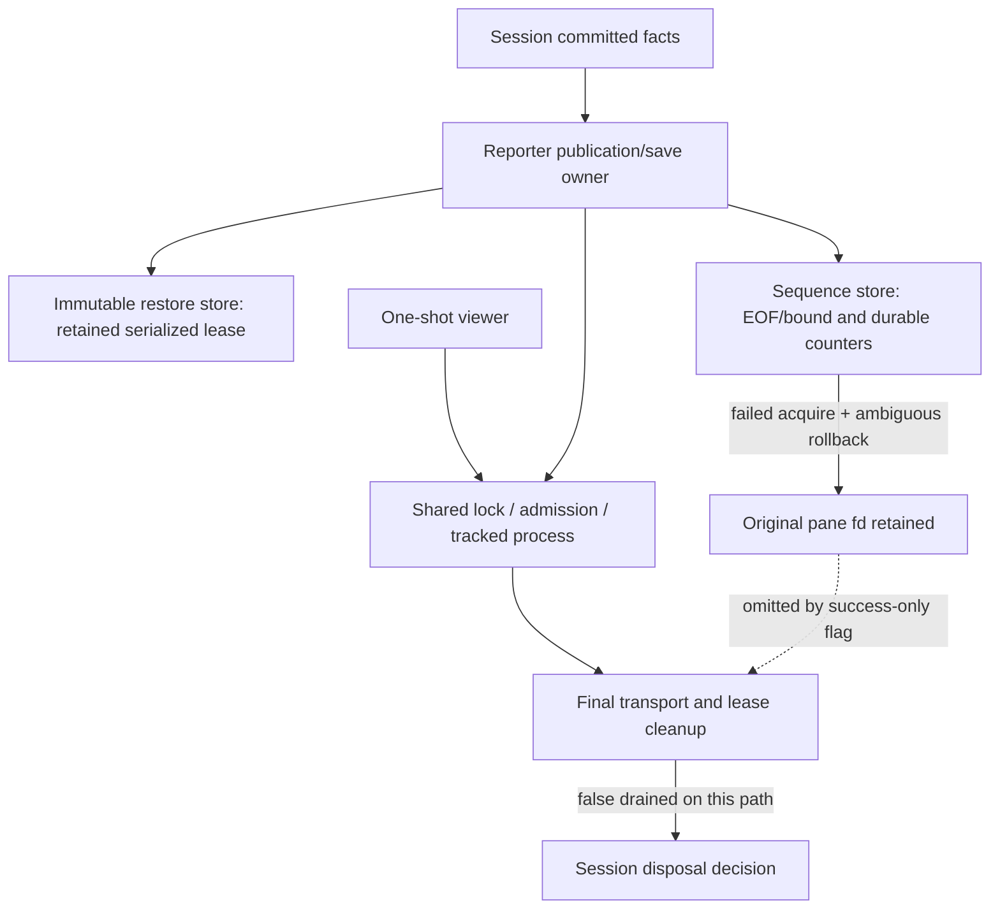

# Independent CORE re-review169 — REVISE

**Finite core re-review complete; bounded CORE is not READY.** R161-2 and R161-3 are resolved. R161-4's documentation omissions are resolved, with the resource-contract exception below. R161-1's unsafe raw-descriptor retry is fixed, but its required ownership closure remains incomplete: failed pane acquisition can retain a real descriptor while reporter final disposal falsely says drained.

Accounting preserved: **turn4/global169/current dispatch8; started4/completed0/historical stopped partial1/retries0; effective turn/dispatch budgets UNLIMITED**. No spawning. This is one independent review partition, not a completed workflow turn, full-feature review, Completion or runtime/model proof. Overall **R155-2 remains open**, awaiting core correction plus wiring, harness/static and synthesis. Live **USER-DEFERRED**; compatibility **UNVERIFIED**.

Branch `feature-94-herdr-integration`, origin `https://gitlab.com/core-27/slo.git`, HEAD/base `d0e3a756689f2675e5507034d43cd8b272d3c6b8` verified. No Git mutations, code fixes, existing-test changes, global/specification/other-worktree/live edits, or private transcript reads. Only this report and its review receipts/probe were created.

## Scope, authority and reuse

Python3.11.7/Pydantic2/asyncio, private files/advisory locks and the CLI transport; session close consumer only. The original [161 finite audit/read ledger](independent-review-core-161-receipts/read-ledger.md) remains explicit evidence for unchanged canonical/core assertions, not approval. [Current hash reconciliation](independent-review-core-169-receipts/manifest.log) establishes **50 unchanged owned test files**, two changed owned test files, and seven new core tests/helpers. The unchanged tests were not presented as newly reread; all were rerun. No whole-feature restart.

Fresh full-body inspection: all six substantive `herdr` modules, extracted `sessions/identity.py`, `sessions/token_format.py`, and unchanged `orchestrator/context_reader.py`; session close/disposal/final-drain consumer (`sessions/service.py:2497–2653`). Read full changed `test_final_lifetime_closure.py`, `test_t2_remaining.py`, `test_session_lifetime.py`, and both changed mounted activation modules; all seven new core test/helper bodies. Inspected root `tests/conftest.py`/`state_isolation.py` guards. No certification of the remaining app/CLI/session/agent implementation.

Read 161 report/ledger/probes and actual probe log, 163/164/165/167/168 reports, 168 API ledger and actual final commands/exits/output tails/manifest. AGENTS first; supplied full AGENTS/CLAUDE/docs RESEARCH, disk CLAUDE/root RESEARCH/Makefile, worktree routing/scope; KB Welcome, actual slo/README and relevant gotchas. Missing documented specifications symlink was not created; canonical read-only H path comes from scope-plan. Fresh governing B7.5, B7.9, B19/B20 (1470–1585), related activation/lease helpers and C23/final-drain prose were read. Final chapter corrections govern illustrative snippets; historical83 intermediate-close deviation is not authority.

Selected worktree skills: exact `workflows/code-test-review.md`, review-feature-code, mandatory Python code-review-rules, engineering routing/review/ownership/testing, coding-rules, shared/Python declarative, Python root/types/docstrings and application-service guidance. Domain guidance applies only to typed transient DAOs/Field ownership, not database scaffolding. No SQL/web/Command/graph redesign is imposed. The original161 ubiquitous-language audit is reused for unchanged vocabulary and extended below. An initial malformed parallel read did not read anything; corrected reads followed. An oversized KB/context aggregate truncated; entry/index were reread separately, relevant gotchas plus routing/scope consumed. These tool corrections are not workflow retries.

## Findings and closure decisions

### High — R161-1 remains PARTIAL: failed acquisition hides a retained pane lease

**Where:** `src/agents/slo_agent/herdr/reporter.py:874–883,898–911,1119–1143`; `sequence_store.py:216–237` acquisition rollback (line locations identify current bodies).

**Causal chain:**

1. The sequence store acquires its real pane lease, then counter load fails.
2. Rollback calls `HerdrFileLease.close`; a close-before-release error correctly leaves the original fd retained and marks its close ambiguous.
3. `_activate` retrieves the failed acquisition task before `_lease_held=True`, so reporter's success-only flag stays false.
4. Both `_release_lease` and `retains_external_resources` rely on that flag, not unresolved ownership in the sequence store. Final close skips the actual retained lease. Final local drain skips it again.
5. Both outcomes return uncertain/**drained**. The session consumer has no contrary evidence and may discard this owner rather than quarantine it. Remote uncertainty suppresses successor integration but does **not** fix the descriptor/lock leak or false disposal permission.

**Independent reproduction:** [acquisition_probe.py](independent-review-core-169-receipts/acquisition_probe.py), [output](independent-review-core-169-receipts/acquisition-probe.log). It runs public reporter start/close/close_transport/final drain, injects a failed counter load and a close error **before** real release, and forbids spawn. Actual temp-owned fd remains valid. Output:

```text
original_lease_retained True
original_fd_still_open True
reporter_lease_held False
reporter_retains False
final {'replacement': 'uncertain', 'resources': 'drained'}
retired {'replacement': 'uncertain', 'resources': 'drained'}
raw_close_attempts 1
```

Probe exit0 means **defect reproduced**, not desired behavior passed. Fixture teardown independently knows that its injected close never released the original generation and closes only that descriptor. No host binary/real Herdr is involved.

**Required correction:** keep acquisition success/admission distinct from local resource ownership. Let the existing sequence/lease owner provide truthful retained evidence after failed acquisition; incorporate it into reporter final cleanup and disposal even when activation never acquired usable authority. Preserve one original owner, closed transport before cleanup, inspection-only ambiguous disposition, sticky uncertainty and no remote resend. Do not merely set `_lease_held=True` before acquire (that conflates permission with ownership), raw-retry close, or invent a global FD manager.

**Required verification:** failed acquisition after actual lease open, rollback close-before-release, release-before-error, reused different-file fd, same-inode reuse, EBADF and inspection failure. Assert original owner reachability, one raw close only, unrelated replacement remains usable, no spawn/reservation admission, and honest retained/drained evidence through reporter and session final drain. Cover both native lock acquisition failure and post-lock counter-load failure. The new cleanup matrix sets `_lease_held=True` manually after successful acquire; it cannot cover this branch. This is a remaining R161-1 closure gap, not a claim of a newly introduced regression or actual host damage.

### R161-1 corrected portions — verified

`HerdrFileLease.close` sets ambiguity before syscall; later calls only inspect. EBADF or different inode clears ownership; same inode is not generation proof and never permits another close. Inspection failure retains ownership. This is sound under the documented exclusive-fd/no-external-duplication/close/replacement assumption; it is not a general FD generation oracle or finite cleanup guarantee. POSIX behavior is exercised; native Windows behavior is not newly certified.

`HerdrRestoreStore` retains its single lease across failed save/load; new operations refuse retained ownership. The nonblocking operation guard prevents cleanup during an active operation. Reporter joins save then offloads store cleanup through the optional typed capability; ambiguity can remain retained or demonstrated absence can drain without erasing earlier uncertainty. Immutable orphan records are not adopted. Tests cover held/released/reused/same-inode/EBADF/inspection across save/load and pane/restore final drain, replacement usability, fixed errors, no second close and cached local attempts. These corrected paths do not close the failed-pane-acquisition gap above.

### R161-2 — CLOSED

`sequence_store.py::_read_state` accumulates through EOF or4097 bytes, rejects >4096 and validates complete JSON. Acquire refusal and reservation refusal preserve original bytes and cannot return a sendable number. Read error after prefix is not EOF. `test_sequence_short_reads.py` covers valid/invalid suffix/exact4096/4097/error; `test_sequence_refusal_composed.py` queues a real viewer behind the shared transport lock, then fails reservation: no ticket, authority disabled, viewer failed, no executable entry or shutdown send, bytes unchanged. Existing malformed/bounds/durability tests remain byte-identical and green. No counter repair/reset introduced.

### R161-3 — CLOSED (distinct R161-1 exception retained)

Reporter intermediate `_close_outcome` reports only binding/activation/sticky defects; normal lease retention no longer creates uncertainty, and default drained is not disposal permission. Tests independently contend for the still-held lease between intermediate and final close. Refused release, unsafe counters and cleanup faults remain uncertain. Final transport/lease evidence alone permits disposal.

Session `_close_herdr_once` preserves every uncertain outcome and resets resource evidence **before each** cleanup gateway. A throwing final gateway cannot inherit intermediate drained. Successful final evidence can prove local drain after an intermediate exception without erasing uncertainty. Null final close/drain independently return no-resource evidence rather than calling intermediate close again. The candidate test's bounded successful branch does not call retained drain or hang; genuine retained work stays pending. Both mounted activation modules exercise corrected normal replacement and conservative throwing-final quarantine. No early unlock or weakened genuine-fault assertion was found.

### R161-4 — documentation omission CLOSED; resource guarantee qualified by R161-1

The finite public API ledger168 was checked against full current bodies, including constructors, protocols, null methods, admission wrappers, task join, transport, reporter, store/lease/counter, viewer, identity/formatter/context reader and compatibility `__getattr__`. Applicable Args/Returns/Raises, off-loop caller ownership, cancellation joining, immutable orphan/read-only behavior, remote deadline versus unbounded OS reap, and intermediate/final distinctions are now explicit. Simple predicates/null non-suspending bodies use the documentation skill's narrow summary exception. No separate missing complex-public-API documentation blocker remains.

Do **not** read this as proof that every documented guarantee is achieved: reporter's final disposal wording is violated by the reproduced R161-1 path. Fix that behavior and reconcile the finite API ledger, rather than documenting false drained evidence as permitted behavior. Session public-doc completeness outside this necessary consumer remains the later wiring review's responsibility.

## Requirement / AC and sample updates

All other statuses/allocations in161 remain unchanged, with unchanged-byte evidence above. “Implemented” here is core-only, not whole-feature approval.

| Owned requirement / AC | Current status | Evidence / sample update |
|---|---|---|
|R1, R9/R11; B1/B2 activation/cleanup|**Partial**|Failed activation rollback loses disposal truth. B19/B20 and C28/C29 remain partial for this path; C23 consumer now propagates truthful outcomes correctly but cannot detect a hidden core lease.|
|R8; C3 private store|Implemented core|C06/C07 now retain operation owner; save/load/close serialized; exact immutable records and original failure preserved. CLI/current-history journey unowned.|
|R21; B3 counters|Implemented core|B7.5 EOF/bound/no-repair proof closes R161-2; B22 reservation and B25 live viewer authority tested through composed refusal.|
|R9; B7.9/C23 intermediate contract|Implemented bounded correction|B19/B20 remote versus final resource separation; C23 aggregation, conservative throw and independent null final behavior. Failed-acquire disposal exception above remains open.|
|R22 documentation|Implemented documentation; behavior exception|Full API ledger checked; no missing complex contracts. R161-1 contradicts final resource guarantee.|
|R3/R4/R5/R6/R7/R10/R12/R13/R16/R18/R19|Implemented core, retained161 boundaries|Frozen assertion bodies reused and rerun; fresh source reading retains immutable capture/revision, G1/G2, privacy, lock-held admission, one-shot viewer, formatter/identity/context parser ownership. No wider wiring approval.|
|R23–25|Bounded review complete, overall pending|Canonical read-only authority preserved; R155-2 still requires later partitions/synthesis and fresh Completion.|
|R2/R14/R15/R17/R20 and broad harness/static|Unowned here|No inferred certification from receipt inspection or mounted tests.|
|Live compatibility/paint and R26 editor redesign|Deferred / excluded|User-deferred live acceptance; separate editor work untouched.|

161's31 core-owned sample allocation is preserved; only C23's necessary close consumer is additionally inspected here, not its entire T5 allocation. B01/B03/B04/B06–B18/B21/B25/C05/C27/D04–D07 retain their prior bounded maps; B19/B20/C28/C29 have the explicit acquisition exception. No example snippet is treated as permission to drop failed-start resources.

## Flow verification and architecture



- Normal activation/publication/viewer flows retain161's tested order, exact save association, stale acknowledgement protection and joined process accounting.
- Restore operation failure → retained store lease → new-operation refusal → post-save off-loop inspection → final retained/drained evidence is connected and tested.
- Counter short-read failure → disable reporter → revoke queued viewer at actual lock → no command is connected and tested.
- Normal close → intermediate remote evidence with physical exclusivity → transport seal/drain → local leases → session final evidence is corrected. Null final cleanup is independent; throwing final evidence stays conservative.
- **Failed pane acquisition → retained lease → reporter final ownership is disconnected.** No full-flow success claim covers it.

## Verification receipts and limits

CWD `/root/Code/slo-94-herdr-integration/slo`; explicit `VIRTUAL_ENV=/root/.pyenv/versions/slo-harness`, PATH prefix and `PYENV_VERSION=slo-harness`; verified Python3.11.7 and `make test-env=fallback`. Tracked synthetic fallback only, no sourced secrets. Root fake-only/terminal guards remain unchanged from161; executables are registered temp-owned regular files, not links to system tools.

Independent [runner](independent-review-core-169-receipts/run.sh), expanded [command](independent-review-core-169-receipts/targeted.command), full log/exit/coreutils: **1205 passed,18 warnings,93.18s, exit0**. Selection: full finite161 core plus new core tests, identity/token/context-reader, necessary session lifetime and both changed mounted activation modules. No skip/deselection reported. Independent probe reproduced the missing branch despite those passes. Post-probe and post-suite `dpkg -V coreutils` silent; suite check exit0. No host anomaly observed.

Inspected retained168 exact commands, exits and output tails:

| Gate | Actual retained result |
|---|---|
|Full non-E2E|8727 passed,19 deselected,780 warnings; exit0|
|Smoke|288 passed,2 warnings; exit0|
|Lint|813 source files clean; exit0|
|B26 / C31 / D09|1507 /1514 /1724 passed; all exit0|
|Surrounding|472 passed; exit0|
|Black all / B26 / C31 / D09|238 /80 /12 /10 unchanged; all exit0|

Both168 manifests hash to `660fde9c82e64dd0cb39b211054a988e38243a7de72e7b4e35617b9b04bdcac3`. **1063/1063 current inputs match**, and a fresh tracked+untracked file-set enumeration using the same exclusions has no added/removed inputs. All corresponding inspected coreutils receipts are empty. This verifies retained author gates on current inputs, not an independent rerun or unowned static/harness certification. No redundant full suite ran. Review-only artifacts are outside that runtime-input manifest;238 remains the historical168 Black count, not a claim that new review probes were part of that gate.

## Mandatory hard-rules post-hook and three tiers

| Checklist section | Assessment |
|---|---|
|1.1 types/named calls|Changed core signatures explicit; no added bare Any/ignore or untyped resource bag. OS positional-only, subprocess argv and callback conventions remain scoped exceptions. Existing decorator/monkeypatch style drift retained from161, not a new custom API waiver.|
|1.2 docs|Finite public omissions corrected; truthful contract exception is R161-1, not hidden by documentation.|
|1.3 declarative ownership|Store guard, lease ambiguity and resource capability stay with existing owners; no duplicate manager/writer/parser. Atomic admission and joined teardown remain cohesive. Success-only resource projection is the substantive ownership defect.|
|1.4 vocabulary|generation→generation, revision→revision, capture/reference→same named carriers unchanged. `replacement` remains remote/sticky versus `resources` final disposal; corrected intermediate semantics. `_lease_held` currently conflates usable acquisition with unresolved ownership in final projection.|
|1.5 tests|Meaningful exact failure/forbidden-effect assertions, no newly hidden skip/xfail. Missing failed-acquire composition proved independently. Historical163 short-read and165/167 RED logs are author evidence, not invented independent TDD chronology.|
|2 backend|Typed Pydantic/Field and support-service boundaries apply; no SQL/router/worker obligations manufactured.|
|3 frontend|N/A.|
|4 CLI|No new CLI surface reviewed; fixed native argv remains owned core. CLI admission deferred.|
|5 Textual|Changed mounted assertions examined only for close regression; full app layering/paint not certified.|
|6 graph|No graph change in this delta; usage/profile broader review remains later.|
|7–8 report/evidence|Requirement/sample map, causal severity/correction/tests, flow, three tiers and checklist complete; no full-feature or runtime/model claim.|

**Glaring Gaps:** High R161-1 failed-acquisition retained-resource projection above. No separate Critical finding. R161-2/3 documentation omissions do not remain blockers.

**Nice-to-Haves:** carry161's stale “future adapter” test commentary and remaining ordinary identity error's `UUID4` wording (implementation accepts any UUID version); neither changes this verdict or authorizes unrelated cleanup.

**Temporary shortcuts / explicit limits:** exclusive descriptor ownership is required; same-inode ambiguity may intentionally remain retained indefinitely. No native Windows/live Herdr certification. Local lease and remote binding are not atomic, TTL is not ownership, submitted is not painted, private restore is configuration plus current history rather than a checkpoint. Existing security132 is separate/open; no global tool-event redaction claim.

## Handoff checklist

### Must-fix code
- [ ] Carry failed-acquisition pane resource ownership into reporter final disposal and local drain without raw-FD retry (R161-1).
- [x] Counter EOF/no-repair correction verified (R161-2).
- [x] Intermediate/final distinction, sticky faults, conservative throwing gateway and independent null cleanup verified (R161-3).

### Required tests
- [ ] Add the failed-acquisition/rollback matrix and session-level retained-disposal assertions described above.
- [ ] Rerun affected gates after the correction and independently re-review the finite changed scope.
- [x] Existing owned/new/necessary consumer selection independently passes1205; missing path separately reproduced.

### Product/specification decisions
- [x] Live remains user-deferred; compatibility unverified, not a renewed authorization request.
- [ ] Later wiring/harness/static partitions and full-review synthesis remain required; fresh Completion is separate.

### Documentation
- [x] Finite complex-public-API documentation omissions corrected.
- [ ] Reconcile final resource-contract/API ledger evidence with the R161-1 fix; do not call the current behavior truthful final drain.
- [x] KB/global memory not modified under this review's preservation boundary; durable lesson captured here: successful admission flags are not failed-start resource inventories.
