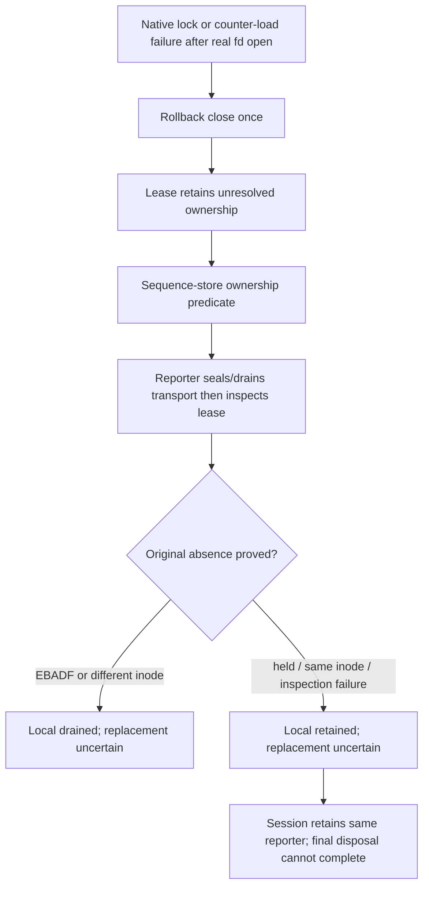

# Independent CORE confirmation172 — READY (CORE ONLY)

**Remaining R161-1 is CLOSED. No Glaring Gaps remain in this finite CORE partition.** Failed pane acquisition now preserves truthful local-resource evidence through reporter and session final drain without granting admission or retrying an ambiguous raw descriptor close. R161-2/3 and the R161-4 documentation closure from169 remain closed on unchanged audited inputs.

Accounting preserved: **turn5/global172/currentdispatch3; started5/completed0/historicalpartial1/retries0; effective turn/dispatch budgets UNLIMITED**. No spawning or fixes. This is not a completed workflow turn, whole-feature Review, fresh Completion or delivery approval. Unowned wiring, harness/static review, full-review synthesis (R155-2) and fresh Completion remain pending. Live **USER-DEFERRED**; compatibility **UNVERIFIED**. Security132 remains separate/open, not a waiver for a new leak.

## Scope, routing and preservation

Verified branch `feature-94-herdr-integration`, origin `https://gitlab.com/core-27/slo.git`, HEAD/base `d0e3a756689f2675e5507034d43cd8b272d3c6b8`. All existing dirty/untracked work preserved. No Git mutations, production/test fixes, global/KB/specification/other-worktree/live edits. Only this report and `independent-review-core-172-receipts/` were created; test caches are incidental. Historical169 probe was not edited.

Read supplied AGENTS first and CLAUDE/docs RESEARCH; disk CLAUDE/root RESEARCH, Makefile, routing/scope-plan,169 report and actual probe,161 read/sample ledger,170 correction,171 gates/runner and168 public-API ledger. Consulted KB Welcome, actual slo/README (not a nonexistent index) and gotchas. Canonical read-only B activation/close B19/B20 prose and C23/final-local-drain C28/C29 prose were reread. Final ownership requirements govern the illustrative success-only `_lease_held` snippet; no specification change was made.

Selected checkout skills under `/root/Code/slo-94-herdr-integration/slo/skills/`: exact `design-and-analysis/workflows/code-test-review.md` Step2, `review-feature-code`, mandatory `languages/python/code-review-rules`, engineering routing/review/ownership/testing, coding-rules, shared/Python declarative structure, Python root/types/docstrings and application-service ownership guidance. Specific routing preserves support-adapter instance lifetimes; no manufactured invoke wrapper, database, HTTP, CLI Command, graph or widget redesign. Test categories: orchestration plus actual temporary-file/native-lock adapter integration, not live Herdr. Supplied manifest has no selected same-name personal override. One malformed parallel call read nothing; subsequent explicit reads supplied context. Oversized skill aggregates truncated; missing workflow prefix was explicitly reread. No truncated output is claimed as a fresh full-file audit.

### Explicit reuse, not an audit restart

Reuse [161 finite read/sample ledger](independent-review-core-161-receipts/read-ledger.md) and [169 completed core audit](independent-review-core-169.md) for unchanged assertions. Fresh [hash reconciliation](independent-review-core-172-receipts/manifest.log) proves168/169→171 changes are exactly:

- `herdr/sequence_store.py`: one pure, documented ownership property.
- `herdr/reporter.py`: two predicates now consult that property.
- New `test_failed_acquisition_ownership.py`:24 cases.

Reversing just that property and the two substitutions **in memory** reproduces both168 source hashes exactly. All other1061 old manifest inputs remain identical; no old path removed. This includes session consumer, lease fault helper, restore/transport/DAO/viewer owners and146 guards. All1064 current171 input hashes match; fresh file-set enumeration has no additions/removals under the declared exclusions.

Fresh body inspection covered the complete new test and `LeaseCloseFault`, full sequence/lease owner, affected reporter activation/admission/close/final-drain/diagnostic paths, session close/disposal/retired-drain consumer and root guards. Other previously audited files were not represented as newly reread. Public API ledger168 was reconciled for its170 accessor/projection additions; no renewed all-files API audit is claimed.

## R161-1 causal closure

`HerdrSequenceStore.retains_external_resources` (`sequence_store.py:239–246`) delegates to its existing lease owner, with no I/O or authority. Reporter resource projection (`reporter.py:874–885`) and `_release_lease` (`898–913`) now consult that evidence. `_lease_held` still becomes true only after successful acquisition; viewer admission still requires successful activation, safe counters, that admission flag and open transport.

The actual failed-start path is now connected:



The store can own cleanup without owning permission to reserve/send. Cleanup remains after transport sealing/drain. `HerdrFileLease` marks ambiguity before its first close; subsequent calls inspect only. Same inode is not descriptor-generation proof. A genuinely held original or uninspectable/same-inode slot stays reachable; a different-file replacement remains usable. No second manager, forged acquisition flag, repeated remote command, raw-FD retry or uncertainty reset was introduced.

Session implementation is unchanged: final resource evidence cannot inherit intermediate default drained, errors are conservative, and any uncertainty stays sticky. Persistent retained resources keep `finish_retired_reporting_cleanup` pending rather than discarding the owner. The matrix uses the finite local-drain gateway, not an intentionally never-returning waiter.

### Actual24-case assertion assessment

Two actual acquisition boundaries (**native `fcntl.flock`**, post-lock `_load`) × six rollback dispositions × reporter/session final consumers:

| Rollback disposition | Required/observed final resources | Safety assertion |
|---|---|---|
| Close fails before release | retained | Original fd remains open; same owner reachable |
| Release then EIO | drained | Absence reconciled; no second close |
| Different-file fd reuse | drained | Replacement fd still readable/writable |
| Same-inode fd reuse | retained | No generation inference or second close; replacement usable |
| Release then EBADF | drained | Absence reconciled; uncertainty preserved |
| Inspection failure | retained | No invented absence/cleanup authority |

All24 assert false successful-acquisition flag, refused viewer admission, sealed/drained transport, zero automatic reservation/spawn, explicit reserve refusal, absent counter file, unchanged owner identity and exactly **one raw close**. Session cases retain the actual reporter. Fault teardown unpatches first and uses independently known fixture-generation authority, not the product's ambiguous fd as permission. These are real temp-owned descriptors; no system links/executables are used. New test does not scan privacy itself; independent DEBUG rerun below supplies that check.

### Original169 counterexample independently reconfirmed

Executed the existing169 probe source unchanged on disk, compiled in memory with only its two obsolete defect assertions inverted and its terminal description corrected. SHA256 `dc74aca6f14472b8f2e151d41ad4773481b6d3942baa8ace074d7a11d3f0fe80`; exact substitutions and output are in [probe.log](independent-review-core-172-receipts/probe.log). Same injected failed load and close-before-release; same public start/close/final/local-drain flow and forbidden spawn:

```text
original_lease_retained True
original_fd_still_open True
reporter_lease_held False
reporter_retains True
intermediate {'replacement': 'uncertain', 'resources': 'drained'}
final {'replacement': 'uncertain', 'resources': 'retained'}
retired {'replacement': 'uncertain', 'resources': 'retained'}
raw_close_attempts 1
```

Exit0 proves the corrected expectation, not the historical false-drained assertion. Intermediate default drained remains deliberately **not** disposal permission. Both probe exception sentinels were absent from captured stdout/stderr. Matrix DEBUG output contains fixed activation diagnostics but none of `private-acquisition-fault`, `private-close-sentinel`, `private-inspection-sentinel`; no newly observed leak is excused by132.

## Requirements, samples and API reconciliation

All other161/169 allocations remain unchanged; statuses below are CORE-only.

| Requirement / acceptance / samples | Status and evidence |
|---|---|
| R1/R9/R11; B1/B2; B19/B20/C28/C29 | **Implemented; acquisition exception closed.** Real failed start retains truthful ownership through final consumers; no remote work admitted. |
| C23 necessary close consumer | **Verified bounded consumer.** Final retained/drained and sticky uncertainty propagate; whole T5 session/app wiring remains unowned. |
| R8/C3; C06/C07 | Prior corrected restore owner unchanged and regression-tested; CLI/current-history journey not recertified. |
| R21/B3; B22/B25 | Counter EOF/bound/no-repair and queued-viewer refusal corrections unchanged and regression-tested. |
| R22 public contracts | New predicate documents WHAT/WHO/WHEN, pure evidence and no authority. Final reporter contract is now achieved on the previously failing branch;169 documentation exception removed. |
| Remaining31 CORE-owned sample allocation | Reused161/169 unchanged maps; broader core suite rerun. No claim that all72 samples belong to this partition. |
| R2/R14/R15/R17/R20, broad harness/static/full synthesis | Unowned/pending; retained gates are not independent approval of these partitions. |
| Live compatibility/paint; R26 editor redesign | User-deferred / excluded. |

## Independent verification and retained171 gates

CWD `/root/Code/slo-94-herdr-integration/slo`. Explicit `VIRTUAL_ENV=/root/.pyenv/versions/slo-harness`, that `bin` PATH prefix and `PYENV_VERSION=slo-harness`; `which python` verified the approved interpreter, **Python3.11.7**. `make test-env=fallback`. Used tracked synthetic fallback exports plus `PYTHONPATH=$PWD`; no env file/secrets sourced. Root fake-only registered regular-file and terminal guards unchanged from168; no actual Herdr/provider/pane action.

Receipts: [independent-review-core-172-receipts](independent-review-core-172-receipts/). Expanded `targeted.command` selects all direct Herdr tests excluding session/attention families, then identity/token/context-reader, session lifetime and the two previously changed mounted activation modules—same169 core selection plus new24 cases.

| Independent execution | Actual result |
|---|---|
| Targeted broader CORE preservation | **1229 passed,18 warnings,92.29s; exit0**, no reported skips/deselections |
|24-case DEBUG matrix (`matrix.command`) | **24 passed,2 warnings,1.91s; exit0**; three private sentinels absent, fixed diagnostic present |
| Original169 probe with corrected in-memory expectations | exit0; retained/one-close evidence above |
| `dpkg -V coreutils` after each execution | exit0, silent each time |

Counts overlap; do not sum them. No redundant full suite/static suite was run. Actual171 commands/exits/output tails and unchanged comprehensive inputs independently validated:

| Retained author gate | Result, all exit0 |
|---|---|
| Full / smoke / lint |8751 passed,19 deselected /288 passed /814 source files clean |
| B26 / C31 / D09 |1531 /1538 /1748 passed |
| Surrounding |472 passed |
| Black all / B26 / C31 / D09 |240 /81 /12 /10 unchanged |

All corresponding171 coreutils receipts are silent/exit0. Both171 manifests digest to `e48b436daa345fd28253dbab6d73bff094e53758a5f0757dacab04979a9ec49d`;1064/1064 current hashes and fresh enumeration match. Parsed all-black-final argv equals the exact current240 changed/new Python paths.171's historical initial Black failure/incomplete enumeration remain disclosed there; final success is not substituted for those initial results. Excluded receipt/probe artifacts and two research indexes are not runtime-input coverage. Gate validation is not an independent full-suite rerun or unowned harness/static certification.

## Mandatory hard-rules post-hook / findings

- **Types/named calls:** new predicate explicitly returns bool; no Any, ignore, cast, signature ambiguity or custom positional API added. Native positional syscalls and existing pytest patch style remain scoped framework conventions.
- **Documentation:** pure accessor caller timing and ownership/admission distinction explicit. Previously audited complex public contracts unchanged; R161-4's behavioral exception is resolved.
- **Declarative ownership:** one existing owner supplies disposal evidence; flat predicate substitutions, no shallow wrapper/module proliferation. Cohesive fixture sequence does not require mechanical splitting; no new production nesting.
- **Vocabulary:** `retains_external_resources` flows lease→sequence→reporter→session. `_lease_held` remains acquisition/admission, `resources` final disposal, `replacement` remote/sticky certainty. No synonym or authority conflation.
- **Tests:** all new branches assert effects and forbidden effects; no new skip/xfail or weakened expectations.170's RED chronology is author evidence, not newly invented independent TDD.
- Backend database/HTTP/worker, frontend, new CLI, graph and styling checks are N/A to this delta; broader wiring is not implicitly certified.

**Glaring Gaps / Critical or High blockers:** none remaining in bounded CORE. **Nice-to-Haves:** carry169's existing stale fixture commentary/ordinary UUID4 wording, not newly reopened cleanup work. **Temporary limits:** exclusive descriptor ownership is a precondition; same-inode ambiguity may remain retained indefinitely. Native Windows and live Herdr are not certified; submitted is not painted; no global tool-event redaction claim.

## Handoff checklist

- [x] R161-1 failed-acquisition disposal and24-case matrix independently confirmed.
- [x] R161-2/3 and documentation closure preserved; final API/resource guarantee reconciled.
- [x] Broader CORE1229, privacy matrix and original probe pass; integrity checks silent.
- [x]171 receipts/current1064 inputs validated without repeating full suite.
- [ ] Independent wiring and harness/static partitions.
- [ ] Full-feature Review synthesis; R155-2 remains open until then.
- [ ] Separate fresh Completion after passing Review.

**READY only for CORE.** No workflow completion count increment. Shared KB/global memory remains read-only; durable lesson stays in this receipt: successful admission is not a failed-start resource inventory, and ambiguous descriptor cleanup must never infer retry authority from inode equality.
