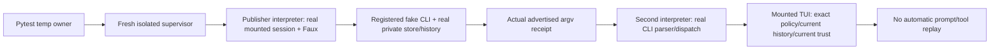

# Independent HARNESS/STATIC review181 — READY

**READY for the harness/static partition.** The current offline harness exercises actual registered executables, temporary filesystem state, independent OS processes and mounted Textual owners. Fresh unmodified `make lint` is clean. No blocking safety, static-suppression or false live-certification defect was found in this partition.

**CORE172 and wiring180 acceptance are preserved.** This is not full-feature review synthesis, delivery approval or a completion assessment. **Full-review synthesis and fresh Completion remain pending.** Live **USER-DEFERRED**; compatibility **UNVERIFIED**; security132 **separate/open**. Accounting: **turn6, global dispatch181**; no sub-agents and no workflow completion increment.

## Scope, authority and environment

Review only: no production/permanent-test fixes, commits, push, MR, package installation/removal, specification edits, other-worktree edits, live Herdr/provider/window actions or KB changes. Only this report and `review-harness-static-181-receipts/` were authored; test caches are incidental. Pre-existing dirty app/startup/audit-test work and historical receipts were preserved.

Initial read-only checks confirmed cwd `/root/Code/slo-94-herdr-integration/slo`, `pyenv which python` → `/root/.pyenv/versions/slo-harness/bin/python`, Python **3.11.7**, and `make test-env` → **fallback**. Every recorded run uses the explicit approved VIRTUAL_ENV/PATH/PYENV_VERSION and tracked synthetic fallback, with `PYTHONPATH=$PWD`. No development environment was sourced and no full environment was printed. [Runner](review-harness-static-181-receipts/run.sh) records exact argv, complete output, command exit and a separate post-execution `dpkg -V coreutils` result; it stops on an integrity anomaly.

Read supplied AGENTS/CLAUDE/docs RESEARCH, disk root RESEARCH and Makefile; routing/scope-plan, core172/wiring180, gates171/final-code-status, A–E repair receipts, conventions159, baseline/continuation, all requested `t6-harness-*`, `t6-mounted-*` and two-process121 receipts. Oversized harness-document output was recovered from its spill prefix rather than counted as fully read when truncated. Historical partial/HOLD reports are chronology, not current verdicts. Consulted KB Welcome, actual `slo/README.md` (index.md absent), gotchas, OS ROLE/README and workload guidance read-only.

Applied checkout `review-feature-code`, `engineering-review`, mandatory Python `code-review-rules`, engineering routing/ownership/testing and Python-root guidance. Scoped Python style and Textual testing guidance specialize the review. Python/asyncio, Typer, Textual, real temporary filesystem and disposable process adapters are applicable; database, HTTP API, new CLI Command and editor-redesign conventions are not. Cohesive barrier scenarios and atomic ownership sections are not mechanically split to satisfy a line-count example.

Fresh source inspection covered complete root guards, process bootstrap/entry/parent, full-flow module, canonical matrix and its ownership helpers, parity/transport-observer/unified-journey helpers, all 60 A–D allocated/authorized file diffs, E manifest/lock delta and conventions159 owned diff. The 2,588-line safety suite was inspected by mapped execution/mutation/ownership families and selected bodies, then executed in full; this is not a claim to have newly read every historical helper line. Whole-repository searches inventoried link/signal/spawn seams, with targeted caller inspection; this is not an OS sandbox certification or a fresh review of every unrelated test body.

## Requirement-to-evidence map

| Requirement | Status | Independent source/assertion evidence |
|---|---|---|
| Two actual OS-process restore flow | **Verified offline** | `test_herdr_two_process_restore.py:75–188`: eight single/pool × available/credential-refused/trust-changed/model-changed cases; different PIDs, actual advertised five-element argv, literal independent policy oracle, full history equality and zero restore factory calls. All execute in the fresh composed run. |
| Current capability and trust, not frozen authorization | **Verified offline** | Parent `:89–107` proves project plugin loaded before trust withdrawal, removes its marker, writes empty trust; second entry requires marker absent while explicit plugins reload. Entry `:228–273,300–353` changes child-local catalog/OAuth inputs, retains real eligibility and mounts actual PromptInput refusal; fixed painted error, blocked state, unchanged policy/history and no model calls asserted. Missing credential uses public `session.invoke`, not private readiness. |
| Real mounted complete journey | **Verified offline** | Full-flow `:242–405,1478–1517` drives PromptInput → Faux graph → actual tool executor → usage/history/reporting, including genuine retry and pool fallback. `herdr_unified_141.py` continues the same mounted lifetime through both viewer event entries, rename/model/new, exact CLI argv, immutable revisions and old-release-before-new-claim. |
| Canonical 64-case lifetime matrix | **Verified** | Matrix `:165–771`: 4 triggers × 8 phases × 2 diagnostic modes; fresh collection has exactly 64 distinct node IDs. Real lock wait, spawned-child collection, off-loop real save and registered app-worker barriers differ by phase; assertions cover command counts, no stale acknowledgement, task/transport drain, lease/timer/subscriber identity, retained claimed bytes and successor policy. |
| Executable positive controls and negative sensitivity | **Verified** | Safety suite `:84–120,264–355,414–519`: actual parent preparation/real plain-slo discovery; old missing PATH fails the same oracle; actual Popen/run/asyncio registered inode executes exact capture argv, substituted inode refuses. Generated old capture body corrupts only a test-owned victim and exits41; current body preserves it and exits0. These are not non-null mocks. |
| argv/pipe/lock/spawn/reap/crash bounds | **Verified within declared fixture contract** | `test_resume_bounds.py` checks 64/65 args and 8192/8193 UTF-8 bytes; `test_transport_lifetime.py:25–118,210–224` covers actual queued deadline and both real pipe limits, including 16384/16385 and TERM-ignore cleanup. `test_independent_lock_holder.py` proves reporter timeout leaves the independently held viewer alive. `test_restore_process.py` uses own spawned children for pre-replace crash and lock release; exact previous revision bytes survive. |
| No non-test-owned process signalling/reaping | **Verified for audited execution paths** | Bootstrap `:175–280,487–504` retains its unreaped child/group anchor, checks SID/PGID and uses its own READY-identified supervisor. Adoption/waitpid(-1) occurs only in the disposable fresh supervisor, not pytest/agent. Safety `:1266–1371` asserts actual descendant wait receipts, TERM/KILL status and separate test-owned sentinel survival. Restore crashes use objects returned by that test's `Process.start`; sequence crashes use the locally spawned Popen. No PID-name scan or host kill fallback. |
| Root fake-only guards/window blocker | **Intact and exercised** | `state_isolation.py:46–105` binds absolute contained regular single-link device/inode identity for executable/capture/barrier; `conftest.py:118–207` retains terminal blocker and rechecks registration immediately before transport spawn. `test_test_isolation.py` proves pre-import/per-test stripping and actual mounted/headless unregistered refusal. Guard files are unchanged from171. |
| Whole-repository helper safety | **Sound within audited scope** | Retained `spawn-inventory.txt` (350 lines) and `link-signal-inventory.txt` (49 lines), root guards, FakeBin writer/passthrough and isolated-launcher link fixtures reviewed. System tools are reached through regular temp wrappers, not writable symlinks. Installer and capture-test safety helpers are byte-identical to feature base. Herdr spawn wrappers either delegate to the already guarded original or fail without spawning; fresh entry reinstalls its own guard because pytest fixtures do not cross interpreters. |
| A–D real repairs, no static escape hatch | **Verified** | Full 60-file scoped diff retained. A initializes real widgets and handles nameless partials; B supplies complete store/factory contracts and annotation-only float deadlines; C fixes request-local Anthropic bound-tool lookup and preserves Codex wire; D uses narrowing, ParamSpec, literal types and scoped patches. Existing outcome/order/content assertions remain or become stronger. No new skip/xfail/checker exclusion/config suppression used to pass. |
| E minimal stub repair | **Verified** | Parsed full lock records against feature base: **all87 prior records unchanged**, only dev `types-pyyaml==6.0.12.20260906` added plus content hash. Retained wheel hash matches lock. Historical installed multisets add exactly that one distribution, with no removals/changes. |
| Baseline unwaived; zero new diagnostics | **Verified/reconciled** | Exact normalized diagnostic multisets: baseline301 → pre-E281 (zero added,20 removed) → post-E280 (zero added, exactly yaml import-untyped removed). A81+B53+C45+D101=280, supported by actual red logs. Current full lint is **zero errors /816 files**, not an exception for the old errors. |
| Import-untyped RED→GREEN | **Verified without package mutation** | Historical actual loader RED1/GREEN0 logs inspected; fresh actual loader no-incremental GREEN. Independent temp-only runtime-package view reproduces yaml `[import-untyped]` RED, then copies the installed exact stubs into that view and gets GREEN with the same checker. This does not uninstall or conceal packages in the real environment. |
| Static-input integrity | **Verified** | Fresh enumeration and SHA256 before/after: **1066/1066 identical**; digest below. 171→current changes are exactly session/app/headless-test plus two added wiring-test modules; accepted core files and root guards unchanged. |
| No live certification | **Verified boundary** | README:528–573, INSTALL:14–139, AGENTS Feature94 and current status explicitly distinguish target0.9.2+, submitted versus painted, and pending/unproven live evidence. Source publication contract explicitly defers to final B/C/D and labels its earlier recommendations non-certifying. No live action occurred. |

## Flow verification and false-confidence assessment

The second interpreter does not read the publisher's expectation JSON to construct runtime policy. It receives the advertised argument tail, loads the actual immutable record/current history through production dispatch and writes independent observations. Parent assertions use explicit expected pool priorities/cooldowns/order and paths, not only publisher-versus-restorer equality. The changed-trust case has a positive prior-load marker, not merely absence in an always-untrusted fixture.

**Source shim is not installed-launcher or live server restart proof.** The actual command tail reaches `src.cli.app.main`; the parent intentionally invokes approved Python `-I -B` against its registered regular shim. The discovery test separately proves plain-slo availability. Neither proves installed pipx launcher equivalence, Herdr native restart or remote protocol compatibility.

Mounted workflow ingress uses controlled normalized attached events and detached tool-result payloads, then real parsing/scheduling/admission/transport. It does not spawn live sub-agents. Platform matrix variants invoke real launch/thread code but replace OS creation with the root blocker/recorders. The independent pane owner in those variants proves integration disablement is not authority to cancel separately selected platform work; new/unmount still join the captured app worker. This deliberate distinction is not 64 repetitions of one predicate.

Parity normalization is schema/path-specific, retains ordered payloads/nulls and consistent identity topology, and has mutation-sensitivity controls for semantic fields and user-owned identity-looking keys. The cancelled transport observer records one terminal return **or cancellation**, delegated admission/completion, joined tasks and reaped child evidence; counting returned DAOs alone is expressly not the oracle.

The root guards and child audit are bounded accident-prevention mechanisms over trusted fixtures, not malicious-Python confinement. Same-inode content rewriting, hostile concurrent filesystem replacement, native-extension bypass and escaped process groups are not certified. Generated transport fakes are finite; the outer supervisor's inherited-group proof is not recast as forced cleanup proof for arbitrary escaped sessions. Actual product transport pipe bounds are proved; the supervisor's regular-file capture reader is not a bounded-output security boundary.

No real system-tool symlink was found in the inventoried fixtures. Symlink negatives point to test-owned regular files/directories or missing targets. The bash escape-link test targets its pytest parent solely to test refusal, not to write there. Existing fake helpers are not universal per-syscall guards: safety depends on the audited temp-root construction and callers as well as the explicit checks.

## Fresh execution receipts

All files below are under [review-harness-static-181-receipts](review-harness-static-181-receipts/). Counts overlap; do not sum them as unique coverage. All completed test selections have **zero failures and no reported skips/deselections**. Default `not e2e` remains unchanged.

| Label | Exact selection/purpose | Result |
|---|---|---|
| `safety` | Full harness-safety module + test isolation/spawn guard/SLO_HOME isolation | **258 passed**,4 warnings,76.38s; exit0 |
| `composed` | two-process, full-flow, lifetime matrix, activation-composed, attached-composed | **232 passed**,154 warnings,322.76s; exit0 |
| `collection` | first three composed modules | **217 collected** =9 two-process/bootstrap +144 full-flow +64 matrix; exit0 |
| `bounds-crash` | exact transport/lifetime/read/argv/restore-process/lock/viewer-authority + visualizer + installer list in command receipt | **203 passed**,2 warnings,14.61s; exit0 |
| `static-regressions` | projector/partial/recovery, Anthropic/Codex/Faux, OAuth, registry, loader/declaration | **166 passed**,2 warnings,4.74s; exit0 |
| `lint` | **unmodified `make lint`** → `poetry run mypy src/ tests/` | **Success: no issues found in816 source files**, exit0 |
| `yaml-green` | actual SkillsLoader, no incremental cache | **1 source file clean**, exit0 |
| `yaml-red-green` | temp-only package search view, same mypy and config | Expected RED exit1 `[import-untyped]`; GREEN exit0; probe exit0 |
| `conventions` | unchanged159 audit | **1583 owned/new definitions**, no incomplete signatures; Faux descriptions present; exit0 |
| `static-audit`, `reconciliation` | lock/config/diagnostics/install/case-count/171-input comparisons | Assertions pass, exit0 |
| `manifest-before`, `manifest-after` | fresh membership + content hashes | **1066 identical**, exit0 |
| `diff-check` | `git diff --check` | silent, exit0 |

**Every runner invocation has a silent, exit0 coreutils receipt**, including after each pytest and static run. No broken command or host anomaly observed. No fresh full non-E2E suite is claimed: that remains retained author evidence and a separate synthesis/fresh-Completion concern, not required execution for this partition.

Comprehensive manifest digest (both snapshots):
`8c576b3dda45c991f0ce1147ce7eab7570e1f30c087ea9b2c5fcd09a6cdea805`.
Scope: nonignored tracked/untracked regular files under the application root, including source/tests/config/packaging/lock/assets/skills/docs; excludes `docs/implementation/**`, root/docs RESEARCH and symlinks. Receipt/probe files are deliberately not runtime static inputs. The two new files relative to171 explain814→816 lint files; the current manifest is not falsely asserted identical to all171 bytes.

## Mandatory hard-rules pass and three-tier findings

### Glaring Gaps — must fix

**None demonstrated in this partition.** No fresh failing test, added diagnostic, safety bypass to a real Herdr/provider/window, weakened static assertion, new skip/xfail or checker-config suppression was found. CORE172 and wiring180 are not reopened.

Types, documented lifetime ownership, named custom boundaries and canonical vocabulary remain coherent: publication/configuration generation differs from report revision; admission is not completion; replacement uncertainty differs from local resources; submitted is not painted. The159 audit is a finite signature check, not proof of every documentation or semantic requirement. No manufactured service layer or API rename is required for test-only process capabilities.

### Nice-to-Haves — Low

1. **Remove the now-stale relocated ignore** at `tests/agents/slo_agent/orchestrator/test_spawn_tool.py:681`: `# type: ignore[union-attr, assignment]` now sits on `assert description is not None`. Base line672 already contained exactly this ignore on the old unsafe access; the repair moved it while adding actual schema/nil narrowing. This is **not a newly introduced suppression used to make lint pass**, but it is misleading debris. Remove it in a later authorized edit and rerun the scoped/full checker.
2. **Keep capture-bound wording precise** at `tests/integration/herdr_restore_process_bootstrap.py:370–377`: `read_capture` reads an owned regular file to EOF. The exercised finite fixtures make that acceptable here; do not describe it as a memory-bounded general subprocess-capture facility. If future scenarios emit unbounded output, add a byte cap and a positive/overflow test before broadening the helper's use.
3. Historical status headings in `final-code-status.md` and older harness receipts are explicit history but cumbersome. Synthesis should link the accepted172/180/181 partition verdicts and current gates instead of treating historical HOLD/static-red text as current or rewriting old receipts.

### Temporary shortcuts / acknowledged limits

- Live Herdr/version/wire/TTL/wait/restart/release/pane placement/focus/paint acceptance is **USER-DEFERRED**, not waived or passed; compatibility **UNVERIFIED**.
- Linux disposable-subreaper and exclusive descriptor/reaping ownership are fixture preconditions, not cross-platform or adversarial guarantees.
- Old static baseline was **UNWAIVED** throughout; it is now repaired to clean, not merely tolerated as zero-new debt. Historical scoped `--follow-imports` checks are not substituted for today's unmodified full lint.
- Four provider labels in reporting privacy tests are synthetic sentinel categories, not four native provider execution lanes. Intentional Slo tool-error content remains covered by the separately open security132 issue; no global redactor certificate is issued.
- Review receipts exclude their own scripts from the comprehensive static manifest. The YAML RED/GREEN probe changes only a temporary search view, not installed state or repository checker configuration.

## Handoff

- [x] Harness/static requirements independently mapped to actual assertions and fresh execution.
- [x] Guard/manifest/dependency/baseline integrity verified; no code fixes or delivery actions.
- [x] CORE172 and wiring180 acceptance preserved.
- [ ] **Full-review synthesis remains pending.**
- [ ] **Separate fresh Completion remains pending.**

**READY — harness/static partition only.**
