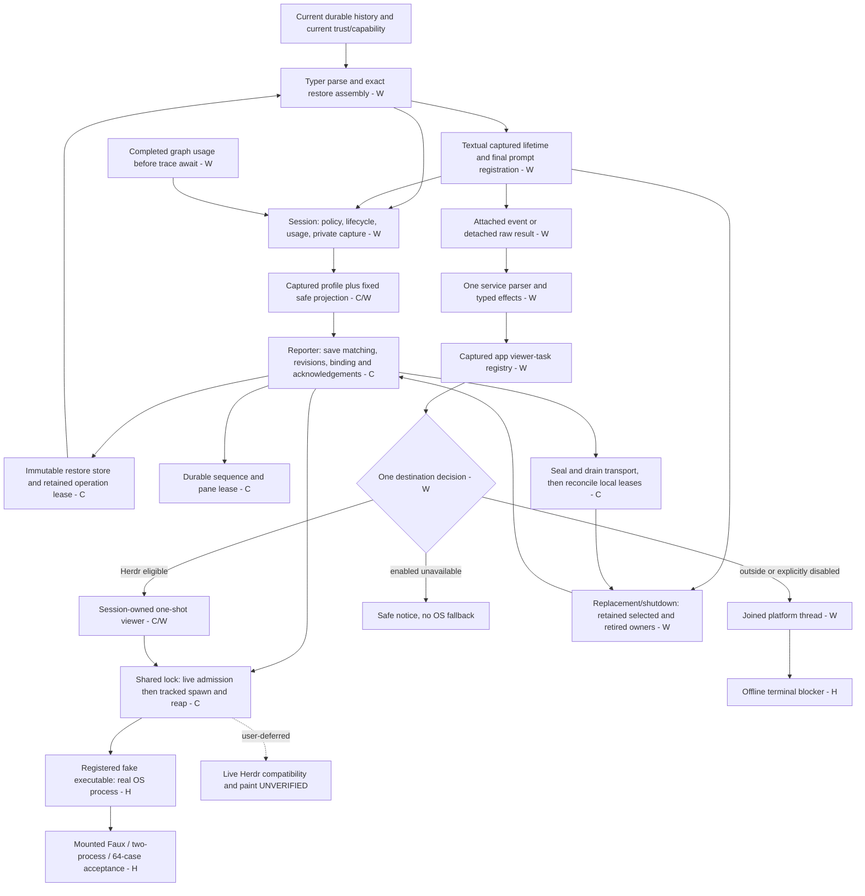

# Feature 94 Herdr — independent full-review synthesis182

## Executive summary — READY (offline scope)

**The combined independent Review is READY for the authorized OFFLINE scope. R155-2 is CLOSED by this synthesis.** Core172, wiring173 as corrected and accepted by wiring180, and harness/static181 together cover the feature's foundations, reporting, restore, viewer, session/app lifetime, composed acceptance, safety and static repairs. No blocking requirement gap or unowned cross-partition interaction remains in that scope.

**This synthesis completes the independent full Review (R155-2) for the OFFLINE scope; fresh Completion remains pending and must be a SEPARATE phase.** This is not a completion assessment, workflow-complete declaration, release/compatibility certificate or delivery authorization. No fixes, commits, push, MR, live acceptance or sub-agent dispatch were performed. Accounting: **turn6, global dispatch182**; no workflow completion increment.

Live installed-launcher/native restart/Herdr version/wire/panes/paint/TTL/wait/release acceptance remains **USER-DEFERRED**, compatibility **UNVERIFIED**, and **security132 separate/open**. Those qualifications are not silently converted into Implemented or Passed rows.

## 1. Authority, method and environment

This is independent synthesis, not a replacement implementation or a fresh line-by-line re-review of every previously audited file. The evidence chain is:

- [155](independent-review-155.md): original profile defect and unfinished full Review.
- [158](independent-review-158.md): profile closure, completed-usage cancellation and convention findings, explicit remaining inventory.
- [core161](independent-review-core-161.md) and its [complete canonical/sample/read ledger](independent-review-core-161-receipts/read-ledger.md): finite core audit and complete seven-document ingestion.
- [core169](independent-review-core-169.md) → [core172](independent-review-core-172.md): descriptor, sequence, intermediate/final close and public-contract closure, including failed acquisition.
- [wiring173](independent-review-wiring-173.md) → [175](independent-review-wiring-175.md) → [178](independent-review-wiring-178.md) → [180](independent-review-wiring-180.md): complete wiring audit followed by bounded correction verification, not four independent whole-feature approvals.
- [harness/static181](independent-review-harness-static-181.md): composed processes/journeys, safety, A–E repairs and static honesty.

All those reports were read, as were `routing.md`, `scope-plan.md`, `scope-routing-assessment.md`, `gates-171.md` and the complete historical `final-code-status.md`. Later accepted evidence supersedes their older pending/HOLD headings; historical failures remain historical facts. No source specification or old receipt was rewritten.

Reference root H: `/root/Code/specifications/projects/slo/specifications/94-slo-tui-redesign/herdr/`. Fresh reference reads included the complete overview, tasks' normative T1–T6/acceptance sections and final gate/sample attachments, B's method/branch and final ownership ledgers plus acceptance, C's final drain/lifetime64/acceptance contracts, D's automated/live acceptance, and both complete historical source documents. Complete B/C/D/sample-body ingestion is explicitly reused from core161 and wiring173; this report does **not** claim to have reread all 9,859 lines. The final chapters govern historical `--model`, free-text labels, `--current`/focus, per-source process slots and success-only lease snippets.

Applied checkout `review-feature-code`, `engineering-review`, routing/ownership/testing, Python conventions and mandatory `code-review-rules`; the partitions' scoped hard-rules passes are reconciled below. Stack: Python3.11/asyncio/Pydantic, existing LangGraph/Faux, Typer, Textual, real temporary filesystem and guarded process adapters. No SQL/HTTP/new Command/editor-styling framework is required. Supplied AGENTS/project instructions and RESEARCH were consulted; root RESEARCH and KB Welcome, actual `slo/README.md` and gotchas were read. KB/spec/global files were left unchanged.

First read-only checks:

```text
cwd: /root/Code/slo-94-herdr-integration/slo
pyenv which python: /root/.pyenv/versions/slo-harness/bin/python
Python: 3.11.7
make test-env: fallback
HEAD: c2f9e562b5b0ad5b3f4592715d205bfaf756893d
```

Executions pinned that interpreter with VIRTUAL_ENV/PATH/PYENV_VERSION and used only tracked synthetic fallback exports plus `PYTHONPATH=$PWD`. No development env was sourced or full environment printed. Root pre-import isolation, registered regular-file/inode fake guard and real-terminal blocker were freshly read. No real provider/Herdr/pane/window or system/package mutation. `dpkg -V coreutils` was silent/exit0 following the test run and subsequent verification. Existing dirty/untracked work was preserved; this report is the only authored repository artifact.

## 2. Frozen-input consistency — reconciled, not identical snapshots

The statement “all three used the same committed snapshot” would be false. They share feature base **d0e3a756689f2675e5507034d43cd8b272d3c6b8**, but review staged corrections over time:

| Evidence | Actual input boundary | Reconciliation |
|---|---|---|
| core172 / gates171 | HEAD/base d0e3a75, implemented worktree; 1,064 comprehensive inputs | Accepted core code and its tests remain hash-identical. |
| wiring180 | HEAD c2f9e56 plus current uncommitted179 corrections | Six executable/test/probe entries in179 final short manifest match; current app guard and ordinary audit source seam inspected. |
| harness181 | Same current executable tree; 1,066 comprehensive inputs | Fresh182 enumeration and every SHA256 match181 exactly. |

**Current comprehensive digest:** `8c576b3dda45c991f0ce1147ce7eab7570e1f30c087ea9b2c5fcd09a6cdea805`, **1,066/1,066**. Scope is nonignored tracked/untracked regular application files, excluding `docs/implementation/**`, root/docs RESEARCH and symlinks, exactly as181 defines it. Thus this report and historical receipt scripts are not falsely counted as runtime inputs.

Relative to171, the exhaustive changed set is:

- `src/agents/slo_agent/sessions/service.py`: documented activation/close/attention/source contracts; wiring175/178/180 verified actual behavior and distinction between joining activation and closing retained resources.
- `src/tui/app.py`: captured-owner startup/replay/failure/final-summary-scroll guards, accepted180.
- `tests/cli/test_headless.py`: three explicit fixture annotations, independently inverse-reconciled175.
- Added `tests/tui/test_startup_notice_cutoff.py` and `tests/implementation_checks/test_conventions_audit_paths.py`.
- **No removal or other input difference.** All seven core package files, extracted identity/formatter/context reader, root guards, transport/store/lease tests and lifetime tests match171.

Fresh182 ran180's read-only checker: core hashes, session/headless/guard identities, all twelve prior startup helper/test ASTs, six executable179 entries and preserved probes reconciled. Session AST also matches committed bc98b76 after stripping documentation; that comparison is not misrepresented as an independently reconstructed171 blob. Current close bodies were inspected and their failed-acquisition/final-drain consumers rerun in182. No wiring change invalidates core172's transport/store/lease adjudication.

Two179 manifest entries are **not** current-byte matches:176/177 prose gained appended correction sections. The checker reproduced each old hash from its exact pre-correction prefix. This is disclosed receipt hygiene, not runtime drift. Likewise `final-code-status.md` still leads with171; it is not the latest verdict authority.

## 3. Coverage union and unique accountability

“Exactly one owner” means one **primary acceptance owner**, not a prohibition on tests crossing boundaries. R1/R7/R9/R22 and other broad requirements necessarily span owners. The table assigns accountability once and explicitly names corroborating evidence; it does not manufacture disjoint runtime subsystems or add overlapping test counts.

Abbreviations: **C** = accepted core172, including161/169 audited maps; **W** = wiring173 map with all blockers closed through180; **H** = harness/static181. Herdr test basenames below are under `tests/agents/slo_agent/herdr/` unless another path is given. “Implemented” means implemented and independently supported **offline**.

| Requirement | Primary partition | Status / implementation and evidence |
|---|---|---|
| R1 optional, zero-work disabled, nonblocking faults | W | **Implemented.** Gate/null C; session activation/publication isolation W; mounted stalled Faux completion, disabled parity and headless JSONL H. Publication does not await CLI/save. |
| R2 existing editor journey/pane schematic | H | **Implemented offline journey** in full_flow/unified141; actual operator pane approval **USER-DEFERRED**, not an editor redesign requirement. |
| R3 private atomic handoff/sole save scheduler | W | **Implemented.** Session immutable publication → C reporter save owner; session_publication/isolation/compositions and full-flow private-channel assertions. |
| R4 configuration generation versus display revision | W | **Implemented.** session_capture/mutation and C publication_admission/save continuation; usage/name/fallback/catalog-only changes do not change exact policy identity. |
| R5 G1 same capture/newest display | C | **Implemented.** reporter/save_worker_closure plus real session/store/transport `test_session_publication_compositions.py`; same capture one save, changed reasoning new save, newest tokens advertised. |
| R6 recursive immutability/bounded slots | C | **Implemented.** dao frozen tuples/closed shapes; test_daos and reporter slots; W caller-pool mutation tests preserve exact bytes. |
| R7 privacy/no credential lookup in publication | H | **Implemented reporting boundary.** C projection/privacy/diagnostic tests; W captured profile and publication tests; H snapshot/argv/events/diagnostics/sequence scans and schema-specific parity sensitivity. Four provider labels are synthetic sentinels, not four live lanes. Security132 excluded explicitly. |
| R8 immutable revision/current history/secure restore | H | **Implemented offline end-to-end.** C restore security/quota/short-read/crash/lease matrices; W CLI refusal/preference bypass; H two independent processes, literal policy oracle/current history/current trust/capability/no replay. |
| R9 remote uncertainty versus local disposal | W | **Implemented.** C intermediate versus final evidence and ambiguous lease ownership; W session retained close/candidate/headless/app quarantine; H matrix/unified replacement.172 failed-start24 and182 consumer run specifically cover the seam. |
| R10 lock → synchronous admission → tracked spawn | C | **Implemented.** cli_transport, policy_accounting, operation_results and actual guarded executable tests; H observer joins/accounting. No await separates admission from spawn registration. |
| R11 cancellation/sequence gaps/stale effects | C | **Implemented.** transport_lifetime/signals/final_lifetime, reservation and stale-result matrices; W app/headless retained joins; H distinct queued/admitted phase matrix. |
| R12 every report/viewer operation admitted | C | **Implemented.** all ordinary/activation/replacement/shutdown ticket families, clears/sets/install and viewer split/rename/run; operation_results/currentness/authority assertions include forbidden executable entry. |
| R13 G2 viewer-held lock/A queued/B replaces | C | **Implemented.** actual shared-lock visualizer_acceptance and reporter regressions; durable A reservation, no A executable entry, higher B sequence; already-admitted A accounts old effect without new acknowledgement. |
| R14 lifecycle, final usage, attention, unchanged execution | W | **Implemented.** completed usage captured before trace await; trace-cancellation5, agent usage regressions, attention execution/auth/compaction/preparation tests; H real PromptInput/Faux/tool/retry/pool journey.182 reran cancellation and real SDK-local Feature89 equal-usage assertions. |
| R15 scheduler/child environment exclusion | W | **Implemented.** scheduler fresh/resume actual child checks exact case-insensitive HERDR_ filtering, parent unchanged; existing subagent/detached/relaunch allowlist assertions retained. |
| R16 validator/UUID/ordinary slug compatibility | W | **Implemented.** C single extracted validator and formatter tests; W root CLI/history/headless/footer consumers. Herdr canonical UUID gate does not tighten ordinary resume. |
| R17 standard bootstrap provenance | W | **Implemented.** before/after exact attachment identity, capture/mutation/publication compositions; custom/general/malformed/failed attachment cannot become eligible through matching names. |
| R18 one destination/one-shot/manual reuse | W | **Implemented.** both actual event entries → captured app registry → session eligibility → C attempt ledger/transport; H unified journey and queued/admitted viewer/platform phases. Submitted never means painted. |
| R19 one lower-layer context reader | C | **Implemented.** context_reader source/tests plus W loader and eligibility delegation; no reverse Textual dependency or duplicate parser. |
| R20 candidate rollback/adoption/inbox/shutdown | W | **Implemented.** replacement, initialization ownership/rollback, inbox disposition/cutoffs, final prompt registration, all-owner cleanup and startup16; H64 matrix and unified old-release-before-new-claim. Claimed refusal stays claimed. |
| R21 numeric bounds/no unsafe retries or eviction | C | **Implemented.** projection/metadata_payload, sequence, resume_bounds, restore boundaries/security, transport pipe/deadline tests; H203 bounds/crash run. Exact limits summarized below. |
| R22 declarative owners/branch ledgers/static/full gates | H | **Implemented offline.** C/W public contract/signature passes; H safety/A–E/static review; retained current179 full8773, clean181 lint816, incremental Black coverage. This synthesis audits the union; separate Completion is not claimed. |
| R23 preserve canonical source/separate TUI/precedence | H | **Satisfied scope obligation.** All partitions retain final B/C/D precedence and no normative/spec/editor rewrite. Adjacent selection test repair is not editor implementation. |
| R24 prerequisite no implementation/live/external actions | H | **Satisfied historical phase obligation**, not runtime code. Scope-routing-assessment records prerequisite-only work; later authorized implementation is a different phase.182 itself is review-only. |
| R25 accepted spec review and later independent review | H | **Satisfied Review obligation through182.**161 consumed accepted spec turn4; C/W/H independent evidence plus this union closes R155-2. Fresh Completion remains pending. |
| R26 prompt-input redesign | — | **Excluded by scope**, not Missing or Implemented. |

### Task and top-level acceptance coverage

| Task | Primary technical acceptance split | Result |
|---|---|---|
| T1 foundations | C schemas/identity/formatter/lease; H isolation/defaults/guard | Implemented offline. |
| T2 reporting/transport | C mechanics, policies, branch ledgers; H actual fake boundary safety | Implemented offline. |
| T3 restore/CLI | C immutable store; W parser/admission/config assembly; H process acceptance | Implemented offline; installed/native restart deferred. |
| T4 viewer/reader | C one-shot core/reader; W loader caller | Implemented offline. |
| T5 session/app/headless/both entries | W owns all coupled lifetime wiring; C owns cleanup/admission mechanisms | Implemented offline; corrections through180 included. |
| T6 composed proof/docs/gates | H owns full_flow, two-process,64 cases, safety, docs and static evidence | Implemented offline; live portion deferred; Review now closed, Completion separate. |

- **B1–B6:** W nonblocking handoff, C cleanup/counters/sources-clears-TTL/formatter, H privacy composition: Implemented. **B7:** fake protocol Implemented; real interoperability deferred.
- **C1–C6:** W session authority/original-result isolation, H restore composition, W ordered replacement/registration/inbox and H disabled parity: Implemented offline.
- **D1–D3:** W both paths/destination, C one-shot/cancellation plus W owned app/platform joins: Implemented offline. **D4:** automated evidence Implemented, real restart/metadata evidence deferred. **D5:** actual pane acceptance deferred.

Numerical obligations retain distinct proofs: one shared CLI child;1s deadline including lock wait;0.25s TERM grace;2s remote close budget (not a bound on filesystem/reap);2s refresh/5s TTL;18 owned keys,16 per patch,32 retained pane keys;80 characters **and**128 UTF-8 bytes with whole-token omission; strict non-bool signed63-bit positive-range counters including zero; restore65,536 bytes/1,024 records/67,108,864 total/1,025 scan/three draws/0700+0600; argv64 arguments/8,192 bytes; pane ID128 UTF-8 bytes. C boundary suites and H bounds/crash evidence cover these; TTL is not a lock and a retained descriptor is not admission authority.

### All72 samples: exact primary allocation

Fresh182 parsed `#### Sample` headings from H/tasks.md: **72 unique IDs**. The following disjoint sets reproduce that set exactly: **31 C +32 W +9 H**, no duplicate and no missing allocation. I04 and overview samples receive explicit synthesis ownership rather than falling between the original core and wiring lists.

| Primary owner | Allocated IDs | Implementation/evidence interpretation |
|---|---|---|
| C | B01,B03,B04,B06–B22,B25; C05,C06,C07,C27,C28,C29; D04–D07 | Core161 exact ledger →169/172 closure. Same existing owners, not duplicate classes copied from snippets. C05 owns argv builder; W audits its consumer. |
| W | B02,B05; C01,C02,C03,C04,C08–C26,C30; D01,D02,D03,D08; I02,I03 | Wiring173 complete map →180 corrections. Before-code/historical event/usage excerpts are traced to current replacements, not reinstated as event-authority requirements. |
| H | B23,B24,B26; C31; D09; O01,O02,O03; I04 | Root guards/real delegation, exact gates, full-flow/runtime diagram and current-history process oracle. I04 is historical metadata context: H verifies actual events/history/config rather than copying the old schema. O03's live visual portion and O02's actual Herdr restart are deferred. |

Ten intentionally excluded historical fences stay excluded: **I01,I05,I06,I07,I08,P01,P02,P03,P04,R01**. No unsupported flags, free-text labels, focus, mutable restore record or unrelated editor requirement returns through these examples.

## 4. Cross-partition interaction audit

| Seam / primary acceptance owner | Actual evidence crossing the boundary | Synthesis result |
|---|---|---|
| Session close → reporter final drain → store/pane lease (W) | C172 real failed native-lock/load rollback24 includes reporter **and session** consumers, one raw close and no reservation/spawn.169 final-gateway/null/uncertainty tests; W lifetime/headless/app retained-owner assertions. Fresh182 reads current close/resource predicates and reruns failed-acquisition + session-lifetime. | Verified. Intermediate default drained cannot authorize disposal; final exceptions cannot inherit it; retained ownership remains reachable; uncertainty is sticky. |
| Session capture/profile → reporter save/adopt/display (W) | R155-1 closed158; W metadata-profile8 covers both activation modes, exact detail/compact, captured env stability. G1 real session/store/transport contrasts unchanged capture with changed reasoning. H mounted full-flow scans emitted argv. | Verified, not projector-only inference. Config generation differs from report revision; only reporter saves. |
| Completed graph usage → session → final report (W) | R158-1 closure in173; source captures completed delta before cancellable trace. Trace/history tests assert exact totals and terminal cardinality; H Faux retry/fallback journey;182 Feature89 local SDK fixture asserts two distinct14-token responses total28. | Verified. No per-chunk sum, equal-total dedup or independent Herdr counter. |
| CLI restore → private store → current admission (H) | C secure immutable store; W actual root parser/dispatch fixed refusal and preference bypass; H eight single/pool × available/credential/trust/model cases use distinct PIDs and advertised argv, independent literal policy oracle and current history equality. | Verified offline. Trust case proves prior plugin load then withdrawal; capability case reaches mounted PromptInput refusal; no automatic model/tool replay. Source shim is not installed-launcher/native-server restart evidence. |
| Viewer entries → eligibility → core live admission (W) |173 attached/detached parser/service/effects/registry assertions, actual persisted parent checks; C revocable queued split/rename/run at real transport lock; H same mounted lifetime traverses both entries and terminal reset/manual reuse. | Verified. Renderer request reset cannot reset irreversible attempt ledger. Enabled unavailable never falls back to OS window. |
| Shared reporter/viewer transport (C) | Distinct G2 viewer/A/B real lock and executable log, plus reverse queued-viewer revocation and admitted-operation completion; H observer counts terminal return **or cancellation**, callback and reaped-resource evidence. | Verified. A waiter's timeout does not kill a different holder; no stale newer acknowledgement. |
| `/new`/unmount → captured inbox/timers/viewer/session (W) | W actual claim/advance/registration barriers, captured original ack, candidate-only rollback, retained predecessor and independent final owners; H64 owned lease/timer/subscriber/claimed-bytes assertions. | Verified. Claimed is not admitted; no automatic replay or queued successor after cutoff. |
| Startup/replay awaits → monotonic app cutoff (W) |175/178 failures closed180 with real projector/summary barriers, public shutdown/displacement and positive open control;182 startup16 pass. | Verified through final summary→scroll continuation. Already-admitted mount/storage work is not retroactively cancelled. |
| Platform destination → owned thread → app close (W) | W real discovery/spawn continuation and repeated cancellation tests; H precommit/committed platform phases retain separately chosen platform work; root blocker prevents OS windows. | Verified offline. Reporter disablement is not authority to cancel independent platform work; admitted thread is joined, late notice suppressed. |
| Headless/scheduler → isolation/finalization (W) | W adopted outer-finally original-result/JSONL/credential lifetime and exact child prefix filtering; H registered-process guards and default safety. | Verified without changing child/relaunch allowlist policy or advertising native headless restore. |
| Static repairs → actual existing behavior (H) |181 A–D60-file audit, actual Anthropic binding/Codex regressions, full lint; fresh182 explicitly reconciles adjacent Feature89 usage, config-only reload and selection fixture callback fence diffs. | Verified, not annotation-only assurance. Selection fence delegates actual callbacks/descendants and waits paint; assertions retain native scroll/selection and add exact clipboard text, no production editor change. |

The last row also resolves inventory granularity: bootstrap/replay tests belong W; `test_session.py` config reload and `test_feature89_model_flows.py` usage evidence are W-adjacent regression evidence; `selection_fixture_fence.py`/selection-scroll assertions are H-adjacent fixture evidence. They are not an unassigned fourth partition merely because they are outside the core directory and A–D list. Their complete feature diffs were freshly inspected here, and the relevant tests executed below.

### Canonical64 and complete mounted/process evidence

H181 collected exactly64 distinct lifetime node IDs. Dimensions match C7.14:

- triggers: runtime disable, session close, new, unmount;
- phases: queued/admitted report, queued/admitted viewer, precommit/committed platform, queued capture, running save;
- diagnostics: healthy/raising.

These are distinct barriers: actual shared-lock wait, actual spawned-child collection, off-loop real save and registered app-worker continuation—not64 tests of one Boolean. Assertions include no stale acknowledgement, exact command cardinality, drained task/transport, same lease/timer/subscriber ownership, retained claimed bytes and successor policy. G1/G2, inbox refusal, initialization and persistent quarantine remain separate tests, not replaced by the matrix.

H181's composed232 includes two-process/full-flow/matrix plus mounted activation/attached suites; collection217 =9 process/bootstrap +144 full-flow +64 matrix. Real PromptInput/Faux/graph/tool execution/usage/history/reporting and unified rename/model/new/both-viewers are exercised. Controlled normalized workflow events do not claim live sub-agent execution. Safety258 proves executable positive controls and negative mutation sensitivity; fresh process entry reinstalls its guard because pytest fixtures do not cross interpreters.

## 5. Verification and static/baseline honesty

### Reused, independently audited receipts

Actual exits and output tails were checked in182; no count below is invented from a READY heading. Counts overlap and must not be summed as unique coverage.

| Evidence | Actual result |
|---|---|
| C172 broader core / DEBUG failed-acquisition matrix |1229 /24 passed; historical independent evidence, core unchanged |
| W180 surrounding / startup / residuals |533 /16 /8 passed, exit0 |
| W180 historical175 mutation observation |**3 failed,3 passed, exit1**: the intended ordinary assertion rejections under removed discovery, not a green product suite;180's explicit rejection oracle independently green |
| H181 safety / composed / bounds-crash / static regressions |258 /232 /203 /166 passed, exit0 |
| H181 unmodified `make lint` |**816 files clean**, exit0 |
| Author179 `make test` |**8773 passed,19 deselected,780 warnings,1178.04s**, exit0 |
| Author179 smoke / B26 / C31 / D09 / surrounding |288 /1531 /1538 /1748 /504 passed, exit0 |
| Black evidence chain |171 all240 and chapter81/12/10 clean;174/176 changed-file/chapter checks clean;179 final three changed Python files clean. Current membership delta is fully covered, not claimed as a fresh all-files rerun. |

All inspected per-run coreutils receipts are empty/exit0. The19 full-gate deselections are the existing non-E2E gate's exclusions, not hidden skipped offline acceptance cases. Dependency/AsyncMock warnings remain disclosed. No redundant full suite was rerun by182, and no fresh Completion execution is claimed.

### Fresh182 cross-boundary execution

After the pinned interpreter and tracked synthetic fallback exports, from the application cwd:

```bash
python -B -m pytest -q \
  tests/agents/slo_agent/herdr/test_failed_acquisition_ownership.py \
  tests/agents/slo_agent/herdr/test_session_lifetime.py \
  tests/agents/slo_agent/test_usage_trace_cancellation.py \
  tests/tui/test_startup_notice_cutoff.py \
  tests/tui/test_selection_scroll_highlight.py \
  tests/integration/test_feature89_model_flows.py \
  tests/agents/slo_agent/test_session.py::TestStreamInactivityTimeoutConfig
```

**192 passed,134 warnings,35.67s; exit0.** No reported skip/deselection. Warnings are pythonjsonlogger/LangGraph/Pydantic deprecations, not suppressed. Post-run `dpkg -V coreutils`: silent/exit0. Fresh read-only hash/sample/receipt/lock checks and180 input checker exited0; `git diff --check` was silent. Tool output is the fresh execution record; no historical log was overwritten to store182 results.

### Baseline and dependency claims

- Baseline301 diagnostics were **disclosed and UNWAIVED**, never accepted merely because feature tests passed.181's normalized multiset reconciliation shows301→281 (zero added,20 removed), then E281→280 (zero added, exactly YAML import-untyped removed); A81+B53+C45+D101 repairs the remaining280. Current unmodified full lint is **zero**, not “280 tolerated, zero-new.”
- Fresh182 parsed the lock against d0e3a75: all87 previous package records unchanged; only dev `types-pyyaml==6.0.12.20260906` added.181 additionally checked retained wheel hash and installed multiset: one addition, no removals/upgrades.182 performed no install.
-181 confirmed mypy/pytest/Black configuration equal to base, real YAML loader RED→GREEN and no newly introduced static escape hatch.176's wrong-interpreter YAML errors remain historical environment failures, not a silent code waiver.
- **Literal “no suppression anywhere” is not true.** Existing ignores/noqa remain, including a pre-existing ignore relocated to `tests/agents/slo_agent/orchestrator/test_spawn_tool.py:681`.181 correctly records it as stale debris, not a suppression introduced to obtain green. The current179 three-file delta adds no Any/ignore/skip/xfail. The defensible accepted claim is **no new gate-enabling suppression, checker exclusion or weakened assertion**, not absence of every historical suppression token.

Mandatory hard-rules synthesis: C complex-public-API omission closed169/172; W activation/close/attention contract and explicit fixture signatures closed180; H finite signature1583 and actual type checker agree without equating lexical audit to semantic correctness. Named typed boundaries and domain vocabulary remain coherent. Specific instance-owned/atomic lifetime contracts govern generic wrapper/extraction examples; no duplicate process manager, atomic writer, UUID parser, formatter, token counter or workflow-result parser is introduced.

## 6. Findings and remaining scope

### Glaring Gaps — must fix

**None remaining for the reviewed offline feature.** R155-1, R158-1/2, R161-1/2/3/4 and R173-1/2/3 including R178-1/2 have explicit independent closure. R155-2 is now closed by this coverage union and interaction audit. No unresolved offline requirement was discovered by182.

### Nice-to-Haves — Low, nonblocking

1. Correct stale test/helper commentary carried by172/180: future-viewer wording, ordinary UUID4 wording, audit-test removed helper name and incorrect prose describing the no-`--relative` mutant. Assertions establish the actual behavior.
2. Clarify session activation WHEN wording at `sessions/service.py:2407–2409`: publication can occur inside activation. WHAT and tests are correct; no runtime change is requested.
3. Remove the relocated stale ignore at `test_spawn_tool.py:681` in a later authorized edit; it is not a new lint waiver.
4. Keep manifest/status navigation honest:179's two prose hashes predate appended corrections; older CURRENT headings in final-code-status/RESEARCH are historical. Use this synthesis and172/180/181, not those headings, for Review state.
5. H supervisor capture reader consumes a finite fixture file to EOF; do not advertise a general bounded-output/adversarial sandbox guarantee. Add bounds before expanding that helper to unbounded fixtures.

No fixes to these items were authorized or made in this synthesis.

### Acknowledged boundaries — not unowned product gaps

- **Live USER-DEFERRED:** installed plain-slo launcher equivalence, native Herdr server restart, supported version/wire behavior, status/metadata clear/TTL/wait/notification/release, sibling placement/no-focus/manual reuse/retention and actual viewer paint. H is accountable for tracking this T6 release evidence; it is not certified offline.
- **Compatibility UNVERIFIED:**0.9.2+ remains a target. Source-shim two-process proof is not native installed restart. Native Windows and adversarial process/filesystem confinement are not certified by the Linux trusted-fixture tests.
- **Security132 separate/open:** ordinary Slo tool-error disclosure is not a global-redactor promise of this integration. Fresh base diff for `tool_execution/executors.py` is empty. New reporting privacy remains required and audited; this open issue does not waive a new leak.
- **Intentional behavior:** ambiguous same-inode descriptor ownership may remain retained indefinitely; graceful teardown can stay pending; no repeated remote release, automatic claimed-message replay, restore GC or cross-process pane discovery. Remote uncertainty alone does not imply a local leak. TTL is stale-display mitigation, not atomic ownership; submission is not paint; saved configuration uses current history, not a checkpoint.
- **Excluded:** R26 editor redesign and superseded historical sample proposals. These are not missing acceptance work for this family.
- **Separate phase:** fresh Completion is still pending. Delivery and any external action are outside this request. Thus “only unpassed items” applies to product acceptance within this review boundary, not a claim that Completion/release or every unrelated repository issue has passed.

## 7. Verified architecture



The diagram deliberately has no Herdr→prompt-execution control edge, no reporter→history-writer ownership, and no unavailable→platform fallback. `AtomicFileWriter` remains unchanged (fresh base diff empty). One canonical vocabulary crosses layers: `configuration_generation` versus `report_revision`, exact `restore_reference`, viewer `parent_session_id`, and independent close `replacement`/`resources`.

## Final handoff

- [x] Combined R1–R26, B/C/D acceptance, T1–T6 and72-sample allocation reconciled.
- [x] Core/wiring/harness interactions backed by actual assertions and execution, not partition verdicts alone.
- [x] Current1,066 input hashes match181; core172 preserved; current uncommitted corrections included.
- [x] Full/static evidence, baseline, dependency, mutation-probe failures and prose drift disclosed accurately.
- [x] No implementation changes, commits/push/MR, live action or completion assessment.
- [ ] **Separate fresh Completion phase.**
- [ ] User-deferred live acceptance/compatibility and separately open security132 remain as stated.

**READY — whole-feature independent Review for the authorized OFFLINE scope. R155-2 closed; fresh Completion pending separately.**
