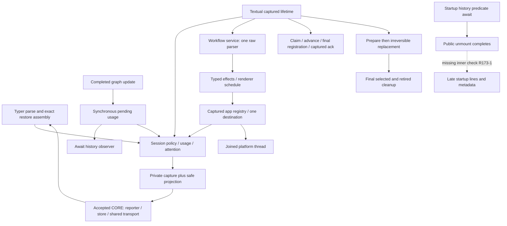

# Independent WIRING review173 — REVISE

**Bounded WIRING is not READY.** The finite session/app/CLI/headless/viewer audit found a reproducible inner startup continuation that renders and writes startup metadata after public shutdown, plus remaining mandatory signature and public-contract documentation omissions. No production fixes were made. **CORE172 remains accepted unchanged**; none of these findings reopens its transport/store/lease adjudication.

Accounting: **turn5/global173/currentdispatch4; started5/completed0/historicalpartial1/retries0; turn/dispatch budgets UNLIMITED**. This is a review partition, not a completed workflow turn. Full-feature synthesis, the separately allocated harness/static audit, and fresh Completion remain separate. Live installed launcher/native restart/wire/version/TTL/wait/release/panes/paint are **USER-DEFERRED; compatibility UNVERIFIED**. Security132 remains separate/open, never permission for a new reporting leak.

## 1. Scope, authority and preservation

Verified `feature-94-herdr-integration`, `origin=https://gitlab.com/core-27/slo.git`, HEAD/base `d0e3a756689f2675e5507034d43cd8b272d3c6b8`. No Git mutations, source/existing-test fixes, agents, package changes, global/KB/specification/other-worktree/live actions or private transcript reads. Outputs are this report and [review receipts](independent-review-wiring-173-receipts/). Test caches are incidental. The documented `specifications` symlink is absent; no replacement was created. Canonical reference-only root H is `/root/Code/specifications/projects/slo/specifications/94-slo-tui-redesign/herdr`.

AGENTS was read first (full supplied reference plus disk opening), then supplied CLAUDE/docs RESEARCH and disk root RESEARCH/Makefile/routing/scope; KB Welcome, actual slo/README and gotchas consulted read-only. Read155/158 remaining ledgers,161 complete canonical/sample ledger,169/172 core decisions,171 actual gates,156/159/167/170 correction receipts. Reuse is explicit:161 establishes complete canonical ingestion and accepted sample allocation;158 establishes complete wiring diffs, not full unchanged caller coverage. Fresh comparisons show all listed tracked wiring paths unchanged from156 **except agent.py and sessions/service.py**. Those deltas were inspected anew, as were the actual relevant caller bodies. Core172's unchanged acceptance is not inferred from authors' summaries.

Stack: Python3.11.7, asyncio, Pydantic2, LangChain/LangGraph, Typer and Textual. Tests are pure/orchestration, real temporary filesystem and registered fake subprocess integration, and headlessly mounted app flows. No SQL/API/worker framework, new Command class, graph topology, editor styling or process-manager redesign is appropriate.

Selected authoritative checkout skills under `skills/`: exact `design-and-analysis/workflows/code-test-review.md` Step2 and `review-feature-code`; engineering routing/review/ownership/testing; coding-rules/shared declarative/naming; Python root, code-review-rules, named arguments/types, method-docstrings, declarative, domain Field/boundary rules, application-service ownership and Faux graph tests; product Typer and Textual; ubiquitous-language. These were read, not replaced with the installed similarly named workflow skill. No selected personal override occurs in the supplied manifest. Canonical instance-owned lifetimes, atomic nonawaiting registration/admission and explicit app transactions specialize generic classmethod/invoke/run_worker examples. Mechanical splitting is not requested.

## 2. Findings by severity

### Medium — R173-1: startup notice resumes after shutdown and performs new effects

**Where:** `src/tui/app.py:751–790`, `_maybe_render_startup_notice`; caller `on_mount:615–630`; session predicate/marker `sessions/service.py:2053–2082`.

**Requirement:** C7.13/C7.14, T5 monotonic startup continuation contract: captured owner must be checked after real awaits; late startup must not repaint/reopen work after shutdown. The outer check is insufficient when the helper itself performs effects before returning.

**Cause:** the helper awaits `self._session.should_show_startup_notice()`, then uses mutable `self._session`, writes the startup lines, and awaits `mark_startup_notice_shown()` without rechecking `_app_closing` or captured identity. `on_unmount` can complete while mount is suspended here because `_mount_runtime_task` is not registered until after this helper. The check at627 occurs only after the new output and metadata write.

**Independent deterministic reproduction:** [test_startup_cutoff_probe.py](independent-review-wiring-173-receipts/test_startup_cutoff_probe.py) mounts actual SloTUI, injected Faux agent and real temp FilesystemSessionHistoryStore. The original startup predicate runs, then an Event holds its return. Public `on_unmount()` completes; the test proves no session metadata exists at that instant. Releasing the predicate produces two startup lines and creates metadata with `startup_notice_shown_at`, despite the completed shutdown. No flag was assigned directly by the probe, no real provider/Herdr/window was used.

Actual `probe-final.log`, exit1:

```text
late_notice_count 2
startup_marker_written_after_shutdown True
AssertionError: assert ['slo, Copyright ...', 'Tip: use /help ...'] == []
1 failed, 2 warnings in 2.02s
```

The first probe also failed at the same output assertion (2.18s); the final version adds durable evidence, not a changed product. This is not claimed to start a model or Herdr command. It is a demonstrated gap in this feature's new monotonic lifetime guarantee, in an unchanged helper that the changed caller relies on.

**False confidence:** `test_herdr_activation_cutoffs.py:191–196` calls the original notice helper **before** its barrier. Its green result proves the outer continuation check, not the helper's internal predicate await. Replay hydration has an analogous unchecked internal continuation (`app.py:718–724`); that is a source-inspection concern requiring the same boundary test, not a separately reproduced failure here.

**Required correction, no fix applied:** capture the session and revalidate its app lifetime after the startup predicate/history await and before starting rendering or marker persistence. Preserve ordinary open startup and already-admitted storage semantics. Inspect hydration's internal awaits for the same contract; do not cancel an already running filesystem thread or add a parallel lifecycle owner.

**Required tests:** mount and replacement startup, shutdown and displaced-session variants at the actual predicate/history read; no post-cutoff notice/marker initiation and no successor-state access. Include replay hydration's inner read/mount boundary, open-path once-only notices, and already-admitted marker-write ownership. Retain all existing cutoff assertions.

### Medium — R173-2: new tracked headless tests escaped the explicit-signature audit

**Where:** `tests/cli/test_headless.py:166,193,228`: `tmp_path` lacks its `Path` annotation in three newly added tests. These are new feature definitions, not a request to annotate the entire historical file.

**Rule/impact:** Python hard-rules1.1 and named-arguments/type-hints apply to tests. The lifecycle tests bypass the required explicit fixture boundary. A green configured mypy result does not establish this syntactic obligation.

**Why159 missed them:** `conventions-revision-159-receipts/audit.py` runs `git diff --name-only` from the product subdirectory, obtaining root-relative `slo/tests/...`; it then checks `Path(filename).is_file()` relative to the product cwd and silently skips those paths. Its own/new files are covered, but its advertised newly-added tracked-definition coverage is not. The same path distinction is observable with `git diff --relative --name-only` versus `git diff --name-only`; this is not speculation about mypy configuration.

Independent read-only [signature_audit.py](independent-review-wiring-173-receipts/signature_audit.py) asserts all25 finite app-relative paths exist, compares base lexical definitions and checks125 new definitions including nested/variadic parameters. `signatures.log` identifies exactly these three incomplete signatures; exit1. No new production missing annotation was found by that bounded scan.

**Required correction:** annotate the three fixtures; correct the audit's repository/product path normalization and fail on unexpected missing candidate paths. Add an audit regression covering a newly added tracked definition from this nested cwd. Preserve assertions; no Any/ignore/config weakening. The earlier ten-file159 correction remains valid in its actual scope, not as a whole tracked-diff certificate.

### Medium — R173-3: complex session lifetime APIs still omit caller contracts

**Where:** `sessions/service.py:2360–2377` (`start_external_reporting`), `2505–2514` (`close_external_reporting`); `2414–2428` attention APIs; `515–529` (`HerdrPolicySourcesDAO.permits_commit`).

**Rule:** mandatory method-docstrings/WHAT-WHO-WHEN and applicable Args/Returns/Raises. Simple predicate/no-op exceptions do not apply to retained async activation and disposal authority.

`close_external_reporting` has only “Join retained cleanup before propagating caller cancellation.” It omits the meaning of its two independent result dimensions, cached repeated-call behavior, failure retention, and which final-drain caller must retain a `resources=retained` owner. `start_external_reporting` has only an interactive argument description: no cancellation-after-join contract, first-call mode semantics, disabled behavior or failed-owner lifetime. These are precisely the boundaries app/headless callers must understand, not internal implementation trivia. Attention methods also omit their applicable token input/return contracts; the comparison method does not explain the authority its model/reasoning flags permit.

**Required correction:** document these existing APIs in place, consistent with their tested behavior; enumerate the finite new/changed wiring public interfaces and record applicable A/R/E plus lifetime. Do not add wrappers or copy the core ledger as session coverage.168 explicitly covered the core ten files, and169 explicitly deferred session documentation—this does not reopen R161-4 CORE closure. Validate docs against `test_session_lifetime`, candidate/app/headless retained tests, and the distinction between intermediate reporter evidence and final session disposal.

## 3. Owned requirement / AC / sample map

“Implemented” is a bounded wiring verdict, not live or whole-feature certification. Samples describing before-code are traced to their replacement, not treated as alternate requirements. The32 T5 allocations below are all accounted for; C03/C05 are additionally traced as the owned CLI seam, without reopening store internals.

| Requirement / AC | Samples | Actual code → inspected assertions | Status |
|---|---|---|---|
|R1/R3; B1/B6, C1/C2/C6: nonblocking private handoff, disabled parity|B02,B05,C01,C04|session `_publish_herdr_snapshot`, `_on_herdr_event`, rebuild/commit hooks → publication/isolation/compositions prohibit path/auth/model/save/task work inside publication; real Faux completes/aborts while save held; mounted inactive and headless whole-JSONL parity|Implemented wiring|
|R14; C1/C2: accepted scope, final usage, no event-derived approval|C02,C22,I02,I03|agent completed update before trace; pending single-consumer drain; session run/startup/manual scopes and final refresh → all usage regressions, trace-cancellation5, attention state/execution/auth/compaction/preparation-race tests assert exact totals/terminal counts, working through tools/retry/recovery, stale token refusal, original exceptions|Implemented; R158-1 closed in owned flow|
|R3/R4/R6/R17; C1/C3: immutable exact policy and provenance|C08,C09,C10,C11|constructor source snapshot; activation path resolution; history ensure/rename; model/prepared/reasoning/startup commits; bootstrap before/after exact tool identity → capture/mutation/publication/compositions assert ordered five pool scalars, no aliases, effective reasoning, workspace precedence, malformed/changed policy refusal, failed/early/general/custom attachment, no generation churn on usage/name/fallback/catalog|Implemented|
|R5; B1/C3: same-capture newest display|C08 plus shared core G1 endpoint|real session + BarrierRestoreStore + real transport composition: unchanged capture save reused with newest tokens; changed reasoning requires another exact save; old bytes survive caller mutation|Implemented caller evidence; core accepted|
|R7/profile; B6/C1|B05,C08,I03|retained `_herdr_metadata_profile` → projector; metadata_profile six enabled/two disabled cases assert exact compact/detail maps, stable captured profile after env mutation, clear-before-set and absence of private values; four-provider synthetic publication sentinels|Implemented reporting boundary; not global redaction|
|R8/R16; C3: CLI exact identity/config and current admission|C01; adjacent C03,C05|root option → dispatch UUID/conflict/history/ref load → fresh mutable config/pool → ordinary session build/plugin loader/preparation/backend checks; all382 CLI restore lines assert fixed refusal/no build, preference bypass, old revision equality, pool independence, workspace/plugin order, ordinary slug compatibility, no history mutation before mounted TUI|Implemented CLI; two-process capability/trust proof remains harness partition|
|R9/R11; B2/C2: retained session lifetime|C23,C30|session start/begin-close/close/finish/drain/dispose → lifetime940 lines: repeated cancel joins same owner; all cleanup owners attempted; final throwing evidence retained; null final independence; real lease/child GC and sticky uncertainty; headless retained180 lines|Implemented;167/170 consistent with172|
|R20; C4: prepare/commit/adopt|C12,C13,C14,C15|app `_start_new_session` prepares under gate; commit registered/revokes synchronously; viewer drain outside gate; captured release → close → atomic subscribe/adopt → runtime → tests preparation build/attach/name/cancel faults preserve old state; deep-copy pools, candidate-only drain/history retention; repeated commit cancel, safe/uncertain close, rendering failures, root mismatch|Implemented transaction; startup inner continuation partial R173-1|
|R20; C4/C5: captured delivery initialization/transfer|C16,C24,C25|immutable `_DeliveryInitialization`, rechecks after reconcile/acquire/inbox, per-created timer ownership and rollback → init_ownership/init_rollback/init_branches exact store/owner/session/service/renderer displacements, retained failed handles, absent store, false/error release, no successor cleanup|Implemented|
|R20; C5: claimed versus admitted and no replay|C17,C18,C19,C20,C21|claim→advance→bool delivery→captured ack; `_register_prompt_task` final synchronous check; local/queue share gate → disposition/cutoffs/prompt_registration/combined/all_owner tests assert exact lane bytes, no invoke/ack for refusal, durable advance retained, original-store ack for registered work, real abort/no successor/restart explicit resubmit|Implemented|
|R9/R20; C5/C6: shutdown and retired owners|C26,C30|monotonic prefix, mount/commit joins outside lock, independent cleanup, both final owners started before either join → app_shutdown/activation_cutoffs/all_owner/viewer_retention assertions prove pending quarantine and no late launch, but inner startup notice escapes outer guard|Partial R173-1|
|R18/R19; D1/D2/D3: both viewer entries and one parser|D01,D02,D03|attached child event / detached launch result or lifecycle → workflow service parser/effects → renderer schedule → captured app registry → destination → session persisted-parent eligibility → core viewer; viewer policy/lifetime48-case read matrix and attached_composed six cases assert exact parent argv, no fallback/no forbidden pane commands, stale root/workdir/owner/authority refusal, no private output|Implemented wiring|
|R11/R18; D3: platform work lifetime|D08|`launch_async` → `_launch_platform_joined` → existing sync platform path; actual thread/discovery/spawn guards plus replacement/registry tests prove one admitted spawn, joined thread after repeated cancellation, no late notices|Implemented offline, not actual window/paint|
|R15; C2/C6: headless/scheduler exclusions|C01,C04 governing C7.2|headless outer finally retains session through close/final drain then clears credential; original terminal/status/notify paths preserved. Scheduler copies env excluding exactly case-insensitive HERDR_; real fresh/resume child reports presence booleans; subagent/detached/relaunch spawn kwargs preserve their different existing allowlist|Implemented scoped boundary|
|R16; B5|shared core formatter/identity, C01 compatibility callers|footer delegates exact half-up formatter; headless_request imports unchanged validator closure; ordinary slug/UUID/env precedence and footer magnitude/cache/raw RPM/context assertions retained|Implemented callers; core not redone|
|R22 conventions|all owned rows|explicit typed boundaries and ownership mostly sound; finite new tracked signatures and complex session documentation fail above|Partial R173-2/3|
|B7/D4 live portions, D5/R2|not owned offline samples|No actual installed launcher/native restart/Herdr pane/paint evidence|Deferred by user, not passed|

No dead alternative parser/launch callable remains in the reviewed receive path. Renderer request guards are distinct from the session adapter's irreversible attempt ledger; a terminal reset cannot reset that ledger. Approval vocabulary is reserved, not inferred from tool/assistant text.

## 4. End-to-end flow verification

1. **Publication:** inert session → app/headless activation → captured gate/profile and private paths → retained reporter → committed immutable capture plus safe snapshot → reporter save/revision/transport. Session never builds CLI argv or schedules a save. Publication errors do not replace prompt/rename results.
2. **Usage/attention:** completed node delta → synchronous pending handoff → cancellable history observer → session consume/refresh → working metadata → operation retirement/idle or fixed blocked. Child/delta events do not invent totals or approval; equal completed totals count separately. Unknowns stay unknown, known zero counts.159 precedes the trace await; repeated refresh cannot charge twice.
3. **Restore:** parser → canonical literal/conflicts → existing exact history → immutable saved revision → new validated config/pool without ambient preferences → normal build/trust/capability checks → no automatic prompt. Explicit plugin paths retain the existing explicit-trust semantics; project tier still consults current trust. Full changed-trust/process acceptance is not claimed here.
4. **Replacement:** prepare candidate while old subscription/queue/lease intact → synchronous transition/revocation → retained commit joins viewer outside gate → cancel preparation/release captured old inbox lease → final session close → one nonawaiting subscription/adoption → reset UI and activate permitted candidate. Uncertainty suppresses all successors; local retention holds the old owner through GC. Final cleanup starts selected and retired attempts independently.
5. **Inbox:** serialized claim → recheck → durable workflow advance → recheck → notice/context or final chat registration → ack original store/ID only after admission. Pre-cutoff registration may execute later; closing does not acquire a new prompt-abort policy. Claimed refusal is not replayed automatically.
6. **Viewer:** both entries share app registry and one destination. Herdr eligibility joins real off-loop reads, rechecks current authority, then delegates the core one-shot adapter. Platform selection owns one joined thread. No fallback after enabled Herdr failure. Outcome is submission evidence, not liveness.
7. **Startup exception:** inner startup-notice predicate → completed public shutdown → late render and marker write. This is the remaining demonstrated broken flow.



## 5. Verification and false-confidence assessment

CWD is the feature product directory. Explicit `VIRTUAL_ENV=/root/.pyenv/versions/slo-harness`, matching PATH prefix and `PYENV_VERSION=slo-harness`; `which python` and **Python3.11.7** verified. `make test-env=fallback`. Used only tracked synthetic fallback exports, `PYTHONPATH=$PWD`; no secrets/environment file sourced. Root pre-import/per-test state isolation, regular-file/inode/nlink fake guard and terminal blocker were inspected. Fake commands live in pytest roots; no real Herdr/providers/panes. `dpkg -V coreutils` was silent/exit0 after each test execution.

| Execution | Actual receipt/result |
|---|---|
|Owned session/attention/usage/CLI/headless/all new TUI Herdr/receive/workflow/scheduler selection|`targeted.command/log/exit`: **1004 passed,224 warnings,185.79s**, exit0|
|Adjacent usage/footer/bootstrap/headless-request/platform/loader/subagent routing|`surrounding.command/log/exit`: **122 passed,4 warnings,8.54s**, exit0|
|Independent inner startup cutoff probe|`probe.log` then strengthened `probe-final.log`: **1 failed** each, exit1, expected no late lines versus actual2; final also proves new marker persistence|
|Finite new tracked signature inventory|`signatures.log/exit`:125 new definitions across25 actual paths, three incomplete fixtures, exit1|
|171 frozen input verification|`manifest.log/exit`: **1064/1064 OK**, exit0; fresh enumeration1064, no additions/removals/mismatches under171 exclusions|

Retained171 actual commands/exits/output tails inspected: full **8751 passed/19 deselected**, smoke **288**, lint **814 clean**, B26 **1531**, C31 **1538**, D09 **1748**, surrounding **472**, all-Black **240 unchanged**, all exit0. Before/after manifest digest `e48b436daa345fd28253dbab6d73bff094e53758a5f0757dacab04979a9ec49d`. No redundant full-suite rerun. This independently validates current author receipts, not independent execution of those broad gates. Review artifacts/research indexes are excluded exactly as171 documents.1126 fresh passing tests are disjoint selections; do not add historical counts as unique coverage.

Tests inspected do not merely assert non-null: retained-task identities, exact command/lane cardinality, fixed diagnostic sentinels, repeated cancellation, current versus stale ownership and forbidden side effects are asserted. Recording mocks prove delegation, not OS behavior; real registered fakes and native temp leases supply distinct adapter evidence. CLI tests patch TUI construction and therefore do not prove installed restart/current trust. The separate two-process/full-flow/safety harness partition must close that claim. Existing AsyncMock/dependency warnings remain in logs, not suppressed.

False confidence remains specifically identified: outer notice barriers cannot cover an inner await; the159 audit silently skipped root-relative tracked paths; public API ledger168 is core-only. Green tests/lint do not erase these gaps. Source-chunk/actual observer151 cardinality and unrelated baselineA–E semantics were not changed or recertified.

## 6. Mandatory hard-rules post-hook and API ledger

The Python checklist was applied after the flow/assertion audit. Scope is the owned changes and necessary callers, not every historical function in these large modules.

| Rule | Result |
|---|---|
|1.1 explicit types / named calls|New production boundaries are typed; R173-2 identifies three new test omissions. Framework task callbacks, subprocess argv, gather/zip, mock APIs are specific exceptions; no general positional-call waiver.|
|1.2 contract docs|R173-3. Agent consume, viewer launch, candidate dispose and final retained drain document meaningful ownership; initial/final session reporting and attention contracts remain incomplete.|
|1.3 declarative / Tell, Don't Ask|Cohesive atomic app transactions remain in the specified owner. Policy comparison belongs to its immutable private carrier; renderer schedules, session decides eligibility, core handles commands. No mechanical line-count extraction requested. R173-1 is a real misplaced lifetime decision, not a size complaint.|
|1.4 naming|Table below; no demonstrated runtime synonym bug. Stale renderer/test wording is a Low documentation item.|
|1.5 tests|Meaningful branch evidence and independent1126 pass; missing inner startup boundary proved red. Author TDD chronology is retained author evidence, not newly reconstructed.|
|2 Python backend|Pydantic new fields described/frozen; temporal authority stays with lifecycle owners. No SQL/model/router/migration/DBOS obligations apply.|
|3 Vue/TS|N/A.|
|4 Typer|Parse delegates; dispatch owns exact assembly and fixed refusals; store owns private format. Product option requires no invented Make verb/Command class.|
|5 Textual|App owns mandated transactions/retained workers; workflow service parses, renderer formats. No styling change. Startup continuation fails R173-1.|
|6 graph|Existing topology/gateway preserved; completed-update accounting changes only its handoff. No new synthesize node or public streaming API required.|
|7/8 evidence|Concrete cause/impact/correction/tests and partial/deferred scope stated; no whole-feature approval.|

Finite public-contract reconciliation (new or materially changed wiring surfaces):

- `SloAgent.consume_completed_usage`: clear single-consumer/reset/unknown return contract; no I/O.
- `OperatorAttentionDAO`, `SessionReportingStateDAO`, `HerdrOrchestratorProvenanceDAO`: described typed fields and state validation; private provenance not a public serialization channel.
- `HerdrPolicySourcesDAO.permits_commit`: typed but documentation incomplete (R173-3).
- Session `workflow_visualizer_destination`: simple predicate summary sufficient; `open_workflow_visualizer`: arguments/result/cancellation documented.
- Session `start_external_reporting`, `close_external_reporting`, `set_operator_attention`, `clear_operator_attention`: R173-3.
- Session `begin_external_reporting_close`, `suppress_external_reporting`: synchronous cutoff/pre-start restriction clear; no execution cancellation. `dispose_unmounted_session`, `finish_retired_reporting_cleanup`, `drain_retained_external_resources`: ownership/precondition/persistent pending/cancellation documented.
- Existing `build`, `prepare_startup`, `invoke`, model/reasoning selection, usage refresh, rename and compaction retain their established gateway docs; new reporting facts are internal. Headless `invoke` documents original exit outcome but should cross-reference final-retention behavior with the R173-3 documentation correction.
- `TyperDispatch.tui`, compatibility headless identity, scheduler fresh/resume, footer formatter delegates: established interfaces preserved; restore flag documented in help/dispatch method. Add the integration option to the dispatch module's currently headless-only name table as a Low navigation improvement.
- `SloTUI.on_mount/on_unmount`: lifecycle hooks own the new tasks, with R173-1 behavior exception. `VisualizerLauncher.launch_async`: A/R/E and joined-thread distinction clear. Existing synchronous `launch` still says “never raises” although discovery can raise; this is inherited wording, with async error translation tested, not a new runtime defect.
- Workflow `advance_from_launch_result`: typed effect return/no durable-advance claim documented. `DetachedVisualizerSchedule`, renderer constructor/effects/outcome: schedule versus execution ownership clear. Existing loader delegate remains read-only.

| Canonical concept | Trace / assessment |
|---|---|
|configuration_generation vs report_revision|Session exact-capture identity versus core display freshness; not conflated with catalog generation.|
|restore_reference|CLI `herdr_restore` → dispatch `herdr_restore_reference` → store `restore_reference`, explicit integration adaptation; no config JSON on argv.|
|parent_session_id|Detached `orchestrator_session_id` deliberately becomes viewer parent; owner session stays captured separately.|
|replacement / resources|Remote/sticky certainty versus final disposal evidence; no disposal on intermediate default drained.|
|attention token / operation token|Independent serials; matching completion only; neither controls execution.|
|schedule / launch outcome|Synchronous registry registration has no result; async completion has typed outcome; submitted is not painted.|

### Three tiers

**Glaring Gaps:** Medium R173-1 correctness/coverage; Medium R173-2 mandatory explicit typing/evidence omission; Medium R173-3 complex public-contract documentation. No Critical/High product defect demonstrated in this partition.

**Nice-to-Haves (Low):** renderer `_launch_once` still says “Open” rather than schedule; `test_workflow_renderer.py` retains unused `launched` argument and names/docstrings claiming a success notice while asserting no notice. `HandleAdvanceOutcomeDAO` prose still limits effects to lifecycle paths although launch-result now also emits them. Correct these when documenting the new boundary; do not alter working guards.

**Acknowledged limits:** persistent retained resources intentionally keep graceful shutdown pending; no automatic claimed-message replay; no cross-process viewer deduplication or pane liveness promise; existing explicit-plugin trust remains explicit; native Windows/live Herdr not certified; security132 not widened or waived.

## 7. Exact read ledger and remaining boundaries

Full fresh test-body reads (including helpers/assertions/finally): all11 `tests/agents/slo_agent/herdr/test_session_*.py`, all5 `test_attention_*.py`; both new usage regression files; `tests/cli/test_herdr_restore.py`1–382 and four new headless modules; **all27** `tests/tui/test_herdr*.py` (6101 lines), including retained-viewer helper/all-owner compositions; full `test_workflow_receive_path.py`1–855, `workflows/test_workflow_app_service.py`1–EOF and `test_workflow_renderer.py`1–EOF. Full root conftest/state_isolation read; native_factory/plain_slo/recording admission/BarrierRestoreStore and imported manual-compaction/launch/relaunch/process fixture helpers followed. These are not filename-based certifications.

Tracked assertion/diff closure: complete diff of headless/app/receive/workflow/launcher/loader/subagent/bootstrap/scheduler files read. Fresh relevant unchanged assertions: headless1–247; app610–1400 and1640–2050; bootstrap1–EOF; usage/footer1–EOF; headless_request1–EOF; loader1–150 and exact added delegate test.158's unchanged complete wiring-diff evidence is reused, not relabeled as whole-file reading.

Production fresh reads, inclusive ranges (a complete diff plus these callers, not entire large unrelated modules):

|Path|Body ranges examined|
|---|---|
|`agent.py`|350–495,570–860; complete usage diff; parser1–95; completed trace and run reset/finalization ownership|
|`sessions/service.py`|1–180,499–1819,2033–2185,2218–3509,3500–3755,3880–4040,4590–4705,4920–5219,5450–5510,5720–EOF; complete feature diff. Core172 final cleanup contract reused.|
|`sessions/dao.py`|1–EOF|
|`orchestrator/bootstrap.py`|1–EOF|
|`cli/app.py`|1–160 plus complete diff; restore root parse surface|
|`cli/typer_dispatch.py`|1–330,450–485 plus complete diff|
|`cli/headless.py`|1–705,890–EOF plus complete diff; unrelated unchanged fleet reaper/phase helper bodies not certified|
|`cli/headless_request.py`|1–EOF|
|`scheduling/runtime/subprocess_runner.py`|1–165 plus complete diff; summary helpers unchanged|
|`tui/app.py`|65–100,450–1549,1710–1845,2310–3149,3395–3624,4164–EOF; complete diff reused158/checked current. Internal notice/hydration caller bodies explicitly included.|
|`tui/visualizer_launcher.py`|1–EOF|
|`tui/workflow_visualizer_loader.py`|165–270 plus complete extraction diff; core reader accepted, unrelated tailing/discovery body not recertified|
|`tui/workflows/{dao,service,renderer}.py`|1–EOF|
|`tui/widgets/usage_status_bar.py`|1–EOF|

Additional unchanged dependencies read at their actual boundaries: usage DAO arithmetic, inbox claim/ack async and native lane moves; current plugin loader/trust admission; ordinary resume resolver and backend eligibility; pool fixture/cleanup interfaces. This is not a fresh full security review of those pre-existing subsystems.

Canonical fresh reading: complete C1–2175 and D1–711; overview1–239 and tasks normative1–285 (retained untruncated portions), T5 attachment opening2401–2468 and ending3600–3720; B1–115,150–235; historical I02/I03 prose and bodies55–114. **All T5 sample bodies are present in the freshly read owning C/D/B/I chapters**;161's complete task attachment/72-sample ledger is explicitly reused rather than rereading duplicate1320 attachment lines. Oversized context/inventory aggregates were truncated; their missing prefixes are not claimed read from those calls. One malformed parallel tool call read nothing; corrected explicit calls followed. Neither is a workflow retry.

**Unowned, not passed by this report:** two-process restore/mounted full-feature journey and full safety-harness assertion audit; baselineA–E/static-diff equivalence; whole repository test-helper safety; full privacy scans across those composed artifacts; full-feature synthesis and fresh Completion. R155-2 stays open until those partitions and these findings are resolved. Unrelated portions of the large app/session/headless files outside the ranges above remain unaudited here; no full-file convention certificate is issued for them. The finite wiring review has concrete findings rather than stopping at an author-summary reread.

## 8. Handoff checklist

### Must-fix code / contracts
- [ ] R173-1: enforce captured startup lifetime at inner awaits; retain storage ownership and normal startup behavior.
- [ ] R173-2: annotate three new tracked test fixtures and repair audit path enumeration.
- [ ] R173-3: document complete session activation/close/attention contracts in place.

### Required verification
- [ ] Permanent inner startup/hydration cutoff tests, plus open-path/replacement regressions.
- [ ] Audit regression for nested-product tracked Git paths; no silently missing candidates.
- [ ] Rerun affected suites and appropriate integrated gates after fixes; independently rereview changed boundaries.

### Decisions / documentation
- [x] CORE172 remains accepted on unchanged inputs; no core restart requested.
- [x]156 profile and159 completed-usage fix confirmed in owned flows.
- [x] Live deferral retained without another approval request.
- [ ] Separate harness/static partition, full Review synthesis, then fresh Completion.

**REVISE for WIRING only. No delivery approval or workflow completion increment.**
