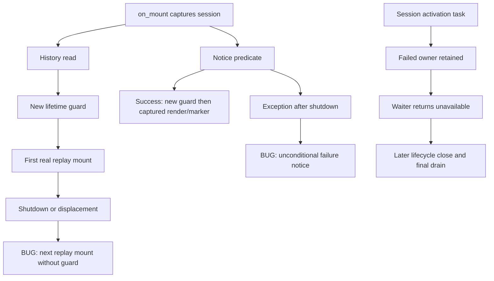

# Independent wiring re-review175 — REVISE

**The three R173 findings are not fully resolved.** The original successful startup-predicate continuation is corrected, the three fixture annotations are corrected, and most requested session contracts are present. However, independent probes reproduce late replay and late failure-notice rendering; the audit regression tests bypass the discovery path they claim to protect; and activation documentation incorrectly promises cleanup on ordinary failed activation.

**Accounting: turn6, global dispatch175.** Review partition only; no fixes, commits, delivery or completion assessment. No sub-agents dispatched. CORE172 acceptance is preserved; harness/static partition, full-review synthesis and fresh Completion remain pending. Live remains **USER-DEFERRED**, compatibility **UNVERIFIED**, security132 **separate/open**.

## Scope, environment and preservation

Read the authoritative R173 report and preserved probes, author174 claim, routing, scope-plan, gates171, core172, final-code-status and conventions159. Read root RESEARCH and supplied AGENTS/CLAUDE/docs RESEARCH; consulted KB Welcome, actual slo/README and gotchas read-only. Applied checkout review-feature-code, engineering-review/routing/ownership/testing, Python code-review-rules/root/types/docstrings/declarative guidance, shared declarative guidance, Textual and Typer skills, and the exact Code-Test-Review workflow Step2. Reference-only C7.13/C7.14 and D lifetime/acceptance framing govern this bounded scope. No specification or KB changes.

Stack: Python3.11.7, asyncio, Pydantic, Textual, existing session/headless callers. Evidence categories: deterministic orchestration, real temporary history storage, mounted Textual/Faux, and temp-only synthetic Git repositories. No new framework, lifecycle manager or thread-cancellation policy is warranted.

Verified first: cwd `/root/Code/slo-94-herdr-integration/slo`; `pyenv which python` → `/root/.pyenv/versions/slo-harness/bin/python`; `pyenv exec python --version` → Python3.11.7; `make test-env` → fallback. [Runner](review-wiring-175-receipts/run.sh) pins that interpreter and uses only the tracked synthetic fallback exports plus `PYTHONPATH=$PWD`. No development environment sourced or full environment printed. Root pre-import isolation, registered regular-file/device/inode/nlink Herdr guard and terminal blocker were inspected and left intact. No real provider/Herdr/pane/window used. Every execution below has a silent, exit0 `dpkg -V coreutils` receipt.

[Input reconciliation](review-wiring-175-receipts/inputs.log) independently verifies all **1066 current174 hashes**, not merely the author’s summary. Relative to171: exactly three changed inputs (`src/tui/app.py`, `sessions/service.py`, `tests/cli/test_headless.py`), two added test modules, no removals. All seven core production files and existing guard/cutoff test files retain171 hashes. Accepted CORE172 transport/store/lease adjudication is not reopened by these wiring findings. Only this report and its receipt directory were authored; existing source/tests/probes remain unchanged.

## Requirement-to-evidence map

| Finding / requirement | Independent result | Evidence |
|---|---|---|
| R173-1 successful notice predicate: captured owner, no late lines/marker | **Resolved subcase** | `app.py:771–813` captures session, checks after predicate before synchronous rendering and captured marker call; permanent closing/displaced tests pass |
| R173-1 replay history-read → first mount cutoff | **Resolved subcase** | `app.py:721–727`; permanent read-boundary closing/displaced cases pass |
| R173-1 every subsequent real await / failure continuation | **Not resolved** | `app.py:730–733` and `625–626`; three independent deterministic failures below |
| R173-1 preserved RED probe must pass | **Not met; obsolete observation assumption** | Unmodified probe exits1 at its line66 metadata read; no metadata exists. This is not evidence of the old late-marker bug, and is not a passing test |
| R173-1 ordinary startup, replacement attribution, storage preservation | **Supported, with coverage limits** | Nine permanent tests and533 surrounding tests pass; already-admitted marker test does not exercise public shutdown or an already-running storage thread |
| R173-2 three new headless fixtures, no sweep | **Resolved exactly** | Independent125-definition audit clean; reversing only three annotations/signature wrapping in memory reproduces171 file hash exactly |
| R173-2 audit product-relative discovery and missing candidates | **Implementation corrected** | `audit.py:59–75` uses `--relative`, fails missing `.py` candidates; real audit1554 clean |
| R173-2 genuine nested-cwd discovery regression | **Not resolved** | All three regression tests pass with tracked discovery removed from a temp copy; fixture includes tested path in explicit `owned` inventory |
| R173-3 close outcome/caching/cancellation/final retention | **Resolved** | In-place contract at `service.py:2571–2607`; lifetime tests assert independent dimensions, exact cached object, cleanup continuation, persistent retained pending state; headless retained tests preserve owner |
| R173-3 attention and per-gateway source authority | **Resolved in substance** | `permits_commit:515–552`; attention methods2460–2508; matching-token/operation precedence and mutation/capture tests pass |
| R173-3 activation contract matches actual behavior | **Partially resolved** | Mode/disabled/join-before-cancel documented; ordinary failure incorrectly says waiter joins cleanup at2391–2393; independent two-mode observation proves no close task/call on return |

## Remaining findings — Glaring Gaps (Medium)

### R173-1 remains open: hydration and error continuations still publish after cutoff

**Locations:** `src/tui/app.py:730–733` and `625–626`.

Hydration checks once after `hydrate_transcript_entries()`, then awaits every `project_replay_entry()` with no subsequent identity/closing check. Those are real async mounting operations (`transcript_projector.py:366–384`, host mounts). After the first admitted entry completes, shutdown or displacement can occur before control returns to hydration. Hydration nevertheless initiates the next entry, summary work and scrolling. The outer `on_mount` check happens too late.

The notice helper’s success return is now guarded, but an ordinary predicate/marker exception reaches `on_mount`’s unconditional failure renderer before its lifetime check. Thus a fixed failure notice still repaints after shutdown. Fixed/redacted text does not exempt it from the monotonic continuation contract.

[Independent probes](review-wiring-175-receipts/test_review_boundaries.py) keep the real seeded history and real projector. An Event pauses the return of the first completed real mount. Public `on_unmount()` completes in the closing case; the other case displaces the selected session. Both then initiate the assistant replay entry. A separate probe completes the real notice predicate read, waits for public shutdown and raises an ordinary OSError; the app renders its fixed failure line.

Actual [output](review-wiring-175-receipts/independent-boundaries.log):

```text
late_replay_entries closing ['assistant']
late_replay_entries displaced ['assistant']
late_failure_lines ['Session startup notice unavailable.']
3 failed, 3 passed, 2 warnings in 2.45s
```

**Correction required:** use the existing captured-owner predicate after each relevant replay await and before subsequent rendering/mount/summary/scroll effects; guard the startup failure-rendering continuation too. Inspect the actual nested mount continuations when defining admitted versus new effects. Preserve already-admitted storage/mount work; do not cancel filesystem threads or add a second lifecycle owner. Add permanent closing/displaced and ordinary-failure cases at these boundaries while retaining all current assertions.

**Preserved probe qualification:** the exact original probe was rerun unchanged. It now fails at `independent-review-wiring-173-receipts/test_startup_cutoff_probe.py:66` because `read_metadata()` requires a file that the corrected code rightly never creates:

```text
FileNotFoundError: No persisted session metadata at .../session.json; call ensure_session first.
1 failed, 2 warnings in 2.02s
```

Its final no-late-lines assertion is not reached. Do not “fix” production by creating metadata after shutdown to make this probe green. Retain the historical file/output and provide an explicitly identified corrected observation that accepts absent metadata, asserts no marker and no late lines. The requested unchanged passing-probe gate is not satisfied; this report does not silently substitute the permanent test for it.

### R173-2 remains open for regression quality, not annotations or the repaired enumeration

**Locations:** `tests/implementation_checks/test_conventions_audit_paths.py:41,85–125`; audit `audit.py:65–78`.

`_init_nested_repo` explicitly puts `src/tracked.py` in `files.txt`. The audit unions `owned + new + changed`, and owned candidates are checked without base comparison. Both alleged tracked-discovery tests therefore find their subject even when Git discovery is completely absent. The missing-path test genuinely covers an owned missing candidate, not a missing Git-discovered one.

**Independent sensitivity proof:** a review-only copy in the pytest temp root replaced the entire `changed = subprocess.check_output(...).splitlines()` expression with `changed = []`. All three original test functions still passed unchanged. The product audit and repository were not modified. The three PASS cases in `independent-boundaries.log` explicitly report this surviving mutant; they are evidence of weak regression sensitivity, not product correctness.

**Correction required:** use a separate tracked file absent from `files.txt` and absent from the untracked set. Add its new definition after the base commit, run from the nested product cwd, and assert discovery, failure for untyped and success for typed definitions. Preserve the missing-candidate case. Verify the discovery tests reject both omitted discovery and root-relative path regression. No annotation sweep or weakened assertions needed.

The actual repair is sound in its finite scope: independent signature audit reports25 paths/125 definitions clean; repaired159 audit checks1554. Exact inverse-hash reconstruction proves **only the three requested headless definitions changed**, including wrapping of the first signature. Author174’s statement about two additional pre-existing signature wraps is not supported by the retained171 bytes; it is not grounds to undo correct annotations.

### R173-3 remains open for a misleading activation lifetime promise

**Location:** `src/agents/slo_agent/sessions/service.py:2391–2393` (related comment2446–2451).

The new public doc says failed activation retains the partial owner and “the public waiter still joins the same cleanup.” Actual ordinary-failure flow is `_start_herdr_once` catch → mark uncertain/unavailable → return; `start_external_reporting` only calls `close_external_reporting` when its waiter was cancelled. A noncancelled failed start returns with **no close task and no reporter-close call**. Retention is intentional; cleanup belongs to a later lifecycle finalizer. Promising cleanup completion here can cause a caller to discard the retained owner.

[Independent contract observation](review-wiring-175-receipts/test_activation_contract.py) covers both first-call modes and an opposite-mode repeat. It proves the mode stays pinned, owner retained, destination unavailable, uncertainty set, `_herdr_close_task is None` and `reporter.close` uncalled until explicitly invoked. **2 passed**, with `failed_start_returned_without_cleanup False/True True` in the log. Existing `test_actual_factory_fault_retains_owner` likewise explicitly closes *after* failed start returns.

**Correction required (documentation, not runtime redesign):** distinguish joining activation from closing its retained owner. State that ordinary failed activation returns unavailable and requires later close/final drain; cancelled waiters join activation then run the close gateway before cancellation escapes. Also qualify “only the first call” as the **first eligible activating call**: disabled calls allocate nothing and do not pin a mode. `HERDR_ENV != "1"` is the actual inactive predicate, not merely unset; publication can occur inside activation before its waiter returns. Align narrative timing with those facts.

The close contract’s two dimensions, sticky failure evidence, repeated-call cache, caller final-drain duty, attention matching-only semantics and per-field commit permissions are materially improved and agree with inspected/tested behavior. No wrapper or competing owner was introduced. This finding does not reopen CORE172 docs or resource semantics.

## False-confidence assessment

- Permanent notice cases exercise a real predicate read and public shutdown, plus displacement. They genuinely close the original successful-predicate race. All old cutoff assertions are unchanged by manifest evidence.
- Permanent hydration cutoff cases stop at the **history read** and replace the projector with a recorder. They cannot detect a cutoff between real replay mounts. The new independent real-projector probes do.
- Hydration and marker tests set `_app_closing` directly (`test_startup_notice_cutoff.py:223,288`). The marker barrier is before calling the real marker method, not within a running filesystem write. It proves an admitted coroutine continues, not that public shutdown retains/joins a running storage operation.
- Open history/memory tests prove one mount’s two lines and marker. Existing `test_startup_notice.py` additionally proves resume suppression; replacement test proves ordinary successor attribution, not an interrupted replacement-marker race.
- The independent125-definition audit is genuine finite tracked-wiring evidence, but cannot certify new untracked test typing or all public docs. The new test has a bare `list` return at207 and two type-ignore comments at95/187; author174’s blanket “no ignores added” claim is inaccurate. Do not equate green configured mypy with complete convention evidence.
- Full174 receipts are author evidence, not independently rerun here. Current hashes are verified; this bounded review does not certify the separate harness/static partition or infer broad acceptance from counts.

## Executable evidence

All commands run from the product cwd through `bash docs/implementation/94-herdr/review-wiring-175-receipts/run.sh <label> ...`. Each label has the expanded `.command`, full `.log`, actual `.exit`, `.coreutils` and `.coreutils.exit`. Every coreutils file is empty, exit0. Warnings are retained, not suppressed.

| Label | Exact command after runner | Result |
|---|---|---|
| preserved-probe | `python -m pytest -q -s -p tests.conftest docs/implementation/94-herdr/independent-review-wiring-173-receipts/test_startup_cutoff_probe.py` | **1 failed**, exit1; missing metadata observation |
| permanent | `python -m pytest -q tests/tui/test_startup_notice_cutoff.py tests/implementation_checks/test_conventions_audit_paths.py` | **12 passed**, exit0 |
| signatures | `python docs/implementation/94-herdr/independent-review-wiring-173-receipts/signature_audit.py` | **125 clean**, exit0 |
| surrounding | `python -m pytest -q` with exact15-module list in `surrounding.command` | **533 passed,106 warnings,185.56s**, exit0 |
| independent-boundaries | `python -m pytest -q -s -p tests.conftest docs/implementation/94-herdr/review-wiring-175-receipts/test_review_boundaries.py` | **3 failed/3 passed**, exit1; replay/failure defects and audit sensitivity |
| repaired-audit | `python docs/implementation/94-herdr/conventions-revision-159-receipts/audit.py` | **1554 clean**, exit0 |
| activation-contract | `python -m pytest -q -s -p tests.conftest docs/implementation/94-herdr/review-wiring-175-receipts/test_activation_contract.py` | **2 passed**, exit0; documented cleanup promise disproved |
| inputs | `python docs/implementation/94-herdr/review-wiring-175-receipts/verify_inputs.py` | **1066 matching hashes**, exact three-signature inverse matches171; exit0 |

Surrounding modules: TUI startup_notice, replay_resume, herdr_activation_cutoffs, herdr_activation, herdr_session_lifecycle, herdr_replacement, app; Herdr session_lifetime, session_attention, attention_boundary_closure, session_mutation, session_capture; CLI headless, headless_herdr, headless_retained. No full suite/static rerun or live acceptance claimed. `git diff --check` was silent.

## Flow and convention review



Hard-rules post-hook: meaningful typed headless fixture boundaries now comply; no new production signature ambiguity, wrapper, alias, manager or thread-cancel shortcut. Existing instance-owned lifecycle transactions remain appropriate. Captured `session` identity flows through the notice success path; hydration does not consistently enforce that identity after mounts. `replacement` and `resources` remain distinct; attention token and operation token are not conflated. No CLI parse/assembly, graph topology, styling, database/API or Vue changes are in this delta.

### Three-tier summary

1. **Glaring Gaps:** Medium R173-1 remaining runtime cutoffs; Medium R173-2 insensitive regression; Medium R173-3 misleading activation cleanup contract. No Critical/High defect demonstrated in this bounded partition.
2. **Nice-to-Haves:** tighten the new replay helper to `list[TranscriptEntryDAO]`; replace avoidable new type ignores with typed test seams; correct author scope/ignore claims. Strengthen marker ownership evidence at public shutdown/real storage boundary without changing admitted-work semantics.
3. **Acknowledged limits:** persistent retained resources intentionally keep final teardown pending; no live Herdr/restart/pane/paint certification; no global tool-event redaction claim. Prior173 low-priority renderer wording is not recertified or expanded here.

## Required handoff

- [ ] Correct remaining replay and failure-notice continuations in the existing owner; preserve admitted work and old assertions.
- [ ] Make nested-cwd audit tests depend on Git discovery and prove their sensitivity.
- [ ] Correct activation contract wording to match retained-owner/finalizer behavior.
- [ ] Keep historical probe intact; explicitly reconcile its absent-metadata observation and obtain valid passing no-late-effects evidence rather than creating metadata after shutdown.
- [ ] Rerun affected gates and independently re-review the bounded corrections.
- [x] CORE172 acceptance preserved on unchanged core inputs.
- [ ] Harness/static partition, full-review synthesis, then separate fresh Completion remain pending.

**REVISE — bounded wiring re-review only. No completion increment or delivery approval.**
