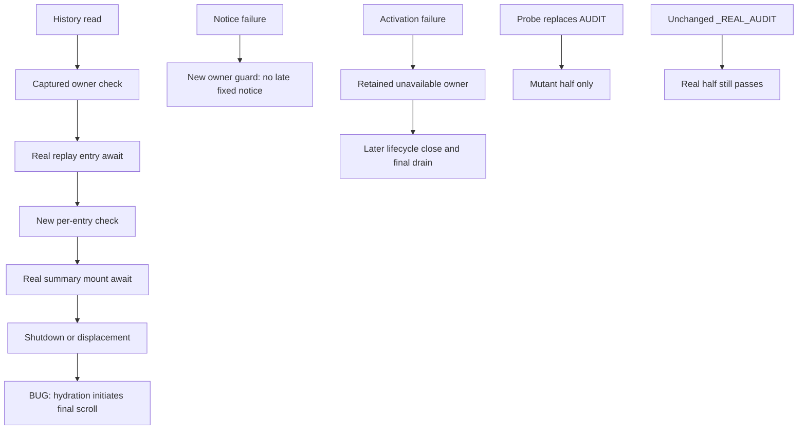

# Independent bounded wiring re-review178 — REVISE

**Two residuals remain: R173-1's final replay-scroll continuation and R173-2's claimed independent sensitivity gate. R173-3's activation contract is resolved.** All requested ordinary executions are green, but their counts do not prove all three requirements. Independent negative assertions reproduce both remaining gaps.

Accounting: **turn6, global dispatch178**. Review only: no implementation/test fixes, commits, push, delivery or completion assessment; no sub-agents. **CORE172 acceptance is preserved on unchanged core inputs.** Harness/static partition, full-review synthesis (R155-2), and fresh Completion remain pending. Live **USER-DEFERRED**; compatibility **UNVERIFIED**; security132 **separate/open**.

## Scope and environment

Reviewed CURRENT worktree, not just the committed snapshot. First read-only checks confirmed cwd `/root/Code/slo-94-herdr-integration/slo`, `pyenv which python` = `/root/.pyenv/versions/slo-harness/bin/python`, Python **3.11.7**, `make test-env` = **fallback**, HEAD `c2f9e562b5b0ad5b3f4592715d205bfaf756893d`. The turn177 audit-test edit was already uncommitted; it was not reverted, amended or staged. Existing turn176 runner/receipt changes and untracked author artifacts were preserved. No MR or external state was changed or inspected.

Read required173/175 reviews,174/176/177 author receipts, routing, scope-plan and core172; supplied AGENTS/docs RESEARCH plus root RESEARCH/Makefile, KB Welcome and actual slo/README/gotchas. Applied checkout review-feature-code, engineering review/routing/ownership/testing, Python review/root/types/docstrings/declarative guidance and Textual guidance. Python asyncio/Textual lifecycle and temporary-filesystem/Git test evidence only; no database/API, new CLI, graph or styling redesign.

[Runner](review-wiring-178-receipts/run.sh) pins the approved interpreter and tracked synthetic fallback plus `PYTHONPATH=$PWD`. Root pre-import isolation, registered fake-only Herdr spawn guard and terminal blocker were inspected and remain intact. No development env sourced, full env printed, real provider/Herdr/pane/window used, package/global/system modification made. Every execution has a silent, exit0 `dpkg -V coreutils` receipt. Only this report and `review-wiring-178-receipts/` were authored (test caches incidental).

[Input reconciliation](review-wiring-178-receipts/inputs.log): all seven core production paths retain171 hashes; every171 manifested input except the already-known session/app/headless corrections matches. Relative to174, only session service, app, startup-cutoff tests and audit-path tests differ. Current app/session/startup tests, audit implementation, root guards and historical probes match HEAD. The audit-path test is the pre-existing uncommitted177 revision. Core172 is not reopened. These checks do not recertify the separate full harness/static partition.

## Requirement-to-evidence map

| Residual requirement | Status | Independent source/test evidence |
|---|---|---|
| R173-1 recheck after each replay entry | Resolved | `app.py:737–740`; real-projector closing/displaced probes pass; permanent tests retain real seeded history and require exactly one admitted mount |
| R173-1 failure-render continuation checks captured owner | Resolved | `app.py:625–632`; guard inside `except`; real predicate + public-shutdown ordinary OSError probe passes |
| R173-1 no post-cutoff summary/scroll continuation | **Partial** | Check before summary is effective, but `app.py:741–742` awaits summary then starts scroll without another check; two new deterministic failures |
| Historical173 probe preserved; valid absent-metadata observation | Resolved | Historical file SHA256 `2002fdea202b981734fe87fd27211936478b741c3b92fcb78f0b45131dff5dc5`, byte-identical HEAD. Explicit corrected observation `test_hydration_cutoff_accepts_absent_metadata_without_late_effects` accepts absent metadata and asserts no marker AND no late lines |
| R173-2 subject reachable only via tracked discovery | Resolved in fixture construction | `test_conventions_audit_paths.py:172–204`: separate `src/tracked_after.py`, created/committed after base, absent owned/untracked, clean src/tests index and present relative diff asserted |
| R173-2 missing candidate and repair intact | Resolved | New committed relative dangling link remains temp-contained and outside owned/untracked channels; `audit.py:59–75` retains `--relative` and fail-on-missing;1574 definitions clean |
| R173-2 all three regressions reject the preserved independent mutant | **Not met** | `_REAL_AUDIT` bypasses patched `AUDIT`; unchanged historical probe explicitly reports all three regressions **passed** with discovery removed. New rejection oracle fails3/3 on that seam |
| Three headless fixture annotations | Preserved | Independent finite25-path/125-definition signature audit clean |
| R173-3 ordinary failed activation retains owner without closing | Resolved | `service.py:2382–2468`; new WHAT text matches actual catch/return and both interactive modes in independent contract test |
| R173-3 eligible first call, inactive predicate, cancellation and publication | Resolved in substance | First task-creating call pins mode; `HERDR_ENV != "1"`; cancelled waiter joins then closes; successful publication inside `_start_herdr_once` documented |
| Existing close dimensions/caching/final drain | Preserved | `service.py:2598–2665` plus lifetime/headless retained surrounding tests; no new runtime change requested |

## Glaring Gaps — Medium

### R178-1 / R173-1: final scroll is still initiated after the summary await crosses cutoff

**Where:** `src/tui/app.py:741–742`; real nested mount at `3147–3166`.

The per-entry guard is correctly placed and closes the original late assistant-entry defect. It also prevents entering summary work after a cutoff observed at the last entry. But `_update_earlier_summary()` itself awaits a real Textual mount/removal. After that await, hydration unconditionally calls `_scroll_transcript_to_end()`. A check before the summary is not a check before this later scroll.

**Independent reproduction:** [test_residuals.py](review-wiring-178-receipts/test_residuals.py) seeds a complete two-entry turn through the real store, sets the existing hydration limit to1 to require a real earlier-summary mount, executes that real method and verifies its widget is mounted. An Event holds its return; public `on_unmount()` completes, or selected session identity is displaced, before release. The observer delegates to the real scroll and attributes only calls directly from hydration (excluding framework callbacks):

```text
late_scrolls_after_summary closing ['_hydrate_transcript_from_history']
late_scrolls_after_summary displaced ['_hydrate_transcript_from_history']
```

Both no-late-scroll assertions fail. The initial broader observer saw two late calls per case; the attributed rerun isolates one initiated by this exact production continuation. Both logs are retained. This is not cancellation of an already-admitted summary/mount: it is a new scroll initiated after its completion. No provider or remote effect is claimed.

**Required correction:** revalidate the existing captured-owner predicate after the summary await and before initiating scroll. Preserve admitted summary/mount work and existing lifecycle ownership; no new manager or filesystem-thread cancellation. Add permanent closing/displaced coverage at this final await and explicit summary/scroll observations; retain all current startup/replay assertions.

**Why existing green tests miss it:** permanent per-entry cases stop after the first of two entries. They assert `calls == 1` and `late_entries == []`, but never observe summary/scroll. The176 report's claim that those tests assert no summary/scroll is stronger than their actual assertions. The13 permanent tests and three original runtime probes genuinely prove their respective earlier boundaries, not this last one.

### R178-2 / R173-2: independent sensitivity result is inverted, and the test source bypasses its mutation seam

**Where:** `tests/implementation_checks/test_conventions_audit_paths.py:34–44,60–77,241,264,321`; preserved observation probe `review-wiring-175-receipts/test_review_boundaries.py:111–132`.

The historical probe is an **observation of surviving tests**, not a mutation-killing oracle. It patches `AUDIT`, calls the regression directly, then prints `existing audit regression passed with tracked discovery removed`. It contains no `pytest.raises(AssertionError)` around that call. Therefore its green cases cannot mean the regressions failed under the mutant. The user-requested phrase “probe goes GREEN3/3” and the author's interpretation conflict with the preserved probe's actual semantics; this report uses the required behavior, not that misleading color.

Turn177 adds `_REAL_AUDIT = AUDIT` and makes every real half use that alias. Patching `AUDIT` now only redirects the intentionally-mutant half. `_write_sensitivity_mutant` accepts an already stripped source (count0), so the pair still observes real behavior from the original file and expected mutant behavior from the replacement. This explicitly prevents the independent probe from mutating the audited real half.

Actual requested unmodified run:

```text
existing audit regression passed with tracked discovery removed: untyped
existing audit regression passed with tracked discovery removed: typed
existing audit regression passed with tracked discovery removed: missing
6 passed, 2 warnings
```

The three runtime cases are valid green evidence. The three sensitivity cases are **survivals**, not kills.

**Independent discrimination:** a new review-only oracle requires each regression to raise under removed discovery. With only historical `AUDIT` redirected, all3 fail with `DID NOT RAISE AssertionError`. With **both** `AUDIT` and `_REAL_AUDIT` redirected to the same temp mutant, all3 pass the rejection oracle. This is important positive evidence: the strengthened counts/missing-path assertions genuinely detect loss of discovery when the tested source is actually replaced. Do not misreport the implementation as still insensitive to an on-disk audit regression, or discard those useful assertions. The remaining gap is the bypassed independent test seam and false acceptance claim.

**Required correction:** retain one explicit source-under-test path for ordinary regressions; separate normal assertions from any real-versus-mutant comparison test so mutation cannot silently fall back to an unmutated source. Preserve the historical probe. Add an explicitly identified rejection oracle that expects each ordinary regression to fail under `changed=[]`, and correct176/177's survival-as-rejection claims. Also verify removal of `--relative` with the repaired missing-path behavior rather than treating root-relative names and an empty discovery list as literally identical mutants. Keep audit.py unchanged, all channel assertions and signature fixes; no Any/ignores/waivers.

The missing-link fixture is genuinely tracked and committed after base and its fixed inventory excludes it. Unlike the ordinary subject, it does not explicitly assert absence from `files.txt`; adding that precondition would make the claim directly executable. This is a minor strengthening, not the causal reason for the failed gate.

## R173-3 resolved — activation is not cleanup

The current docstring distinguishes joining activation from closing its retained owner. Ordinary failure returns with `destination=unavailable`, sticky uncertainty, retained reporter, no close task/call; later finalizer owns close/final drain. Cancellation joins activation then invokes close before escaping. First **eligible activating** call pins interactive mode; disabled calls allocate nothing. The actual environment predicate and publication inside activation are explicit.

The independent2-case test observes both initial interactive values, an opposite-mode repeat, retained owner identity, unavailable destination, uncertainty, absent close task and uncalled reporter.close; explicit later close then calls it once. Both pass. Existing lifetime/attention/headless tests passed in the533 surrounding run. Correct close-outcome dimensions, cached task/result, uncertainty and retained final-drain contracts are not reopened.

Minor wording remains at `service.py:2407–2409`: WHEN says “before any publication” while WHAT correctly permits publication during activation. Read as entry timing this is consistent, but “before initial publication, which may occur within this call” would remove ambiguity. Not a blocker and not a reason to change runtime.

## Executed evidence

Each label below has expanded `.command`, full `.log`, actual `.exit`, `.coreutils` and `.coreutils.exit` under [review-wiring-178-receipts](review-wiring-178-receipts/). Every integrity output is empty and exit0. Warnings are retained. Cwd and fallback are as above.

| Label | Command after runner | Actual result |
|---|---|---|
| boundaries | `python -m pytest -q -s -p tests.conftest docs/implementation/94-herdr/review-wiring-175-receipts/test_review_boundaries.py` |6 passed,2 warnings; **3 runtime passes + 3 mutant survivals**, exit0 |
| audit-tests | `python -m pytest -q tests/implementation_checks/test_conventions_audit_paths.py` |4 passed,2 warnings, exit0 |
| signatures | `python docs/implementation/94-herdr/independent-review-wiring-173-receipts/signature_audit.py` |25 paths/125 definitions clean, exit0 |
| activation | `python -m pytest -q -s -p tests.conftest docs/implementation/94-herdr/review-wiring-175-receipts/test_activation_contract.py` |2 passed,2 warnings, exit0 |
| startup | `python -m pytest -q tests/tui/test_startup_notice_cutoff.py` |13 passed,2 warnings, exit0 |
| surrounding | `python -m pytest -q` plus exact15-module list in receipt |533 passed,106 warnings,185.48s, exit0 |
| residuals | new review-only `test_residuals.py` via pytest/root fixtures |5 failed,3 passed,2 warnings, exit1; broad scroll observation |
| residuals-attributed | same with scroll caller attribution |5 failed,3 passed,2 warnings, exit1; two hydration scroll defects + three failed rejection expectations, three both-source mutation kills |
| repaired-audit | `python docs/implementation/94-herdr/conventions-revision-159-receipts/audit.py` |1574 checked, PASS, exit0 |
| inputs | `python docs/implementation/94-herdr/review-wiring-178-receipts/verify_inputs.py` |core/input/probe hashes reconciled, exit0 |

Surrounding modules: TUI startup_notice, replay_resume, herdr_activation_cutoffs, herdr_activation, herdr_session_lifecycle, herdr_replacement, app; Herdr session_lifetime, session_attention, attention_boundary_closure, session_mutation, session_capture; CLI headless, headless_herdr, headless_retained. Counts overlap with other receipts; do not sum as unique coverage. No full-suite/static partition or live gate rerun claimed. `git diff --check` was silent.

## False-confidence and convention assessment

- Preserved173 probe's metadata-existence assumption remains obsolete; no attempt was made to make production create metadata after shutdown. Current corrected test accepts absence via `_marker_written` and separately asserts no late lines and no runtime task. Historical source remains unchanged; old failure is not relabeled a passing run.
- Current permanent tests retain previous assertions for notice success, displacement, history-read cutoff, open memory/history paths, replacement attribution and admitted marker continuation. Typed replay return and typed seed tuples improve174; the earlier method-assign ignore remains, not newly introduced by176/177. No new Any/ignore or audit configuration weakening found in this bounded delta.
- Real projector/store tests are stronger than recorder-only tests. They still need the final summary-await boundary; a green test cannot prove assertions it never makes.
- Mutation testing requires both reaching the mutant and rejecting it. `_REAL_AUDIT` defeats the first half of that proof at the preserved seam. The new both-binding control proves the underlying assertions have improved; this review does not erase that progress.
- Signature125 is a finite lexical audit, not full static/documentation certification. Audit1574 is a separate bounded tool. Neither count establishes full-review synthesis.
- Hard-rules pass: typed captured-owner guards fit the existing app owner; no new lifecycle wrapper, reverse dependency or thread cancellation. Domain vocabulary remains stable: captured `session`, `interactive`, `destination`, `replacement` and `resources` keep their distinct meanings. Test claims and actual mutant semantics diverge as R178-2; final continuation authority remains missing as R178-1. No new styling/CLI/API/graph rule applies.



## Three-tier findings and handoff

1. **Glaring Gaps / Medium:** R178-1 final replay-scroll cutoff; R178-2 independent mutation-seam bypass and false sensitivity claim. No Critical/High defect demonstrated in this bounded partition.
2. **Nice-to-Haves / Low:** clarify activation WHEN wording; assert missing-link owned-inventory exclusion explicitly; retain175's distinction between admitted-marker coroutine evidence and an already-running filesystem-thread proof. No expansion into new runtime ownership work.
3. **Acknowledged limits:** live USER-DEFERRED, compatibility UNVERIFIED; security132 separate/open; no global redaction certification; retained-resource pending shutdown remains intentional. Broad author gates are not independent acceptance.

Required next actions: correct the final continuation in its existing owner; obtain genuine mutant rejection with a single explicit source-under-test and honest receipts; rerun affected gates and independently re-review. Preserve CORE172 and all already-resolved subcases. Harness/static partition, full-review synthesis and separate fresh Completion remain pending.

**REVISE — bounded wiring re-review only. No completion assessment or delivery approval.**
