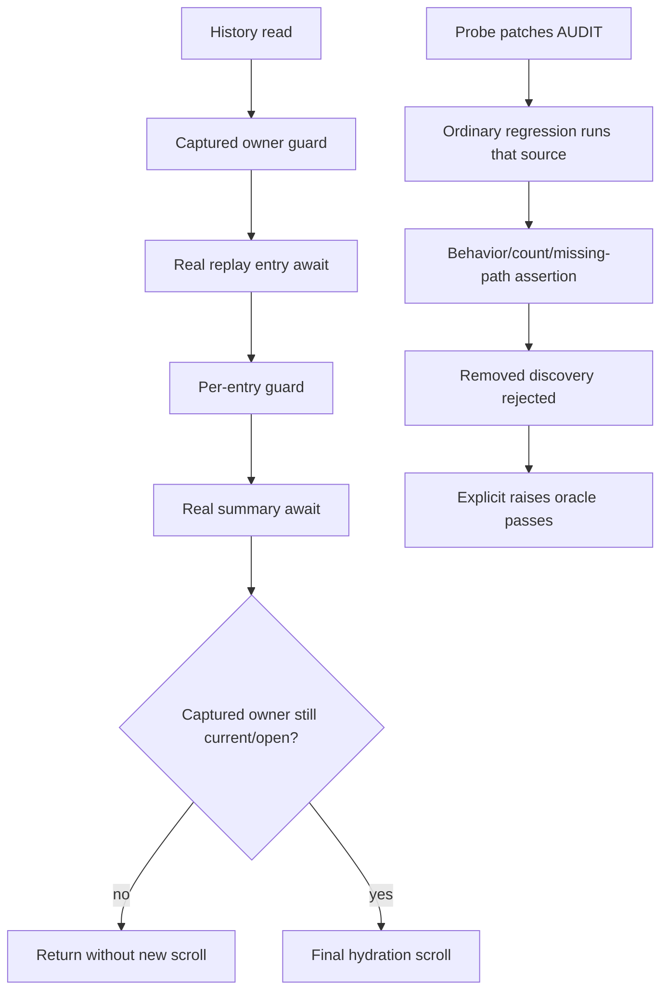

# Independent bounded wiring re-review180 — READY

**R178-1 and R178-2 are resolved in the CURRENT working tree. No blocking regression was found in this bounded wiring re-review.** The final hydration scroll now revalidates its captured owner after summary completion. Ordinary audit regressions now consume the patchable source, and independently executed mutation observations prove rejection rather than survival.

Accounting: **turn6, global dispatch180**. Review only: no production or permanent-test fixes, no commits/push/MR, no delivery and no completion assessment. No sub-agents. **CORE172 acceptance is preserved.** Harness/static partition, full-review synthesis (R155-2), and fresh Completion remain pending. Live **USER-DEFERRED**; compatibility **UNVERIFIED**; security132 **separate/open**. READY here is not whole-feature approval.

## Scope, authority and environment

Initial read-only checks confirmed `/root/Code/slo-94-herdr-integration/slo`, `pyenv which python` → `/root/.pyenv/versions/slo-harness/bin/python`, `make test-env` → `fallback`, HEAD `c2f9e562b5b0ad5b3f4592715d205bfaf756893d`. The runner additionally verified Python **3.11.7**. Existing uncommitted app/audit-test/startup-test changes and all prior receipts were preserved; commit boundaries were not used as a substitute for current source inspection.

Read authoritative178, prior175/173, author174/176/177/179, routing, scope-plan and core172; supplied AGENTS/docs RESEARCH plus root RESEARCH and Makefile. Consulted KB Welcome, actual slo/README (no index.md) and gotchas read-only. Applied checkout review-feature-code, engineering review/routing/ownership/testing, Python code-review-rules/root/types/docstrings/declarative guidance and Textual guidance. Specific project lifecycle ownership takes precedence over generic wrapper/extraction examples. Scope is Python asyncio/Textual startup and temporary-filesystem/Git audit evidence, not a new CLI/API/graph/styling feature.

Fresh reading covered the complete current audit test module, startup-cutoff module, historical175/178 probes and activation/signature probes, audit implementation, app startup/hydration/predicate/summary bodies, real projector entry, session activation/close bodies and relevant retained-drain test assertions. Prior173/178 broader wiring adjudication is reused, not represented as a fresh whole-file or whole-feature audit.

[Runner](review-wiring-180-receipts/run.sh) pins the approved interpreter with VIRTUAL_ENV/PATH/PYENV_VERSION and exports only the tracked synthetic fallback plus `PYTHONPATH=$PWD`. No development env was sourced or full env printed. Root pre-import isolation, registered temp-file-only Herdr spawn capability and terminal blocker were inspected and left intact. No real provider/Herdr/pane/window or system/package/global changes. Synthetic Git fixture commits occur only in pytest-owned repositories, never this checkout. Every execution has a silent, exit0 `dpkg -V coreutils` receipt. Only this report and `review-wiring-180-receipts/` were authored; test caches are incidental.

## Requirement-to-evidence map

| Requirement | Status | Current source and independent evidence |
|---|---|---|
| R178-1 summary → final scroll cutoff | **Resolved** | `src/tui/app.py:743–746`: await summary → captured `_runtime_may_start(session=session)` → return or scroll, with no intervening await. Historical178 closing/displaced probes both pass with empty late-scroll lists. |
| R178-1 permanent actual-boundary coverage | **Resolved** | `tests/tui/test_startup_notice_cutoff.py:479–588`: real seeded two-entry history, real projector, limit1, real summary method with mounted-widget assertion before barrier, public shutdown or displacement before return; hydration-attributed late AND admitted scroll lists empty. Separate open control observes exactly one hydration scroll. |
| Earlier successful-predicate, failure-render and per-entry guards | **Preserved** | `app.py:625–632,740–742,787–797` retain their checks; permanent startup16 and historical175 runtime3 pass. AST comparison proves all12 previous top-level helper/test function bodies unchanged (13 parametrized tests). |
| R178-2 single patchable source-under-test | **Resolved** | Audit tests `:258–281,315–331` use `source=AUDIT`; `_REAL_AUDIT` at75 has no executable reader and exists only for the unchanged178 probe's contrast. No ordinary regression calls mutant helpers. |
| Separate normal assertions and comparisons | **Resolved** | Normal assertions at240–281/315–331; distinct mutation comparisons at363–428 use explicitly materialized paths. No fallback to unmutated source. |
| Explicit rejection oracle for all ordinary regressions | **Resolved** | `:334–360` patches `sys.modules[__name__].AUDIT`, calls each ordinary regression under `pytest.raises(AssertionError)`. Historical178 six cases pass with either AUDIT alone or both names redirected. |
| Historical175 mutation reaches source and is rejected | **Resolved** | Unchanged probe has **3 failed/3 passed**, exit1: three intended assertion failures, not setup failures; three runtime cases pass. Exact failure analysis below. |
| Distinct removed-`--relative` mutation | **Resolved** | `:96–110,363–428` removes flag only, retains discovery, observes root-relative MISSING subject/link and count1. `changed=[]` instead hides subject/link. Both comparisons pass. |
| Channel preconditions and missing-path coverage | **Preserved/strengthened** | Subject committed after base, absent owned/untracked, clean src/tests and present relative diff asserted; missing-link owned exclusion now explicit at302. Owned missing path remains asserted. |
| audit.py byte identity and actual repair | **Preserved** | SHA256 `552eddbf1f99819bb33a7f7da171851c902fce36f3f331b5dd2aab6a28aa1d42`, identical HEAD and179 before/after. `:59–75` retains relative enumeration/fail-on-missing. Fresh execution:1583 checked, PASS. |
| R173-2 three fixture annotations | **Preserved** | `tests/cli/test_headless.py:166–168,195,230` retain `tmp_path: Path`; byte-identical HEAD. Independent signature audit:25 paths/125 definitions clean. |
| R173-3 activation contract | **Preserved** | `sessions/service.py:2382–2468` distinguishes ordinary failure retention from cancelled-waiter close, first eligible mode and publication inside activation. Independent two-mode contract test passes. |
| Close dimensions, caching, final drain | **Preserved** | Entire session file byte-identical HEAD. `:2598–2675` retains independent replacement/resources and fresh evidence per cleanup gateway. Surrounding lifetime tests retain exact cached identity, sticky uncertainty, pending retained owner, independent final evidence and cancellation assertions. |
| Accepted core partition | **Preserved** | All seven core production files match171 manifest hashes used by172. No core correction or reopening requested. |

## Causal verification

### R178-1: final continuation, not cancellation of admitted work

The real earlier-summary body (`app.py:3152–3171`) can await mounting or removal. The new check is **after** that await and **before** the next effect. It uses the session captured before the history read, so both irreversible closing and displacement reject the continuation. It neither cancels an admitted summary mount nor adds a lifecycle owner.

Independent unchanged178 output:

```text
late_scrolls_after_summary closing []
late_scrolls_after_summary displaced []
8 passed, 2 warnings
```

Permanent tests do not substitute a recorder for the projector or summary. The wrapper awaits the real summary and verifies it is mounted before exposing the cutoff barrier. The observer delegates to the real scroll and walks past mock frames to count only hydration callers. The positive control's one hydration scroll prevents a vacuous result from an observer that sees no calls. Existing read/entry/notice/marker assertions remain unchanged. This proves the identified final continuation, not every Textual repaint callback or a new guarantee that running filesystem threads can be cancelled.

### R178-2: actual rejection at the historical seam

The ordinary tests now read only `AUDIT`. Their helper receives that path explicitly, materializes it in a temp nested repository, and runs that source. The alias is not used by setup, ordinary assertions or mutation comparisons. The rejection oracle patches the actual running module object, avoiding pytest import-name aliasing.

The historical175 probe has no `pytest.raises` around its call. Its desired behavior is therefore **red**, and it is not reported as a passing suite:

| Case | Actual failing ordinary assertion | Why this is a genuine kill |
|---|---|---|
| untyped | `:242`, `assert result.returncode != 0`, actual0 | Removing discovery hides the untyped definition; the regression rejects the audit's vacuous success. |
| typed | `:256`, expected `Checked 2`, actual `Checked 1` | A green process without examining the subject is rejected. |
| missing | `:328`, missing `src/broken_link.py` in output | The owned missing path is still reported, but loss of the independent discovered missing path is rejected. |

All three reached their intended result assertions after synthetic-repository setup/channel checks. No incidental setup failure is counted as a kill. The178 rejection oracle is green6/6 across the single-binding and both-binding variants; normal permanent regressions and comparison tests are green6/6. These independent observations close the earlier source-bypass defect and survival-as-rejection claim.

Removed discovery and removed `--relative` are not conflated: the former has no discovered candidate; the latter has nonempty repository-root-relative candidates that the repaired audit explicitly reports as missing. Source and assertions establish the distinction; no production audit mutation was made.



## Executed evidence

Every label has expanded `.command`, full `.log`, actual `.exit`, `.coreutils` and `.coreutils.exit` in [review-wiring-180-receipts](review-wiring-180-receipts/). All integrity files are empty/exit0. Counts overlap and must not be summed as unique coverage.

| Label | Execution | Actual result |
|---|---|---|
| residuals | unchanged178 `test_residuals.py`, `pytest -q -s -p tests.conftest` | **8 passed**,2 warnings,exit0 |
| boundaries | unchanged175 `test_review_boundaries.py`, same root plugin | **3 failed,3 passed**,2 warnings,exit1; exactly the3 desired mutant rejections and3 runtime passes |
| audit-tests | `pytest -q tests/implementation_checks/test_conventions_audit_paths.py` | **6 passed**,2 warnings,exit0 |
| signatures | unchanged173 `signature_audit.py` | **25 paths,125 definitions clean**,exit0 |
| activation | unchanged175 `test_activation_contract.py`, root plugin | **2 passed**,2 warnings,exit0 |
| startup | `pytest -q tests/tui/test_startup_notice_cutoff.py` | **16 passed**,2 warnings,exit0 |
| surrounding | exact15-module command in receipt | **533 passed**,106 warnings,183.04s,exit0 |
| repaired-audit | unchanged159 `audit.py` | **1583 definitions**,PASS,exit0 |
| inputs-confirmed | review-only `verify_inputs.py` | core/session/guards/probes/source bytes and old ASTs reconciled,exit0 |
| environment | interpreter/version/fallback/HEAD and `git diff --check` | expected interpreter3.11.7/fallback/HEAD; diff check silent,exit0 |

Surrounding selection: TUI startup_notice, replay_resume, herdr_activation_cutoffs, herdr_activation, herdr_session_lifecycle, herdr_replacement, app; Herdr session_lifetime, session_attention, attention_boundary_closure, session_mutation, session_capture; CLI headless, headless_herdr, headless_retained. No live or full-suite/static partition rerun is claimed. Author179's broad gate counts are not independent acceptance in this report.

### Input reconciliation qualification

All six code/test/audit/probe entries in179's final short manifest match current bytes. Session/headless/guards and historical173/175 probes also match HEAD. All12 previous startup helper/test ASTs are unchanged; only two top-level tests (three parametrized cases) were added.

The initial `inputs` execution exited1 because179's final manifest still lists **pre-correction** hashes for176/177 prose. This failure is retained, not hidden. `inputs-final` disclosed both mismatches; `inputs-confirmed` then independently hashes each exact prefix before `## Correction (turn6-179)` and reproduces the manifest hash. Thus only the appended retractions account for this documentation drift, not different tested source. It is a receipt hygiene issue, not a reason to reopen corrected runtime behavior or accept the old false claims. The review-only checker was refined; no author source/probe/manifest was altered.

## False-confidence and convention assessment

- A historical observation probe passing under a mutant would mean survival. Here its three intended failures, explicit rejection-oracle passes and normal regression passes agree. Full tracebacks are retained.
- `pytest.raises(AssertionError)` alone could accept a setup failure. The unwrapped historical run proves the actual failures are the intended ordinary-result assertions. The separate normal run proves fixture setup works.
- The now-unused `_REAL_AUDIT` name does not constitute a second source path. The both-binding contrast remains compatible without changing the preserved probe.
- Prior per-entry tests still do not directly observe summary/scroll. New final-boundary tests supply that missing evidence rather than claiming the older assertions did so.
- Historical173 absent-metadata assumption remains obsolete; its file is unchanged. Permanent corrected observation accepts no metadata and asserts no marker/late lines. No production metadata creation was introduced to placate the old probe.
- Existing admitted-marker coroutine test still is not proof of public shutdown joining an already-running storage thread. This earlier qualification remains, without widening the bounded residual request.
- Hard-rules post-hook: new production delta is a typed, named guard in the existing owner, no wrapper/manager/thread cancellation. New test signatures are explicit; no added Any/type-ignore/noqa/skip/xfail in the three-file delta. The old method-assignment ignore remains unchanged. Built-in positional-only string operations and established mock/framework calling forms are not new custom API ambiguity. Cohesive barrier fixtures retain their setup/teardown rather than mechanical extraction.
- Vocabulary remains stable: captured `session` means selected-owner identity; `replacement` is sticky remote/defect certainty and `resources` is local disposal evidence. Activation joining is not closing. No new cross-layer synonym or authority change.
- Signature125 and audit1583 are finite lexical checks, not a full static/public-documentation certificate. No unrelated CLI/API/database/graph/styling rules are applied to this delta.

## Three-tier findings

### Glaring Gaps / must fix

**None remaining in this bounded partition.** R178-1 and R178-2 are closed. Earlier resolved R173 subcases remain green; CORE172 is preserved. No Critical/High/Medium blocker demonstrated.

### Nice-to-Haves / Low

1. `tests/implementation_checks/test_conventions_audit_paths.py:15,46–49`: introductory prose still names removed `_prepare_discovery_case` (actual helper `_run_discovery_case`) and says the discovered missing link is reported “only without the tracked enumeration”; the body correctly proves it is reported by the **retained enumeration without `--relative`**, not `changed=[]`. Correct these two descriptions when next editing the file; assertions and independent evidence are unambiguous.
2. `turn6-code-test-179-receipts/manifest-after.txt` entries for176/177 predate their appended corrections. Refresh/document the prose-only manifest boundary in later synthesis; do not describe all eight entries as matching final bytes. The six executable/test entries do match.
3. Carry178's nonblocking `sessions/service.py:2407–2409` timing clarity note: “before initial publication, which may occur within this call” would be clearer than “before any publication.” WHAT already states the behavior correctly; no runtime change requested.

### Temporary shortcuts / acknowledged limits

Live USER-DEFERRED; compatibility UNVERIFIED; security132 separate/open, no global redaction certification. Persistent retained local resources intentionally keep final teardown pending. Stack-frame attribution is test-only and backed by an open positive control, not a new production API. Harness/static partition, full-feature Review synthesis and fresh Completion remain separate and pending.

## Handoff

- [x] Both R178 residuals independently closed on current working-tree source.
- [x] Permanent boundary coverage and genuine mutant rejection verified.
- [x] Prior R173 checks and CORE172 acceptance preserved.
- [x] No source fixes, commits, push/MR, live action, delivery or completion assessment.
- [ ] Harness/static partition.
- [ ] Full-review synthesis (R155-2).
- [ ] Separate fresh Completion after Review.

**READY — bounded wiring re-review only; no workflow completion increment or delivery approval.**
