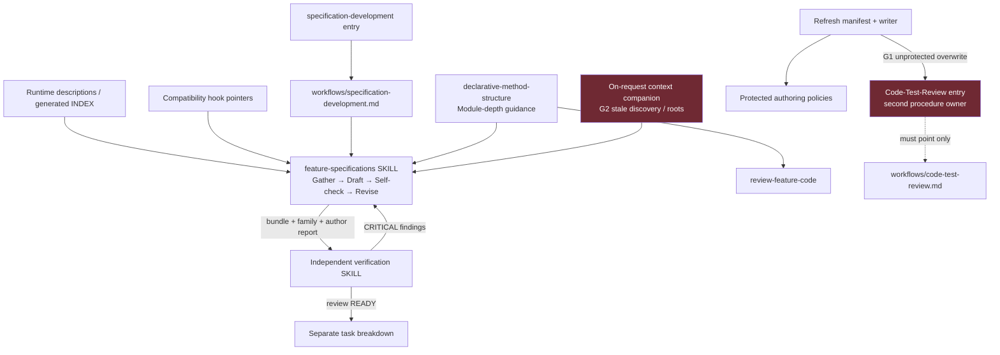

# Independent Step 2 review — specification-skill consolidation and module depth

**Verdict: REVISE — 2 Glaring Gaps.** Return to Step 1; do not start completion assessment yet.

- Baseline: `ea8601c`; branch: `feature-consolidate-spec-skills`.
- Application cwd: `/root/Code/slo/.worktrees/slo-spec-skills/slo`; Git root is its parent.
- Scope: the user's seven-part contract, including the original cross-language module-depth task. This is not a review of only the consolidation.
- Governing workflow: `skills/design-and-analysis/workflows/code-test-review.md`, its entry skill, and `review-feature-code/SKILL.md`, including the baseline review skill and mandatory hard-rules pass.
- No implementation corrections, external writes, agents, commits, publication, process termination, or Step 3 assessment were performed. Review evidence/status files are the only intentional writes.
- Model qualification: this session provides no tool to inspect or select its effective model/reasoning setting. The requested `gpt-6-astra high` setting is therefore not independently attested here; no claim of model verification is made.

## Executive Summary

The substantive authoring consolidation is sound: the full baseline pre-hook, authoring and post-hook bodies were compared with their actual final destinations, not merely the preservation table or keyword assertions. Requirements, examples, reports, mandatory gates and standalone engineering detail survive; independent verification retains its complete procedure. The original depth guidance is integrated into its existing owner and both consumers without weakening extraction, gateway, security or thin-adapter rules.

Two contract gaps remain. Refresh protects the named consolidation files but can still replace the unrelated Code-Test-Review pointer with a second workflow procedure. The migrated context companion also continues to advertise itself as the old PRE-hook in the metadata used for runtime discovery and retains a competing artifact-default block. These are bounded corrections, not a reason to redo the authoring consolidation.

## Stack Summary and implementation inventory

| Layer | Files reviewed | Assessment |
|---|---|---|
| Authoring policy | `feature-specifications/SKILL.md`, both compatibility hooks | One authoritative author, four ordered stages; substantive preservation verified |
| Independent review and breakdown | `feature-specification-verification/SKILL.md`, `breakdown-feature-spec-to-tasks/SKILL.md` | Distinct procedures retained |
| Formal workflow and callers | `workflows/specification-development.md`, its entry, `workflows/SKILL.md`, `orchestrator`, `implement-feature-request`, `gather-feature-context`, orientation readme | Workflow policy retained; companion migration incomplete (G2) |
| Design convention | `coding/declarative-method-structure/SKILL.md`, `review-feature-code/SKILL.md` | Depth guidance and caller checks present |
| Python developer tooling | `scripts/refresh_skills.py` | Non-destructive overlay improves preservation, but incomplete protected-owner boundary (G1) |
| Generated discovery | `skills/INDEX.md` | Exact generator/registry equality passes; faithfully reproduces stale companion metadata |
| Tests | New `tests/agents/skills/test_specification_authoring.py`; existing committed-skills, registry, runtime-loader tests | 9 new contracts; 50 surrounding tests pass freshly |
| Documentation | Root and `docs/RESEARCH.md`; all Step 1 mapping/inventory/evidence/status artifacts | Ownership summary accurate except refresh scope claim needs G1 qualification |

The exact tracked diff is 18 files (895 insertions, 943 deletions), plus the new 159-line test module and implementation evidence directory. No `src/`, Makefile, pyproject, existing test, or Code-Test-Review workflow/entry changes are present. No new skill was added. Go and TypeScript are documentation consumers, not new runtime implementations.

## Feature Completeness Table

| User requirement | Status | Evidence / qualification |
|---|---|---|
| 1. Existing author becomes Gather → Draft → Self-check → Revise | Implemented | Author lines 88, 382, 708, 992; old hooks are 32-line pointers |
| 1. Preserve all substantive baseline mandates, examples, artifacts and gates | Implemented | Full semantic audit below; actual source and destinations read |
| 1. Detailed semantic map with canonical destinations | Implemented | `preservation-mapping.md`, P1–P12/A1–A10/S1–S6 and exact destination headings |
| 2. Independent adversarial verification, revision return, standalone use | Implemented | Verification lines 47–53; full Steps 1–7 unchanged from baseline |
| 2. Breakdown remains separate and complete | Implemented | Full procedure unchanged except report terminology and shared root reference |
| 3. Stage order, outputs, revision loops, manual/auto and publication gates retained | Implemented | Workflow lines 10–17, 51–104, 107–153, 157–224; baseline diff checked clause by clause |
| 3. No unrelated Code-Test-Review policy edits | Implemented in current tree; refresh unsafe | Workflow and pointer byte-identical to baseline; G1 proves later refresh breaks pointer ownership |
| 4. All operational metadata/callers migrated | Partial | G2: context companion metadata and independent roots remain stale |
| 4. Links, anchors, discovery and packaging | Implemented for current files | 162 relative Markdown links checked, no missing file/anchor; index equality passes; `pyproject.toml:101` ships `skills/**/*` |
| 4. Personal skills read-only audit and compatibility decision | Implemented | Only retained Go convention/reviewer names referenced; no removed-hook migration needed |
| 4. Refresh cannot destroy consolidation or unrelated custom policy | Partial | Protected author branch passes; actual manifest/writer reproducer overwrites Code-Test-Review entry (G1) |
| 5. Mode A/B versus single family, paths, repeated review drift resolved | Implemented in core; companion partial | Canonical author lines 42–56, 710–730, 1019–1044; G2 catches remaining discovery/path drift |
| 5. Early granularity versus final breakdown | Implemented | Local dependency/split analysis retained at author 889–914; final reviewed task breakdown remains workflow Step 3 |
| 6. Canonical original module-depth guidance and two consumers | Implemented | Declarative 518–559; author 732–743; review 173–187 |
| 6. Meaningful outcomes, owner complexity, caller burden, internal evolution | Implemented | Actual call-site questions, constructors/order/flags/errors, private cohesion, one invoke insufficient |
| 6. Thin boundaries, compatibility/security, no wrappers/god objects, advisory only | Implemented | Explicit qualifications in canonical section and consumers; ~8-line rule unchanged |
| 6. Python/Go/TS idioms, retry/cancellation/durability/error contracts | Implemented | Three-row idiomatic table and language-rule precedence; small editorial N1 below |
| 7. Test-first evidence, real contracts, no weakened/skipped tests | Implemented with bounded gap | Red logs inspected; fresh 50-pass run; missing refresh regression is G1 |
| 7. Full supported suite gate | Existing receipt verified, not freshly rerun | `full-final.log`: 5311 passed / 18 deselected / 199 warnings, 354.30s; exit 0 |
| Independent Step 3 | Not performed | Reserved for a fresh agent after corrections and Step 2 clearance |

## Baseline-to-final semantic preservation audit

Sources were read in full with `git show ea8601c:slo/skills/design-and-analysis/<name>/SKILL.md`: pre-hook 393 lines, author 448, post-hook 390. Final author was read in full through line 1044. This table independently checks every mapping group, including the passages compressed or removed rather than copied.

`A` below means final `feature-specifications/SKILL.md`. Baseline ranges are those in the Step 1 map; the findings here are based on the source bodies themselves.

| Map group | Actual final destination | Independent result |
|---|---|---|
| P1–P3: metadata, triggers, roots, mandatory timing | A 1–86, 28–40, 992–1044 | Preserved; trigger issue-fetch and before-draft/before-publish requirements retained. Changed role is intentional. |
| P4: ordered guardrails, home/repo variants, memory | A 90–107 | Preserved; union of both baseline lists plus repository precedence, not one list silently dropped |
| P5: artifact declaration, both halves, partial ask, tiny exception | A 109–116, 384–399, 745–760 | Preserved, including explicit inference and STRUCTURE GAP/automatic REVISE |
| P6: non-blocking KB discovery and eight-row example mapping | A 118–142 | Preserved, including missing-KB message/offer/bundle and README failure table |
| P7: affected layers and child-specific current/stale/local inventories | A 145–178 | All ten surface categories and four per-file fields retained |
| P8: behavior-based owner search | A 180–202, 495–510, 850–887 | Full/partial/adjacent/no-owner evidence retained. Consolidation definitions centralized; migration/backfill detail remains at 873. |
| P9: convention mappings | A 203–229 | Entire mapping list retained, including DBOS/ClickHouse/gateway/API-doc/test rules |
| P10: second-order constraints | A 232–248 | All eleven categories retained; concrete values and explicit deferrals still required |
| P11: narrative planning | A 252–295 | Overview and child-specific plan fields retained, not replaced by only a draft template |
| P12: context bundle and handoff | A 299–380 | Complete main and child templates retained; material-question pause and section-to-bundle/assumption traceability survive |
| A1: opening and audit thresholds | A 402–425, 763–821 | Ordering, named resolution headings, grouped callouts, no section-symbol shorthand, nouns before code, quality thresholds and NARRATIVE GAP retained |
| A2: overview shape | A 429–454 | All four overview sections, source-connector/access requirement, class/method map and dependency-ordered children retained |
| A3: engineering shape | A 456–491, 792–821 | Seven metadata fields, both title examples, ten sections, standalone contract, isolated unit and true functional-flow tests retained |
| A4: journey and orchestration | A 514–527 | Cross-cutting/domain-only exceptions retained; every middleware/helper/commit/external call and atomicity sentence still required |
| A5: ideal before defect | A 529–539 | Two baseline overlapping definitions merged without losing symptom/cause → ideal → exact break order; faithful real code required for both sides |
| A6: code/examples | A 543–567, 918–962 | Prose-before-code, no prose-only behavior, source citations, central class+helpers, helper what/who/when, imports/real values, full child-local examples and EXAMPLE GAP retained |
| A7: tone and visuals | A 571–622 | Conversational/direct/scannable voice, transitions, concrete examples, before/after trees, inline literals, tables and language fences retained |
| A8: implementation and consistency | A 624–668 | Files/components/dependencies/triggers/errors/config/tests/commands/smoke, stale/unchanged corrections and concrete ID types retained; naming is language-qualified |
| A9: principles and repeated AI checklist | A 670–687 plus explicit Draft requirements | All 16 principles retained. Removed final AI summary duplicates these instructions; no unique enforceable requirement was found there. |
| A10: implementation contract | A 691–706 | Entire granular contract and packaged-sample requirement retained, including create/modify/move/delete, callers, meaningful branches and exact assertions |
| S1: formal audit coverage | A 710–730 plus unchanged verification Steps 1–7 | Coverage retained through an explicit complete checklist reference and summary; no false claim that author audit is independent |
| S2: convention audit | A 823–848 | All layer-specific checks and CONVENTION GAP template retained |
| S3: granularity | A 889–914 | Six split triggers, structure-aware split, dependency list and actual parent/child restructuring retained; final issue publication moved to proper separate stage |
| S4: test plan | A 964–988 | Every method/branch, fixtures/mocks/negative paths, namespace/controller-stack/BDD/name checks and TEST GAP retained |
| S5–S6: report, gates, revisions and handoff | A 992–1044 | All metrics and automatic REVISE cases retained; critical gaps also cannot pass. Full recheck after revision, report retention and operator-dependent handoff survive. |

### Drift decisions challenged

- **One family versus Mode A/B:** final names identify artifacts, not alternative levels of completeness. Broad Mode A children must still carry engineering slices. This preserves the useful classification without reviving overview-only defaults.
- **Verification called “legacy” while required twice:** the author now performs the full audit checklist without claiming independence; workflow Step 2 performs independent verification. A clean author report is not sufficient to publish. This is a safe deduplication of invocation, not deletion of review coverage.
- **Roots:** the canonical precedence correctly selects the Slo repo-local symlink over home defaults. Verification and breakdown reference that owner. G2 identifies a remaining companion copy the inventory overlooked.
- **Granularity:** the author still must produce dependency-ordered local slices and replace the monolith, not merely suggest splitting later. Applying breakdown's local analysis without its JIRA side effects avoids a recursive author/reviewer loop. Final task creation after independent review is consistent with the user contract. The word “provisional” is in the mapping rather than the operational paragraph, but the paragraph explicitly defers final breakdown and publication; no substantive split requirement was lost.
- **Not mere concatenation:** path defaults, artifact vocabulary and consolidation definitions now have canonical destinations; duplicate ideal/bug explanations and AI summary were folded together. Narrative audit tables intentionally repeat criteria as checks, not independent competing authorities.

### Independent reviewer and workflow preservation checks

`review-preservation-checks.log` records executable identity comparisons:

1. Removing only the new module-depth subsection from final `review-feature-code` yields the exact baseline file, including its mandatory hard-rules post-hook.
2. Code-Test-Review workflow and entry are byte-identical to baseline.
3. Verification from `## Step 1 — Load Context` through its final conventions is byte-identical to baseline: all nine layers, state/data/error flows, DRY independent search, traceability, severity templates, review-of-review and implementation-details CRITICAL gate survive.
4. Breakdown below `## Guidance` is byte-identical after the single POST-hook → author-self-check terminology replacement. Source samples exactly once, dependency graph, consolidation tasks, JIRA fields/ordering/results and quality checklist survive.
5. Specification workflow diff preserves triggers/preconditions, implementation-detail pass, stage inputs/outputs, full independent review procedure, CRITICAL return, dependency handoff, task sample/acceptance rules, manual pauses, auto external-action confirmation and exit conditions. Changes are stage/reference names and necessary single-family/independence integration.

## End-to-End Flow Verification

### Author and review flow — passes

Discovery → canonical author → declared artifacts and context bundle → draft family → full author requirements/architecture/error, narrative, convention, DRY, granularity, example and branch-test audit → revise/recheck → author READY → independent verification → return findings to author or forward verified family to separate breakdown.

Old hook names resolve to anchored stages in the same owner. The pre-hook permits reusing/refeshing an existing bundle; the post-hook rechecks changes and delegates independent review rather than keeping a second procedure. Standalone independent review explicitly accepts a source ask without an earlier author report. Historical report labels remain explicit aliases, not separate states.

### Formal routing — passes in current tree

`specification-development/SKILL.md` points to `workflows/specification-development.md`; it does not implement the workflow. Orchestrator's draft-only route points to authoring. `implement-feature-request` still loads the formal specification workflow. No changes to sync/detached routing or agent launch policy were found.

### Discovery/generation — partial

`SkillsLoader` reads frontmatter descriptions; registry generation feeds the committed INDEX. Equality with the actual generator passes, but equality cannot prove the description is correct: G2 survives unchanged into discovery. The wheel/sdist glob includes all skill, redirect, workflow and sample files. No wheel was built in this review.

### Refresh — fails preservation contract

Manifest construction can discover an upstream `workflows/code-test-review.md`. Because `code-test-review` is not protected, `_write_skills` replaces the local pointer with that workflow's body. The formal workflow file survives the removed directory deletion, leaving two procedure owners. `review-refresh-probe.py` exercises actual manifest selection and writer behavior entirely under an owned temporary root; no checkout skill was changed.

## Unit Tests Assessment

| New test | What it actually proves | Limits |
|---|---|---|
| `test_module_depth_guidance_preserves_hard_rules_and_language_boundaries` | Named concepts are present | Does not prove semantics; manually reviewed here |
| `test_authoring_has_one_ordered_lifecycle_and_complete_artifacts` | Ordered headings and named artifacts exist | Does not prove baseline preservation |
| `test_legacy_hooks_redirect_without_duplicate_authoring_procedures` | Redirect targets exist and old Step headings absent | Semantic loop behavior requires prose review |
| `test_workflow_sequences_author_review_and_breakdown_only` | Old hook calls absent; independent/confirmation/mode text present | Not a complete workflow clause comparison |
| `test_code_review_links_canonical_depth_guidance` | Canonical anchor and caller/advisory wording | Manual cross-language audit required |
| `test_refresh_preserves_repository_owned_authoring_and_workflow` | One protected author and unaddressed workflow file survive | Does not cover other local policy or manifest generation; misses G1 |
| `test_refresh_renders_upstream_owned_skill` | Ordinary unprotected manual-body record writes | No manifest/upstream-body integration |
| `test_generated_index_matches_registry` | Exact deterministic discovery equality | Correctly generated stale metadata still passes (G2) |
| `test_authoring_relative_links_and_anchors_resolve` | Selected author's/reviewer's Markdown targets resolve | Review widened to all changed skill documents: 162 links pass |

**Fresh reviewer run:** `review-surrounding.log` / `.exit`: **50 passed, 2 warnings, exit 0**, 1.46s. Selection: `tests/agents/skills tests/agents/slo_agent/test_skills_loader.py`, with Makefile-equivalent test environment, `PYTHONDONTWRITEBYTECODE=1`, `PYTHONPATH="$PWD"`, Poetry pytest, `-p no:cacheprovider -q`. Existing discovery/registry/runtime loader tests were included. No failures were hidden, skipped or weakened.

**Prior full gate inspected, not rerun:** `full-final.log` and `full-final.exit` agree on **5311 passed, 18 deselected, 199 warnings in 354.30s, exit 0**. The supplied parent confirmation is consistent with those actual files. This is Step 1's receipt, not a fresh reviewer full run and not proof of G1/G2.

Red receipts show the intended missing-depth, missing-lifecycle, routing/consumer and destructive-refresh failures before their green counterparts. These logs support bounded test-first development; they do not reconstruct every file edit's chronology. The final fixture typo failure is documented separately and was not hidden. No baseline/environment failure is relabelled green.

Python: `.python-version` is `slo-harness`; `pyenv which python` is `/root/.pyenv/versions/slo-harness/bin/python`. Poetry reports Python **3.11.7**, executable `/root/.pyenv/versions/3.11.7/bin/python`; not system Python. The older AGENTS spelling `slo` was not installed or substituted. No development environment was sourced.

Additional fresh checks: 162 Markdown link/anchor checks pass (`review-links.log`); scoped Black check passes for the script/test module; `git diff --check` and `dpkg -V coreutils` print nothing. Full mypy, full Black and wheel-build gates were not run and are not claimed green.

## Convention Adherence and hard-rules pass

- **Universal typing/naming:** new production constant is explicitly `frozenset[str]`; added branch is a simple membership guard. Existing helper signatures and keyword calls are retained. New tests have explicit return/fixture types and behavioral docstrings. No new `Any`, domain aliases, or runtime class/framework layer was introduced.
- **Declarative structure:** depth guidance preserves the hard extraction policy, meaningful responsibility boundaries and required gateways. `_write_skills` already had a procedural writer body at baseline; the patch replaces deletion with a simple guard. No new service architecture should be introduced to fix G1; keep ownership selection in the existing refresh mechanism.
- **Testing:** both new membership outcomes have tests, but the protected set's contract is incomplete; G1 requires real manifest-to-writer preservation coverage. String tests are treated as discovery contracts, not semantic acceptance.
- **Docs and behavior contracts:** canonical depth explicitly keeps retry limits, cancellation, durability and meaningful errors visible to callers; WHAT/WHO/WHEN sample requirements remain. Go/TypeScript qualification is explicit; N1 requests consistency in inherited wording.
- **Security/compatibility:** intentional routers, CLI adapters, tool bridges and public compatibility are expressly protected; no credentials/runtime/security implementation changes. Test writes resolve within owned temporary roots; no command stubs were introduced.
- **Layer-specific hard rules:** FastAPI/domain DB/router, Vue, CLI runtime, TUI and LangGraph runtime sections are not applicable to this diff. They were not waived for future generated implementations.
- **Review requirements:** requirement map, actual-flow trace, tiered evidence, correction examples and test needs are present. The baseline review gate was not weakened to permit this result.

## Ubiquitous Language Audit

| Concept | Trace | Result |
|---|---|---|
| Canonical author | author → callers → formal Step 1 → INDEX | Stable `feature-specifications` |
| Context Bundle / PRE-Hook Context Bundle | canonical template → redirect → workflow handoff | Explicit compatibility alias |
| Author Self-check Report / POST-Hook Report | canonical report → redirect → workflow Step 2 | Explicit alias; not independent approval |
| Independent verification | author handoff → verifier → workflow Step 2 | Stable distinct owner |
| Task breakdown | author local split reference → verified workflow Step 3 | Distinct final procedure |
| Context companion | body says on-request; discovery says PRE-hook | **G2** |
| Formal workflow | pointer → workflows/ owner → refresh | Current files correct; **G1** recreates competing owner |

## Findings Summary

### Glaring Gaps — must return to Step 1

#### G1 — High: refresh protection omits an unrelated authoritative workflow pointer

**Where:** `scripts/refresh_skills.py:36–52,2393–2414`; manifest selection at `1984–2014`; test `test_specification_authoring.py:87–126`.

**Problem:** the new allowlist protects `specification-development` but not `code-test-review`. An upstream workflow of that name is discovered normally and rendered into `skills/design-and-analysis/code-test-review/SKILL.md`, replacing its pointer-only contract. The non-destructive overlay leaves the actual `workflows/code-test-review.md` alongside it. This recreates exactly the workflow/skill duplication the repository prohibits and does not satisfy the user's explicit requirement that refresh preserve unrelated custom policy.

**Independent reproduction:** run `PYTHONDONTWRITEBYTECODE=1 PYTHONPATH="$PWD" poetry run python docs/implementation/spec-skills-consolidation/review-refresh-probe.py`. It copies the current pointer and the existing formal workflow into temporary fixture roots, then calls actual `_build_skill_specs` and `_write_skills`. `review-refresh-probe.log` reports:

```text
Manifest source: workflows/code-test-review.md; output group: design-and-analysis
Pointer preserved byte-for-byte: False
Pointer-only guidance remains: False
Workflow procedure copied into SKILL.md: True
```

This is a bounded fixture using a supported upstream source shape, not a claim that a live upstream refresh was run. The underlying overwrite risk existed in baseline; this change explicitly takes responsibility for preservation and only partially repairs it. Current Code-Test-Review files themselves remain unchanged.

**Correction:** preserve locally owned formal-workflow entry pointers, including `code-test-review`, in the existing refresh ownership mechanism; audit other locally maintained policy before claiming all unrelated policy is preserved. Do not copy workflow procedures into their entry skills. For this concrete case, adding the pointer's slug to the protected owner set is a minimal correction if the broader ownership audit confirms the set.

**Required test:** seed the real pointer and formal workflow plus an upstream same-name procedure, derive the real manifest, run the writer, and assert both local files remain byte-identical. Include protected hooks/depth/reviewer and unrelated local policy representatives, a local sample, and a genuinely upstream-owned replacement that still updates. Keep all writes inside the resolved test temp root. Update the preservation/evidence claims, then rerun focused/surrounding/full gates.

#### G2 — Medium, contract-blocking: companion discovery and roots still contradict its migrated role

**Where:** `skills/design-and-analysis/gather-feature-context/SKILL.md:3–7,18–27,29–49,54–66`; generated `skills/INDEX.md:26`.

**Problem:** only the body role/opt-out paragraphs were migrated. Runtime frontmatter still calls this a “Pre-hook for feature-specifications”; summary/examples repeat that role. The same file retains a separate unconditional environment/home artifact-root definition instead of the canonical project-aware precedence. The generated index is technically correct but propagates this stale role. An agent choosing from runtime descriptions still sees an apparently default pre-hook before it reads the corrective paragraph.

**Why this blocks this task:** user contract 4 explicitly requires all operational frontmatter/discovery callers to be migrated, and contract 5 requires safe root/default drift resolution. The inventory says this caller is now optional and roots have one definition; the actual file does not consistently say that. This is not a claim of an observed misrouted live session.

**Correction example:** use a discovery description such as `On-request extended context briefing that feeds feature-specifications' mandatory Gather context stage; not a separate default pre-hook.` Align its summary/examples/purpose with that role. Replace the duplicate root block with the existing canonical artifact-path anchor (as verifier and breakdown already do), preserving its substantive extended briefing, source-retention and sign-off requirements. Regenerate INDEX with the existing tool, not by hand.

**Required test:** assert the companion's registry/runtime description advertises on-request/optional behavior, does not advertise the superseded default PRE-hook role, and references canonical path precedence. Keep the exact generated-index check. This is a metadata contract test, supplemented by a manual check that briefing/sign-off content was not lost.

### Nice-to-Haves

#### N1 — Low: qualify residual Python documentation language in shared authoring checks

Author lines 555–561 still say “Google-style docstrings” immediately after explicitly qualifying named arguments by language; the common convention checklist at 827–837 and shared example list at 924–932 are similarly Python-shaped. The new depth table correctly specifies Go conventions and TypeScript JSDoc, and the applicable-language precedence prevents treating this as a missing original depth deliverable. Make the shared wording equally explicit: “Python Google-style docstrings; Go godoc; TypeScript JSDoc, following applicable language skills.” Do not modify personal skills to achieve that.

#### N2 — Low: make the shipped link regression cover all migrated callers

The new test checks feature-spec* and review-feature-code only. The review's independent parsed-Markdown check covers 162 links across all changed skill documents and found no failures. Expand the maintained test to include workflow entry/owner, breakdown, readme and context companion so that future changes receive the same coverage.

### Temporary Shortcuts / acknowledged limitations

- Non-destructive refresh deliberately retains stale upstream files; removal now requires a reviewed change. This is recorded in the migration inventory and is acceptable, distinct from G1.
- No live upstream refresh, package installation, wheel build or external task creation was performed. Packaged inclusion is a source-glob assessment, not an installed-artifact execution claim.
- Prompt-policy correctness is supported by full manual semantic review; keyword tests alone cannot prove it. No LLM behavioral evaluation or live generated feature specification was executed.
- Independent Step 3 remains pending. Do not infer feature completion from the green full-suite receipt or the substantial preservation that passed this review.

## Architecture Diagram



## Completion checklist for remediation, not Step 3

### Must-fix implementation
- [ ] G1: protect Code-Test-Review and audit unrelated locally maintained refresh policy.
- [ ] G2: migrate context-companion discovery and canonical artifact-root reference consistently.

### Required tests
- [ ] Real manifest → writer regression proving unrelated workflow pointer preservation and ordinary upstream update.
- [ ] Companion runtime/registry metadata and path-owner regression.
- [ ] Fresh focused/surrounding and supported full non-E2E gate after corrections; no weakened checks.

### Decisions and documentation
- [x] Core baseline semantic preservation and drift decisions independently reviewed.
- [x] Original module-depth task reviewed in Python, Go and TypeScript idioms.
- [ ] Update mapping/inventory/evidence to reflect corrected refresh and companion scope.
- [ ] Independent Step 2 rereview clears Glaring Gaps.
- [ ] Fresh agent performs Step 3 only after Step 2 READY.
